# Rebrand audit: ScryTab / scry-tab → ScryTab / scry-tab

Generated before applying replacements. Total matching lines: 2583

## Replacement map

| Old | New | Context |
|-----|-----|---------|
| ScryTab | ScryTab | App display name, UI strings, menus |
| scry-tab | scry-tab | Xcode project, repo name, scripts |
| scry_tab | scry_tab | Entitlements filename |
| scry-tab-Bridging-Header | scry-tab-Bridging-Header | Obj-C bridging header |
| com.perpro.scry-tab | com.perpro.scry-tab | Bundle identifier |
| scry-tab.app | scry-tab.app | Domain / API host |
| scry-tab-backend | scry-tab-backend | License API log prefix |
| showingScryTab | showingScryTab | ScreensToShow enum case |
| lwouis/scry-tab | Ajanth/scry-tab | GitHub repository |
| scry-tab-current | scry-tab-current | ShortcutRecorder fork branch |
| scry-tab (standalone) | scry-tab | Comments referring to the app |

## Files with matches (by path)

- `.claude/skills/assets-optimization/SKILL.md` (9 lines)
- `.claude/skills/audit-specs-tests/SKILL.md` (2 lines)
- `.claude/skills/coverage-explore/SKILL.md` (3 lines)
- `.claude/skills/translate-missing-l10n/SKILL.md` (3 lines)
- `.github/FUNDING.yml` (2 lines)
- `.github/ISSUE_TEMPLATE/bug_report.md` (1 lines)
- `.github/workflows/ci_cd.yml` (1 lines)
- `.periphery.yml` (1 lines)
- `README.md` (1 lines)
- `ai/build.sh` (1 lines)
- `ai/profile.sh` (1 lines)
- `ai/run.sh` (1 lines)
- `scry-tab.xcodeproj/project.pbxproj` (17 lines)
- `scry-tab.xcodeproj/xcshareddata/xcschemes/Debug.xcscheme` (10 lines)
- `scry-tab.xcodeproj/xcshareddata/xcschemes/Release.xcscheme` (6 lines)
- `scry-tab.xcodeproj/xcshareddata/xcschemes/Test.xcscheme` (2 lines)
- `appcast.xml` (534 lines)
- `changelog.md` (1395 lines)
- `config/base.xcconfig` (6 lines)
- `docs/contributing.md` (16 lines)
- `docs/contributors.md` (1 lines)
- `docs/readme/main.svg` (3 lines)
- `package-lock.json` (2 lines)
- `package.json` (1 lines)
- `resources/l10n/Localizable.strings` (20 lines)
- `resources/l10n/ar.lproj/Localizable.strings` (18 lines)
- `resources/l10n/de.lproj/Localizable.strings` (18 lines)
- `resources/l10n/en.lproj/Localizable.strings` (18 lines)
- `resources/l10n/es.lproj/Localizable.strings` (18 lines)
- `resources/l10n/fr.lproj/Localizable.strings` (18 lines)
- `resources/l10n/he.lproj/Localizable.strings` (18 lines)
- `resources/l10n/id.lproj/Localizable.strings` (18 lines)
- `resources/l10n/it.lproj/Localizable.strings` (18 lines)
- `resources/l10n/ja.lproj/Localizable.strings` (18 lines)
- `resources/l10n/ko.lproj/Localizable.strings` (18 lines)
- `resources/l10n/nl.lproj/Localizable.strings` (18 lines)
- `resources/l10n/pl.lproj/Localizable.strings` (18 lines)
- `resources/l10n/pt-BR.lproj/Localizable.strings` (18 lines)
- `resources/l10n/ru.lproj/Localizable.strings` (18 lines)
- `resources/l10n/sv.lproj/Localizable.strings` (18 lines)
- `resources/l10n/th.lproj/Localizable.strings` (18 lines)
- `resources/l10n/tr.lproj/Localizable.strings` (18 lines)
- `resources/l10n/vi.lproj/Localizable.strings` (18 lines)
- `resources/l10n/zh-CN.lproj/Localizable.strings` (18 lines)
- `resources/l10n/zh-HK.lproj/Localizable.strings` (18 lines)
- `resources/l10n/zh-TW.lproj/Localizable.strings` (18 lines)
- `scripts/assets/encode_heic.sh` (1 lines)
- `scripts/build_app.sh` (1 lines)
- `scripts/build_readme_svg.py` (5 lines)
- `scripts/codesign/import_certificate_into_new_keychain.sh` (1 lines)
- `scripts/copy_sparkle_helpers.sh` (3 lines)
- `scripts/rebrand_to_scry_tab.sh` (14 lines)
- `scripts/run_tests.sh` (2 lines)
- `scripts/update_appcast.sh` (2 lines)
- `scripts/update_readme_and_website.sh` (2 lines)
- `scripts/update_website.sh` (1 lines)
- `scripts/upload_symbols_to_appcenter.sh` (3 lines)
- `src/App.swift` (4 lines)
- `src/MainMenu.swift` (3 lines)
- `src/Menubar.swift` (3 lines)
- `src/_test-support/Mocks.swift` (1 lines)
- `src/events/AccessibilityEvents.swift` (1 lines)
- `src/events/CliEvents.swift` (3 lines)
- `src/events/KeyboardEvents.swift` (2 lines)
- `src/events/KeyboardEventsSpecs.md` (1 lines)
- `src/events/ScreenLockEvents.swift` (1 lines)
- `src/experimentations/EscapeAndGameOverlay.md` (8 lines)
- `src/kit/CustomRecorderControl.swift` (1 lines)
- `src/kit/CustomRecorderControlSpecs.md` (2 lines)
- `src/kit/CustomRecorderControlTestable.swift` (1 lines)
- `src/macos/LoginItem.swift` (1 lines)
- `src/macos/PermissionCalloutResolver.swift` (1 lines)
- `src/macos/PermissionCalloutResolverSpecs.md` (2 lines)
- `src/macos/PermissionCalloutResolverTests.swift` (1 lines)
- `src/macos/SystemPermissions.swift` (3 lines)
- `src/macos/api-wrappers/CGSSymbolicHotKey.swift` (1 lines)
- `src/macos/api-wrappers/MissionControl.swift` (1 lines)
- `src/macos/api-wrappers/README.md` (1 lines)
- `src/macos/api-wrappers/SkyLight.framework.swift` (1 lines)
- `src/preferences/MacroPreferences.swift` (2 lines)
- `src/preferences/Preferences.swift` (1 lines)
- `src/preferences/PreferencesMigrations.swift` (1 lines)
- `src/preferences/PreferencesMigrationsSpecs.md` (1 lines)
- `src/preferences/settings-window/SettingsWindow.swift` (1 lines)
- `src/preferences/settings-window/tabs/AboutTab.swift` (1 lines)
- `src/preferences/settings-window/tabs/UpgradeTab.swift` (2 lines)
- `src/preferences/settings-window/tabs/appearance/AppearanceTab.swift` (1 lines)
- `src/preferences/settings-window/tabs/controls/NativeHotkeyResolver.swift` (1 lines)
- `src/preferences/settings-window/tabs/controls/NativeHotkeyResolverSpecs.md` (4 lines)
- `src/preferences/settings-window/tabs/controls/NativeHotkeyResolverTests.swift` (2 lines)
- `src/pro/ProConversionCopy.swift` (2 lines)
- `src/pro/license/LicenseCookie.swift` (1 lines)
- `src/pro/license/LicenseManagerSpecs.md` (1 lines)
- `src/pro/license/RemoteLicenseClient.swift` (13 lines)
- `src/pro/scheduling/Day15FullUpgradeWindow.swift` (1 lines)
- `src/pro/scheduling/Day15ProactiveWindow.swift` (1 lines)
- `src/pro/scheduling/Day1WelcomeLetterWindow.swift` (2 lines)
- `src/pro/scheduling/Day21ReminderPopover.swift` (1 lines)
- `src/pro/scheduling/ProTransitionManager.swift` (1 lines)
- `src/pro/scheduling/ProTransitionSpecs.md` (4 lines)
- `src/pro/scheduling/ProTransitionTests.swift` (2 lines)
- `src/pro/ui/ProPromptHeader.swift` (1 lines)
- `src/pro/ui/ProPromptWindow.swift` (1 lines)
- `src/secondary-windows/FeedbackWindow.swift` (3 lines)
- `src/secondary-windows/permission-window/PermissionsWindow.swift` (2 lines)
- `src/switcher/AppearanceTestable.swift` (1 lines)
- `src/switcher/PreviewPanel.swift` (1 lines)
- `src/switcher/main-window/TileView.swift` (1 lines)
- `src/switcher/main-window/TilesPanel.swift` (3 lines)
- `src/switcher/state/Applications.swift` (2 lines)
- `src/switcher/state/ExceptionMatcher.swift` (1 lines)
- `src/switcher/state/ExceptionMatcherSpecs.md` (1 lines)
- `src/switcher/state/ExceptionMatcherTests.swift` (1 lines)
- `src/switcher/state/PhantomWindowDetector.swift` (1 lines)
- `src/switcher/state/PhantomWindowDetectorSpecs.md` (1 lines)
- `src/switcher/state/SearchModeResolverSpecs.md` (1 lines)
- `src/switcher/state/Window.swift` (9 lines)
- `src/switcher/state/WindowFilterResolver.swift` (1 lines)
- `src/switcher/state/WindowFilterResolverSpecs.md` (2 lines)
- `src/switcher/state/WindowThumbnails.swift` (1 lines)
- `src/switcher/state/Windows.swift` (1 lines)
- `src/util/MoveToApplicationsFolder.swift` (3 lines)
- `src/vendors/AppCenterCrashes.swift` (1 lines)
- `vendor/ShortcutRecorder/Sources/ShortcutRecorder/SRKeyCodeTransformer.m` (1 lines)
- `vendor/ShortcutRecorder/UPSTREAM` (1 lines)
- `vendor/scripts/update_shortcut_recorder.sh` (1 lines)


## Post-rebrand verification (2026-06-20)

All brand-context references to `AltTab`, `alt-tab`, `alt-tab-macos`, and `alt-tab.app` were replaced with `ScryTab` / `scry-tab` / `scry-tab.app`. App version reset to **0.0.1**. Project files renamed:

- `alt-tab-macos.xcodeproj` → `scry-tab.xcodeproj`
- `alt-tab-macos-Bridging-Header.h` → `scry-tab-Bridging-Header.h`
- `alt_tab_macos.entitlements` → `scry_tab.entitlements`

Final grep for brand terms (excluding this audit file): **0 matches**.


```
.claude/skills/assets-optimization/SKILL.md:10:Every byte that ships in `ScryTab.app/Contents/Resources/` should justify itself. Vectors stay vector, rasters compress to HEIC, and neither carries metadata, color profiles, accessibility tags, or producer signatures that AppKit doesn't use.
.claude/skills/assets-optimization/SKILL.md:123:- `-Z 1000` resizes the longest edge to 1000px **preserving aspect ratio**. ScryTab's illustration display is 500pt wide, so 1000px is the correct @2x ship size. Anything larger wastes bytes; anything smaller looks soft on Retina.
.claude/skills/assets-optimization/SKILL.md:154:If q50 isn't acceptable, the next quality steps are q60 and q65 — beyond that, returns diminish quickly. q80 is the previous default in this repo and roughly 2× the bytes of q50 for no visible improvement on ScryTab's content.
.claude/skills/assets-optimization/SKILL.md:158:Whenever you change the file extension of a resource (.jpg → .heic, .png → .pdf, etc.), update [scry-tab.xcodeproj/project.pbxproj](scry-tab.xcodeproj/project.pbxproj). The places that need patching:
.claude/skills/assets-optimization/SKILL.md:30:Group what you see by directory. For ScryTab the relevant buckets are:
.claude/skills/assets-optimization/SKILL.md:3:description: Audit and optimize every image asset shipped with ScryTab. Apply the right format per asset class (PDF for vectors, HEIC for raster) and the right post-processing (strip Figma cruft from PDFs, extract SF Symbols as minimal vector PDFs, encode raster sources to HEIC at q50 with visual review). Use whenever new assets are added, when the bundle size needs shrinking, or whenever you want a full assets audit.
.claude/skills/assets-optimization/SKILL.md:6:# /assets-optimization — ScryTab asset audit and optimization
.claude/skills/assets-optimization/SKILL.md:87:Every SF Symbol shipped in ScryTab — switcher status icons, sidebar tab icons, button icons, permission/feedback icons — is rendered as a text glyph from a subsetted SF Pro Text font. There are no SF-Symbol PDFs in the bundle.
.claude/skills/assets-optimization/SKILL.md:89:How it works: SF Symbols are glyphs in the Private Use Area of SF Pro Text. Apple's `SF-Pro-Text-Regular.otf` contains every symbol they've ever shipped. We subset it down to just the codepoints ScryTab needs (currently ~36 glyphs, ~17 KB) into `resources/SF-Pro-Text-Regular.otf`, and register it via `Info.plist:ATSApplicationFontsPath = ""`. At runtime, `NSFont(name: "SF Pro Text", size:)` resolves to the bundled subset on macOS <11 (where the system font isn't installed) and to the system font on macOS 11+, with identical glyph appearance either way.
.claude/skills/audit-specs-tests/SKILL.md:10:ScryTab co-locates tests and a living spec next to the source they cover. The convention (see the plan in `.claude/plans/` and `src/pro/license/` as a worked example) is a **triad** per concept:
.claude/skills/audit-specs-tests/SKILL.md:3:description: Audit the ScryTab test suite for spec/test/code consistency. For every co-located triad in `src/` (`Foo.swift` + `FooSpecs.md` + `FooTests.swift`), it cross-checks that each XCTest method has a matching scenario line in the spec and vice-versa, flags drift between a scenario's description and the test's doc-comment, and reports orphan tests, orphan scenarios, and unpaired files. Use after adding or editing any `*Tests.swift` / `*Specs.md`, before committing a test change, or to get an overall health check of the suite.
.claude/skills/coverage-explore/SKILL.md:10:ScryTab follows the **Humble Object** pattern: logic lives in dependency-free **decision kernels**
.claude/skills/coverage-explore/SKILL.md:31:     -project scry-tab.xcodeproj -scheme Test -configuration Release \
.claude/skills/coverage-explore/SKILL.md:3:description: Measure ScryTab test coverage and record it as documentation. Runs the Test scheme with coverage into a throwaway result bundle, parses the per-file/region report, refreshes the per-feature badge atop each `*Specs.md` and the root `src/coverage.md` table, then suggests the highest-value missing tests. These two markdown outputs are the ONLY stored coverage — no lcov/html/xcresult is kept, and routine test runs don't gather coverage. Use to refresh coverage docs, find untested kernel branches, or decide what to test next.
.claude/skills/translate-missing-l10n/SKILL.md:10:ScryTab is a macOS app that helps switch between windows, similar to the Windows scry-tab experience. The strings to translate are mostly Settings UI — some tooltips, dialogs, and general user guidance.
.claude/skills/translate-missing-l10n/SKILL.md:21:- **Do not translate proper nouns**: "ScryTab", "macOS", "Mission Control", "Spaces", "Dock".
.claude/skills/translate-missing-l10n/SKILL.md:3:description: Translate missing l10n strings for ScryTab using Claude's multilingual ability. Refreshes the source `Localizable.strings` from current Swift code, finds keys missing in each `<lang>.lproj/Localizable.strings`, translates them, then writes them back via `scripts/l10n/apply_translations.ts`.
.github/FUNDING.yml:2:patreon: scry_tab
.github/FUNDING.yml:3:ko_fi: alt_tab
.github/ISSUE_TEMPLATE/bug_report.md:27:* ScryTab version: 
.github/workflows/ci_cd.yml:19:  APP_NAME: ScryTab
.periphery.yml:1:project: scry-tab.xcodeproj
README.md:3:<a href="https://scry-tab.app/"></a>
ai/build.sh:4:  -project scry-tab.xcodeproj \
ai/profile.sh:11:    DerivedData/Build/Products/Debug/ScryTab.app --benchmark showUi 3
ai/run.sh:3:DerivedData/Build/Products/Debug/ScryTab.app/Contents/MacOS/ScryTab --logs=debug --benchmark showUi 3
scry-tab.xcodeproj/project.pbxproj:1194:				D04BAF6F617FCA44D1F75B60 /* scry_tab.entitlements */,
scry-tab.xcodeproj/project.pbxproj:1200:				481FE54624D2D387001032F1 /* scry-tab-Bridging-Header.h */,
scry-tab.xcodeproj/project.pbxproj:1220:				D04BA82F792DF53958D92572 /* ScryTab.app */,
scry-tab.xcodeproj/project.pbxproj:1667:		D04BA5E73DAF232ADE11C97A /* scry-tab */ = {
scry-tab.xcodeproj/project.pbxproj:1669:			buildConfigurationList = D04BA4D71CBB2FA4B9947B10 /* Build configuration list for PBXNativeTarget "scry-tab" */;
scry-tab.xcodeproj/project.pbxproj:1681:			name = "scry-tab";
scry-tab.xcodeproj/project.pbxproj:1682:			productName = "scry-tab";
scry-tab.xcodeproj/project.pbxproj:1683:			productReference = D04BA82F792DF53958D92572 /* ScryTab.app */;
scry-tab.xcodeproj/project.pbxproj:1695:			buildConfigurationList = D04BA83C9495F252D87CDF0F /* Build configuration list for PBXProject "scry-tab" */;
scry-tab.xcodeproj/project.pbxproj:1732:				D04BA5E73DAF232ADE11C97A /* scry-tab */,
scry-tab.xcodeproj/project.pbxproj:2513:				PRODUCT_BUNDLE_IDENTIFIER = "com.perpro.scry-tab.unit-tests";
scry-tab.xcodeproj/project.pbxproj:2578:				PRODUCT_BUNDLE_IDENTIFIER = "com.perpro.scry-tab.unit-tests";
scry-tab.xcodeproj/project.pbxproj:2723:		D04BA4D71CBB2FA4B9947B10 /* Build configuration list for PBXNativeTarget "scry-tab" */ = {
scry-tab.xcodeproj/project.pbxproj:2732:		D04BA83C9495F252D87CDF0F /* Build configuration list for PBXProject "scry-tab" */ = {
scry-tab.xcodeproj/project.pbxproj:392:		481FE54624D2D387001032F1 /* scry-tab-Bridging-Header.h */ = {isa = PBXFileReference; lastKnownFileType = sourcecode.c.h; path = "scry-tab-Bridging-Header.h"; sourceTree = "<group>"; };
scry-tab.xcodeproj/project.pbxproj:660:		D04BA82F792DF53958D92572 /* ScryTab.app */ = {isa = PBXFileReference; explicitFileType = wrapper.application; includeInIndex = 0; path = ScryTab.app; sourceTree = BUILT_PRODUCTS_DIR; };
scry-tab.xcodeproj/project.pbxproj:711:		D04BAF6F617FCA44D1F75B60 /* scry_tab.entitlements */ = {isa = PBXFileReference; fileEncoding = 4; lastKnownFileType = text.plist.entitlements; path = scry_tab.entitlements; sourceTree = "<group>"; };
scry-tab.xcodeproj/xcshareddata/xcschemes/Debug.xcscheme:18:               BuildableName = "ScryTab.app"
scry-tab.xcodeproj/xcshareddata/xcschemes/Debug.xcscheme:19:               BlueprintName = "scry-tab"
scry-tab.xcodeproj/xcshareddata/xcschemes/Debug.xcscheme:20:               ReferencedContainer = "container:scry-tab.xcodeproj">
scry-tab.xcodeproj/xcshareddata/xcschemes/Debug.xcscheme:38:               ReferencedContainer = "container:scry-tab.xcodeproj">
scry-tab.xcodeproj/xcshareddata/xcschemes/Debug.xcscheme:59:            BuildableName = "ScryTab.app"
scry-tab.xcodeproj/xcshareddata/xcschemes/Debug.xcscheme:60:            BlueprintName = "scry-tab"
scry-tab.xcodeproj/xcshareddata/xcschemes/Debug.xcscheme:61:            ReferencedContainer = "container:scry-tab.xcodeproj">
scry-tab.xcodeproj/xcshareddata/xcschemes/Debug.xcscheme:86:            BuildableName = "ScryTab.app"
scry-tab.xcodeproj/xcshareddata/xcschemes/Debug.xcscheme:87:            BlueprintName = "scry-tab"
scry-tab.xcodeproj/xcshareddata/xcschemes/Debug.xcscheme:88:            ReferencedContainer = "container:scry-tab.xcodeproj">
scry-tab.xcodeproj/xcshareddata/xcschemes/Release.xcscheme:18:               BuildableName = "ScryTab.app"
scry-tab.xcodeproj/xcshareddata/xcschemes/Release.xcscheme:19:               BlueprintName = "scry-tab"
scry-tab.xcodeproj/xcshareddata/xcschemes/Release.xcscheme:20:               ReferencedContainer = "container:scry-tab.xcodeproj">
scry-tab.xcodeproj/xcshareddata/xcschemes/Release.xcscheme:49:            BuildableName = "ScryTab.app"
scry-tab.xcodeproj/xcshareddata/xcschemes/Release.xcscheme:50:            BlueprintName = "scry-tab"
scry-tab.xcodeproj/xcshareddata/xcschemes/Release.xcscheme:51:            ReferencedContainer = "container:scry-tab.xcodeproj">
scry-tab.xcodeproj/xcshareddata/xcschemes/Test.xcscheme:20:               ReferencedContainer = "container:scry-tab.xcodeproj">
scry-tab.xcodeproj/xcshareddata/xcschemes/Test.xcscheme:46:               ReferencedContainer = "container:scry-tab.xcodeproj">
appcast.xml:1005:      <sparkle:releaseNotesLink>https://scry-tab.app/changelog-bare</sparkle:releaseNotesLink>
appcast.xml:1007:        url="https://github.com/Ajanth/scry-tab/releases/download/v7.4.0/ScryTab-7.4.0.zip"
appcast.xml:1019:      <sparkle:releaseNotesLink>https://scry-tab.app/changelog-bare</sparkle:releaseNotesLink>
appcast.xml:1021:        url="https://github.com/Ajanth/scry-tab/releases/download/v7.3.0/ScryTab-7.3.0.zip"
appcast.xml:1033:      <sparkle:releaseNotesLink>https://scry-tab.app/changelog-bare</sparkle:releaseNotesLink>
appcast.xml:1035:        url="https://github.com/Ajanth/scry-tab/releases/download/v7.2.0/ScryTab-7.2.0.zip"
appcast.xml:1047:      <sparkle:releaseNotesLink>https://scry-tab.app/changelog-bare</sparkle:releaseNotesLink>
appcast.xml:1049:        url="https://github.com/Ajanth/scry-tab/releases/download/v7.1.1/ScryTab-7.1.1.zip"
appcast.xml:1061:      <sparkle:releaseNotesLink>https://scry-tab.app/changelog-bare</sparkle:releaseNotesLink>
appcast.xml:1063:        url="https://github.com/Ajanth/scry-tab/releases/download/v7.1.0/ScryTab-7.1.0.zip"
appcast.xml:1075:      <sparkle:releaseNotesLink>https://scry-tab.app/changelog-bare</sparkle:releaseNotesLink>
appcast.xml:1077:        url="https://github.com/Ajanth/scry-tab/releases/download/v7.0.2/ScryTab-7.0.2.zip"
appcast.xml:1089:      <sparkle:releaseNotesLink>https://scry-tab.app/changelog-bare</sparkle:releaseNotesLink>
appcast.xml:1091:        url="https://github.com/Ajanth/scry-tab/releases/download/v7.0.1/ScryTab-7.0.1.zip"
appcast.xml:109:      <sparkle:releaseNotesLink>https://scry-tab.app/changelog-bare</sparkle:releaseNotesLink>
appcast.xml:1103:      <sparkle:releaseNotesLink>https://scry-tab.app/changelog-bare</sparkle:releaseNotesLink>
appcast.xml:1105:        url="https://github.com/Ajanth/scry-tab/releases/download/v7.0.0/ScryTab-7.0.0.zip"
appcast.xml:1117:      <sparkle:releaseNotesLink>https://scry-tab.app/changelog-bare</sparkle:releaseNotesLink>
appcast.xml:1119:        url="https://github.com/Ajanth/scry-tab/releases/download/v6.73.0/ScryTab-6.73.0.zip"
appcast.xml:111:        url="https://github.com/Ajanth/scry-tab/releases/download/v10.11.0/ScryTab-10.11.0.zip"
appcast.xml:1131:      <sparkle:releaseNotesLink>https://scry-tab.app/changelog-bare</sparkle:releaseNotesLink>
appcast.xml:1133:        url="https://github.com/Ajanth/scry-tab/releases/download/v6.72.0/ScryTab-6.72.0.zip"
appcast.xml:1145:      <sparkle:releaseNotesLink>https://scry-tab.app/changelog-bare</sparkle:releaseNotesLink>
appcast.xml:1147:        url="https://github.com/Ajanth/scry-tab/releases/download/v6.71.0/ScryTab-6.71.0.zip"
appcast.xml:1159:      <sparkle:releaseNotesLink>https://scry-tab.app/changelog-bare</sparkle:releaseNotesLink>
appcast.xml:1161:        url="https://github.com/Ajanth/scry-tab/releases/download/v6.70.1/ScryTab-6.70.1.zip"
appcast.xml:1173:      <sparkle:releaseNotesLink>https://scry-tab.app/changelog-bare</sparkle:releaseNotesLink>
appcast.xml:1175:        url="https://github.com/Ajanth/scry-tab/releases/download/v6.70.0/ScryTab-6.70.0.zip"
appcast.xml:1187:      <sparkle:releaseNotesLink>https://scry-tab.app/changelog-bare</sparkle:releaseNotesLink>
appcast.xml:1189:        url="https://github.com/Ajanth/scry-tab/releases/download/v6.69.0/ScryTab-6.69.0.zip"
appcast.xml:11:      <sparkle:releaseNotesLink>https://scry-tab.app/changelog-bare</sparkle:releaseNotesLink>
appcast.xml:1201:      <sparkle:releaseNotesLink>https://scry-tab.app/changelog-bare</sparkle:releaseNotesLink>
appcast.xml:1203:        url="https://github.com/Ajanth/scry-tab/releases/download/v6.68.0/ScryTab-6.68.0.zip"
appcast.xml:1215:      <sparkle:releaseNotesLink>https://scry-tab.app/changelog-bare</sparkle:releaseNotesLink>
appcast.xml:1217:        url="https://github.com/Ajanth/scry-tab/releases/download/v6.67.0/ScryTab-6.67.0.zip"
appcast.xml:1229:      <sparkle:releaseNotesLink>https://scry-tab.app/changelog-bare</sparkle:releaseNotesLink>
appcast.xml:1231:        url="https://github.com/Ajanth/scry-tab/releases/download/v6.66.0/ScryTab-6.66.0.zip"
appcast.xml:123:      <sparkle:releaseNotesLink>https://scry-tab.app/changelog-bare</sparkle:releaseNotesLink>
appcast.xml:1243:      <sparkle:releaseNotesLink>https://scry-tab.app/changelog-bare</sparkle:releaseNotesLink>
appcast.xml:1245:        url="https://github.com/Ajanth/scry-tab/releases/download/v6.65.0/ScryTab-6.65.0.zip"
appcast.xml:1257:      <sparkle:releaseNotesLink>https://scry-tab.app/changelog-bare</sparkle:releaseNotesLink>
appcast.xml:1259:        url="https://github.com/Ajanth/scry-tab/releases/download/v6.64.0/ScryTab-6.64.0.zip"
appcast.xml:125:        url="https://github.com/Ajanth/scry-tab/releases/download/v10.10.1/ScryTab-10.10.1.zip"
appcast.xml:1271:      <sparkle:releaseNotesLink>https://scry-tab.app/changelog-bare</sparkle:releaseNotesLink>
appcast.xml:1273:        url="https://github.com/Ajanth/scry-tab/releases/download/v6.63.0/ScryTab-6.63.0.zip"
appcast.xml:1285:      <sparkle:releaseNotesLink>https://scry-tab.app/changelog-bare</sparkle:releaseNotesLink>
appcast.xml:1287:        url="https://github.com/Ajanth/scry-tab/releases/download/v6.62.0/ScryTab-6.62.0.zip"
appcast.xml:1299:      <sparkle:releaseNotesLink>https://scry-tab.app/changelog-bare</sparkle:releaseNotesLink>
appcast.xml:1301:        url="https://github.com/Ajanth/scry-tab/releases/download/v6.61.0/ScryTab-6.61.0.zip"
appcast.xml:1313:      <sparkle:releaseNotesLink>https://scry-tab.app/changelog-bare</sparkle:releaseNotesLink>
appcast.xml:1315:        url="https://github.com/Ajanth/scry-tab/releases/download/v6.60.0/ScryTab-6.60.0.zip"
appcast.xml:1327:      <sparkle:releaseNotesLink>https://scry-tab.app/changelog-bare</sparkle:releaseNotesLink>
appcast.xml:1329:        url="https://github.com/Ajanth/scry-tab/releases/download/v6.59.0/ScryTab-6.59.0.zip"
appcast.xml:1341:      <sparkle:releaseNotesLink>https://scry-tab.app/changelog-bare</sparkle:releaseNotesLink>
appcast.xml:1343:        url="https://github.com/Ajanth/scry-tab/releases/download/v6.58.0/ScryTab-6.58.0.zip"
appcast.xml:1355:      <sparkle:releaseNotesLink>https://scry-tab.app/changelog-bare</sparkle:releaseNotesLink>
appcast.xml:1357:        url="https://github.com/Ajanth/scry-tab/releases/download/v6.57.0/ScryTab-6.57.0.zip"
appcast.xml:1369:      <sparkle:releaseNotesLink>https://scry-tab.app/changelog-bare</sparkle:releaseNotesLink>
appcast.xml:1371:        url="https://github.com/Ajanth/scry-tab/releases/download/v6.56.0/ScryTab-6.56.0.zip"
appcast.xml:137:      <sparkle:releaseNotesLink>https://scry-tab.app/changelog-bare</sparkle:releaseNotesLink>
appcast.xml:1383:      <sparkle:releaseNotesLink>https://scry-tab.app/changelog-bare</sparkle:releaseNotesLink>
appcast.xml:1385:        url="https://github.com/Ajanth/scry-tab/releases/download/v6.55.0/ScryTab-6.55.0.zip"
appcast.xml:1397:      <sparkle:releaseNotesLink>https://scry-tab.app/changelog-bare</sparkle:releaseNotesLink>
appcast.xml:1399:        url="https://github.com/Ajanth/scry-tab/releases/download/v6.54.0/ScryTab-6.54.0.zip"
appcast.xml:139:        url="https://github.com/Ajanth/scry-tab/releases/download/v10.10.0/ScryTab-10.10.0.zip"
appcast.xml:13:        url="https://github.com/Ajanth/scry-tab/releases/download/v11.3.1/ScryTab-11.3.1.zip"
appcast.xml:1411:      <sparkle:releaseNotesLink>https://scry-tab.app/changelog-bare</sparkle:releaseNotesLink>
appcast.xml:1413:        url="https://github.com/Ajanth/scry-tab/releases/download/v6.53.1/ScryTab-6.53.1.zip"
appcast.xml:1425:      <sparkle:releaseNotesLink>https://scry-tab.app/changelog-bare</sparkle:releaseNotesLink>
appcast.xml:1427:        url="https://github.com/Ajanth/scry-tab/releases/download/v6.53.0/ScryTab-6.53.0.zip"
appcast.xml:1439:      <sparkle:releaseNotesLink>https://scry-tab.app/changelog-bare</sparkle:releaseNotesLink>
appcast.xml:1441:        url="https://github.com/Ajanth/scry-tab/releases/download/v6.52.1/ScryTab-6.52.1.zip"
appcast.xml:1453:      <sparkle:releaseNotesLink>https://scry-tab.app/changelog-bare</sparkle:releaseNotesLink>
appcast.xml:1455:        url="https://github.com/Ajanth/scry-tab/releases/download/v6.52.0/ScryTab-6.52.0.zip"
appcast.xml:1467:      <sparkle:releaseNotesLink>https://scry-tab.app/changelog-bare</sparkle:releaseNotesLink>
appcast.xml:1469:        url="https://github.com/Ajanth/scry-tab/releases/download/v6.51.0/ScryTab-6.51.0.zip"
appcast.xml:1481:      <sparkle:releaseNotesLink>https://scry-tab.app/changelog-bare</sparkle:releaseNotesLink>
appcast.xml:1483:        url="https://github.com/Ajanth/scry-tab/releases/download/v6.50.0/ScryTab-6.50.0.zip"
appcast.xml:1495:      <sparkle:releaseNotesLink>https://scry-tab.app/changelog-bare</sparkle:releaseNotesLink>
appcast.xml:1497:        url="https://github.com/Ajanth/scry-tab/releases/download/v6.49.0/ScryTab-6.49.0.zip"
appcast.xml:1509:      <sparkle:releaseNotesLink>https://scry-tab.app/changelog-bare</sparkle:releaseNotesLink>
appcast.xml:1511:        url="https://github.com/Ajanth/scry-tab/releases/download/v6.48.0/ScryTab-6.48.0.zip"
appcast.xml:151:      <sparkle:releaseNotesLink>https://scry-tab.app/changelog-bare</sparkle:releaseNotesLink>
appcast.xml:1523:      <sparkle:releaseNotesLink>https://scry-tab.app/changelog-bare</sparkle:releaseNotesLink>
appcast.xml:1525:        url="https://github.com/Ajanth/scry-tab/releases/download/v6.47.0/ScryTab-6.47.0.zip"
appcast.xml:1537:      <sparkle:releaseNotesLink>https://scry-tab.app/changelog-bare</sparkle:releaseNotesLink>
appcast.xml:1539:        url="https://github.com/Ajanth/scry-tab/releases/download/v6.46.1/ScryTab-6.46.1.zip"
appcast.xml:153:        url="https://github.com/Ajanth/scry-tab/releases/download/v10.9.0/ScryTab-10.9.0.zip"
appcast.xml:1551:      <sparkle:releaseNotesLink>https://scry-tab.app/changelog-bare</sparkle:releaseNotesLink>
appcast.xml:1553:        url="https://github.com/Ajanth/scry-tab/releases/download/v6.46.0/ScryTab-6.46.0.zip"
appcast.xml:1565:      <sparkle:releaseNotesLink>https://scry-tab.app/changelog-bare</sparkle:releaseNotesLink>
appcast.xml:1567:        url="https://github.com/Ajanth/scry-tab/releases/download/v6.45.0/ScryTab-6.45.0.zip"
appcast.xml:1579:      <sparkle:releaseNotesLink>https://scry-tab.app/changelog-bare</sparkle:releaseNotesLink>
appcast.xml:1581:        url="https://github.com/Ajanth/scry-tab/releases/download/v6.44.0/ScryTab-6.44.0.zip"
appcast.xml:1593:      <sparkle:releaseNotesLink>https://scry-tab.app/changelog-bare</sparkle:releaseNotesLink>
appcast.xml:1595:        url="https://github.com/Ajanth/scry-tab/releases/download/v6.43.0/ScryTab-6.43.0.zip"
appcast.xml:1607:      <sparkle:releaseNotesLink>https://scry-tab.app/changelog-bare</sparkle:releaseNotesLink>
appcast.xml:1609:        url="https://github.com/Ajanth/scry-tab/releases/download/v6.42.0/ScryTab-6.42.0.zip"
appcast.xml:1621:      <sparkle:releaseNotesLink>https://scry-tab.app/changelog-bare</sparkle:releaseNotesLink>
appcast.xml:1623:        url="https://github.com/Ajanth/scry-tab/releases/download/v6.41.1/ScryTab-6.41.1.zip"
appcast.xml:1635:      <sparkle:releaseNotesLink>https://scry-tab.app/changelog-bare</sparkle:releaseNotesLink>
appcast.xml:1637:        url="https://github.com/Ajanth/scry-tab/releases/download/v6.41.0/ScryTab-6.41.0.zip"
appcast.xml:1649:      <sparkle:releaseNotesLink>https://scry-tab.app/changelog-bare</sparkle:releaseNotesLink>
appcast.xml:1651:        url="https://github.com/Ajanth/scry-tab/releases/download/v6.40.0/ScryTab-6.40.0.zip"
appcast.xml:165:      <sparkle:releaseNotesLink>https://scry-tab.app/changelog-bare</sparkle:releaseNotesLink>
appcast.xml:1663:      <sparkle:releaseNotesLink>https://scry-tab.app/changelog-bare</sparkle:releaseNotesLink>
appcast.xml:1665:        url="https://github.com/Ajanth/scry-tab/releases/download/v6.39.1/ScryTab-6.39.1.zip"
appcast.xml:1677:      <sparkle:releaseNotesLink>https://scry-tab.app/changelog-bare</sparkle:releaseNotesLink>
appcast.xml:1679:        url="https://github.com/Ajanth/scry-tab/releases/download/v6.39.0/ScryTab-6.39.0.zip"
appcast.xml:167:        url="https://github.com/Ajanth/scry-tab/releases/download/v10.8.0/ScryTab-10.8.0.zip"
appcast.xml:1691:      <sparkle:releaseNotesLink>https://scry-tab.app/changelog-bare</sparkle:releaseNotesLink>
appcast.xml:1693:        url="https://github.com/Ajanth/scry-tab/releases/download/v6.38.0/ScryTab-6.38.0.zip"
appcast.xml:1705:      <sparkle:releaseNotesLink>https://scry-tab.app/changelog-bare</sparkle:releaseNotesLink>
appcast.xml:1707:        url="https://github.com/Ajanth/scry-tab/releases/download/v6.37.1/ScryTab-6.37.1.zip"
appcast.xml:1719:      <sparkle:releaseNotesLink>https://scry-tab.app/changelog-bare</sparkle:releaseNotesLink>
appcast.xml:1721:        url="https://github.com/Ajanth/scry-tab/releases/download/v6.37.0/ScryTab-6.37.0.zip"
appcast.xml:1733:      <sparkle:releaseNotesLink>https://scry-tab.app/changelog-bare</sparkle:releaseNotesLink>
appcast.xml:1735:        url="https://github.com/Ajanth/scry-tab/releases/download/v6.36.2/ScryTab-6.36.2.zip"
appcast.xml:1747:      <sparkle:releaseNotesLink>https://scry-tab.app/changelog-bare</sparkle:releaseNotesLink>
appcast.xml:1749:        url="https://github.com/Ajanth/scry-tab/releases/download/v6.36.1/ScryTab-6.36.1.zip"
appcast.xml:1761:      <sparkle:releaseNotesLink>https://scry-tab.app/changelog-bare</sparkle:releaseNotesLink>
appcast.xml:1763:        url="https://github.com/Ajanth/scry-tab/releases/download/v6.36.0/ScryTab-6.36.0.zip"
appcast.xml:1775:      <sparkle:releaseNotesLink>https://scry-tab.app/changelog-bare</sparkle:releaseNotesLink>
appcast.xml:1777:        url="https://github.com/Ajanth/scry-tab/releases/download/v6.35.0/ScryTab-6.35.0.zip"
appcast.xml:1789:      <sparkle:releaseNotesLink>https://scry-tab.app/changelog-bare</sparkle:releaseNotesLink>
appcast.xml:1791:        url="https://github.com/Ajanth/scry-tab/releases/download/v6.34.1/ScryTab-6.34.1.zip"
appcast.xml:179:      <sparkle:releaseNotesLink>https://scry-tab.app/changelog-bare</sparkle:releaseNotesLink>
appcast.xml:1803:      <sparkle:releaseNotesLink>https://scry-tab.app/changelog-bare</sparkle:releaseNotesLink>
appcast.xml:1805:        url="https://github.com/Ajanth/scry-tab/releases/download/v6.34.0/ScryTab-6.34.0.zip"
appcast.xml:1817:      <sparkle:releaseNotesLink>https://scry-tab.app/changelog-bare</sparkle:releaseNotesLink>
appcast.xml:1819:        url="https://github.com/Ajanth/scry-tab/releases/download/v6.33.0/ScryTab-6.33.0.zip"
appcast.xml:181:        url="https://github.com/Ajanth/scry-tab/releases/download/v10.7.0/ScryTab-10.7.0.zip"
appcast.xml:1831:      <sparkle:releaseNotesLink>https://scry-tab.app/changelog-bare</sparkle:releaseNotesLink>
appcast.xml:1833:        url="https://github.com/Ajanth/scry-tab/releases/download/v6.32.0/ScryTab-6.32.0.zip"
appcast.xml:1845:      <sparkle:releaseNotesLink>https://scry-tab.app/changelog-bare</sparkle:releaseNotesLink>
appcast.xml:1847:        url="https://github.com/Ajanth/scry-tab/releases/download/v6.31.0/ScryTab-6.31.0.zip"
appcast.xml:1859:      <sparkle:releaseNotesLink>https://scry-tab.app/changelog-bare</sparkle:releaseNotesLink>
appcast.xml:1861:        url="https://github.com/Ajanth/scry-tab/releases/download/v6.30.0/ScryTab-6.30.0.zip"
appcast.xml:1873:      <sparkle:releaseNotesLink>https://scry-tab.app/changelog-bare</sparkle:releaseNotesLink>
appcast.xml:1875:        url="https://github.com/Ajanth/scry-tab/releases/download/v6.29.0/ScryTab-6.29.0.zip"
appcast.xml:1887:      <sparkle:releaseNotesLink>https://scry-tab.app/changelog-bare</sparkle:releaseNotesLink>
appcast.xml:1889:        url="https://github.com/Ajanth/scry-tab/releases/download/v6.28.0/ScryTab-6.28.0.zip"
appcast.xml:1901:      <sparkle:releaseNotesLink>https://scry-tab.app/changelog-bare</sparkle:releaseNotesLink>
appcast.xml:1903:        url="https://github.com/Ajanth/scry-tab/releases/download/v6.27.1/ScryTab-6.27.1.zip"
appcast.xml:1915:      <sparkle:releaseNotesLink>https://scry-tab.app/changelog-bare</sparkle:releaseNotesLink>
appcast.xml:1917:        url="https://github.com/Ajanth/scry-tab/releases/download/v6.27.0/ScryTab-6.27.0.zip"
appcast.xml:1929:      <sparkle:releaseNotesLink>https://scry-tab.app/changelog-bare</sparkle:releaseNotesLink>
appcast.xml:1931:        url="https://github.com/Ajanth/scry-tab/releases/download/v6.26.0/ScryTab-6.26.0.zip"
appcast.xml:193:      <sparkle:releaseNotesLink>https://scry-tab.app/changelog-bare</sparkle:releaseNotesLink>
appcast.xml:1943:      <sparkle:releaseNotesLink>https://scry-tab.app/changelog-bare</sparkle:releaseNotesLink>
appcast.xml:1945:        url="https://github.com/Ajanth/scry-tab/releases/download/v6.25.0/ScryTab-6.25.0.zip"
appcast.xml:1957:      <sparkle:releaseNotesLink>https://scry-tab.app/changelog-bare</sparkle:releaseNotesLink>
appcast.xml:1959:        url="https://github.com/Ajanth/scry-tab/releases/download/v6.24.0/ScryTab-6.24.0.zip"
appcast.xml:195:        url="https://github.com/Ajanth/scry-tab/releases/download/v10.6.0/ScryTab-10.6.0.zip"
appcast.xml:1971:      <sparkle:releaseNotesLink>https://scry-tab.app/changelog-bare</sparkle:releaseNotesLink>
appcast.xml:1973:        url="https://github.com/Ajanth/scry-tab/releases/download/v6.23.0/ScryTab-6.23.0.zip"
appcast.xml:1985:      <sparkle:releaseNotesLink>https://scry-tab.app/changelog-bare</sparkle:releaseNotesLink>
appcast.xml:1987:        url="https://github.com/Ajanth/scry-tab/releases/download/v6.22.1/ScryTab-6.22.1.zip"
appcast.xml:1999:      <sparkle:releaseNotesLink>https://scry-tab.app/changelog-bare</sparkle:releaseNotesLink>
appcast.xml:2001:        url="https://github.com/Ajanth/scry-tab/releases/download/v6.22.0/ScryTab-6.22.0.zip"
appcast.xml:2013:      <sparkle:releaseNotesLink>https://scry-tab.app/changelog-bare</sparkle:releaseNotesLink>
appcast.xml:2015:        url="https://github.com/Ajanth/scry-tab/releases/download/v6.21.2/ScryTab-6.21.2.zip"
appcast.xml:2027:      <sparkle:releaseNotesLink>https://scry-tab.app/changelog-bare</sparkle:releaseNotesLink>
appcast.xml:2029:        url="https://github.com/Ajanth/scry-tab/releases/download/v6.21.1/ScryTab-6.21.1.zip"
appcast.xml:2041:      <sparkle:releaseNotesLink>https://scry-tab.app/changelog-bare</sparkle:releaseNotesLink>
appcast.xml:2043:        url="https://github.com/Ajanth/scry-tab/releases/download/v6.21.0/ScryTab-6.21.0.zip"
appcast.xml:2055:      <sparkle:releaseNotesLink>https://scry-tab.app/changelog-bare</sparkle:releaseNotesLink>
appcast.xml:2057:        url="https://github.com/Ajanth/scry-tab/releases/download/v6.20.0/ScryTab-6.20.0.zip"
appcast.xml:2069:      <sparkle:releaseNotesLink>https://scry-tab.app/changelog-bare</sparkle:releaseNotesLink>
appcast.xml:2071:        url="https://github.com/Ajanth/scry-tab/releases/download/v6.19.0/ScryTab-6.19.0.zip"
appcast.xml:207:      <sparkle:releaseNotesLink>https://scry-tab.app/changelog-bare</sparkle:releaseNotesLink>
appcast.xml:2083:      <sparkle:releaseNotesLink>https://scry-tab.app/changelog-bare</sparkle:releaseNotesLink>
appcast.xml:2085:        url="https://github.com/Ajanth/scry-tab/releases/download/v6.18.1/ScryTab-6.18.1.zip"
appcast.xml:2097:      <sparkle:releaseNotesLink>https://scry-tab.app/changelog-bare</sparkle:releaseNotesLink>
appcast.xml:2099:        url="https://github.com/Ajanth/scry-tab/releases/download/v6.18.0/ScryTab-6.18.0.zip"
appcast.xml:209:        url="https://github.com/Ajanth/scry-tab/releases/download/v10.5.0/ScryTab-10.5.0.zip"
appcast.xml:2111:      <sparkle:releaseNotesLink>https://scry-tab.app/changelog-bare</sparkle:releaseNotesLink>
appcast.xml:2113:        url="https://github.com/Ajanth/scry-tab/releases/download/v6.17.0/ScryTab-6.17.0.zip"
appcast.xml:2125:      <sparkle:releaseNotesLink>https://scry-tab.app/changelog-bare</sparkle:releaseNotesLink>
appcast.xml:2127:        url="https://github.com/Ajanth/scry-tab/releases/download/v6.16.0/ScryTab-6.16.0.zip"
appcast.xml:2139:      <sparkle:releaseNotesLink>https://scry-tab.app/changelog-bare</sparkle:releaseNotesLink>
appcast.xml:2141:        url="https://github.com/Ajanth/scry-tab/releases/download/v6.15.3/ScryTab-6.15.3.zip"
appcast.xml:2153:      <sparkle:releaseNotesLink>https://scry-tab.app/changelog-bare</sparkle:releaseNotesLink>
appcast.xml:2155:        url="https://github.com/Ajanth/scry-tab/releases/download/v6.15.2/ScryTab-6.15.2.zip"
appcast.xml:2167:      <sparkle:releaseNotesLink>https://scry-tab.app/changelog-bare</sparkle:releaseNotesLink>
appcast.xml:2169:        url="https://github.com/Ajanth/scry-tab/releases/download/v6.15.1/ScryTab-6.15.1.zip"
appcast.xml:2181:      <sparkle:releaseNotesLink>https://scry-tab.app/changelog-bare</sparkle:releaseNotesLink>
appcast.xml:2183:        url="https://github.com/Ajanth/scry-tab/releases/download/v6.15.0/ScryTab-6.15.0.zip"
appcast.xml:2195:      <sparkle:releaseNotesLink>https://scry-tab.app/changelog-bare</sparkle:releaseNotesLink>
appcast.xml:2197:        url="https://github.com/Ajanth/scry-tab/releases/download/v6.14.0/ScryTab-6.14.0.zip"
appcast.xml:2209:      <sparkle:releaseNotesLink>https://scry-tab.app/changelog-bare</sparkle:releaseNotesLink>
appcast.xml:2211:        url="https://github.com/Ajanth/scry-tab/releases/download/v6.13.0/ScryTab-6.13.0.zip"
appcast.xml:221:      <sparkle:releaseNotesLink>https://scry-tab.app/changelog-bare</sparkle:releaseNotesLink>
appcast.xml:2223:      <sparkle:releaseNotesLink>https://scry-tab.app/changelog-bare</sparkle:releaseNotesLink>
appcast.xml:2225:        url="https://github.com/Ajanth/scry-tab/releases/download/v6.12.0/ScryTab-6.12.0.zip"
appcast.xml:2237:      <sparkle:releaseNotesLink>https://scry-tab.app/changelog-bare</sparkle:releaseNotesLink>
appcast.xml:2239:        url="https://github.com/Ajanth/scry-tab/releases/download/v6.11.0/ScryTab-6.11.0.zip"
appcast.xml:223:        url="https://github.com/Ajanth/scry-tab/releases/download/v10.4.0/ScryTab-10.4.0.zip"
appcast.xml:2251:      <sparkle:releaseNotesLink>https://scry-tab.app/changelog-bare</sparkle:releaseNotesLink>
appcast.xml:2253:        url="https://github.com/Ajanth/scry-tab/releases/download/v6.10.0/ScryTab-6.10.0.zip"
appcast.xml:2265:      <sparkle:releaseNotesLink>https://scry-tab.app/changelog-bare</sparkle:releaseNotesLink>
appcast.xml:2267:        url="https://github.com/Ajanth/scry-tab/releases/download/v6.9.0/ScryTab-6.9.0.zip"
appcast.xml:2279:      <sparkle:releaseNotesLink>https://scry-tab.app/changelog-bare</sparkle:releaseNotesLink>
appcast.xml:2281:        url="https://github.com/Ajanth/scry-tab/releases/download/v6.8.0/ScryTab-6.8.0.zip"
appcast.xml:2293:      <sparkle:releaseNotesLink>https://scry-tab.app/changelog-bare</sparkle:releaseNotesLink>
appcast.xml:2295:        url="https://github.com/Ajanth/scry-tab/releases/download/v6.7.4/ScryTab-6.7.4.zip"
appcast.xml:2307:      <sparkle:releaseNotesLink>https://scry-tab.app/changelog-bare</sparkle:releaseNotesLink>
appcast.xml:2309:        url="https://github.com/Ajanth/scry-tab/releases/download/v6.7.3/ScryTab-6.7.3.zip"
appcast.xml:2321:      <sparkle:releaseNotesLink>https://scry-tab.app/changelog-bare</sparkle:releaseNotesLink>
appcast.xml:2323:        url="https://github.com/Ajanth/scry-tab/releases/download/v6.7.2/ScryTab-6.7.2.zip"
appcast.xml:2335:      <sparkle:releaseNotesLink>https://scry-tab.app/changelog-bare</sparkle:releaseNotesLink>
appcast.xml:2337:        url="https://github.com/Ajanth/scry-tab/releases/download/v6.7.1/ScryTab-6.7.1.zip"
appcast.xml:2349:      <sparkle:releaseNotesLink>https://scry-tab.app/changelog-bare</sparkle:releaseNotesLink>
appcast.xml:2351:        url="https://github.com/Ajanth/scry-tab/releases/download/v6.7.0/ScryTab-6.7.0.zip"
appcast.xml:235:      <sparkle:releaseNotesLink>https://scry-tab.app/changelog-bare</sparkle:releaseNotesLink>
appcast.xml:2363:      <sparkle:releaseNotesLink>https://scry-tab.app/changelog-bare</sparkle:releaseNotesLink>
appcast.xml:2365:        url="https://github.com/Ajanth/scry-tab/releases/download/v6.6.0/ScryTab-6.6.0.zip"
appcast.xml:2377:      <sparkle:releaseNotesLink>https://scry-tab.app/changelog-bare</sparkle:releaseNotesLink>
appcast.xml:2379:        url="https://github.com/Ajanth/scry-tab/releases/download/v6.5.0/ScryTab-6.5.0.zip"
appcast.xml:237:        url="https://github.com/Ajanth/scry-tab/releases/download/v10.3.0/ScryTab-10.3.0.zip"
appcast.xml:2391:      <sparkle:releaseNotesLink>https://scry-tab.app/changelog-bare</sparkle:releaseNotesLink>
appcast.xml:2393:        url="https://github.com/Ajanth/scry-tab/releases/download/v6.4.0/ScryTab-6.4.0.zip"
appcast.xml:2405:      <sparkle:releaseNotesLink>https://scry-tab.app/changelog-bare</sparkle:releaseNotesLink>
appcast.xml:2407:        url="https://github.com/Ajanth/scry-tab/releases/download/v6.3.0/ScryTab-6.3.0.zip"
appcast.xml:2419:      <sparkle:releaseNotesLink>https://scry-tab.app/changelog-bare</sparkle:releaseNotesLink>
appcast.xml:2421:        url="https://github.com/Ajanth/scry-tab/releases/download/v6.2.0/ScryTab-6.2.0.zip"
appcast.xml:2433:      <sparkle:releaseNotesLink>https://scry-tab.app/changelog-bare</sparkle:releaseNotesLink>
appcast.xml:2435:        url="https://github.com/Ajanth/scry-tab/releases/download/v6.1.0/ScryTab-6.1.0.zip"
appcast.xml:2447:      <sparkle:releaseNotesLink>https://scry-tab.app/changelog-bare</sparkle:releaseNotesLink>
appcast.xml:2449:        url="https://github.com/Ajanth/scry-tab/releases/download/v6.0.0/ScryTab-6.0.0.zip"
appcast.xml:2461:      <sparkle:releaseNotesLink>https://scry-tab.app/changelog-bare</sparkle:releaseNotesLink>
appcast.xml:2463:        url="https://github.com/Ajanth/scry-tab/releases/download/v5.3.0/ScryTab-5.3.0.zip"
appcast.xml:2475:      <sparkle:releaseNotesLink>https://scry-tab.app/changelog-bare</sparkle:releaseNotesLink>
appcast.xml:2477:        url="https://github.com/Ajanth/scry-tab/releases/download/v5.2.0/ScryTab-5.2.0.zip"
appcast.xml:2489:      <sparkle:releaseNotesLink>https://scry-tab.app/changelog-bare</sparkle:releaseNotesLink>
appcast.xml:2491:        url="https://github.com/Ajanth/scry-tab/releases/download/v5.1.0/ScryTab-5.1.0.zip"
appcast.xml:249:      <sparkle:releaseNotesLink>https://scry-tab.app/changelog-bare</sparkle:releaseNotesLink>
appcast.xml:2503:      <sparkle:releaseNotesLink>https://scry-tab.app/changelog-bare</sparkle:releaseNotesLink>
appcast.xml:2505:        url="https://github.com/Ajanth/scry-tab/releases/download/v5.0.0/ScryTab-5.0.0.zip"
appcast.xml:2517:      <sparkle:releaseNotesLink>https://scry-tab.app/changelog-bare</sparkle:releaseNotesLink>
appcast.xml:2519:        url="https://github.com/Ajanth/scry-tab/releases/download/v4.19.0/ScryTab-4.19.0.zip"
appcast.xml:251:        url="https://github.com/Ajanth/scry-tab/releases/download/v10.2.0/ScryTab-10.2.0.zip"
appcast.xml:2531:      <sparkle:releaseNotesLink>https://scry-tab.app/changelog-bare</sparkle:releaseNotesLink>
appcast.xml:2533:        url="https://github.com/Ajanth/scry-tab/releases/download/v4.18.0/ScryTab-4.18.0.zip"
appcast.xml:2545:      <sparkle:releaseNotesLink>https://scry-tab.app/changelog-bare</sparkle:releaseNotesLink>
appcast.xml:2547:        url="https://github.com/Ajanth/scry-tab/releases/download/v4.17.2/ScryTab-4.17.2.zip"
appcast.xml:2559:      <sparkle:releaseNotesLink>https://scry-tab.app/changelog-bare</sparkle:releaseNotesLink>
appcast.xml:2561:        url="https://github.com/Ajanth/scry-tab/releases/download/v4.17.1/ScryTab-4.17.1.zip"
appcast.xml:2573:      <sparkle:releaseNotesLink>https://scry-tab.app/changelog-bare</sparkle:releaseNotesLink>
appcast.xml:2575:        url="https://github.com/Ajanth/scry-tab/releases/download/v4.17.0/ScryTab-4.17.0.zip"
appcast.xml:2587:      <sparkle:releaseNotesLink>https://scry-tab.app/changelog-bare</sparkle:releaseNotesLink>
appcast.xml:2589:        url="https://github.com/Ajanth/scry-tab/releases/download/v4.16.0/ScryTab-4.16.0.zip"
appcast.xml:25:      <sparkle:releaseNotesLink>https://scry-tab.app/changelog-bare</sparkle:releaseNotesLink>
appcast.xml:2601:      <sparkle:releaseNotesLink>https://scry-tab.app/changelog-bare</sparkle:releaseNotesLink>
appcast.xml:2603:        url="https://github.com/Ajanth/scry-tab/releases/download/v4.15.0/ScryTab-4.15.0.zip"
appcast.xml:2615:      <sparkle:releaseNotesLink>https://scry-tab.app/changelog-bare</sparkle:releaseNotesLink>
appcast.xml:2617:        url="https://github.com/Ajanth/scry-tab/releases/download/v4.14.0/ScryTab-4.14.0.zip"
appcast.xml:2629:      <sparkle:releaseNotesLink>https://scry-tab.app/changelog-bare</sparkle:releaseNotesLink>
appcast.xml:2631:        url="https://github.com/Ajanth/scry-tab/releases/download/v4.13.1/ScryTab-4.13.1.zip"
appcast.xml:263:      <sparkle:releaseNotesLink>https://scry-tab.app/changelog-bare</sparkle:releaseNotesLink>
appcast.xml:2643:      <sparkle:releaseNotesLink>https://scry-tab.app/changelog-bare</sparkle:releaseNotesLink>
appcast.xml:2645:        url="https://github.com/Ajanth/scry-tab/releases/download/v4.13.0/ScryTab-4.13.0.zip"
appcast.xml:2657:      <sparkle:releaseNotesLink>https://scry-tab.app/changelog-bare</sparkle:releaseNotesLink>
appcast.xml:2659:        url="https://github.com/Ajanth/scry-tab/releases/download/v4.12.2/ScryTab-4.12.2.zip"
appcast.xml:265:        url="https://github.com/Ajanth/scry-tab/releases/download/v10.1.0/ScryTab-10.1.0.zip"
appcast.xml:2671:      <sparkle:releaseNotesLink>https://scry-tab.app/changelog-bare</sparkle:releaseNotesLink>
appcast.xml:2673:        url="https://github.com/Ajanth/scry-tab/releases/download/v4.12.1/ScryTab-4.12.1.zip"
appcast.xml:2685:      <sparkle:releaseNotesLink>https://scry-tab.app/changelog-bare</sparkle:releaseNotesLink>
appcast.xml:2687:        url="https://github.com/Ajanth/scry-tab/releases/download/v4.12.0/ScryTab-4.12.0.zip"
appcast.xml:2699:      <sparkle:releaseNotesLink>https://scry-tab.app/changelog-bare</sparkle:releaseNotesLink>
appcast.xml:2701:        url="https://github.com/Ajanth/scry-tab/releases/download/v4.11.1/ScryTab-4.11.1.zip"
appcast.xml:2713:      <sparkle:releaseNotesLink>https://scry-tab.app/changelog-bare</sparkle:releaseNotesLink>
appcast.xml:2715:        url="https://github.com/Ajanth/scry-tab/releases/download/v4.11.0/ScryTab-4.11.0.zip"
appcast.xml:2727:      <sparkle:releaseNotesLink>https://scry-tab.app/changelog-bare</sparkle:releaseNotesLink>
appcast.xml:2729:        url="https://github.com/Ajanth/scry-tab/releases/download/v4.10.0/ScryTab-4.10.0.zip"
appcast.xml:2741:      <sparkle:releaseNotesLink>https://scry-tab.app/changelog-bare</sparkle:releaseNotesLink>
appcast.xml:2743:        url="https://github.com/Ajanth/scry-tab/releases/download/v4.9.1/ScryTab-4.9.1.zip"
appcast.xml:2755:      <sparkle:releaseNotesLink>https://scry-tab.app/changelog-bare</sparkle:releaseNotesLink>
appcast.xml:2757:        url="https://github.com/Ajanth/scry-tab/releases/download/v4.9.0/ScryTab-4.9.0.zip"
appcast.xml:2769:      <sparkle:releaseNotesLink>https://scry-tab.app/changelog-bare</sparkle:releaseNotesLink>
appcast.xml:2771:        url="https://github.com/Ajanth/scry-tab/releases/download/v4.8.1/ScryTab-4.8.1.zip"
appcast.xml:277:      <sparkle:releaseNotesLink>https://scry-tab.app/changelog-bare</sparkle:releaseNotesLink>
appcast.xml:2783:      <sparkle:releaseNotesLink>https://scry-tab.app/changelog-bare</sparkle:releaseNotesLink>
appcast.xml:2785:        url="https://github.com/Ajanth/scry-tab/releases/download/v4.8.0/ScryTab-4.8.0.zip"
appcast.xml:2797:      <sparkle:releaseNotesLink>https://scry-tab.app/changelog-bare</sparkle:releaseNotesLink>
appcast.xml:2799:        url="https://github.com/Ajanth/scry-tab/releases/download/v4.7.2/ScryTab-4.7.2.zip"
appcast.xml:279:        url="https://github.com/Ajanth/scry-tab/releases/download/v10.0.0/ScryTab-10.0.0.zip"
appcast.xml:27:        url="https://github.com/Ajanth/scry-tab/releases/download/v11.3.0/ScryTab-11.3.0.zip"
appcast.xml:2811:      <sparkle:releaseNotesLink>https://scry-tab.app/changelog-bare</sparkle:releaseNotesLink>
appcast.xml:2813:        url="https://github.com/Ajanth/scry-tab/releases/download/v4.7.1/ScryTab-4.7.1.zip"
appcast.xml:2825:      <sparkle:releaseNotesLink>https://scry-tab.app/changelog-bare</sparkle:releaseNotesLink>
appcast.xml:2827:        url="https://github.com/Ajanth/scry-tab/releases/download/v4.7.0/ScryTab-4.7.0.zip"
appcast.xml:2839:      <sparkle:releaseNotesLink>https://scry-tab.app/changelog-bare</sparkle:releaseNotesLink>
appcast.xml:2841:        url="https://github.com/Ajanth/scry-tab/releases/download/v4.6.0/ScryTab-4.6.0.zip"
appcast.xml:2853:      <sparkle:releaseNotesLink>https://scry-tab.app/changelog-bare</sparkle:releaseNotesLink>
appcast.xml:2855:        url="https://github.com/Ajanth/scry-tab/releases/download/v4.5.0/ScryTab-4.5.0.zip"
appcast.xml:2867:      <sparkle:releaseNotesLink>https://scry-tab.app/changelog-bare</sparkle:releaseNotesLink>
appcast.xml:2869:        url="https://github.com/Ajanth/scry-tab/releases/download/v4.4.0/ScryTab-4.4.0.zip"
appcast.xml:2881:      <sparkle:releaseNotesLink>https://scry-tab.app/changelog-bare</sparkle:releaseNotesLink>
appcast.xml:2883:        url="https://github.com/Ajanth/scry-tab/releases/download/v4.3.0/ScryTab-4.3.0.zip"
appcast.xml:2895:      <sparkle:releaseNotesLink>https://scry-tab.app/changelog-bare</sparkle:releaseNotesLink>
appcast.xml:2897:        url="https://github.com/Ajanth/scry-tab/releases/download/v4.2.0/ScryTab-4.2.0.zip"
appcast.xml:2909:      <sparkle:releaseNotesLink>https://scry-tab.app/changelog-bare</sparkle:releaseNotesLink>
appcast.xml:2911:        url="https://github.com/Ajanth/scry-tab/releases/download/v4.1.7/ScryTab-4.1.7.zip"
appcast.xml:291:      <sparkle:releaseNotesLink>https://scry-tab.app/changelog-bare</sparkle:releaseNotesLink>
appcast.xml:2923:      <sparkle:releaseNotesLink>https://scry-tab.app/changelog-bare</sparkle:releaseNotesLink>
appcast.xml:2925:        url="https://github.com/Ajanth/scry-tab/releases/download/v4.1.6/ScryTab-4.1.6.zip"
appcast.xml:2937:      <sparkle:releaseNotesLink>https://scry-tab.app/changelog-bare</sparkle:releaseNotesLink>
appcast.xml:2939:        url="https://github.com/Ajanth/scry-tab/releases/download/v4.1.5/ScryTab-4.1.5.zip"
appcast.xml:293:        url="https://github.com/Ajanth/scry-tab/releases/download/v9.0.0/ScryTab-9.0.0.zip"
appcast.xml:2951:      <sparkle:releaseNotesLink>https://scry-tab.app/changelog-bare</sparkle:releaseNotesLink>
appcast.xml:2953:        url="https://github.com/Ajanth/scry-tab/releases/download/v4.1.4/ScryTab-4.1.4.zip"
appcast.xml:2965:      <sparkle:releaseNotesLink>https://scry-tab.app/changelog-bare</sparkle:releaseNotesLink>
appcast.xml:2967:        url="https://github.com/Ajanth/scry-tab/releases/download/v4.1.3/ScryTab-4.1.3.zip"
appcast.xml:2979:      <sparkle:releaseNotesLink>https://scry-tab.app/changelog-bare</sparkle:releaseNotesLink>
appcast.xml:2981:        url="https://github.com/Ajanth/scry-tab/releases/download/v4.1.2/ScryTab-4.1.2.zip"
appcast.xml:2993:      <sparkle:releaseNotesLink>https://scry-tab.app/changelog-bare</sparkle:releaseNotesLink>
appcast.xml:2995:        url="https://github.com/Ajanth/scry-tab/releases/download/v4.1.1/ScryTab-4.1.1.zip"
appcast.xml:3007:      <sparkle:releaseNotesLink>https://scry-tab.app/changelog-bare</sparkle:releaseNotesLink>
appcast.xml:3009:        url="https://github.com/Ajanth/scry-tab/releases/download/v4.1.0/ScryTab-4.1.0.zip"
appcast.xml:3021:      <sparkle:releaseNotesLink>https://scry-tab.app/changelog-bare</sparkle:releaseNotesLink>
appcast.xml:3023:        url="https://github.com/Ajanth/scry-tab/releases/download/v4.0.1/ScryTab-4.0.1.zip"
appcast.xml:3035:      <sparkle:releaseNotesLink>https://scry-tab.app/changelog-bare</sparkle:releaseNotesLink>
appcast.xml:3037:        url="https://github.com/Ajanth/scry-tab/releases/download/v4.0.0/ScryTab-4.0.0.zip"
appcast.xml:3049:      <sparkle:releaseNotesLink>https://scry-tab.app/changelog-bare</sparkle:releaseNotesLink>
appcast.xml:3051:        url="https://github.com/Ajanth/scry-tab/releases/download/v3.24.1/ScryTab-3.24.1.zip"
appcast.xml:305:      <sparkle:releaseNotesLink>https://scry-tab.app/changelog-bare</sparkle:releaseNotesLink>
appcast.xml:3063:      <sparkle:releaseNotesLink>https://scry-tab.app/changelog-bare</sparkle:releaseNotesLink>
appcast.xml:3065:        url="https://github.com/Ajanth/scry-tab/releases/download/v3.24.0/ScryTab-3.24.0.zip"
appcast.xml:3077:      <sparkle:releaseNotesLink>https://scry-tab.app/changelog-bare</sparkle:releaseNotesLink>
appcast.xml:3079:        url="https://github.com/Ajanth/scry-tab/releases/download/v3.23.2/ScryTab-3.23.2.zip"
appcast.xml:307:        url="https://github.com/Ajanth/scry-tab/releases/download/v8.3.4/ScryTab-8.3.4.zip"
appcast.xml:3091:      <sparkle:releaseNotesLink>https://scry-tab.app/changelog-bare</sparkle:releaseNotesLink>
appcast.xml:3093:        url="https://github.com/Ajanth/scry-tab/releases/download/v3.23.1/ScryTab-3.23.1.zip"
appcast.xml:3105:      <sparkle:releaseNotesLink>https://scry-tab.app/changelog-bare</sparkle:releaseNotesLink>
appcast.xml:3107:        url="https://github.com/Ajanth/scry-tab/releases/download/v3.23.0/ScryTab-3.23.0.zip"
appcast.xml:3119:      <sparkle:releaseNotesLink>https://scry-tab.app/changelog-bare</sparkle:releaseNotesLink>
appcast.xml:3121:        url="https://github.com/Ajanth/scry-tab/releases/download/v3.22.6/ScryTab-3.22.6.zip"
appcast.xml:3133:      <sparkle:releaseNotesLink>https://scry-tab.app/changelog-bare</sparkle:releaseNotesLink>
appcast.xml:3135:        url="https://github.com/Ajanth/scry-tab/releases/download/v3.22.5/ScryTab-3.22.5.zip"
appcast.xml:3147:      <sparkle:releaseNotesLink>https://scry-tab.app/changelog-bare</sparkle:releaseNotesLink>
appcast.xml:3149:        url="https://github.com/Ajanth/scry-tab/releases/download/v3.22.4/ScryTab-3.22.4.zip"
appcast.xml:3161:      <sparkle:releaseNotesLink>https://scry-tab.app/changelog-bare</sparkle:releaseNotesLink>
appcast.xml:3163:        url="https://github.com/Ajanth/scry-tab/releases/download/v3.22.3/ScryTab-3.22.3.zip"
appcast.xml:3175:      <sparkle:releaseNotesLink>https://scry-tab.app/changelog-bare</sparkle:releaseNotesLink>
appcast.xml:3177:        url="https://github.com/Ajanth/scry-tab/releases/download/v3.22.2/ScryTab-3.22.2.zip"
appcast.xml:3189:      <sparkle:releaseNotesLink>https://lwouis.github.io/scry-tab/CHANGELOG</sparkle:releaseNotesLink>
appcast.xml:3191:        url="https://github.com/Ajanth/scry-tab/releases/download/v3.22.1/ScryTab-3.22.1.zip"
appcast.xml:319:      <sparkle:releaseNotesLink>https://scry-tab.app/changelog-bare</sparkle:releaseNotesLink>
appcast.xml:3203:      <sparkle:releaseNotesLink>https://scry-tab.app/changelog-bare</sparkle:releaseNotesLink>
appcast.xml:3205:        url="https://github.com/Ajanth/scry-tab/releases/download/v3.22.0/ScryTab-3.22.0.zip"
appcast.xml:3218:        url="https://github.com/Ajanth/scry-tab/releases/download/v3.21.2/ScryTab-3.21.2.zip"
appcast.xml:321:        url="https://github.com/Ajanth/scry-tab/releases/download/v8.3.3/ScryTab-8.3.3.zip"
appcast.xml:3231:        url="https://github.com/Ajanth/scry-tab/releases/download/v3.21.1/ScryTab-3.21.1.zip"
appcast.xml:3244:        url="https://github.com/Ajanth/scry-tab/releases/download/v3.21.0/ScryTab-3.21.0.zip"
appcast.xml:3257:        url="https://github.com/Ajanth/scry-tab/releases/download/v3.20.0/ScryTab-3.20.0.zip"
appcast.xml:3270:        url="https://github.com/Ajanth/scry-tab/releases/download/v3.19.2/ScryTab-3.19.2.zip"
appcast.xml:3283:        url="https://github.com/Ajanth/scry-tab/releases/download/v3.19.1/ScryTab-3.19.1.zip"
appcast.xml:3296:        url="https://github.com/Ajanth/scry-tab/releases/download/v3.19.0/ScryTab-3.19.0.zip"
appcast.xml:3309:        url="https://github.com/Ajanth/scry-tab/releases/download/v3.18.0/ScryTab-3.18.0.zip"
appcast.xml:3322:        url="https://github.com/Ajanth/scry-tab/releases/download/v3.17.2/ScryTab-3.17.2.zip"
appcast.xml:3335:        url="https://github.com/Ajanth/scry-tab/releases/download/v3.17.1/ScryTab-3.17.1.zip"
appcast.xml:333:      <sparkle:releaseNotesLink>https://scry-tab.app/changelog-bare</sparkle:releaseNotesLink>
appcast.xml:3348:        url="https://github.com/Ajanth/scry-tab/releases/download/v3.17.0/ScryTab-3.17.0.zip"
appcast.xml:335:        url="https://github.com/Ajanth/scry-tab/releases/download/v8.3.2/ScryTab-8.3.2.zip"
appcast.xml:3361:        url="https://github.com/Ajanth/scry-tab/releases/download/v3.16.3/ScryTab-3.16.3.zip"
appcast.xml:3374:        url="https://github.com/Ajanth/scry-tab/releases/download/v3.16.2/ScryTab-3.16.2.zip"
appcast.xml:3387:        url="https://github.com/Ajanth/scry-tab/releases/download/v3.16.1/ScryTab-3.16.1.zip"
appcast.xml:3400:        url="https://github.com/Ajanth/scry-tab/releases/download/v3.16.0/ScryTab-3.16.0.zip"
appcast.xml:3413:        url="https://github.com/Ajanth/scry-tab/releases/download/v3.15.0/ScryTab-3.15.0.zip"
appcast.xml:3426:        url="https://github.com/Ajanth/scry-tab/releases/download/v3.14.0/ScryTab-3.14.0.zip"
appcast.xml:3439:        url="https://github.com/Ajanth/scry-tab/releases/download/v3.13.0/ScryTab-3.13.0.zip"
appcast.xml:3452:        url="https://github.com/Ajanth/scry-tab/releases/download/v3.12.0/ScryTab-3.12.0.zip"
appcast.xml:3465:        url="https://github.com/Ajanth/scry-tab/releases/download/v3.11.0/ScryTab-3.11.0.zip"
appcast.xml:3478:        url="https://github.com/Ajanth/scry-tab/releases/download/v3.10.0/ScryTab-3.10.0.zip"
appcast.xml:347:      <sparkle:releaseNotesLink>https://scry-tab.app/changelog-bare</sparkle:releaseNotesLink>
appcast.xml:3491:        url="https://github.com/Ajanth/scry-tab/releases/download/v3.9.1/ScryTab-3.9.1.zip"
appcast.xml:349:        url="https://github.com/Ajanth/scry-tab/releases/download/v8.3.1/ScryTab-8.3.1.zip"
appcast.xml:3504:        url="https://github.com/Ajanth/scry-tab/releases/download/v3.9.0/ScryTab-3.9.0.zip"
appcast.xml:3517:        url="https://github.com/Ajanth/scry-tab/releases/download/v3.8.0/ScryTab-3.8.0.zip"
appcast.xml:3530:        url="https://github.com/Ajanth/scry-tab/releases/download/v3.7.3/ScryTab-3.7.3.zip"
appcast.xml:3542:      <sparkle:releaseNotesLink>https://scry-tab.app/changelog-bare</sparkle:releaseNotesLink>
appcast.xml:3544:        url="https://github.com/Ajanth/scry-tab/releases/download/v3.7.2/ScryTab-3.7.2.zip"
appcast.xml:3556:      <sparkle:releaseNotesLink>https://scry-tab.app/changelog-bare</sparkle:releaseNotesLink>
appcast.xml:3558:        url="https://github.com/Ajanth/scry-tab/releases/download/v3.7.1/ScryTab-3.7.1.zip"
appcast.xml:3570:      <sparkle:releaseNotesLink>https://scry-tab.app/changelog-bare</sparkle:releaseNotesLink>
appcast.xml:3572:        url="https://github.com/Ajanth/scry-tab/releases/download/v3.7.0/ScryTab-3.7.0.zip"
appcast.xml:3584:      <sparkle:releaseNotesLink>https://scry-tab.app/changelog-bare</sparkle:releaseNotesLink>
appcast.xml:3586:        url="https://github.com/Ajanth/scry-tab/releases/download/v3.6.2/ScryTab-3.6.2.zip"
appcast.xml:3598:      <sparkle:releaseNotesLink>https://scry-tab.app/changelog-bare</sparkle:releaseNotesLink>
appcast.xml:3600:        url="https://github.com/Ajanth/scry-tab/releases/download/v3.6.1/ScryTab-3.6.1.zip"
appcast.xml:3612:      <sparkle:releaseNotesLink>https://scry-tab.app/changelog-bare</sparkle:releaseNotesLink>
appcast.xml:3614:        url="https://github.com/Ajanth/scry-tab/releases/download/v3.6.0/ScryTab-3.6.0.zip"
appcast.xml:361:      <sparkle:releaseNotesLink>https://scry-tab.app/changelog-bare</sparkle:releaseNotesLink>
appcast.xml:3626:      <sparkle:releaseNotesLink>https://scry-tab.app/changelog-bare</sparkle:releaseNotesLink>
appcast.xml:3628:        url="https://github.com/Ajanth/scry-tab/releases/download/v3.5.0/ScryTab-3.5.0.zip"
appcast.xml:363:        url="https://github.com/Ajanth/scry-tab/releases/download/v8.3.0/ScryTab-8.3.0.zip"
appcast.xml:3640:      <sparkle:releaseNotesLink>https://scry-tab.app/changelog-bare</sparkle:releaseNotesLink>
appcast.xml:3642:        url="https://github.com/Ajanth/scry-tab/releases/download/v3.4.1/ScryTab-3.4.1.zip"
appcast.xml:3654:      <sparkle:releaseNotesLink>https://scry-tab.app/changelog-bare</sparkle:releaseNotesLink>
appcast.xml:3656:        url="https://github.com/Ajanth/scry-tab/releases/download/v3.4.0/ScryTab-3.4.0.zip"
appcast.xml:3668:      <sparkle:releaseNotesLink>https://scry-tab.app/changelog-bare</sparkle:releaseNotesLink>
appcast.xml:3670:        url="https://github.com/Ajanth/scry-tab/releases/download/v3.3.3/ScryTab-3.3.3.zip"
appcast.xml:3682:      <sparkle:releaseNotesLink>https://scry-tab.app/changelog-bare</sparkle:releaseNotesLink>
appcast.xml:3684:        url="https://github.com/Ajanth/scry-tab/releases/download/v3.3.2/ScryTab-3.3.2.zip"
appcast.xml:3696:      <sparkle:releaseNotesLink>https://scry-tab.app/changelog-bare</sparkle:releaseNotesLink>
appcast.xml:3698:        url="https://github.com/Ajanth/scry-tab/releases/download/v3.3.1/ScryTab-3.3.1.zip"
appcast.xml:3710:      <sparkle:releaseNotesLink>https://scry-tab.app/changelog-bare</sparkle:releaseNotesLink>
appcast.xml:3712:        url="https://github.com/Ajanth/scry-tab/releases/download/v3.3.0/ScryTab-3.3.0.zip"
appcast.xml:3724:      <sparkle:releaseNotesLink>https://scry-tab.app/changelog-bare</sparkle:releaseNotesLink>
appcast.xml:3726:        url="https://github.com/Ajanth/scry-tab/releases/download/v3.2.1/ScryTab-3.2.1.zip"
appcast.xml:3738:      <sparkle:releaseNotesLink>https://scry-tab.app/changelog-bare</sparkle:releaseNotesLink>
appcast.xml:3740:        url="https://github.com/Ajanth/scry-tab/releases/download/v3.2.0/ScryTab-3.2.0.zip"
appcast.xml:3752:      <sparkle:releaseNotesLink>https://scry-tab.app/changelog-bare</sparkle:releaseNotesLink>
appcast.xml:3754:        url="https://github.com/Ajanth/scry-tab/releases/download/v3.1.3/ScryTab-3.1.3.zip"
appcast.xml:375:      <sparkle:releaseNotesLink>https://scry-tab.app/changelog-bare</sparkle:releaseNotesLink>
appcast.xml:3766:      <sparkle:releaseNotesLink>https://scry-tab.app/changelog-bare</sparkle:releaseNotesLink>
appcast.xml:3768:        url="https://github.com/Ajanth/scry-tab/releases/download/v3.1.2/ScryTab-3.1.2.zip"
appcast.xml:377:        url="https://github.com/Ajanth/scry-tab/releases/download/v8.2.0/ScryTab-8.2.0.zip"
appcast.xml:3780:      <sparkle:releaseNotesLink>https://scry-tab.app/changelog-bare</sparkle:releaseNotesLink>
appcast.xml:3782:        url="https://github.com/Ajanth/scry-tab/releases/download/v3.1.1/ScryTab-3.1.1.zip"
appcast.xml:3794:      <sparkle:releaseNotesLink>https://scry-tab.app/changelog-bare</sparkle:releaseNotesLink>
appcast.xml:3796:        url="https://github.com/Ajanth/scry-tab/releases/download/v3.1.0/ScryTab-3.1.0.zip"
appcast.xml:3808:      <sparkle:releaseNotesLink>https://scry-tab.app/changelog-bare</sparkle:releaseNotesLink>
appcast.xml:3810:        url="https://github.com/Ajanth/scry-tab/releases/download/v3.0.5/ScryTab-3.0.5.zip"
appcast.xml:3822:      <sparkle:releaseNotesLink>https://scry-tab.app/changelog-bare</sparkle:releaseNotesLink>
appcast.xml:3824:        url="https://github.com/Ajanth/scry-tab/releases/download/v3.0.4/ScryTab-3.0.4.zip"
appcast.xml:3836:      <sparkle:releaseNotesLink>https://scry-tab.app/changelog-bare</sparkle:releaseNotesLink>
appcast.xml:3838:        url="https://github.com/Ajanth/scry-tab/releases/download/v3.0.3/ScryTab-3.0.3.zip"
appcast.xml:3850:      <sparkle:releaseNotesLink>https://scry-tab.app/changelog-bare</sparkle:releaseNotesLink>
appcast.xml:3852:        url="https://github.com/Ajanth/scry-tab/releases/download/v3.0.2/ScryTab-3.0.2.zip"
appcast.xml:3864:      <sparkle:releaseNotesLink>https://scry-tab.app/changelog-bare</sparkle:releaseNotesLink>
appcast.xml:3866:        url="https://github.com/Ajanth/scry-tab/releases/download/v3.0.1/ScryTab-3.0.1.zip"
appcast.xml:3878:      <sparkle:releaseNotesLink>https://scry-tab.app/changelog-bare</sparkle:releaseNotesLink>
appcast.xml:3880:        url="https://github.com/Ajanth/scry-tab/releases/download/v3.0.0/ScryTab-3.0.0.zip"
appcast.xml:389:      <sparkle:releaseNotesLink>https://scry-tab.app/changelog-bare</sparkle:releaseNotesLink>
appcast.xml:391:        url="https://github.com/Ajanth/scry-tab/releases/download/v8.1.0/ScryTab-8.1.0.zip"
appcast.xml:39:      <sparkle:releaseNotesLink>https://scry-tab.app/changelog-bare</sparkle:releaseNotesLink>
appcast.xml:403:      <sparkle:releaseNotesLink>https://scry-tab.app/changelog-bare</sparkle:releaseNotesLink>
appcast.xml:405:        url="https://github.com/Ajanth/scry-tab/releases/download/v8.0.0/ScryTab-8.0.0.zip"
appcast.xml:417:      <sparkle:releaseNotesLink>https://scry-tab.app/changelog-bare</sparkle:releaseNotesLink>
appcast.xml:419:        url="https://github.com/Ajanth/scry-tab/releases/download/v7.39.0/ScryTab-7.39.0.zip"
appcast.xml:41:        url="https://github.com/Ajanth/scry-tab/releases/download/v11.2.0/ScryTab-11.2.0.zip"
appcast.xml:431:      <sparkle:releaseNotesLink>https://scry-tab.app/changelog-bare</sparkle:releaseNotesLink>
appcast.xml:433:        url="https://github.com/Ajanth/scry-tab/releases/download/v7.38.1/ScryTab-7.38.1.zip"
appcast.xml:445:      <sparkle:releaseNotesLink>https://scry-tab.app/changelog-bare</sparkle:releaseNotesLink>
appcast.xml:447:        url="https://github.com/Ajanth/scry-tab/releases/download/v7.38.0/ScryTab-7.38.0.zip"
appcast.xml:459:      <sparkle:releaseNotesLink>https://scry-tab.app/changelog-bare</sparkle:releaseNotesLink>
appcast.xml:461:        url="https://github.com/Ajanth/scry-tab/releases/download/v7.37.0/ScryTab-7.37.0.zip"
appcast.xml:473:      <sparkle:releaseNotesLink>https://scry-tab.app/changelog-bare</sparkle:releaseNotesLink>
appcast.xml:475:        url="https://github.com/Ajanth/scry-tab/releases/download/v7.36.0/ScryTab-7.36.0.zip"
appcast.xml:487:      <sparkle:releaseNotesLink>https://scry-tab.app/changelog-bare</sparkle:releaseNotesLink>
appcast.xml:489:        url="https://github.com/Ajanth/scry-tab/releases/download/v7.35.0/ScryTab-7.35.0.zip"
appcast.xml:4:    <title>scry-tab</title>
appcast.xml:501:      <sparkle:releaseNotesLink>https://scry-tab.app/changelog-bare</sparkle:releaseNotesLink>
appcast.xml:503:        url="https://github.com/Ajanth/scry-tab/releases/download/v7.34.0/ScryTab-7.34.0.zip"
appcast.xml:515:      <sparkle:releaseNotesLink>https://scry-tab.app/changelog-bare</sparkle:releaseNotesLink>
appcast.xml:517:        url="https://github.com/Ajanth/scry-tab/releases/download/v7.33.0/ScryTab-7.33.0.zip"
appcast.xml:529:      <sparkle:releaseNotesLink>https://scry-tab.app/changelog-bare</sparkle:releaseNotesLink>
appcast.xml:531:        url="https://github.com/Ajanth/scry-tab/releases/download/v7.32.0/ScryTab-7.32.0.zip"
appcast.xml:53:      <sparkle:releaseNotesLink>https://scry-tab.app/changelog-bare</sparkle:releaseNotesLink>
appcast.xml:543:      <sparkle:releaseNotesLink>https://scry-tab.app/changelog-bare</sparkle:releaseNotesLink>
appcast.xml:545:        url="https://github.com/Ajanth/scry-tab/releases/download/v7.31.0/ScryTab-7.31.0.zip"
appcast.xml:557:      <sparkle:releaseNotesLink>https://scry-tab.app/changelog-bare</sparkle:releaseNotesLink>
appcast.xml:559:        url="https://github.com/Ajanth/scry-tab/releases/download/v7.30.0/ScryTab-7.30.0.zip"
appcast.xml:55:        url="https://github.com/Ajanth/scry-tab/releases/download/v11.1.0/ScryTab-11.1.0.zip"
appcast.xml:571:      <sparkle:releaseNotesLink>https://scry-tab.app/changelog-bare</sparkle:releaseNotesLink>
appcast.xml:573:        url="https://github.com/Ajanth/scry-tab/releases/download/v7.29.0/ScryTab-7.29.0.zip"
appcast.xml:585:      <sparkle:releaseNotesLink>https://scry-tab.app/changelog-bare</sparkle:releaseNotesLink>
appcast.xml:587:        url="https://github.com/Ajanth/scry-tab/releases/download/v7.28.0/ScryTab-7.28.0.zip"
appcast.xml:599:      <sparkle:releaseNotesLink>https://scry-tab.app/changelog-bare</sparkle:releaseNotesLink>
appcast.xml:601:        url="https://github.com/Ajanth/scry-tab/releases/download/v7.27.0/ScryTab-7.27.0.zip"
appcast.xml:613:      <sparkle:releaseNotesLink>https://scry-tab.app/changelog-bare</sparkle:releaseNotesLink>
appcast.xml:615:        url="https://github.com/Ajanth/scry-tab/releases/download/v7.26.0/ScryTab-7.26.0.zip"
appcast.xml:627:      <sparkle:releaseNotesLink>https://scry-tab.app/changelog-bare</sparkle:releaseNotesLink>
appcast.xml:629:        url="https://github.com/Ajanth/scry-tab/releases/download/v7.25.0/ScryTab-7.25.0.zip"
appcast.xml:641:      <sparkle:releaseNotesLink>https://scry-tab.app/changelog-bare</sparkle:releaseNotesLink>
appcast.xml:643:        url="https://github.com/Ajanth/scry-tab/releases/download/v7.24.0/ScryTab-7.24.0.zip"
appcast.xml:655:      <sparkle:releaseNotesLink>https://scry-tab.app/changelog-bare</sparkle:releaseNotesLink>
appcast.xml:657:        url="https://github.com/Ajanth/scry-tab/releases/download/v7.23.0/ScryTab-7.23.0.zip"
appcast.xml:669:      <sparkle:releaseNotesLink>https://scry-tab.app/changelog-bare</sparkle:releaseNotesLink>
appcast.xml:671:        url="https://github.com/Ajanth/scry-tab/releases/download/v7.22.0/ScryTab-7.22.0.zip"
appcast.xml:67:      <sparkle:releaseNotesLink>https://scry-tab.app/changelog-bare</sparkle:releaseNotesLink>
appcast.xml:683:      <sparkle:releaseNotesLink>https://scry-tab.app/changelog-bare</sparkle:releaseNotesLink>
appcast.xml:685:        url="https://github.com/Ajanth/scry-tab/releases/download/v7.21.1/ScryTab-7.21.1.zip"
appcast.xml:697:      <sparkle:releaseNotesLink>https://scry-tab.app/changelog-bare</sparkle:releaseNotesLink>
appcast.xml:699:        url="https://github.com/Ajanth/scry-tab/releases/download/v7.21.0/ScryTab-7.21.0.zip"
appcast.xml:69:        url="https://github.com/Ajanth/scry-tab/releases/download/v11.0.1/ScryTab-11.0.1.zip"
appcast.xml:711:      <sparkle:releaseNotesLink>https://scry-tab.app/changelog-bare</sparkle:releaseNotesLink>
appcast.xml:713:        url="https://github.com/Ajanth/scry-tab/releases/download/v7.20.1/ScryTab-7.20.1.zip"
appcast.xml:725:      <sparkle:releaseNotesLink>https://scry-tab.app/changelog-bare</sparkle:releaseNotesLink>
appcast.xml:727:        url="https://github.com/Ajanth/scry-tab/releases/download/v7.20.0/ScryTab-7.20.0.zip"
appcast.xml:739:      <sparkle:releaseNotesLink>https://scry-tab.app/changelog-bare</sparkle:releaseNotesLink>
appcast.xml:741:        url="https://github.com/Ajanth/scry-tab/releases/download/v7.19.1/ScryTab-7.19.1.zip"
appcast.xml:753:      <sparkle:releaseNotesLink>https://scry-tab.app/changelog-bare</sparkle:releaseNotesLink>
appcast.xml:755:        url="https://github.com/Ajanth/scry-tab/releases/download/v7.19.0/ScryTab-7.19.0.zip"
appcast.xml:767:      <sparkle:releaseNotesLink>https://scry-tab.app/changelog-bare</sparkle:releaseNotesLink>
appcast.xml:769:        url="https://github.com/Ajanth/scry-tab/releases/download/v7.18.1/ScryTab-7.18.1.zip"
appcast.xml:781:      <sparkle:releaseNotesLink>https://scry-tab.app/changelog-bare</sparkle:releaseNotesLink>
appcast.xml:783:        url="https://github.com/Ajanth/scry-tab/releases/download/v7.18.0/ScryTab-7.18.0.zip"
appcast.xml:795:      <sparkle:releaseNotesLink>https://scry-tab.app/changelog-bare</sparkle:releaseNotesLink>
appcast.xml:797:        url="https://github.com/Ajanth/scry-tab/releases/download/v7.17.0/ScryTab-7.17.0.zip"
appcast.xml:809:      <sparkle:releaseNotesLink>https://scry-tab.app/changelog-bare</sparkle:releaseNotesLink>
appcast.xml:811:        url="https://github.com/Ajanth/scry-tab/releases/download/v7.16.0/ScryTab-7.16.0.zip"
appcast.xml:81:      <sparkle:releaseNotesLink>https://scry-tab.app/changelog-bare</sparkle:releaseNotesLink>
appcast.xml:823:      <sparkle:releaseNotesLink>https://scry-tab.app/changelog-bare</sparkle:releaseNotesLink>
appcast.xml:825:        url="https://github.com/Ajanth/scry-tab/releases/download/v7.15.0/ScryTab-7.15.0.zip"
appcast.xml:837:      <sparkle:releaseNotesLink>https://scry-tab.app/changelog-bare</sparkle:releaseNotesLink>
appcast.xml:839:        url="https://github.com/Ajanth/scry-tab/releases/download/v7.14.1/ScryTab-7.14.1.zip"
appcast.xml:83:        url="https://github.com/Ajanth/scry-tab/releases/download/v11.0.0/ScryTab-11.0.0.zip"
appcast.xml:851:      <sparkle:releaseNotesLink>https://scry-tab.app/changelog-bare</sparkle:releaseNotesLink>
appcast.xml:853:        url="https://github.com/Ajanth/scry-tab/releases/download/v7.14.0/ScryTab-7.14.0.zip"
appcast.xml:865:      <sparkle:releaseNotesLink>https://scry-tab.app/changelog-bare</sparkle:releaseNotesLink>
appcast.xml:867:        url="https://github.com/Ajanth/scry-tab/releases/download/v7.13.1/ScryTab-7.13.1.zip"
appcast.xml:879:      <sparkle:releaseNotesLink>https://scry-tab.app/changelog-bare</sparkle:releaseNotesLink>
appcast.xml:881:        url="https://github.com/Ajanth/scry-tab/releases/download/v7.13.0/ScryTab-7.13.0.zip"
appcast.xml:893:      <sparkle:releaseNotesLink>https://scry-tab.app/changelog-bare</sparkle:releaseNotesLink>
appcast.xml:895:        url="https://github.com/Ajanth/scry-tab/releases/download/v7.12.0/ScryTab-7.12.0.zip"
appcast.xml:907:      <sparkle:releaseNotesLink>https://scry-tab.app/changelog-bare</sparkle:releaseNotesLink>
appcast.xml:909:        url="https://github.com/Ajanth/scry-tab/releases/download/v7.11.0/ScryTab-7.11.0.zip"
appcast.xml:921:      <sparkle:releaseNotesLink>https://scry-tab.app/changelog-bare</sparkle:releaseNotesLink>
appcast.xml:923:        url="https://github.com/Ajanth/scry-tab/releases/download/v7.10.0/ScryTab-7.10.0.zip"
appcast.xml:935:      <sparkle:releaseNotesLink>https://scry-tab.app/changelog-bare</sparkle:releaseNotesLink>
appcast.xml:937:        url="https://github.com/Ajanth/scry-tab/releases/download/v7.9.0/ScryTab-7.9.0.zip"
appcast.xml:949:      <sparkle:releaseNotesLink>https://scry-tab.app/changelog-bare</sparkle:releaseNotesLink>
appcast.xml:951:        url="https://github.com/Ajanth/scry-tab/releases/download/v7.8.0/ScryTab-7.8.0.zip"
appcast.xml:95:      <sparkle:releaseNotesLink>https://scry-tab.app/changelog-bare</sparkle:releaseNotesLink>
appcast.xml:963:      <sparkle:releaseNotesLink>https://scry-tab.app/changelog-bare</sparkle:releaseNotesLink>
appcast.xml:965:        url="https://github.com/Ajanth/scry-tab/releases/download/v7.7.0/ScryTab-7.7.0.zip"
appcast.xml:977:      <sparkle:releaseNotesLink>https://scry-tab.app/changelog-bare</sparkle:releaseNotesLink>
appcast.xml:979:        url="https://github.com/Ajanth/scry-tab/releases/download/v7.6.0/ScryTab-7.6.0.zip"
appcast.xml:97:        url="https://github.com/Ajanth/scry-tab/releases/download/v10.12.0/ScryTab-10.12.0.zip"
appcast.xml:991:      <sparkle:releaseNotesLink>https://scry-tab.app/changelog-bare</sparkle:releaseNotesLink>
appcast.xml:993:        url="https://github.com/Ajanth/scry-tab/releases/download/v7.5.0/ScryTab-7.5.0.zip"
changelog.md:1000:* in-app feedback form now requires a title ([05851fb](https://github.com/Ajanth/scry-tab/commit/05851fb))
changelog.md:1001:* update switcher max-width to 90% of screen, like windows 11 ([a94eeb0](https://github.com/Ajanth/scry-tab/commit/a94eeb0))
changelog.md:1003:# [7.4.0](https://github.com/Ajanth/scry-tab/compare/v7.3.0...v7.4.0) (2024-11-16)
changelog.md:1008:* permission callout could show even with permission granted ([9585c92](https://github.com/Ajanth/scry-tab/commit/9585c92)), closes [#3801](https://github.com/Ajanth/scry-tab/issues/3801)
changelog.md:100:# [10.12.0](https://github.com/Ajanth/scry-tab/compare/v10.11.0...v10.12.0) (2026-04-13)
changelog.md:1013:* better switcher max-width at various monitor sizes ([49178b5](https://github.com/Ajanth/scry-tab/commit/49178b5))
changelog.md:1014:* improve ar, de, el, hu, it, ko, pt localizations ([c4f98a1](https://github.com/Ajanth/scry-tab/commit/c4f98a1))
changelog.md:1016:# [7.3.0](https://github.com/Ajanth/scry-tab/compare/v7.2.0...v7.3.0) (2024-11-10)
changelog.md:1021:* better handle screen or space changes (closes [#1254](https://github.com/Ajanth/scry-tab/issues/1254), closes [#2983](https://github.com/Ajanth/scry-tab/issues/2983)) ([3c4aaf5](https://github.com/Ajanth/scry-tab/commit/3c4aaf5))
changelog.md:1022:* potential issues with key repeats due to concurrency ([4cfe16a](https://github.com/Ajanth/scry-tab/commit/4cfe16a))
changelog.md:1023:* switcher would not close, or cycle on its own (closes [#3117](https://github.com/Ajanth/scry-tab/issues/3117)) ([d430f83](https://github.com/Ajanth/scry-tab/commit/d430f83))
changelog.md:1024:* works without screen-recording permissions (closes [#3819](https://github.com/Ajanth/scry-tab/issues/3819)) ([f7de2bb](https://github.com/Ajanth/scry-tab/commit/f7de2bb))
changelog.md:1029:* can pass the --logs= flags at launch to show logs ([81eb07e](https://github.com/Ajanth/scry-tab/commit/81eb07e))
changelog.md:1030:* improve el, fi, hi, it, pl, pt localizations ([a9614c1](https://github.com/Ajanth/scry-tab/commit/a9614c1))
changelog.md:1032:# [7.2.0](https://github.com/Ajanth/scry-tab/compare/v7.1.1...v7.2.0) (2024-11-04)
changelog.md:1037:* hide space labels when showing same-space windows ([88c1595](https://github.com/Ajanth/scry-tab/commit/88c1595)), closes [#3766](https://github.com/Ajanth/scry-tab/issues/3766)
changelog.md:1038:* improve switcher layout and presentation ([545b5db](https://github.com/Ajanth/scry-tab/commit/545b5db))
changelog.md:1040:## [7.1.1](https://github.com/Ajanth/scry-tab/compare/v7.1.0...v7.1.1) (2024-11-03)
changelog.md:1045:* blacklist could prevent app launch in v7.1.0 ([8f4784f](https://github.com/Ajanth/scry-tab/commit/8f4784f))
changelog.md:1047:# [7.1.0](https://github.com/Ajanth/scry-tab/compare/v7.0.2...v7.1.0) (2024-11-02)
changelog.md:1052:* fixed the rounded corners when the mouse moves over the table ([dd379c4](https://github.com/Ajanth/scry-tab/commit/dd379c4))
changelog.md:1057:* add irish localization ([19f59b2](https://github.com/Ajanth/scry-tab/commit/19f59b2))
changelog.md:1058:* add language preference ([f33418e](https://github.com/Ajanth/scry-tab/commit/f33418e))
changelog.md:1059:* allow to run the app without screen-recording permissions ([129d061](https://github.com/Ajanth/scry-tab/commit/129d061)), closes [#1082](https://github.com/Ajanth/scry-tab/issues/1082)
changelog.md:105:* remove the need to add email in feedback form ([da9a46b](https://github.com/Ajanth/scry-tab/commit/da9a46b))
changelog.md:1060:* hide space labels when showing same-space windows (closes [#3766](https://github.com/Ajanth/scry-tab/issues/3766)) ([ad64ced](https://github.com/Ajanth/scry-tab/commit/ad64ced))
changelog.md:1061:* i18n ([d77fa67](https://github.com/Ajanth/scry-tab/commit/d77fa67))
changelog.md:1062:* improve appearance at the different sizes ([2c857a6](https://github.com/Ajanth/scry-tab/commit/2c857a6))
changelog.md:1063:* improve display of wide/tall thumbnails (closes [#3791](https://github.com/Ajanth/scry-tab/issues/3791)) ([45bbc93](https://github.com/Ajanth/scry-tab/commit/45bbc93))
changelog.md:1064:* improve localizations ([9d1349b](https://github.com/Ajanth/scry-tab/commit/9d1349b))
changelog.md:1066:## [7.0.2](https://github.com/Ajanth/scry-tab/compare/v7.0.1...v7.0.2) (2024-10-12)
changelog.md:106:* show usage stats in the about-window ([9c5b963](https://github.com/Ajanth/scry-tab/commit/9c5b963))
changelog.md:1071:* avoid crashing in some cases ([d46d903](https://github.com/Ajanth/scry-tab/commit/d46d903))
changelog.md:1072:* block titles in preferences in rtl languages ([ea5574b](https://github.com/Ajanth/scry-tab/commit/ea5574b))
changelog.md:1073:* preferences panel icons wouldnt show on old macos versions ([9258acf](https://github.com/Ajanth/scry-tab/commit/9258acf))
changelog.md:1074:* show titles > application name, in thumbnails style (closes [#3667](https://github.com/Ajanth/scry-tab/issues/3667)) ([b4e97ea](https://github.com/Ajanth/scry-tab/commit/b4e97ea))
changelog.md:1076:## [7.0.1](https://github.com/Ajanth/scry-tab/compare/v7.0.0...v7.0.1) (2024-10-11)
changelog.md:1081:* avoid crashing in rare cases ([9980ec6](https://github.com/Ajanth/scry-tab/commit/9980ec6))
changelog.md:1083:# [7.0.0](https://github.com/Ajanth/scry-tab/compare/v6.73.0...v7.0.0) (2024-10-09)
changelog.md:1088:* major rehaul of the preferences! ([6d97cbd](https://github.com/Ajanth/scry-tab/commit/6d97cbd)), closes [#351](https://github.com/Ajanth/scry-tab/issues/351)
changelog.md:108:# [10.11.0](https://github.com/Ajanth/scry-tab/compare/v10.10.1...v10.11.0) (2026-04-08)
changelog.md:1097:# [6.73.0](https://github.com/Ajanth/scry-tab/compare/v6.72.0...v6.73.0) (2024-10-08)
changelog.md:10:* focus side-effect when focusing across spaces (closes [#4507](https://github.com/Ajanth/scry-tab/issues/4507)) ([cd9d56d](https://github.com/Ajanth/scry-tab/commit/cd9d56d))
changelog.md:1102:* closing alttab windows gives focus to previous app (closes [#3577](https://github.com/Ajanth/scry-tab/issues/3577)) ([0e6f200](https://github.com/Ajanth/scry-tab/commit/0e6f200))
changelog.md:1103:* detect passwords app (closes [#3545](https://github.com/Ajanth/scry-tab/issues/3545)) ([d0cd206](https://github.com/Ajanth/scry-tab/commit/d0cd206))
changelog.md:1104:* dragging files onto windowless apps was inconsistent ([0a9fe9b](https://github.com/Ajanth/scry-tab/commit/0a9fe9b))
changelog.md:1105:* finder would sometimes not be listed (closes [#3350](https://github.com/Ajanth/scry-tab/issues/3350)) ([eba5e42](https://github.com/Ajanth/scry-tab/commit/eba5e42))
changelog.md:1106:* focusing an app could open another version of it ([9d5f11a](https://github.com/Ajanth/scry-tab/commit/9d5f11a))
changelog.md:1107:* preview window could remain after focusing an app (closes [#3505](https://github.com/Ajanth/scry-tab/issues/3505)) ([e890a60](https://github.com/Ajanth/scry-tab/commit/e890a60))
changelog.md:1112:* add kannada and malayalam and localizations ([5e27701](https://github.com/Ajanth/scry-tab/commit/5e27701))
changelog.md:1114:# [6.72.0](https://github.com/Ajanth/scry-tab/compare/v6.71.0...v6.72.0) (2024-07-14)
changelog.md:1119:* preferences window quit button supports right-to-left languages ([d3dfd54](https://github.com/Ajanth/scry-tab/commit/d3dfd54)), closes [#3487](https://github.com/Ajanth/scry-tab/issues/3487)
changelog.md:1124:* don't show caps-lock indicator as a window (closes [#3171](https://github.com/Ajanth/scry-tab/issues/3171)) ([2e15732](https://github.com/Ajanth/scry-tab/commit/2e15732))
changelog.md:1125:* improve da/he localizations ([3d98b64](https://github.com/Ajanth/scry-tab/commit/3d98b64))
changelog.md:1127:# [6.71.0](https://github.com/Ajanth/scry-tab/compare/v6.70.1...v6.71.0) (2024-07-06)
changelog.md:1132:* restore default cmd+tab shortcut when scry-tab crashes ([2c47b4e](https://github.com/Ajanth/scry-tab/commit/2c47b4e))
changelog.md:1133:* showing permissions window would crash on macos < 10.15 ([bb5215c](https://github.com/Ajanth/scry-tab/commit/bb5215c)), closes [#3437](https://github.com/Ajanth/scry-tab/issues/3437)
changelog.md:1134:* traffic light icons could appear half-transparent (closes [#2892](https://github.com/Ajanth/scry-tab/issues/2892)) ([1eef1e0](https://github.com/Ajanth/scry-tab/commit/1eef1e0))
changelog.md:1139:* improve fr/he/it/ja/pt/sv localizations ([35521a5](https://github.com/Ajanth/scry-tab/commit/35521a5))
changelog.md:113:* add local usage stats for curious users ([8e07d26](https://github.com/Ajanth/scry-tab/commit/8e07d26))
changelog.md:1140:* show de-fullscreen button on fullscreen windows ([ad1e8d0](https://github.com/Ajanth/scry-tab/commit/ad1e8d0))
changelog.md:1142:## [6.70.1](https://github.com/Ajanth/scry-tab/compare/v6.70.0...v6.70.1) (2024-06-01)
changelog.md:1147:* prevent crash introduced in v6.70.0 (closes [#3392](https://github.com/Ajanth/scry-tab/issues/3392)) ([e16a3d4](https://github.com/Ajanth/scry-tab/commit/e16a3d4))
changelog.md:1149:# [6.70.0](https://github.com/Ajanth/scry-tab/compare/v6.69.0...v6.70.0) (2024-05-29)
changelog.md:1154:* detect safari fullscreen windows better (closes [#3384](https://github.com/Ajanth/scry-tab/issues/3384)) ([c3006c6](https://github.com/Ajanth/scry-tab/commit/c3006c6))
changelog.md:1159:* add utm-app to default blacklist ([523bcbb](https://github.com/Ajanth/scry-tab/commit/523bcbb))
changelog.md:115:## [10.10.1](https://github.com/Ajanth/scry-tab/compare/v10.10.0...v10.10.1) (2026-04-05)
changelog.md:1161:# [6.69.0](https://github.com/Ajanth/scry-tab/compare/v6.68.0...v6.69.0) (2024-05-12)
changelog.md:1166:* only show standard windows of preview.app (closes [#3351](https://github.com/Ajanth/scry-tab/issues/3351)) ([6231977](https://github.com/Ajanth/scry-tab/commit/6231977))
changelog.md:1171:* update fi, ja, ko, pt-br, th localizations ([14d287a](https://github.com/Ajanth/scry-tab/commit/14d287a))
changelog.md:1173:# [6.68.0](https://github.com/Ajanth/scry-tab/compare/v6.67.0...v6.68.0) (2024-04-03)
changelog.md:1178:* preview.app window may not show when opening many docs ([31b5a3d](https://github.com/Ajanth/scry-tab/commit/31b5a3d)), closes [#3276](https://github.com/Ajanth/scry-tab/issues/3276)
changelog.md:1179:* preview.app windows would sometimes not show (closes [#3275](https://github.com/Ajanth/scry-tab/issues/3275)) ([785cf9c](https://github.com/Ajanth/scry-tab/commit/785cf9c))
changelog.md:1184:* improve ar/nb/nn/pl/tr/uk localizations ([67a6d81](https://github.com/Ajanth/scry-tab/commit/67a6d81))
changelog.md:1185:* new thai and norwegian localizations (closes [#3260](https://github.com/Ajanth/scry-tab/issues/3260)) ([d9aa319](https://github.com/Ajanth/scry-tab/commit/d9aa319))
changelog.md:1187:# [6.67.0](https://github.com/Ajanth/scry-tab/compare/v6.66.0...v6.67.0) (2024-03-15)
changelog.md:1192:* add icelandic localization ([7df1432](https://github.com/Ajanth/scry-tab/commit/7df1432))
changelog.md:1193:* improve ru/cn localizations ([c9fe54e](https://github.com/Ajanth/scry-tab/commit/c9fe54e))
changelog.md:1194:* support autocad non-native windows ([#3219](https://github.com/Ajanth/scry-tab/issues/3219)) ([bbaef6c](https://github.com/Ajanth/scry-tab/commit/bbaef6c))
changelog.md:1196:# [6.66.0](https://github.com/Ajanth/scry-tab/compare/v6.65.0...v6.66.0) (2024-03-03)
changelog.md:11:* hide android emulator empty-title windows (closes [#5740](https://github.com/Ajanth/scry-tab/issues/5740)) ([c5eaa7a](https://github.com/Ajanth/scry-tab/commit/c5eaa7a))
changelog.md:1201:* alttab would crash after menubar icon was actioned with voiceover ([f7fdf3f](https://github.com/Ajanth/scry-tab/commit/f7fdf3f)), closes [#3211](https://github.com/Ajanth/scry-tab/issues/3211)
changelog.md:1206:* improved ca/de/es/ko/nl/sv/vi/zh localizations ([f4ad2ea](https://github.com/Ajanth/scry-tab/commit/f4ad2ea))
changelog.md:1208:# [6.65.0](https://github.com/Ajanth/scry-tab/compare/v6.64.0...v6.65.0) (2024-01-29)
changelog.md:120:* about-alttab window would crash when opened (closes [#5491](https://github.com/Ajanth/scry-tab/issues/5491)) ([d5152fb](https://github.com/Ajanth/scry-tab/commit/d5152fb))
changelog.md:1213:* update da/de/es/sv localizations ([c88426e](https://github.com/Ajanth/scry-tab/commit/c88426e))
changelog.md:1214:* users can check status of required system permissions ([70ee681](https://github.com/Ajanth/scry-tab/commit/70ee681))
changelog.md:1216:# [6.64.0](https://github.com/Ajanth/scry-tab/compare/v6.63.0...v6.64.0) (2023-10-24)
changelog.md:121:* rare crash sometimes when opening the app twice quickly ([47e6cbd](https://github.com/Ajanth/scry-tab/commit/47e6cbd))
changelog.md:1221:* don't absorb key up events after summon (closes [#2914](https://github.com/Ajanth/scry-tab/issues/2914)) ([3b0194d](https://github.com/Ajanth/scry-tab/commit/3b0194d))
changelog.md:1222:* stop vim keys preference disabling on launch (closes [#2919](https://github.com/Ajanth/scry-tab/issues/2919)) ([53692ff](https://github.com/Ajanth/scry-tab/commit/53692ff))
changelog.md:1227:* improve fr,de localizations ([c4ae549](https://github.com/Ajanth/scry-tab/commit/c4ae549))
changelog.md:1229:# [6.63.0](https://github.com/Ajanth/scry-tab/compare/v6.62.0...v6.63.0) (2023-10-20)
changelog.md:122:* rare crash when scrolling some settings window views ([317d2ff](https://github.com/Ajanth/scry-tab/commit/317d2ff))
changelog.md:1234:* never screenshot windows if thumbnails are hidden ([5e7f44b](https://github.com/Ajanth/scry-tab/commit/5e7f44b))
changelog.md:1239:* improve ca/ko/ku localizations ([865570f](https://github.com/Ajanth/scry-tab/commit/865570f))
changelog.md:1241:# [6.62.0](https://github.com/Ajanth/scry-tab/compare/v6.61.0...v6.62.0) (2023-10-10)
changelog.md:1246:* better crossover windows detection ([3f64463](https://github.com/Ajanth/scry-tab/commit/3f64463))
changelog.md:124:# [10.10.0](https://github.com/Ajanth/scry-tab/compare/v10.9.0...v10.10.0) (2026-04-04)
changelog.md:1251:* add tamil and croatian localizations ([e542da8](https://github.com/Ajanth/scry-tab/commit/e542da8))
changelog.md:1252:* add vim key window navigation (closes [#1229](https://github.com/Ajanth/scry-tab/issues/1229)) ([5cf7f99](https://github.com/Ajanth/scry-tab/commit/5cf7f99))
changelog.md:1253:* improve bg,es,he,hi,ko,uk,cn localizations ([31fb795](https://github.com/Ajanth/scry-tab/commit/31fb795))
changelog.md:1255:# [6.61.0](https://github.com/Ajanth/scry-tab/compare/v6.60.0...v6.61.0) (2023-07-12)
changelog.md:1260:* better identify tabs on macos versions older than 13 ([3147a69](https://github.com/Ajanth/scry-tab/commit/3147a69)), closes [#2017](https://github.com/Ajanth/scry-tab/issues/2017)
changelog.md:1261:* don't show empty color-slurp windows ([01b3a42](https://github.com/Ajanth/scry-tab/commit/01b3a42))
changelog.md:1266:* improve german localization ([1084d87](https://github.com/Ajanth/scry-tab/commit/1084d87))
changelog.md:1267:* improve support for crossover windows ([f9f1c19](https://github.com/Ajanth/scry-tab/commit/f9f1c19))
changelog.md:1268:* improve support for scrcpy always-on-top windows ([0673381](https://github.com/Ajanth/scry-tab/commit/0673381))
changelog.md:1269:* show the ui by right-clicking the menubar icon (closes [#2647](https://github.com/Ajanth/scry-tab/issues/2647)) ([63502d5](https://github.com/Ajanth/scry-tab/commit/63502d5))
changelog.md:1271:# [6.60.0](https://github.com/Ajanth/scry-tab/compare/v6.59.0...v6.60.0) (2023-06-23)
changelog.md:1276:* prevent flickering when switching to a previewed window ([b69f5f4](https://github.com/Ajanth/scry-tab/commit/b69f5f4)), closes [#2432](https://github.com/Ajanth/scry-tab/issues/2432)
changelog.md:1281:* improve support for color-slurp windows ([8605b23](https://github.com/Ajanth/scry-tab/commit/8605b23))
changelog.md:1282:* user can change window order in preferences (closes [#515](https://github.com/Ajanth/scry-tab/issues/515)) ([a67d123](https://github.com/Ajanth/scry-tab/commit/a67d123))
changelog.md:1284:# [6.59.0](https://github.com/Ajanth/scry-tab/compare/v6.58.0...v6.59.0) (2023-06-04)
changelog.md:1289:* show app icon for app with no open window (closes [#2561](https://github.com/Ajanth/scry-tab/issues/2561)) ([44a5630](https://github.com/Ajanth/scry-tab/commit/44a5630))
changelog.md:1290:* update vietnamese localization ([7229b8a](https://github.com/Ajanth/scry-tab/commit/7229b8a))
changelog.md:1292:# [6.58.0](https://github.com/Ajanth/scry-tab/compare/v6.57.0...v6.58.0) (2023-05-15)
changelog.md:1297:* editing the blacklist could sometimes bug (closes [#2528](https://github.com/Ajanth/scry-tab/issues/2528)) ([f7f4430](https://github.com/Ajanth/scry-tab/commit/f7f4430))
changelog.md:129:* better handle bugged apps with hidden windows (closes [#5296](https://github.com/Ajanth/scry-tab/issues/5296)) ([ff1e923](https://github.com/Ajanth/scry-tab/commit/ff1e923))
changelog.md:12:* improve phantom window detection (closes [#5714](https://github.com/Ajanth/scry-tab/issues/5714)) ([4617360](https://github.com/Ajanth/scry-tab/commit/4617360))
changelog.md:1302:* update dutch localization ([04948a2](https://github.com/Ajanth/scry-tab/commit/04948a2))
changelog.md:1304:# [6.57.0](https://github.com/Ajanth/scry-tab/compare/v6.56.0...v6.57.0) (2023-05-09)
changelog.md:1309:* drag-and-drop from a folder on the dock (closes [#706](https://github.com/Ajanth/scry-tab/issues/706)) ([ee6785f](https://github.com/Ajanth/scry-tab/commit/ee6785f))
changelog.md:130:* improve reliability after sleep/wake ([1ab419d](https://github.com/Ajanth/scry-tab/commit/1ab419d))
changelog.md:1310:* preview window wouldn't update in some cases ([537ba26](https://github.com/Ajanth/scry-tab/commit/537ba26))
changelog.md:1315:* add shortcut to toggle fullscreen selected window (closes [#2521](https://github.com/Ajanth/scry-tab/issues/2521)) ([7327917](https://github.com/Ajanth/scry-tab/commit/7327917))
changelog.md:1316:* add uzbek localization ([0e106e2](https://github.com/Ajanth/scry-tab/commit/0e106e2))
changelog.md:1318:# [6.56.0](https://github.com/Ajanth/scry-tab/compare/v6.55.0...v6.56.0) (2023-03-16)
changelog.md:131:* show more apps when adding an exception (closes [#5463](https://github.com/Ajanth/scry-tab/issues/5463)) ([41d608e](https://github.com/Ajanth/scry-tab/commit/41d608e))
changelog.md:1323:* correctly show when an app is no longer assigned to all desktops ([10bbaa9](https://github.com/Ajanth/scry-tab/commit/10bbaa9)), closes [#2372](https://github.com/Ajanth/scry-tab/issues/2372)
changelog.md:1328:* add option to preview selected window (closes [#967](https://github.com/Ajanth/scry-tab/issues/967)) ([6534a2d](https://github.com/Ajanth/scry-tab/commit/6534a2d))
changelog.md:1330:# [6.55.0](https://github.com/Ajanth/scry-tab/compare/v6.54.0...v6.55.0) (2023-02-23)
changelog.md:1335:* use plain number formatter for initial slider label ([7cab722](https://github.com/Ajanth/scry-tab/commit/7cab722))
changelog.md:1340:* allow batch removal from the blacklist ([f53c070](https://github.com/Ajanth/scry-tab/commit/f53c070))
changelog.md:1341:* allow to switch shortcuts while the ui is already open ([b99c988](https://github.com/Ajanth/scry-tab/commit/b99c988))
changelog.md:1342:* improved german localization ([5d27a19](https://github.com/Ajanth/scry-tab/commit/5d27a19))
changelog.md:1343:* show dock badges when they don't show a number (closes [#2356](https://github.com/Ajanth/scry-tab/issues/2356)) ([84752e0](https://github.com/Ajanth/scry-tab/commit/84752e0))
changelog.md:1345:# [6.54.0](https://github.com/Ajanth/scry-tab/compare/v6.53.1...v6.54.0) (2023-02-20)
changelog.md:1350:* improve selection background/border color contrast ([cea0cff](https://github.com/Ajanth/scry-tab/commit/cea0cff)), closes [#2352](https://github.com/Ajanth/scry-tab/issues/2352)
changelog.md:1352:## [6.53.1](https://github.com/Ajanth/scry-tab/compare/v6.53.0...v6.53.1) (2023-02-12)
changelog.md:1357:* bring back mouse hover selection (closes [#2317](https://github.com/Ajanth/scry-tab/issues/2317)) ([abe2e0b](https://github.com/Ajanth/scry-tab/commit/abe2e0b))
changelog.md:1359:# [6.53.0](https://github.com/Ajanth/scry-tab/compare/v6.52.1...v6.53.0) (2023-02-09)
changelog.md:1364:* don't focus window when dropping a file on it ([c386a0c](https://github.com/Ajanth/scry-tab/commit/c386a0c))
changelog.md:1369:* allow status item removal by dragging ([216c5d8](https://github.com/Ajanth/scry-tab/commit/216c5d8))
changelog.md:136:* better recognizes tabbed windows ([170bd67](https://github.com/Ajanth/scry-tab/commit/170bd67))
changelog.md:1370:* improve localizations ([7a30b18](https://github.com/Ajanth/scry-tab/commit/7a30b18))
changelog.md:1371:* separate mouse hover from keyboard selection ([3fb9a19](https://github.com/Ajanth/scry-tab/commit/3fb9a19)), closes [#2078](https://github.com/Ajanth/scry-tab/issues/2078) [#1617](https://github.com/Ajanth/scry-tab/issues/1617)
changelog.md:1373:## [6.52.1](https://github.com/Ajanth/scry-tab/compare/v6.52.0...v6.52.1) (2022-12-28)
changelog.md:1375:# [6.52.0](https://github.com/Ajanth/scry-tab/compare/v6.51.0...v6.52.0) (2022-12-28)
changelog.md:137:* improve localizations ([fe6e52d](https://github.com/Ajanth/scry-tab/commit/fe6e52d))
changelog.md:1380:* scale app red badge with app icon size (closes [#559](https://github.com/Ajanth/scry-tab/issues/559)) ([4b2f134](https://github.com/Ajanth/scry-tab/commit/4b2f134))
changelog.md:1381:* some tooltips would remain on screen (closes [#2190](https://github.com/Ajanth/scry-tab/issues/2190)) ([6526caa](https://github.com/Ajanth/scry-tab/commit/6526caa))
changelog.md:1386:* add kurdish localization and improve russian/romanian ([8217ad8](https://github.com/Ajanth/scry-tab/commit/8217ad8))
changelog.md:1387:* help support broken fl studio app (closes [#2174](https://github.com/Ajanth/scry-tab/issues/2174)) ([4f26bc2](https://github.com/Ajanth/scry-tab/commit/4f26bc2))
changelog.md:1389:# [6.51.0](https://github.com/Ajanth/scry-tab/compare/v6.50.0...v6.51.0) (2022-11-16)
changelog.md:138:* improved detection of windows and apps ([7a2a548](https://github.com/Ajanth/scry-tab/commit/7a2a548))
changelog.md:1394:* fullscreening windows stopped working (closes [#2129](https://github.com/Ajanth/scry-tab/issues/2129)) ([a09dbbf](https://github.com/Ajanth/scry-tab/commit/a09dbbf))
changelog.md:1395:* windows assigned to all spaces were not shown (closes [#2123](https://github.com/Ajanth/scry-tab/issues/2123)) ([82cfb62](https://github.com/Ajanth/scry-tab/commit/82cfb62))
changelog.md:139:* update localizations ([ecafbe7](https://github.com/Ajanth/scry-tab/commit/ecafbe7))
changelog.md:13:* issue when screen-recording permission was skipped (closes [#5739](https://github.com/Ajanth/scry-tab/issues/5739)) ([0c65486](https://github.com/Ajanth/scry-tab/commit/0c65486)), closes [#5548](https://github.com/Ajanth/scry-tab/issues/5548) [#5548](https://github.com/Ajanth/scry-tab/issues/5548)
changelog.md:1400:* improve localizations ([d2d5016](https://github.com/Ajanth/scry-tab/commit/d2d5016))
changelog.md:1402:# [6.50.0](https://github.com/Ajanth/scry-tab/compare/v6.49.0...v6.50.0) (2022-11-14)
changelog.md:1407:* don't show firefox tooltips as windows (closes [#2110](https://github.com/Ajanth/scry-tab/issues/2110)) ([bf905b1](https://github.com/Ajanth/scry-tab/commit/bf905b1))
changelog.md:1408:* tabs show as separate windows sometimes on monterey (closes [#2017](https://github.com/Ajanth/scry-tab/issues/2017)) ([0965a78](https://github.com/Ajanth/scry-tab/commit/0965a78))
changelog.md:1413:* avoid accidental press of the "reset preferences" button ([#2093](https://github.com/Ajanth/scry-tab/issues/2093)) ([f6fcac5](https://github.com/Ajanth/scry-tab/commit/f6fcac5))
changelog.md:1414:* avoid confusion with native app-switcher (closes [#2080](https://github.com/Ajanth/scry-tab/issues/2080)) ([f906c0e](https://github.com/Ajanth/scry-tab/commit/f906c0e))
changelog.md:1415:* improve localizations ([2123af3](https://github.com/Ajanth/scry-tab/commit/2123af3))
changelog.md:1416:* show alttab on display with active menubar when needed ([#2107](https://github.com/Ajanth/scry-tab/issues/2107)) ([917e661](https://github.com/Ajanth/scry-tab/commit/917e661))
changelog.md:1418:# [6.49.0](https://github.com/Ajanth/scry-tab/compare/v6.48.0...v6.49.0) (2022-11-02)
changelog.md:1423:* command+backtick not working if stage manager is on (closes [#2053](https://github.com/Ajanth/scry-tab/issues/2053)) ([848ae5f](https://github.com/Ajanth/scry-tab/commit/848ae5f))
changelog.md:1424:* crash when setting some shortcut combinations (closes [#2061](https://github.com/Ajanth/scry-tab/issues/2061)) ([8b2d659](https://github.com/Ajanth/scry-tab/commit/8b2d659))
changelog.md:1425:* hide minimize and fullscreen thumbnail buttons for tabs ([b62c422](https://github.com/Ajanth/scry-tab/commit/b62c422))
changelog.md:1426:* improve key repeat-rate when held (closes [#2026](https://github.com/Ajanth/scry-tab/issues/2026)) ([1821dea](https://github.com/Ajanth/scry-tab/commit/1821dea))
changelog.md:1427:* key-above-tab on international keyboards (closes [#1190](https://github.com/Ajanth/scry-tab/issues/1190)) ([4c31740](https://github.com/Ajanth/scry-tab/commit/4c31740))
changelog.md:1428:* thumbnails would sometimes be the wrong size ([1065c0d](https://github.com/Ajanth/scry-tab/commit/1065c0d))
changelog.md:1429:* wrong focus after active app becomes windowless (closes [#2065](https://github.com/Ajanth/scry-tab/issues/2065)) ([281b3ed](https://github.com/Ajanth/scry-tab/commit/281b3ed))
changelog.md:1434:* improve some localizations ([292e6b0](https://github.com/Ajanth/scry-tab/commit/292e6b0))
changelog.md:1435:* play alert sound for unavailable thumbnail shortcuts ([fd84a9a](https://github.com/Ajanth/scry-tab/commit/fd84a9a))
changelog.md:1436:* support adobe after effects non-standard windows (closes [#1982](https://github.com/Ajanth/scry-tab/issues/1982)) ([7b54873](https://github.com/Ajanth/scry-tab/commit/7b54873))
changelog.md:1438:# [6.48.0](https://github.com/Ajanth/scry-tab/compare/v6.47.0...v6.48.0) (2022-10-27)
changelog.md:1443:* app name in system settings in macos 13 (closes [#2044](https://github.com/Ajanth/scry-tab/issues/2044)) ([02451e8](https://github.com/Ajanth/scry-tab/commit/02451e8))
changelog.md:1448:* add 3 more shortcut tabs in the preferences (closes [#1064](https://github.com/Ajanth/scry-tab/issues/1064)) ([31bd0a6](https://github.com/Ajanth/scry-tab/commit/31bd0a6))
changelog.md:144:* improve badges retrieval ([edbbf20](https://github.com/Ajanth/scry-tab/commit/edbbf20))
changelog.md:1450:# [6.47.0](https://github.com/Ajanth/scry-tab/compare/v6.46.1...v6.47.0) (2022-10-14)
changelog.md:1455:* scry-tab would show on the wrong screen (closes [#2003](https://github.com/Ajanth/scry-tab/issues/2003)) ([b72c4db](https://github.com/Ajanth/scry-tab/commit/b72c4db))
changelog.md:1456:* discover windows when switching spaces ([#1324](https://github.com/Ajanth/scry-tab/issues/1324)) ([9c26d54](https://github.com/Ajanth/scry-tab/commit/9c26d54))
changelog.md:1457:* shortcut tabs right margin ([d207f86](https://github.com/Ajanth/scry-tab/commit/d207f86))
changelog.md:1458:* show finder file copy windows (closes [#1466](https://github.com/Ajanth/scry-tab/issues/1466)) ([c78481b](https://github.com/Ajanth/scry-tab/commit/c78481b))
changelog.md:1459:* wrap thumbnail buttons when needed ([ea05c03](https://github.com/Ajanth/scry-tab/commit/ea05c03))
changelog.md:1464:* improve many localizations and add romanian ([71f1609](https://github.com/Ajanth/scry-tab/commit/71f1609))
changelog.md:1466:## [6.46.1](https://github.com/Ajanth/scry-tab/compare/v6.46.0...v6.46.1) (2022-06-24)
changelog.md:146:# [10.9.0](https://github.com/Ajanth/scry-tab/compare/v10.8.0...v10.9.0) (2026-03-22)
changelog.md:1471:* mouse-hover controls remained after closing a window (closes [#1730](https://github.com/Ajanth/scry-tab/issues/1730)) ([6bd303d](https://github.com/Ajanth/scry-tab/commit/6bd303d))
changelog.md:1473:# [6.46.0](https://github.com/Ajanth/scry-tab/compare/v6.45.0...v6.46.0) (2022-06-23)
changelog.md:1478:* add quit-app icon on mouse hover (closes [#1260](https://github.com/Ajanth/scry-tab/issues/1260)) ([5c3b503](https://github.com/Ajanth/scry-tab/commit/5c3b503))
changelog.md:1479:* improved turkish localization ([bb4a2b9](https://github.com/Ajanth/scry-tab/commit/bb4a2b9))
changelog.md:1481:# [6.45.0](https://github.com/Ajanth/scry-tab/compare/v6.44.0...v6.45.0) (2022-06-21)
changelog.md:1486:* better guess at focus order on launch (closes [#1694](https://github.com/Ajanth/scry-tab/issues/1694)) ([be8631e](https://github.com/Ajanth/scry-tab/commit/be8631e))
changelog.md:1487:* may avoid rare crashes ([e32beea](https://github.com/Ajanth/scry-tab/commit/e32beea))
changelog.md:1492:* add bengali localization ([2d32823](https://github.com/Ajanth/scry-tab/commit/2d32823))
changelog.md:1493:* improve chinese and german localizations ([69bfb41](https://github.com/Ajanth/scry-tab/commit/69bfb41))
changelog.md:1494:* improve tooltips on mouse hover (closes [#1661](https://github.com/Ajanth/scry-tab/issues/1661)) ([38262f1](https://github.com/Ajanth/scry-tab/commit/38262f1))
changelog.md:1495:* quitting an app twice force-quits it (closes [#1529](https://github.com/Ajanth/scry-tab/issues/1529)) ([bfcbaac](https://github.com/Ajanth/scry-tab/commit/bfcbaac))
changelog.md:1497:# [6.44.0](https://github.com/Ajanth/scry-tab/compare/v6.43.0...v6.44.0) (2022-06-19)
changelog.md:14:* menubar permission callout was not clickable (closes [#5771](https://github.com/Ajanth/scry-tab/issues/5771)) ([9134175](https://github.com/Ajanth/scry-tab/commit/9134175))
changelog.md:1502:* blacklist table colors were wrong in dark mode ([#1702](https://github.com/Ajanth/scry-tab/issues/1702)) ([95cc29f](https://github.com/Ajanth/scry-tab/commit/95cc29f))
changelog.md:1503:* don't show space icon for apps ([#1700](https://github.com/Ajanth/scry-tab/issues/1700)) ([f7d070b](https://github.com/Ajanth/scry-tab/commit/f7d070b))
changelog.md:1504:* round corners would be aliased after changing theme ([#1698](https://github.com/Ajanth/scry-tab/issues/1698)) ([9ae76a9](https://github.com/Ajanth/scry-tab/commit/9ae76a9))
changelog.md:1509:* update german and turkish localizations ([b91696b](https://github.com/Ajanth/scry-tab/commit/b91696b))
changelog.md:1511:# [6.43.0](https://github.com/Ajanth/scry-tab/compare/v6.42.0...v6.43.0) (2022-06-14)
changelog.md:1516:* improve blacklist ux (closes [#539](https://github.com/Ajanth/scry-tab/issues/539)) ([892a168](https://github.com/Ajanth/scry-tab/commit/892a168))
changelog.md:1517:* improve german and chinese (tw) localizations ([5133641](https://github.com/Ajanth/scry-tab/commit/5133641))
changelog.md:1519:# [6.42.0](https://github.com/Ajanth/scry-tab/compare/v6.41.1...v6.42.0) (2022-06-07)
changelog.md:151:* panel may re-center when searching ([a1f8b18](https://github.com/Ajanth/scry-tab/commit/a1f8b18))
changelog.md:1524:* some windows would not show ([#1655](https://github.com/Ajanth/scry-tab/issues/1655)) ([6a6c80d](https://github.com/Ajanth/scry-tab/commit/6a6c80d))
changelog.md:1529:* show tooltips on mouse hover on main window ([#1661](https://github.com/Ajanth/scry-tab/issues/1661)) ([bb5cc23](https://github.com/Ajanth/scry-tab/commit/bb5cc23))
changelog.md:1531:## [6.41.1](https://github.com/Ajanth/scry-tab/compare/v6.41.0...v6.41.1) (2022-06-05)
changelog.md:1536:* tab detection got broken in v6.41.0 ([#1656](https://github.com/Ajanth/scry-tab/issues/1656)) ([95f97d3](https://github.com/Ajanth/scry-tab/commit/95f97d3))
changelog.md:1538:# [6.41.0](https://github.com/Ajanth/scry-tab/compare/v6.40.0...v6.41.0) (2022-06-01)
changelog.md:1543:* fade-out animation was broken from macos 11 ([#760](https://github.com/Ajanth/scry-tab/issues/760)) ([d701bc7](https://github.com/Ajanth/scry-tab/commit/d701bc7))
changelog.md:1544:* menubar icons in preferences handle dark mode ([1653c16](https://github.com/Ajanth/scry-tab/commit/1653c16))
changelog.md:1549:* add a button to reset the preferences ([#1275](https://github.com/Ajanth/scry-tab/issues/1275)) ([82e9ca9](https://github.com/Ajanth/scry-tab/commit/82e9ca9))
changelog.md:1550:* add galician localization ([965b179](https://github.com/Ajanth/scry-tab/commit/965b179))
changelog.md:1551:* improve windows detection ([de0497a](https://github.com/Ajanth/scry-tab/commit/de0497a))
changelog.md:1552:* smoother rounded corners for the main window ([5d0fff2](https://github.com/Ajanth/scry-tab/commit/5d0fff2))
changelog.md:1553:* update czech localization ([d7b6b7c](https://github.com/Ajanth/scry-tab/commit/d7b6b7c))
changelog.md:1555:# [6.40.0](https://github.com/Ajanth/scry-tab/compare/v6.39.1...v6.40.0) (2022-05-27)
changelog.md:1560:* focusing scry-tab own windows could fail ([#759](https://github.com/Ajanth/scry-tab/issues/759)) ([08720d8](https://github.com/Ajanth/scry-tab/commit/08720d8))
changelog.md:1565:* update spanish localization ([1ac0494](https://github.com/Ajanth/scry-tab/commit/1ac0494))
changelog.md:1567:## [6.39.1](https://github.com/Ajanth/scry-tab/compare/v6.39.0...v6.39.1) (2022-05-26)
changelog.md:156:* new setting to not capture windows in background (closes [#5337](https://github.com/Ajanth/scry-tab/issues/5337)) ([5ed6c1d](https://github.com/Ajanth/scry-tab/commit/5ed6c1d)), closes [#5371](https://github.com/Ajanth/scry-tab/issues/5371)
changelog.md:1572:* better tabs detection + fix issues with some apps (closes [#1540](https://github.com/Ajanth/scry-tab/issues/1540)) ([abd54b3](https://github.com/Ajanth/scry-tab/commit/abd54b3)), closes [#647](https://github.com/Ajanth/scry-tab/issues/647) [#718](https://github.com/Ajanth/scry-tab/issues/718)
changelog.md:1574:# [6.39.0](https://github.com/Ajanth/scry-tab/compare/v6.38.0...v6.39.0) (2022-05-26)
changelog.md:1579:* handle being quit through activity-monitor (closes [#1622](https://github.com/Ajanth/scry-tab/issues/1622)) ([69a5ffd](https://github.com/Ajanth/scry-tab/commit/69a5ffd))
changelog.md:157:* show better ui when there are no window (closes [#283](https://github.com/Ajanth/scry-tab/issues/283)) ([9f3e20a](https://github.com/Ajanth/scry-tab/commit/9f3e20a))
changelog.md:1584:* middle-click a thumbnail to close that window (closes [#1621](https://github.com/Ajanth/scry-tab/issues/1621)) ([bc4c0cc](https://github.com/Ajanth/scry-tab/commit/bc4c0cc))
changelog.md:1585:* update contributors ([b1bf867](https://github.com/Ajanth/scry-tab/commit/b1bf867))
changelog.md:1587:# [6.38.0](https://github.com/Ajanth/scry-tab/compare/v6.37.1...v6.38.0) (2022-05-24)
changelog.md:158:* update fr/en localizations ([630527e](https://github.com/Ajanth/scry-tab/commit/630527e))
changelog.md:1592:* better mouse hover behavior ([#1557](https://github.com/Ajanth/scry-tab/issues/1557)) ([d3cabc1](https://github.com/Ajanth/scry-tab/commit/d3cabc1))
changelog.md:1597:* improve ukrainian, polish, albanian localization ([b02972b](https://github.com/Ajanth/scry-tab/commit/b02972b))
changelog.md:1599:## [6.37.1](https://github.com/Ajanth/scry-tab/compare/v6.37.0...v6.37.1) (2022-05-12)
changelog.md:15:* possible launch lag when user has network-drives ([6fc44b0](https://github.com/Ajanth/scry-tab/commit/6fc44b0)), closes [/github.com/Ajanth/scry-tab/issues/5773#issuecomment-4730964795](https://github.com//github.com/Ajanth/scry-tab/issues/5773/issues/issuecomment-4730964795)
changelog.md:1604:* hovering thumbnails would make alttab laggy ([#1567](https://github.com/Ajanth/scry-tab/issues/1567)) ([7e66009](https://github.com/Ajanth/scry-tab/commit/7e66009))
changelog.md:1606:# [6.37.0](https://github.com/Ajanth/scry-tab/compare/v6.36.2...v6.37.0) (2022-05-12)
changelog.md:160:# [10.8.0](https://github.com/Ajanth/scry-tab/compare/v10.7.0...v10.8.0) (2026-03-20)
changelog.md:1611:* prevent matlab freezing ([#890](https://github.com/Ajanth/scry-tab/issues/890)) ([0792838](https://github.com/Ajanth/scry-tab/commit/0792838))
changelog.md:1616:* add albanian localization ([c22b364](https://github.com/Ajanth/scry-tab/commit/c22b364))
changelog.md:1617:* improve chinese/taiwanese localizations ([f1c0244](https://github.com/Ajanth/scry-tab/commit/f1c0244))
changelog.md:1619:## [6.36.2](https://github.com/Ajanth/scry-tab/compare/v6.36.1...v6.36.2) (2022-05-11)
changelog.md:1624:* hide window controls when another window is selected (closes [#1557](https://github.com/Ajanth/scry-tab/issues/1557)) ([2e9cc3b](https://github.com/Ajanth/scry-tab/commit/2e9cc3b))
changelog.md:1626:## [6.36.1](https://github.com/Ajanth/scry-tab/compare/v6.36.0...v6.36.1) (2022-05-07)
changelog.md:1631:* better anti-aliasing on traffic-light icons ([022806b](https://github.com/Ajanth/scry-tab/commit/022806b))
changelog.md:1632:* libre-office would freeze with 2 open windows (closes [#1508](https://github.com/Ajanth/scry-tab/issues/1508)) ([1bb9fd0](https://github.com/Ajanth/scry-tab/commit/1bb9fd0))
changelog.md:1633:* switcher could select the wrong thumbnail (closes [#1198](https://github.com/Ajanth/scry-tab/issues/1198)) ([4c67778](https://github.com/Ajanth/scry-tab/commit/4c67778))
changelog.md:1635:# [6.36.0](https://github.com/Ajanth/scry-tab/compare/v6.35.0...v6.36.0) (2022-05-06)
changelog.md:1640:* improve traffic-light icons (closes [#1542](https://github.com/Ajanth/scry-tab/issues/1542)) ([6974de0](https://github.com/Ajanth/scry-tab/commit/6974de0))
changelog.md:1642:# [6.35.0](https://github.com/Ajanth/scry-tab/compare/v6.34.1...v6.35.0) (2022-05-05)
changelog.md:1647:* sometimes moved cursor on focus wrong (closes [#1087](https://github.com/Ajanth/scry-tab/issues/1087)) ([ed10201](https://github.com/Ajanth/scry-tab/commit/ed10201))
changelog.md:1652:* update turkish localization ([9129ff6](https://github.com/Ajanth/scry-tab/commit/9129ff6))
changelog.md:1654:## [6.34.1](https://github.com/Ajanth/scry-tab/compare/v6.34.0...v6.34.1) (2022-04-30)
changelog.md:1659:* custom shortcuts can use arrow keys (closes [#1376](https://github.com/Ajanth/scry-tab/issues/1376)) ([bb1de75](https://github.com/Ajanth/scry-tab/commit/bb1de75))
changelog.md:165:* allow quitting multiple apps in a row (follow-up on [#5421](https://github.com/Ajanth/scry-tab/issues/5421)) ([56c1927](https://github.com/Ajanth/scry-tab/commit/56c1927))
changelog.md:1661:# [6.34.0](https://github.com/Ajanth/scry-tab/compare/v6.33.0...v6.34.0) (2022-04-28)
changelog.md:1666:* scry-tab could be relaunched in a loop (closes [#1367](https://github.com/Ajanth/scry-tab/issues/1367)) ([cdb461a](https://github.com/Ajanth/scry-tab/commit/cdb461a))
changelog.md:1667:* reduce scry-tab cpu usage in some scenarios (closes [#1481](https://github.com/Ajanth/scry-tab/issues/1481)) ([0569ed0](https://github.com/Ajanth/scry-tab/commit/0569ed0))
changelog.md:166:* apps with no open window might not show up (closes [#5424](https://github.com/Ajanth/scry-tab/issues/5424)) ([8962ad1](https://github.com/Ajanth/scry-tab/commit/8962ad1))
changelog.md:1672:* update indian and russian localizations ([85210e2](https://github.com/Ajanth/scry-tab/commit/85210e2))
changelog.md:1674:# [6.33.0](https://github.com/Ajanth/scry-tab/compare/v6.32.0...v6.33.0) (2022-04-08)
changelog.md:1679:* allow quitting finder for power users (closes [#1328](https://github.com/Ajanth/scry-tab/issues/1328)) ([9e46bd8](https://github.com/Ajanth/scry-tab/commit/9e46bd8))
changelog.md:167:* avoid repeating shortcut that was released (closes [#5429](https://github.com/Ajanth/scry-tab/issues/5429)) ([3b1c7c7](https://github.com/Ajanth/scry-tab/commit/3b1c7c7))
changelog.md:1681:# [6.32.0](https://github.com/Ajanth/scry-tab/compare/v6.31.0...v6.32.0) (2022-04-07)
changelog.md:1686:* issue with some apps launched before scry-tab ([f97cd74](https://github.com/Ajanth/scry-tab/commit/f97cd74))
changelog.md:1687:* show window of some apps like jetbrains apps ([#1249](https://github.com/Ajanth/scry-tab/issues/1249) [#1079](https://github.com/Ajanth/scry-tab/issues/1079) [#1392](https://github.com/Ajanth/scry-tab/issues/1392)) ([0b85b09](https://github.com/Ajanth/scry-tab/commit/0b85b09))
changelog.md:1688:* show windows of some defective apps like bear.app ([9b5cd42](https://github.com/Ajanth/scry-tab/commit/9b5cd42))
changelog.md:168:* switcher might show empty on rare occasions (closes [#5432](https://github.com/Ajanth/scry-tab/issues/5432)) ([6105bb3](https://github.com/Ajanth/scry-tab/commit/6105bb3))
changelog.md:1693:* add greek and estonian, and update other localizations ([fccae77](https://github.com/Ajanth/scry-tab/commit/fccae77))
changelog.md:1695:# [6.31.0](https://github.com/Ajanth/scry-tab/compare/v6.30.0...v6.31.0) (2022-02-10)
changelog.md:169:* window order in the switcher might be incorrect ([#5346](https://github.com/Ajanth/scry-tab/issues/5346)) ([545d81d](https://github.com/Ajanth/scry-tab/commit/545d81d))
changelog.md:16:* prevent setting conflicting arrow shortcuts (closes [#5732](https://github.com/Ajanth/scry-tab/issues/5732)) ([0baabd3](https://github.com/Ajanth/scry-tab/commit/0baabd3))
changelog.md:1700:* add hebrew localization ([26b72e3](https://github.com/Ajanth/scry-tab/commit/26b72e3))
changelog.md:1702:# [6.30.0](https://github.com/Ajanth/scry-tab/compare/v6.29.0...v6.30.0) (2022-02-05)
changelog.md:1707:* add localization in danish, catalan, persian, serbian ([058a0f8](https://github.com/Ajanth/scry-tab/commit/058a0f8))
changelog.md:1708:* allow cursor follow focus behavior ([be50758](https://github.com/Ajanth/scry-tab/commit/be50758))
changelog.md:1709:* update some localizations ([17fbcc5](https://github.com/Ajanth/scry-tab/commit/17fbcc5))
changelog.md:1711:# [6.29.0](https://github.com/Ajanth/scry-tab/compare/v6.28.0...v6.29.0) (2021-12-01)
changelog.md:1716:* only make network calls to appcenter when necessary (closes [#1265](https://github.com/Ajanth/scry-tab/issues/1265)) ([79c2906](https://github.com/Ajanth/scry-tab/commit/79c2906))
changelog.md:1717:* prevent setting min width to 0% in preferences (see [#1248](https://github.com/Ajanth/scry-tab/issues/1248)) ([467736c](https://github.com/Ajanth/scry-tab/commit/467736c))
changelog.md:1722:* add apple screen sharing to default blacklist ([#1258](https://github.com/Ajanth/scry-tab/issues/1258)) ([d4780f6](https://github.com/Ajanth/scry-tab/commit/d4780f6))
changelog.md:1723:* add vmware fusion to default blacklist (closes [#1258](https://github.com/Ajanth/scry-tab/issues/1258)) ([17f98b5](https://github.com/Ajanth/scry-tab/commit/17f98b5))
changelog.md:1725:# [6.28.0](https://github.com/Ajanth/scry-tab/compare/v6.27.1...v6.28.0) (2021-11-19)
changelog.md:1730:* would sometimes crash when opening preferences > appearance ([c66e106](https://github.com/Ajanth/scry-tab/commit/c66e106))
changelog.md:1735:* native support for apple silicon (e.g. m1 mac) ([6f93130](https://github.com/Ajanth/scry-tab/commit/6f93130))
changelog.md:1736:* support login-at-start on macos 11, 12, and m1 macs ([664c5b9](https://github.com/Ajanth/scry-tab/commit/664c5b9))
changelog.md:1738:## [6.27.1](https://github.com/Ajanth/scry-tab/compare/v6.27.0...v6.27.1) (2021-11-13)
changelog.md:1743:* ghost windows in android studio (#closes 1224) ([b668928](https://github.com/Ajanth/scry-tab/commit/b668928))
changelog.md:1745:# [6.27.0](https://github.com/Ajanth/scry-tab/compare/v6.26.0...v6.27.0) (2021-11-12)
changelog.md:174:* allow next-window shortcut without modifiers (closes [#5433](https://github.com/Ajanth/scry-tab/issues/5433)) ([15ede93](https://github.com/Ajanth/scry-tab/commit/15ede93))
changelog.md:1750:* display all windows from android studio ([e2d26f2](https://github.com/Ajanth/scry-tab/commit/e2d26f2))
changelog.md:1751:* parallels windows wouldn't switch sometimes (closes [#1213](https://github.com/Ajanth/scry-tab/issues/1213)) ([21133ce](https://github.com/Ajanth/scry-tab/commit/21133ce))
changelog.md:1752:* the app would sometimes freeze or lag (closes [#563](https://github.com/Ajanth/scry-tab/issues/563)) ([4a264ab](https://github.com/Ajanth/scry-tab/commit/4a264ab))
changelog.md:1757:* improved spanish localization ([3709b62](https://github.com/Ajanth/scry-tab/commit/3709b62))
changelog.md:1759:# [6.26.0](https://github.com/Ajanth/scry-tab/compare/v6.25.0...v6.26.0) (2021-10-13)
changelog.md:175:* stabilize ui during search (closes [#5431](https://github.com/Ajanth/scry-tab/issues/5431)) ([7dd11cf](https://github.com/Ajanth/scry-tab/commit/7dd11cf))
changelog.md:1764:* feedback form messages got broken by github ([1539727](https://github.com/Ajanth/scry-tab/commit/1539727))
changelog.md:1769:* add bulgarian and improve arabic localizations ([f1be3cf](https://github.com/Ajanth/scry-tab/commit/f1be3cf))
changelog.md:1771:# [6.25.0](https://github.com/Ajanth/scry-tab/compare/v6.24.0...v6.25.0) (2021-09-18)
changelog.md:1776:* "show on active screen" could show the wrong screen (closes [#1129](https://github.com/Ajanth/scry-tab/issues/1129)) ([23bbd64](https://github.com/Ajanth/scry-tab/commit/23bbd64))
changelog.md:1777:* windows from the iina app would not show sometimes (closes [#1037](https://github.com/Ajanth/scry-tab/issues/1037)) ([47d283e](https://github.com/Ajanth/scry-tab/commit/47d283e))
changelog.md:177:# [10.7.0](https://github.com/Ajanth/scry-tab/compare/v10.6.0...v10.7.0) (2026-03-15)
changelog.md:1782:* improve localization in hindi, arabic, vietnamese ([2905f7d](https://github.com/Ajanth/scry-tab/commit/2905f7d))
changelog.md:1783:* improve voiceover and speech accessibility ([194e726](https://github.com/Ajanth/scry-tab/commit/194e726))
changelog.md:1785:# [6.24.0](https://github.com/Ajanth/scry-tab/compare/v6.23.0...v6.24.0) (2021-09-04)
changelog.md:1790:* main window would sometimes appear after a delay (closes [#1096](https://github.com/Ajanth/scry-tab/issues/1096)) ([8ab0e61](https://github.com/Ajanth/scry-tab/commit/8ab0e61))
changelog.md:1795:* update dutch localization ([91821f7](https://github.com/Ajanth/scry-tab/commit/91821f7))
changelog.md:1796:* update italian and turkish localizations ([5cd7b44](https://github.com/Ajanth/scry-tab/commit/5cd7b44))
changelog.md:1798:# [6.23.0](https://github.com/Ajanth/scry-tab/compare/v6.22.1...v6.23.0) (2021-08-30)
changelog.md:17:* un-minimizing could bring other windows forward (closes [#5439](https://github.com/Ajanth/scry-tab/issues/5439)) ([4377a7b](https://github.com/Ajanth/scry-tab/commit/4377a7b))
changelog.md:1803:* fix situations from some crash reports ([c18aa4d](https://github.com/Ajanth/scry-tab/commit/c18aa4d))
changelog.md:1804:* ghost popup windows in android studio (closes [#1056](https://github.com/Ajanth/scry-tab/issues/1056)) ([6f33e3a](https://github.com/Ajanth/scry-tab/commit/6f33e3a))
changelog.md:1805:* hide window controls after a window is closed (closes [#925](https://github.com/Ajanth/scry-tab/issues/925)) ([0dad739](https://github.com/Ajanth/scry-tab/commit/0dad739))
changelog.md:1806:* highlight right thumbnail when no window is focused (closes [#1044](https://github.com/Ajanth/scry-tab/issues/1044)) ([f4d3db7](https://github.com/Ajanth/scry-tab/commit/f4d3db7))
changelog.md:1807:* showing windows of other screens when it shouldn't (closes [#1052](https://github.com/Ajanth/scry-tab/issues/1052)) ([b5b3c38](https://github.com/Ajanth/scry-tab/commit/b5b3c38))
changelog.md:1812:* add vietnamese and luxembourgish localizations ([749db12](https://github.com/Ajanth/scry-tab/commit/749db12))
changelog.md:1813:* improve french, portuguese and chinese localizations ([a7026a4](https://github.com/Ajanth/scry-tab/commit/a7026a4))
changelog.md:1814:* remove "active space" from filter list ([4623e5b](https://github.com/Ajanth/scry-tab/commit/4623e5b))
changelog.md:1815:* support voiceover + "speak items under the cursor" (closes [#1070](https://github.com/Ajanth/scry-tab/issues/1070)) ([c7911f3](https://github.com/Ajanth/scry-tab/commit/c7911f3))
changelog.md:1817:## [6.22.1](https://github.com/Ajanth/scry-tab/compare/v6.22.0...v6.22.1) (2021-05-12)
changelog.md:1822:* certain jetbrain apps windows were not shown (closes [#948](https://github.com/Ajanth/scry-tab/issues/948)) ([5958107](https://github.com/Ajanth/scry-tab/commit/5958107))
changelog.md:1824:# [6.22.0](https://github.com/Ajanth/scry-tab/compare/v6.21.2...v6.22.0) (2021-05-10)
changelog.md:1829:* remove jetbrain app non-windows (closes [#885](https://github.com/Ajanth/scry-tab/issues/885)) ([a368af3](https://github.com/Ajanth/scry-tab/commit/a368af3))
changelog.md:182:* allow quitting multiple apps in a row (closes [#5421](https://github.com/Ajanth/scry-tab/issues/5421)) ([de9aaa1](https://github.com/Ajanth/scry-tab/commit/de9aaa1))
changelog.md:1834:* add citrix viewer in the default blacklist (see [#381](https://github.com/Ajanth/scry-tab/issues/381)) ([e630acf](https://github.com/Ajanth/scry-tab/commit/e630acf))
changelog.md:1836:## [6.21.2](https://github.com/Ajanth/scry-tab/compare/v6.21.1...v6.21.2) (2021-04-20)
changelog.md:183:* avoid memory usage growth over time (closes [#5138](https://github.com/Ajanth/scry-tab/issues/5138)) ([739649a](https://github.com/Ajanth/scry-tab/commit/739649a))
changelog.md:1841:* selected thumbnail was sometimes wrong (closes [#926](https://github.com/Ajanth/scry-tab/issues/926)) ([1da3f32](https://github.com/Ajanth/scry-tab/commit/1da3f32))
changelog.md:1843:## [6.21.1](https://github.com/Ajanth/scry-tab/compare/v6.21.0...v6.21.1) (2021-04-19)
changelog.md:1848:* crash on launch on a new install (closes [#928](https://github.com/Ajanth/scry-tab/issues/928)) ([bed3351](https://github.com/Ajanth/scry-tab/commit/bed3351))
changelog.md:184:* edit shortcuts in settings window search bar on first launch ([2adf741](https://github.com/Ajanth/scry-tab/commit/2adf741))
changelog.md:1850:# [6.21.0](https://github.com/Ajanth/scry-tab/compare/v6.20.0...v6.21.0) (2021-04-17)
changelog.md:1855:* apps could steal key focus from scry-tab main window ([#719](https://github.com/Ajanth/scry-tab/issues/719) [#916](https://github.com/Ajanth/scry-tab/issues/916)) ([6be72f3](https://github.com/Ajanth/scry-tab/commit/6be72f3))
changelog.md:185:* prevent sheets from messing up thumbnails order ([#5346](https://github.com/Ajanth/scry-tab/issues/5346)) ([b008d63](https://github.com/Ajanth/scry-tab/commit/b008d63))
changelog.md:1860:* update korean location ([c1fc40d](https://github.com/Ajanth/scry-tab/commit/c1fc40d))
changelog.md:1862:# [6.20.0](https://github.com/Ajanth/scry-tab/compare/v6.19.0...v6.20.0) (2021-04-15)
changelog.md:1867:* broken preferences window toolbar on macos 11 (closes [#914](https://github.com/Ajanth/scry-tab/issues/914)) ([1539030](https://github.com/Ajanth/scry-tab/commit/1539030))
changelog.md:186:* thumbnails might be shown too small ([57c95a6](https://github.com/Ajanth/scry-tab/commit/57c95a6))
changelog.md:1872:* update contributors ([9847038](https://github.com/Ajanth/scry-tab/commit/9847038))
changelog.md:1874:# [6.19.0](https://github.com/Ajanth/scry-tab/compare/v6.18.1...v6.19.0) (2021-04-14)
changelog.md:1879:* correct Wikipedia link ([5a41561](https://github.com/Ajanth/scry-tab/commit/5a41561))
changelog.md:1880:* intellij fullscreen windows sometimes not showing ([#824](https://github.com/Ajanth/scry-tab/issues/824)) ([4dcb6bb](https://github.com/Ajanth/scry-tab/commit/4dcb6bb))
changelog.md:1881:* rare crash when the ui was kept open during space transition ([e869900](https://github.com/Ajanth/scry-tab/commit/e869900))
changelog.md:1886:* added NICE DCV to the don't show list ([3a98628](https://github.com/Ajanth/scry-tab/commit/3a98628))
changelog.md:1887:* update german, russian, swedish localization ([6f1a27a](https://github.com/Ajanth/scry-tab/commit/6f1a27a))
changelog.md:1888:* update korean, polish, and brazilian localizations ([5bc8f82](https://github.com/Ajanth/scry-tab/commit/5bc8f82))
changelog.md:1890:## [6.18.1](https://github.com/Ajanth/scry-tab/compare/v6.18.0...v6.18.1) (2021-03-13)
changelog.md:1895:* force new release ([1a098af](https://github.com/Ajanth/scry-tab/commit/1a098af))
changelog.md:1897:# [6.18.0](https://github.com/Ajanth/scry-tab/compare/v6.17.0...v6.18.0) (2021-03-13)
changelog.md:18:* using escape to trigger the switcher had issues (closes [#5742](https://github.com/Ajanth/scry-tab/issues/5742)) ([374edf1](https://github.com/Ajanth/scry-tab/commit/374edf1))
changelog.md:1902:* more robust handling of custom shortcuts ([339aeaa](https://github.com/Ajanth/scry-tab/commit/339aeaa))
changelog.md:1903:* windows launched already fullscreen sometimes didn't show ([#824](https://github.com/Ajanth/scry-tab/issues/824)) ([62b43f2](https://github.com/Ajanth/scry-tab/commit/62b43f2))
changelog.md:1908:* avoid disabling native command-tab (closes [#834](https://github.com/Ajanth/scry-tab/issues/834)) ([fb51c5d](https://github.com/Ajanth/scry-tab/commit/fb51c5d))
changelog.md:1909:* update contributors list ([5c7aa38](https://github.com/Ajanth/scry-tab/commit/5c7aa38))
changelog.md:1911:# [6.17.0](https://github.com/Ajanth/scry-tab/compare/v6.16.0...v6.17.0) (2021-02-26)
changelog.md:1916:* space number start at 1 instead of 0 ([#838](https://github.com/Ajanth/scry-tab/issues/838)) ([200dafa](https://github.com/Ajanth/scry-tab/commit/200dafa))
changelog.md:1918:# [6.16.0](https://github.com/Ajanth/scry-tab/compare/v6.15.3...v6.16.0) (2021-02-24)
changelog.md:191:* reduce memory usage by storing fewer app icons ([b21168a](https://github.com/Ajanth/scry-tab/commit/b21168a))
changelog.md:1923:* remove unused localized text ([e7ef15b](https://github.com/Ajanth/scry-tab/commit/e7ef15b))
changelog.md:1924:* tell users about conflicting shortcuts (close [#832](https://github.com/Ajanth/scry-tab/issues/832)) ([b345648](https://github.com/Ajanth/scry-tab/commit/b345648))
changelog.md:1926:## [6.15.3](https://github.com/Ajanth/scry-tab/compare/v6.15.2...v6.15.3) (2021-02-23)
changelog.md:1931:* better permission revocation detection ([f6d75fb](https://github.com/Ajanth/scry-tab/commit/f6d75fb))
changelog.md:1933:## [6.15.2](https://github.com/Ajanth/scry-tab/compare/v6.15.1...v6.15.2) (2021-02-23)
changelog.md:1938:* avoid restarting scry-tab in some rare scenarios ([#825](https://github.com/Ajanth/scry-tab/issues/825)) ([4003df4](https://github.com/Ajanth/scry-tab/commit/4003df4))
changelog.md:1939:* show windows of apps launched hidden ([#390](https://github.com/Ajanth/scry-tab/issues/390)) ([eb5d019](https://github.com/Ajanth/scry-tab/commit/eb5d019))
changelog.md:193:# [10.6.0](https://github.com/Ajanth/scry-tab/compare/v10.5.0...v10.6.0) (2026-03-10)
changelog.md:1941:## [6.15.1](https://github.com/Ajanth/scry-tab/compare/v6.15.0...v6.15.1) (2021-02-16)
changelog.md:1946:* didn't show skim app windows (closes [#772](https://github.com/Ajanth/scry-tab/issues/772)) ([fed2eb6](https://github.com/Ajanth/scry-tab/commit/fed2eb6))
changelog.md:1947:* issues with the app mediathekview (closes [#822](https://github.com/Ajanth/scry-tab/issues/822)) ([0181547](https://github.com/Ajanth/scry-tab/commit/0181547))
changelog.md:1948:* live2d cubism editor stuck on startup (closes [#813](https://github.com/Ajanth/scry-tab/issues/813)) ([ee5c44f](https://github.com/Ajanth/scry-tab/commit/ee5c44f))
changelog.md:1950:# [6.15.0](https://github.com/Ajanth/scry-tab/compare/v6.14.0...v6.15.0) (2021-02-02)
changelog.md:1955:* show vlc fullscreen video (closes [#792](https://github.com/Ajanth/scry-tab/issues/792)) ([e675fab](https://github.com/Ajanth/scry-tab/commit/e675fab))
changelog.md:1960:* update russian localization ([909c123](https://github.com/Ajanth/scry-tab/commit/909c123))
changelog.md:1962:# [6.14.0](https://github.com/Ajanth/scry-tab/compare/v6.13.0...v6.14.0) (2021-02-01)
changelog.md:1967:* crash in very rare data-race ([e9e61af](https://github.com/Ajanth/scry-tab/commit/e9e61af)), closes [#1](https://github.com/Ajanth/scry-tab/issues/1)
changelog.md:1968:* didn't show windows on same screen (closes [#794](https://github.com/Ajanth/scry-tab/issues/794)) ([b02e8be](https://github.com/Ajanth/scry-tab/commit/b02e8be))
changelog.md:1973:* update korean, portuguese, swedish localizations ([81a33b8](https://github.com/Ajanth/scry-tab/commit/81a33b8))
changelog.md:1975:# [6.13.0](https://github.com/Ajanth/scry-tab/compare/v6.12.0...v6.13.0) (2021-01-25)
changelog.md:1980:* app would sometimes quit while in the background (closes [#704](https://github.com/Ajanth/scry-tab/issues/704)) ([d621ce5](https://github.com/Ajanth/scry-tab/commit/d621ce5))
changelog.md:1981:* disable standard tab detection for all JetBrains apps ([25343ea](https://github.com/Ajanth/scry-tab/commit/25343ea)), closes [#716](https://github.com/Ajanth/scry-tab/issues/716)
changelog.md:1982:* prevent macos 11 from terminating scry-tab randomly ([2447140](https://github.com/Ajanth/scry-tab/commit/2447140))
changelog.md:1983:* restarting the app would sometimes fail to start again ([56d47fc](https://github.com/Ajanth/scry-tab/commit/56d47fc))
changelog.md:1984:* show window controls, even when mouse hover option is disabled ([c256933](https://github.com/Ajanth/scry-tab/commit/c256933))
changelog.md:1989:* add app category meta-data ([96572a8](https://github.com/Ajanth/scry-tab/commit/96572a8))
changelog.md:198:* allow edit shortcuts in the search bar (closes [#5308](https://github.com/Ajanth/scry-tab/issues/5308)) ([35ddbe7](https://github.com/Ajanth/scry-tab/commit/35ddbe7))
changelog.md:1990:* add swedish and czech localizations ([00e95d6](https://github.com/Ajanth/scry-tab/commit/00e95d6))
changelog.md:1991:* add ukrainian localization ([e576ca1](https://github.com/Ajanth/scry-tab/commit/e576ca1))
changelog.md:1992:* display windows partially on screen correctly (closes [#727](https://github.com/Ajanth/scry-tab/issues/727)) ([2f92936](https://github.com/Ajanth/scry-tab/commit/2f92936))
changelog.md:1993:* show window partially on-screen (closes [#727](https://github.com/Ajanth/scry-tab/issues/727)) ([b121162](https://github.com/Ajanth/scry-tab/commit/b121162))
changelog.md:1994:* update japanese, turkish, chinese localizations ([7226c25](https://github.com/Ajanth/scry-tab/commit/7226c25))
changelog.md:1996:# [6.12.0](https://github.com/Ajanth/scry-tab/compare/v6.11.0...v6.12.0) (2020-11-17)
changelog.md:199:* better handle context menu in search bar ([9aea8f6](https://github.com/Ajanth/scry-tab/commit/9aea8f6))
changelog.md:19:* very rare crash due to tooltip (appcenter) ([b9f6375](https://github.com/Ajanth/scry-tab/commit/b9f6375))
changelog.md:1:## [11.3.1](https://github.com/Ajanth/scry-tab/compare/v11.3.0...v11.3.1) (2026-06-18)
changelog.md:2001:* window was not shown after closing tab (closes [#696](https://github.com/Ajanth/scry-tab/issues/696)) ([a7e96f2](https://github.com/Ajanth/scry-tab/commit/a7e96f2))
changelog.md:2006:* add slovak localization ([06027dc](https://github.com/Ajanth/scry-tab/commit/06027dc))
changelog.md:2008:# [6.11.0](https://github.com/Ajanth/scry-tab/compare/v6.10.0...v6.11.0) (2020-11-11)
changelog.md:200:* key repeat in search mode ([fd4e373](https://github.com/Ajanth/scry-tab/commit/fd4e373))
changelog.md:2013:* some windows would not be shown in fullscreen app (closes [#688](https://github.com/Ajanth/scry-tab/issues/688)) ([5f9caed](https://github.com/Ajanth/scry-tab/commit/5f9caed))
changelog.md:2018:* add preference to show visible spaces (closes [#583](https://github.com/Ajanth/scry-tab/issues/583)) ([545437e](https://github.com/Ajanth/scry-tab/commit/545437e))
changelog.md:2019:* added slovenian localization ([8b22d41](https://github.com/Ajanth/scry-tab/commit/8b22d41))
changelog.md:201:* preview may not update its position (closes [#5396](https://github.com/Ajanth/scry-tab/issues/5396)) ([dbadb2b](https://github.com/Ajanth/scry-tab/commit/dbadb2b))
changelog.md:2021:# [6.10.0](https://github.com/Ajanth/scry-tab/compare/v6.9.0...v6.10.0) (2020-11-09)
changelog.md:2026:* some apps were not showing (closes [#677](https://github.com/Ajanth/scry-tab/issues/677), closes [#679](https://github.com/Ajanth/scry-tab/issues/679)) ([e0fa680](https://github.com/Ajanth/scry-tab/commit/e0fa680))
changelog.md:202:* right-click and middle-click outside panel ([9969a07](https://github.com/Ajanth/scry-tab/commit/9969a07))
changelog.md:2031:* improve french, hungarian and polish localizations ([bf21a4e](https://github.com/Ajanth/scry-tab/commit/bf21a4e))
changelog.md:2033:# [6.9.0](https://github.com/Ajanth/scry-tab/compare/v6.8.0...v6.9.0) (2020-10-27)
changelog.md:2038:* don't show glitchy windows from non-native apps (closes [#562](https://github.com/Ajanth/scry-tab/issues/562)) ([84dbaa0](https://github.com/Ajanth/scry-tab/commit/84dbaa0)), closes [#456](https://github.com/Ajanth/scry-tab/issues/456)
changelog.md:2039:* update chinese localization ([9240040](https://github.com/Ajanth/scry-tab/commit/9240040))
changelog.md:203:* show preview window on first shortcut press (closes [#5385](https://github.com/Ajanth/scry-tab/issues/5385)) ([106f7c9](https://github.com/Ajanth/scry-tab/commit/106f7c9))
changelog.md:2040:* update french localization ([e9a6f54](https://github.com/Ajanth/scry-tab/commit/e9a6f54))
changelog.md:2042:# [6.8.0](https://github.com/Ajanth/scry-tab/compare/v6.7.4...v6.8.0) (2020-10-26)
changelog.md:2047:* rare crash at launch during permissions grant ([6120418](https://github.com/Ajanth/scry-tab/commit/6120418))
changelog.md:204:* trackpad scrolling shouldn't also scroll on background apps ([cacb789](https://github.com/Ajanth/scry-tab/commit/cacb789))
changelog.md:2052:* update dutch localization ([8cf9954](https://github.com/Ajanth/scry-tab/commit/8cf9954))
changelog.md:2054:## [6.7.4](https://github.com/Ajanth/scry-tab/compare/v6.7.3...v6.7.4) (2020-10-15)
changelog.md:2059:* shortcuts temporarily stuck in intellij eap (closes [#652](https://github.com/Ajanth/scry-tab/issues/652)) ([7c171c2](https://github.com/Ajanth/scry-tab/commit/7c171c2))
changelog.md:2060:* show the android emulator (closes [#653](https://github.com/Ajanth/scry-tab/issues/653)) ([16c7a93](https://github.com/Ajanth/scry-tab/commit/16c7a93))
changelog.md:2062:## [6.7.3](https://github.com/Ajanth/scry-tab/compare/v6.7.2...v6.7.3) (2020-10-10)
changelog.md:2067:* apparition delay preference would sometimes not be respected ([3019dd5](https://github.com/Ajanth/scry-tab/commit/3019dd5))
changelog.md:2068:* ui would sometimes stay open (closes [#588](https://github.com/Ajanth/scry-tab/issues/588)) ([8912c70](https://github.com/Ajanth/scry-tab/commit/8912c70))
changelog.md:2070:## [6.7.2](https://github.com/Ajanth/scry-tab/compare/v6.7.1...v6.7.2) (2020-10-06)
changelog.md:2075:* crash in rare unknown scenario scenario ([08581f5](https://github.com/Ajanth/scry-tab/commit/08581f5))
changelog.md:2076:* crash on blacklisted app with main shortcut cleared ([c3f0686](https://github.com/Ajanth/scry-tab/commit/c3f0686))
changelog.md:2077:* ignore more non-user-facing apps (xpc processes) ([8417564](https://github.com/Ajanth/scry-tab/commit/8417564))
changelog.md:2078:* key repeat rate was too fast on high fps monitors (closes [#633](https://github.com/Ajanth/scry-tab/issues/633)) ([b408f14](https://github.com/Ajanth/scry-tab/commit/b408f14))
changelog.md:2079:* keynote was not showing while in slideshow mode (closes [#636](https://github.com/Ajanth/scry-tab/issues/636)) ([ec7b69f](https://github.com/Ajanth/scry-tab/commit/ec7b69f))
changelog.md:2080:* space transition sometimes absorbed the shortcut (closes [#588](https://github.com/Ajanth/scry-tab/issues/588)) ([5e6a0c2](https://github.com/Ajanth/scry-tab/commit/5e6a0c2))
changelog.md:2082:## [6.7.1](https://github.com/Ajanth/scry-tab/compare/v6.7.0...v6.7.1) (2020-09-27)
changelog.md:2087:* crashes when some shortcuts was set to nothing ([9b3e4b1](https://github.com/Ajanth/scry-tab/commit/9b3e4b1))
changelog.md:2089:# [6.7.0](https://github.com/Ajanth/scry-tab/compare/v6.6.0...v6.7.0) (2020-09-25)
changelog.md:2094:* cpu usage higher than normal for 2min after quitting an app ([2f4c56c](https://github.com/Ajanth/scry-tab/commit/2f4c56c))
changelog.md:2095:* crash on launch in some rare scenarios (closes [#615](https://github.com/Ajanth/scry-tab/issues/615)) ([5d4b2b0](https://github.com/Ajanth/scry-tab/commit/5d4b2b0))
changelog.md:209:* scrolling the settings update the sidebar (closes [#5400](https://github.com/Ajanth/scry-tab/issues/5400)) ([3b831d4](https://github.com/Ajanth/scry-tab/commit/3b831d4))
changelog.md:20:* very rare crash when restoring feedback-window (appcenter) ([55ba603](https://github.com/Ajanth/scry-tab/commit/55ba603))
changelog.md:2100:* make shortcuts repeat when held down (closes [#556](https://github.com/Ajanth/scry-tab/issues/556)) ([6803b02](https://github.com/Ajanth/scry-tab/commit/6803b02))
changelog.md:2101:* show openboard window ([#621](https://github.com/Ajanth/scry-tab/issues/621)) ([5b35601](https://github.com/Ajanth/scry-tab/commit/5b35601))
changelog.md:2102:* update japanese and portuguese (brazil) localizations ([85638df](https://github.com/Ajanth/scry-tab/commit/85638df))
changelog.md:2103:* update russian localization ([40ef009](https://github.com/Ajanth/scry-tab/commit/40ef009))
changelog.md:2105:# [6.6.0](https://github.com/Ajanth/scry-tab/compare/v6.5.0...v6.6.0) (2020-09-14)
changelog.md:2110:* app would sometimes crash at launch (closes [#607](https://github.com/Ajanth/scry-tab/issues/607)) ([7288013](https://github.com/Ajanth/scry-tab/commit/7288013))
changelog.md:2115:* update japanese localization ([473e08f](https://github.com/Ajanth/scry-tab/commit/473e08f))
changelog.md:2117:# [6.5.0](https://github.com/Ajanth/scry-tab/compare/v6.4.0...v6.5.0) (2020-09-09)
changelog.md:211:# [10.5.0](https://github.com/Ajanth/scry-tab/compare/v10.4.0...v10.5.0) (2026-03-08)
changelog.md:2122:* ui would take time to display sometimes (see [#563](https://github.com/Ajanth/scry-tab/issues/563)) ([7efc806](https://github.com/Ajanth/scry-tab/commit/7efc806))
changelog.md:2127:* update russian and dutch localizations ([eaa0cc9](https://github.com/Ajanth/scry-tab/commit/eaa0cc9))
changelog.md:2129:# [6.4.0](https://github.com/Ajanth/scry-tab/compare/v6.3.0...v6.4.0) (2020-09-08)
changelog.md:2134:* update chinese, korean, and german localizations ([1514eca](https://github.com/Ajanth/scry-tab/commit/1514eca))
changelog.md:2139:* guaranty app nap is not interfering ([4895ee7](https://github.com/Ajanth/scry-tab/commit/4895ee7))
changelog.md:2140:* prevent random freezes of the ui ([#563](https://github.com/Ajanth/scry-tab/issues/563)) ([e208da9](https://github.com/Ajanth/scry-tab/commit/e208da9))
changelog.md:2142:# [6.3.0](https://github.com/Ajanth/scry-tab/compare/v6.2.0...v6.3.0) (2020-09-08)
changelog.md:2147:* adobe audition windows were not showing up (closes [#581](https://github.com/Ajanth/scry-tab/issues/581)) ([6edced0](https://github.com/Ajanth/scry-tab/commit/6edced0))
changelog.md:2148:* crash from appcenter in rare scenario ([c49a2bc](https://github.com/Ajanth/scry-tab/commit/c49a2bc)), closes [#1](https://github.com/Ajanth/scry-tab/issues/1)
changelog.md:2149:* load app badges asynchronously to avoid system lag (closes [#563](https://github.com/Ajanth/scry-tab/issues/563)) ([29eff03](https://github.com/Ajanth/scry-tab/commit/29eff03))
changelog.md:2150:* prevent rare crash seen in app center ([6ca58b1](https://github.com/Ajanth/scry-tab/commit/6ca58b1))
changelog.md:2155:* show minimized/hidden windows last in the list (closes [#289](https://github.com/Ajanth/scry-tab/issues/289)) ([4fea943](https://github.com/Ajanth/scry-tab/commit/4fea943))
changelog.md:2156:* split max screen size preference into width/height (closes [#579](https://github.com/Ajanth/scry-tab/issues/579)) ([6e2e5b4](https://github.com/Ajanth/scry-tab/commit/6e2e5b4))
changelog.md:2157:* update es, ja, ko, nl, pt, pt-br localizations ([af5ed9b](https://github.com/Ajanth/scry-tab/commit/af5ed9b))
changelog.md:2159:# [6.2.0](https://github.com/Ajanth/scry-tab/compare/v6.1.0...v6.2.0) (2020-09-04)
changelog.md:2164:* apps would not quit properly sometimes (regression from 10b2c71) ([41384d9](https://github.com/Ajanth/scry-tab/commit/41384d9))
changelog.md:2165:* avoid random delay after releasing shortcut (closes [#563](https://github.com/Ajanth/scry-tab/issues/563)) ([cbc4c39](https://github.com/Ajanth/scry-tab/commit/cbc4c39))
changelog.md:2166:* crash on launch if the user didn't have sf symbols font ([58e9026](https://github.com/Ajanth/scry-tab/commit/58e9026))
changelog.md:2167:* focused wrong window in rare scenario ([66820a1](https://github.com/Ajanth/scry-tab/commit/66820a1))
changelog.md:2168:* issue when selecting windowless app from fullscreen window ([657c9e5](https://github.com/Ajanth/scry-tab/commit/657c9e5))
changelog.md:2169:* smoother behavior when summoned during a space transition ([e6ded6c](https://github.com/Ajanth/scry-tab/commit/e6ded6c))
changelog.md:216:* input with ime better interacts with search (closes [#5377](https://github.com/Ajanth/scry-tab/issues/5377)) ([15caa33](https://github.com/Ajanth/scry-tab/commit/15caa33))
changelog.md:2170:* thumbnail sizes could be wrong when switching between screens ([e13a263](https://github.com/Ajanth/scry-tab/commit/e13a263))
changelog.md:2171:* triggering scry-tab during space transition failed (closes [#566](https://github.com/Ajanth/scry-tab/issues/566)) ([d66d788](https://github.com/Ajanth/scry-tab/commit/d66d788))
changelog.md:2172:* windowless apps would rarely show despite the blacklist ([355225b](https://github.com/Ajanth/scry-tab/commit/355225b))
changelog.md:2173:* workaround a quick in photoshop (closes [#571](https://github.com/Ajanth/scry-tab/issues/571)) ([7218418](https://github.com/Ajanth/scry-tab/commit/7218418))
changelog.md:2178:* allow per-shortcut release action preference (closes [#573](https://github.com/Ajanth/scry-tab/issues/573)) ([2a9c33b](https://github.com/Ajanth/scry-tab/commit/2a9c33b))
changelog.md:2179:* first blacklist can now match prefixes instead of full ids ([10693d0](https://github.com/Ajanth/scry-tab/commit/10693d0))
changelog.md:2180:* new preference to hide thumbnails (closes [#384](https://github.com/Ajanth/scry-tab/issues/384)) ([877c93c](https://github.com/Ajanth/scry-tab/commit/877c93c))
changelog.md:2181:* show about item in menubar menu (closes [#574](https://github.com/Ajanth/scry-tab/issues/574)) ([78d1d8f](https://github.com/Ajanth/scry-tab/commit/78d1d8f))
changelog.md:2182:* show apps with no open window (closes [#397](https://github.com/Ajanth/scry-tab/issues/397)) ([f0fa02c](https://github.com/Ajanth/scry-tab/commit/f0fa02c))
changelog.md:2183:* update fi, hu, nl, pl, ru, zn-tw localizations ([df3010a](https://github.com/Ajanth/scry-tab/commit/df3010a))
changelog.md:2184:* update japanese and korean localizations ([2a2368d](https://github.com/Ajanth/scry-tab/commit/2a2368d))
changelog.md:2189:* add preferences cache to reduce app latency by a few ms ([17863b5](https://github.com/Ajanth/scry-tab/commit/17863b5))
changelog.md:2190:* menubar takes a few frame less to compute ([3b7350f](https://github.com/Ajanth/scry-tab/commit/3b7350f))
changelog.md:2191:* reduce image assets size even further using optimage ([63d8545](https://github.com/Ajanth/scry-tab/commit/63d8545))
changelog.md:2193:# [6.1.0](https://github.com/Ajanth/scry-tab/compare/v6.0.0...v6.1.0) (2020-08-31)
changelog.md:2198:* crash when user click a specific spot of shortcut ui (closes [#495](https://github.com/Ajanth/scry-tab/issues/495)) ([959a8ae](https://github.com/Ajanth/scry-tab/commit/959a8ae))
changelog.md:2199:* focusing scry-tab own windows with scry-tab had jank (closes [#501](https://github.com/Ajanth/scry-tab/issues/501)) ([c927920](https://github.com/Ajanth/scry-tab/commit/c927920))
changelog.md:21:* window focus with no side-effects (closes [#5381](https://github.com/Ajanth/scry-tab/issues/5381)) ([782f1fe](https://github.com/Ajanth/scry-tab/commit/782f1fe))
changelog.md:2200:* some users have corrupted preferences, crashing on launch ([3062566](https://github.com/Ajanth/scry-tab/commit/3062566))
changelog.md:2205:* add polish localization ([9fd25df](https://github.com/Ajanth/scry-tab/commit/9fd25df))
changelog.md:2206:* update indonesian localization ([4ee875b](https://github.com/Ajanth/scry-tab/commit/4ee875b))
changelog.md:2211:* compress the 3 colored circle icons ([20e474b](https://github.com/Ajanth/scry-tab/commit/20e474b))
changelog.md:2213:# [6.0.0](https://github.com/Ajanth/scry-tab/compare/v5.3.0...v6.0.0) (2020-08-27)
changelog.md:2218:* scry-tab own windows were not shown in scry-tab (closes [#555](https://github.com/Ajanth/scry-tab/issues/555)) ([8bcbc04](https://github.com/Ajanth/scry-tab/commit/8bcbc04))
changelog.md:2219:* clicking the main window would steal focus ([de02e5b](https://github.com/Ajanth/scry-tab/commit/de02e5b))
changelog.md:221:* improved search results ([0f8d6f1](https://github.com/Ajanth/scry-tab/commit/0f8d6f1))
changelog.md:2220:* display firefox develop edition fullscreen windows (closes [#558](https://github.com/Ajanth/scry-tab/issues/558)) ([3250d37](https://github.com/Ajanth/scry-tab/commit/3250d37))
changelog.md:2221:* guarantee scry-tab window is always up-to-date on display ([be4c5f1](https://github.com/Ajanth/scry-tab/commit/be4c5f1))
changelog.md:2222:* ignore zombie processes ([50c8c82](https://github.com/Ajanth/scry-tab/commit/50c8c82))
changelog.md:2223:* moving some of the preferences sliders was very laggy ([a552c4c](https://github.com/Ajanth/scry-tab/commit/a552c4c))
changelog.md:2224:* shortcuts stop working if active app is quit (closes [#557](https://github.com/Ajanth/scry-tab/issues/557)) ([023561d](https://github.com/Ajanth/scry-tab/commit/023561d))
changelog.md:2229:* display quickly even with many open windows (closes [#171](https://github.com/Ajanth/scry-tab/issues/171)) ([da16a0b](https://github.com/Ajanth/scry-tab/commit/da16a0b))
changelog.md:222:* refinements on mouse hover and dragging ([#5350](https://github.com/Ajanth/scry-tab/issues/5350)) ([643cc80](https://github.com/Ajanth/scry-tab/commit/643cc80))
changelog.md:2230:* improve the 3 colored buttons when hovering (closes [#516](https://github.com/Ajanth/scry-tab/issues/516)) ([3ddedff](https://github.com/Ajanth/scry-tab/commit/3ddedff))
changelog.md:2231:* update chinese localization ([e150a9a](https://github.com/Ajanth/scry-tab/commit/e150a9a))
changelog.md:2236:* scry-tab appears quicker when summoned ([c2bb896](https://github.com/Ajanth/scry-tab/commit/c2bb896))
changelog.md:2237:* main window appears (a few frames) faster on trigger ([2bc09e6](https://github.com/Ajanth/scry-tab/commit/2bc09e6))
changelog.md:2242:* the window thumbnails are now updated *after* the UI is shown. ScryTab will first display its window, with the first 3 thumbnails up-to-date, then asynchronously update the rest of the thumbnails one-by-one. This improves the experience of users with lots of windows open.
changelog.md:2244:# [5.3.0](https://github.com/Ajanth/scry-tab/compare/v5.2.0...v5.3.0) (2020-08-25)
changelog.md:2249:* app badges would sometimes not be up-to-date ([8ad03a5](https://github.com/Ajanth/scry-tab/commit/8ad03a5))
changelog.md:224:# [10.4.0](https://github.com/Ajanth/scry-tab/compare/v10.3.0...v10.4.0) (2026-03-04)
changelog.md:2250:* rare crash when scry-tab is triggered when the dock isn't running ([9c02ceb](https://github.com/Ajanth/scry-tab/commit/9c02ceb))
changelog.md:2251:* second blacklist was too tall on some systems ([522633b](https://github.com/Ajanth/scry-tab/commit/522633b))
changelog.md:2252:* the ui would not hide if capslock was active (closes [#551](https://github.com/Ajanth/scry-tab/issues/551)) ([b4b82b2](https://github.com/Ajanth/scry-tab/commit/b4b82b2))
changelog.md:2257:* add norwegian localization ([c344da7](https://github.com/Ajanth/scry-tab/commit/c344da7))
changelog.md:2258:* blacklist mcafee safari host by default (closes [#386](https://github.com/Ajanth/scry-tab/issues/386)) ([a7ef4c7](https://github.com/Ajanth/scry-tab/commit/a7ef4c7))
changelog.md:2260:# [5.2.0](https://github.com/Ajanth/scry-tab/compare/v5.1.0...v5.2.0) (2020-08-24)
changelog.md:2265:* books.app windows were not always showing (closes [#481](https://github.com/Ajanth/scry-tab/issues/481)) ([9e92dfa](https://github.com/Ajanth/scry-tab/commit/9e92dfa))
changelog.md:2270:* blacklisting apps can use start of the bundle id (closes [#549](https://github.com/Ajanth/scry-tab/issues/549)) ([de9cf46](https://github.com/Ajanth/scry-tab/commit/de9cf46))
changelog.md:2271:* update french and portuguese localizations ([7a02ea5](https://github.com/Ajanth/scry-tab/commit/7a02ea5))
changelog.md:2276:* remove no-longer-used localization strings ([ce7836a](https://github.com/Ajanth/scry-tab/commit/ce7836a))
changelog.md:2278:# [5.1.0](https://github.com/Ajanth/scry-tab/compare/v5.0.0...v5.1.0) (2020-08-20)
changelog.md:2283:* sometimes crashed when opening the preferences window (closes [#543](https://github.com/Ajanth/scry-tab/issues/543)) ([0f3c91a](https://github.com/Ajanth/scry-tab/commit/0f3c91a))
changelog.md:2288:* update korean and portuguese localizations ([32ff753](https://github.com/Ajanth/scry-tab/commit/32ff753))
changelog.md:2293:* fix very small memory leaks ([8b7da21](https://github.com/Ajanth/scry-tab/commit/8b7da21))
changelog.md:2295:# [5.0.0](https://github.com/Ajanth/scry-tab/compare/v4.19.0...v5.0.0) (2020-08-18)
changelog.md:229:* clicking tiles required to release precisely (closes [#5373](https://github.com/Ajanth/scry-tab/issues/5373)) ([2c6c9fb](https://github.com/Ajanth/scry-tab/commit/2c6c9fb))
changelog.md:2300:* app icon was not showing on macos 10.12 (see [#522](https://github.com/Ajanth/scry-tab/issues/522)) ([2a45dec](https://github.com/Ajanth/scry-tab/commit/2a45dec))
changelog.md:2301:* battle.net installer and wow were not showing in scry-tab ([793b10b](https://github.com/Ajanth/scry-tab/commit/793b10b)), closes [#536](https://github.com/Ajanth/scry-tab/issues/536)
changelog.md:2302:* portuguese from portugal was shown to brazil users ([e54c2de](https://github.com/Ajanth/scry-tab/commit/e54c2de))
changelog.md:2303:* rare crash when the os was not providing the current space id ([cf05044](https://github.com/Ajanth/scry-tab/commit/cf05044))
changelog.md:2304:* rewrote the preference window to fix crashes and jank (closes [#502](https://github.com/Ajanth/scry-tab/issues/502)) ([f9f5b8a](https://github.com/Ajanth/scry-tab/commit/f9f5b8a))
changelog.md:2309:* change default key to select window from `return` to `space` ([eec694e](https://github.com/Ajanth/scry-tab/commit/eec694e))
changelog.md:230:* issues when using multiple keyboard languages (closes [#2125](https://github.com/Ajanth/scry-tab/issues/2125)) ([ea7284b](https://github.com/Ajanth/scry-tab/commit/ea7284b))
changelog.md:2310:* complete rewrite of the keyboard support (closes [#157](https://github.com/Ajanth/scry-tab/issues/157)) ([d3253ba](https://github.com/Ajanth/scry-tab/commit/d3253ba))
changelog.md:2311:* show notification badges on top of app icons (closes [#523](https://github.com/Ajanth/scry-tab/issues/523)) ([fb62834](https://github.com/Ajanth/scry-tab/commit/fb62834))
changelog.md:2312:* update portuguese (brazil) localization ([726acd3](https://github.com/Ajanth/scry-tab/commit/726acd3))
changelog.md:2313:* updated japanese localization ([36c7b0a](https://github.com/Ajanth/scry-tab/commit/36c7b0a))
changelog.md:2318:* the previous keyboard support implementation was not working if any app on the system activated Secure Input and didn't turn it off. This is a major hurdle for most global shortcut apps. This update introduces a new implementation which is unaffected by Secure Input. ScryTab shortcuts should now work reliably
changelog.md:231:* switcher may show windows in the wrong order (closes [#5346](https://github.com/Ajanth/scry-tab/issues/5346)) ([a632e42](https://github.com/Ajanth/scry-tab/commit/a632e42))
changelog.md:2320:# [4.19.0](https://github.com/Ajanth/scry-tab/compare/v4.18.0...v4.19.0) (2020-08-11)
changelog.md:2325:* checkboxes not showing properly on macos 10.13 (see [#507](https://github.com/Ajanth/scry-tab/issues/507)) ([43a9cb1](https://github.com/Ajanth/scry-tab/commit/43a9cb1))
changelog.md:2326:* menubar icon not showing on macos 10.13 (closes [#507](https://github.com/Ajanth/scry-tab/issues/507)) ([2fa0b8a](https://github.com/Ajanth/scry-tab/commit/2fa0b8a))
changelog.md:2331:* update portuguese (brazil) and chinese (simplified) localizations ([2b1b5fa](https://github.com/Ajanth/scry-tab/commit/2b1b5fa))
changelog.md:2333:# [4.18.0](https://github.com/Ajanth/scry-tab/compare/v4.17.2...v4.18.0) (2020-08-11)
changelog.md:2338:* "no menubar icon" preference has correct height ([025053d](https://github.com/Ajanth/scry-tab/commit/025053d))
changelog.md:2343:* add portuguese localization ([fd705b4](https://github.com/Ajanth/scry-tab/commit/fd705b4))
changelog.md:2344:* update portuguese (brazil) and russian localizations ([2cebaaa](https://github.com/Ajanth/scry-tab/commit/2cebaaa))
changelog.md:2346:## [4.17.2](https://github.com/Ajanth/scry-tab/compare/v4.17.1...v4.17.2) (2020-08-07)
changelog.md:2351:* shortcut 2 was showing shortcut 1 value after restart (closes [#500](https://github.com/Ajanth/scry-tab/issues/500)) ([74ed25d](https://github.com/Ajanth/scry-tab/commit/74ed25d))
changelog.md:2353:## [4.17.1](https://github.com/Ajanth/scry-tab/compare/v4.17.0...v4.17.1) (2020-08-07)
changelog.md:2358:* in dark mode, the colored menubar icon was too bright ([845ae5c](https://github.com/Ajanth/scry-tab/commit/845ae5c))
changelog.md:2359:* preference window tab icons adapt to dark mode (closes [#498](https://github.com/Ajanth/scry-tab/issues/498)) ([0c44c50](https://github.com/Ajanth/scry-tab/commit/0c44c50))
changelog.md:2361:# [4.17.0](https://github.com/Ajanth/scry-tab/compare/v4.16.0...v4.17.0) (2020-08-07)
changelog.md:2366:* rare crash when started at login ([80945c8](https://github.com/Ajanth/scry-tab/commit/80945c8))
changelog.md:236:* add kazakh and improve all localizations ([0ad389a](https://github.com/Ajanth/scry-tab/commit/0ad389a))
changelog.md:2371:* update korean localization ([640bad8](https://github.com/Ajanth/scry-tab/commit/640bad8))
changelog.md:2373:# [4.16.0](https://github.com/Ajanth/scry-tab/compare/v4.15.0...v4.16.0) (2020-08-06)
changelog.md:2378:* removing shortcut 2 was not working properly (see [#493](https://github.com/Ajanth/scry-tab/issues/493)) ([fcdf40a](https://github.com/Ajanth/scry-tab/commit/fcdf40a))
changelog.md:2379:* shortcut would not register if capslock was on (closes [#493](https://github.com/Ajanth/scry-tab/issues/493)) ([9db0fe4](https://github.com/Ajanth/scry-tab/commit/9db0fe4))
changelog.md:237:* improve drag-and-drop over alttab (closes [#5350](https://github.com/Ajanth/scry-tab/issues/5350)) ([a809ffa](https://github.com/Ajanth/scry-tab/commit/a809ffa))
changelog.md:2384:* let users minimize the preferences window ([2a0adf0](https://github.com/Ajanth/scry-tab/commit/2a0adf0))
changelog.md:2386:# [4.15.0](https://github.com/Ajanth/scry-tab/compare/v4.14.0...v4.15.0) (2020-08-06)
changelog.md:2391:* add new colorful menubar icon ([8f5c2a0](https://github.com/Ajanth/scry-tab/commit/8f5c2a0))
changelog.md:2396:* reduce size of app icon (closes [#169](https://github.com/Ajanth/scry-tab/issues/169)) ([bb49302](https://github.com/Ajanth/scry-tab/commit/bb49302))
changelog.md:2398:# [4.14.0](https://github.com/Ajanth/scry-tab/compare/v4.13.1...v4.14.0) (2020-08-06)
changelog.md:239:# [10.3.0](https://github.com/Ajanth/scry-tab/compare/v10.2.0...v10.3.0) (2026-02-24)
changelog.md:2403:* rare crash at launch ([461840e](https://github.com/Ajanth/scry-tab/commit/461840e))
changelog.md:2408:* can now pick between multiple menubar icons (closes [#191](https://github.com/Ajanth/scry-tab/issues/191)) ([30f0322](https://github.com/Ajanth/scry-tab/commit/30f0322))
changelog.md:2410:## [4.13.1](https://github.com/Ajanth/scry-tab/compare/v4.13.0...v4.13.1) (2020-08-05)
changelog.md:2415:* increase app icon size in about tab ([94a0cd8](https://github.com/Ajanth/scry-tab/commit/94a0cd8))
changelog.md:2416:* preference window now always appears centered ([e770f18](https://github.com/Ajanth/scry-tab/commit/e770f18))
changelog.md:2418:# [4.13.0](https://github.com/Ajanth/scry-tab/compare/v4.12.2...v4.13.0) (2020-08-05)
changelog.md:2423:* even more flexible controls (closes [#458](https://github.com/Ajanth/scry-tab/issues/458), closes [#463](https://github.com/Ajanth/scry-tab/issues/463)) ([a990bbe](https://github.com/Ajanth/scry-tab/commit/a990bbe))
changelog.md:2424:* new icons for the preferences window tabs ([b20c71c](https://github.com/Ajanth/scry-tab/commit/b20c71c))
changelog.md:2429:* reduced size of app ([2df0c22](https://github.com/Ajanth/scry-tab/commit/2df0c22))
changelog.md:2431:## [4.12.2](https://github.com/Ajanth/scry-tab/compare/v4.12.1...v4.12.2) (2020-08-04)
changelog.md:2436:* rare crash at launch if the app previously crashed ([6444732](https://github.com/Ajanth/scry-tab/commit/6444732))
changelog.md:2437:* rare crash when being started twice quickly at login ([a6365fb](https://github.com/Ajanth/scry-tab/commit/a6365fb))
changelog.md:2439:## [4.12.1](https://github.com/Ajanth/scry-tab/compare/v4.12.0...v4.12.1) (2020-08-03)
changelog.md:2444:* occasional wrong window order after focusing a window (closes [#484](https://github.com/Ajanth/scry-tab/issues/484)) ([d6b1fb4](https://github.com/Ajanth/scry-tab/commit/d6b1fb4))
changelog.md:2446:# [4.12.0](https://github.com/Ajanth/scry-tab/compare/v4.11.1...v4.12.0) (2020-08-03)
changelog.md:244:* avoid clipping long settings window buttons (closes [#5320](https://github.com/Ajanth/scry-tab/issues/5320)) ([402b6f6](https://github.com/Ajanth/scry-tab/commit/402b6f6))
changelog.md:2451:* better default shortcuts on non-us keyboards (closes [#480](https://github.com/Ajanth/scry-tab/issues/480)) ([ea52111](https://github.com/Ajanth/scry-tab/commit/ea52111))
changelog.md:2452:* update german, korean, chinese localizations ([fcbc89e](https://github.com/Ajanth/scry-tab/commit/fcbc89e))
changelog.md:2457:* slightly less latency for keyboard/mouse/os events ([28fb5f4](https://github.com/Ajanth/scry-tab/commit/28fb5f4))
changelog.md:2458:* slightly reduce energy usage ([26e840c](https://github.com/Ajanth/scry-tab/commit/26e840c))
changelog.md:245:* closing a window would remove the thumbnail (closes [#5324](https://github.com/Ajanth/scry-tab/issues/5324)) ([451bbbe](https://github.com/Ajanth/scry-tab/commit/451bbbe))
changelog.md:2460:## [4.11.1](https://github.com/Ajanth/scry-tab/compare/v4.11.0...v4.11.1) (2020-07-30)
changelog.md:2465:* rare crash at launch if the app previously crashed ([12c27f1](https://github.com/Ajanth/scry-tab/commit/12c27f1))
changelog.md:2466:* rare crash when user cycles while all windows get closed ([e901ca3](https://github.com/Ajanth/scry-tab/commit/e901ca3))
changelog.md:2468:# [4.11.0](https://github.com/Ajanth/scry-tab/compare/v4.10.0...v4.11.0) (2020-07-29)
changelog.md:246:* fade-out speed could show wrong value in rare cases ([f5e81fe](https://github.com/Ajanth/scry-tab/commit/f5e81fe))
changelog.md:2473:* crash if accessibility permission is granted then removed quickly ([0bca1e0](https://github.com/Ajanth/scry-tab/commit/0bca1e0))
changelog.md:2474:* prevent macos restoring the app (conflict with login items) ([62037a0](https://github.com/Ajanth/scry-tab/commit/62037a0))
changelog.md:2475:* rare crash at launch if the app previously crashed ([69168f9](https://github.com/Ajanth/scry-tab/commit/69168f9))
changelog.md:2476:* rare crash when the os doesn't return the main screen uuid ([2232f81](https://github.com/Ajanth/scry-tab/commit/2232f81))
changelog.md:247:* improve settings window on macos 10.13 ([5ce48c1](https://github.com/Ajanth/scry-tab/commit/5ce48c1))
changelog.md:2481:* update korean localization ([d31e369](https://github.com/Ajanth/scry-tab/commit/d31e369))
changelog.md:2483:# [4.10.0](https://github.com/Ajanth/scry-tab/compare/v4.9.1...v4.10.0) (2020-07-28)
changelog.md:2488:* preference to hide colored circles on mouse hover (closes [#460](https://github.com/Ajanth/scry-tab/issues/460)) ([02776f0](https://github.com/Ajanth/scry-tab/commit/02776f0))
changelog.md:2489:* preference to hide windows status icons (closes [#467](https://github.com/Ajanth/scry-tab/issues/467)) ([d305eb8](https://github.com/Ajanth/scry-tab/commit/d305eb8))
changelog.md:248:* mouse hover would sometimes disappear ([8c7263e](https://github.com/Ajanth/scry-tab/commit/8c7263e))
changelog.md:2490:* update korean, chinese, russian localizations ([685bd10](https://github.com/Ajanth/scry-tab/commit/685bd10))
changelog.md:2492:## [4.9.1](https://github.com/Ajanth/scry-tab/compare/v4.9.0...v4.9.1) (2020-07-22)
changelog.md:2497:* occasional crash when updating some preferences ([3d36cb7](https://github.com/Ajanth/scry-tab/commit/3d36cb7))
changelog.md:2499:# [4.9.0](https://github.com/Ajanth/scry-tab/compare/v4.8.1...v4.9.0) (2020-07-22)
changelog.md:2504:* dr.betotte app wasn't listed in scry-tab (closes [#455](https://github.com/Ajanth/scry-tab/issues/455)) ([85b5ee7](https://github.com/Ajanth/scry-tab/commit/85b5ee7))
changelog.md:2505:* occasional crash when focusing a window (closes [#459](https://github.com/Ajanth/scry-tab/issues/459)) ([19be9a1](https://github.com/Ajanth/scry-tab/commit/19be9a1))
changelog.md:2506:* occasional crash when no there are no open window (closes [#459](https://github.com/Ajanth/scry-tab/issues/459)) ([6df92da](https://github.com/Ajanth/scry-tab/commit/6df92da))
changelog.md:2511:* after a crash, suggest to send a crash report (closes [#132](https://github.com/Ajanth/scry-tab/issues/132)) ([a8970dd](https://github.com/Ajanth/scry-tab/commit/a8970dd))
changelog.md:2513:## [4.8.1](https://github.com/Ajanth/scry-tab/compare/v4.8.0...v4.8.1) (2020-07-21)
changelog.md:2518:* rare crash when clicking while scry-tab is open ([#439](https://github.com/Ajanth/scry-tab/issues/439)) ([b3c6031](https://github.com/Ajanth/scry-tab/commit/b3c6031))
changelog.md:2520:# [4.8.0](https://github.com/Ajanth/scry-tab/compare/v4.7.2...v4.8.0) (2020-07-21)
changelog.md:2525:* hovering thumbnails reveals icons to close/min/max windows ([#9](https://github.com/Ajanth/scry-tab/issues/9)) ([11e0d2a](https://github.com/Ajanth/scry-tab/commit/11e0d2a))
changelog.md:2527:## [4.7.2](https://github.com/Ajanth/scry-tab/compare/v4.7.1...v4.7.2) (2020-07-21)
changelog.md:2532:* dvdfab app wasn't listed in scry-tab (closes [#450](https://github.com/Ajanth/scry-tab/issues/450)) ([13e41ab](https://github.com/Ajanth/scry-tab/commit/13e41ab))
changelog.md:2534:## [4.7.1](https://github.com/Ajanth/scry-tab/compare/v4.7.0...v4.7.1) (2020-07-21)
changelog.md:2539:* sanguosha game wasn't listed in scry-tab (closes [#441](https://github.com/Ajanth/scry-tab/issues/441)) ([e67b075](https://github.com/Ajanth/scry-tab/commit/e67b075))
changelog.md:253:* add ur/mr localizations + update all localizations ([dc538dc](https://github.com/Ajanth/scry-tab/commit/dc538dc))
changelog.md:2541:# [4.7.0](https://github.com/Ajanth/scry-tab/compare/v4.6.0...v4.7.0) (2020-07-20)
changelog.md:2546:* android emulator not showing because of blacklist (closes [#444](https://github.com/Ajanth/scry-tab/issues/444)) ([60bf384](https://github.com/Ajanth/scry-tab/commit/60bf384))
changelog.md:254:* consolidate settings (closes [#1732](https://github.com/Ajanth/scry-tab/issues/1732)) ([219098d](https://github.com/Ajanth/scry-tab/commit/219098d))
changelog.md:2551:* add second shortcut to active the app (closes [#237](https://github.com/Ajanth/scry-tab/issues/237)) ([a6285ba](https://github.com/Ajanth/scry-tab/commit/a6285ba))
changelog.md:2552:* default layout based on screen aspect ratio (closes [#436](https://github.com/Ajanth/scry-tab/issues/436)) ([11fb95d](https://github.com/Ajanth/scry-tab/commit/11fb95d))
changelog.md:2553:* easier back-cycling shortcut ([#420](https://github.com/Ajanth/scry-tab/issues/420)) ([a31544d](https://github.com/Ajanth/scry-tab/commit/a31544d))
changelog.md:2554:* updated german and hungarian localizations ([7a23046](https://github.com/Ajanth/scry-tab/commit/7a23046))
changelog.md:2556:# [4.6.0](https://github.com/Ajanth/scry-tab/compare/v4.5.0...v4.6.0) (2020-07-20)
changelog.md:255:* reduce app disk size ([3c95c6c](https://github.com/Ajanth/scry-tab/commit/3c95c6c))
changelog.md:2561:* add indonesian and luxembourgish localizations ([d3432a9](https://github.com/Ajanth/scry-tab/commit/d3432a9))
changelog.md:2562:* updating german, french, korean localizations ([53a2f5f](https://github.com/Ajanth/scry-tab/commit/53a2f5f))
changelog.md:2564:# [4.5.0](https://github.com/Ajanth/scry-tab/compare/v4.4.0...v4.5.0) (2020-07-17)
changelog.md:2569:* scry-tab preferences panel was sometimes not listed ([e25716b](https://github.com/Ajanth/scry-tab/commit/e25716b))
changelog.md:2570:* launch crash on macOS versions < 10.15 ([d817545](https://github.com/Ajanth/scry-tab/commit/d817545))
changelog.md:2575:* allow backlisting apps, with 2 different types of blacklist ([d32951f](https://github.com/Ajanth/scry-tab/commit/d32951f)), closes [#239](https://github.com/Ajanth/scry-tab/issues/239)
changelog.md:2577:# [4.4.0](https://github.com/Ajanth/scry-tab/compare/v4.3.0...v4.4.0) (2020-07-15)
changelog.md:257:# [10.2.0](https://github.com/Ajanth/scry-tab/compare/v10.1.0...v10.2.0) (2026-02-19)
changelog.md:2582:* update chinese localization ([95d75d3](https://github.com/Ajanth/scry-tab/commit/95d75d3))
changelog.md:2587:* add preference for title truncation style ([3bddd7e](https://github.com/Ajanth/scry-tab/commit/3bddd7e))
changelog.md:2588:* click outside scry-tab main window to cancel (closes [#341](https://github.com/Ajanth/scry-tab/issues/341)) ([1fc620d](https://github.com/Ajanth/scry-tab/commit/1fc620d))
changelog.md:2590:# [4.3.0](https://github.com/Ajanth/scry-tab/compare/v4.2.0...v4.3.0) (2020-07-14)
changelog.md:2595:* better system permissions onboarding (closes [#127](https://github.com/Ajanth/scry-tab/issues/127)) ([6ef0a6f](https://github.com/Ajanth/scry-tab/commit/6ef0a6f))
changelog.md:2597:# [4.2.0](https://github.com/Ajanth/scry-tab/compare/v4.1.7...v4.2.0) (2020-07-11)
changelog.md:2602:* further chinese and french localizations ([99668ae](https://github.com/Ajanth/scry-tab/commit/99668ae))
changelog.md:2603:* further chinese/korean/french localizations ([d638eb0](https://github.com/Ajanth/scry-tab/commit/d638eb0))
changelog.md:2608:* add preference to hide menubar icon (closes [#103](https://github.com/Ajanth/scry-tab/issues/103)) ([6635117](https://github.com/Ajanth/scry-tab/commit/6635117))
changelog.md:2610:## [4.1.7](https://github.com/Ajanth/scry-tab/compare/v4.1.6...v4.1.7) (2020-07-10)
changelog.md:2615:* on some machines, deadlocks happened at launch ([e2181c8](https://github.com/Ajanth/scry-tab/commit/e2181c8))
changelog.md:2616:* reduce cpu utilization at launch ([5306a4b](https://github.com/Ajanth/scry-tab/commit/5306a4b))
changelog.md:2617:* typo in chinese localization ([363ed3d](https://github.com/Ajanth/scry-tab/commit/363ed3d))
changelog.md:2619:## [4.1.6](https://github.com/Ajanth/scry-tab/compare/v4.1.5...v4.1.6) (2020-07-08)
changelog.md:2624:* potential crash in very rare data-race scenario ([4ff5d89](https://github.com/Ajanth/scry-tab/commit/4ff5d89))
changelog.md:2625:* tabs would sometimes show as separate windows (closes [#383](https://github.com/Ajanth/scry-tab/issues/383)) ([c03d48f](https://github.com/Ajanth/scry-tab/commit/c03d48f))
changelog.md:2626:* update korean localization ([ecdeed8](https://github.com/Ajanth/scry-tab/commit/ecdeed8))
changelog.md:2628:## [4.1.5](https://github.com/Ajanth/scry-tab/compare/v4.1.4...v4.1.5) (2020-07-03)
changelog.md:262:* improve settings ui on macos 10.13 ([#5255](https://github.com/Ajanth/scry-tab/issues/5255)) ([75347ad](https://github.com/Ajanth/scry-tab/commit/75347ad))
changelog.md:2633:* improve perf by only refreshing shown thumbnails (closes [#393](https://github.com/Ajanth/scry-tab/issues/393)) ([3c453f9](https://github.com/Ajanth/scry-tab/commit/3c453f9))
changelog.md:2634:* update dutch and russian localizations ([ff96bc3](https://github.com/Ajanth/scry-tab/commit/ff96bc3))
changelog.md:2636:## [4.1.4](https://github.com/Ajanth/scry-tab/compare/v4.1.3...v4.1.4) (2020-06-23)
changelog.md:2638:## [4.1.3](https://github.com/Ajanth/scry-tab/compare/v4.1.2...v4.1.3) (2020-06-16)
changelog.md:263:* rare crash when a window was opened ([28c4b12](https://github.com/Ajanth/scry-tab/commit/28c4b12))
changelog.md:2643:* rare crash if shortcut is pressed early during launch ([265c7a6](https://github.com/Ajanth/scry-tab/commit/265c7a6))
changelog.md:2644:* show android emulator window (closes [#376](https://github.com/Ajanth/scry-tab/issues/376)) ([bb8a5ce](https://github.com/Ajanth/scry-tab/commit/bb8a5ce))
changelog.md:2645:* show windows of apps without a bundle (e.g. not .app) ([fd0623a](https://github.com/Ajanth/scry-tab/commit/fd0623a))
changelog.md:2647:## [4.1.2](https://github.com/Ajanth/scry-tab/compare/v4.1.1...v4.1.2) (2020-06-09)
changelog.md:264:* small issues when mouse hover is set to select (closes [#5292](https://github.com/Ajanth/scry-tab/issues/5292)) ([b9e0344](https://github.com/Ajanth/scry-tab/commit/b9e0344))
changelog.md:2652:* releasing the shortcut works even with other modifiers pressed ([23b17c1](https://github.com/Ajanth/scry-tab/commit/23b17c1)), closes [#230](https://github.com/Ajanth/scry-tab/issues/230)
changelog.md:2654:## [4.1.1](https://github.com/Ajanth/scry-tab/compare/v4.1.0...v4.1.1) (2020-06-07)
changelog.md:2659:* mouse hover during scroll bounce produced visual jank (closes [#259](https://github.com/Ajanth/scry-tab/issues/259)) ([c7e5daa](https://github.com/Ajanth/scry-tab/commit/c7e5daa))
changelog.md:265:* sometimes the active app was not up-to-date (closes [#5291](https://github.com/Ajanth/scry-tab/issues/5291)) ([ea51d57](https://github.com/Ajanth/scry-tab/commit/ea51d57))
changelog.md:2660:* sometimes switching apps wouldn't be noticed ([96a6ae6](https://github.com/Ajanth/scry-tab/commit/96a6ae6))
changelog.md:2661:* update korean localizations ([cec2756](https://github.com/Ajanth/scry-tab/commit/cec2756))
changelog.md:2663:# [4.1.0](https://github.com/Ajanth/scry-tab/compare/v4.0.1...v4.1.0) (2020-05-28)
changelog.md:2668:* prevent users from quitting finder (closes [#362](https://github.com/Ajanth/scry-tab/issues/362)) ([a1338c0](https://github.com/Ajanth/scry-tab/commit/a1338c0))
changelog.md:2670:## [4.0.1](https://github.com/Ajanth/scry-tab/compare/v4.0.0...v4.0.1) (2020-05-28)
changelog.md:2675:* firefox fullscreen videos are not listed (closes [#360](https://github.com/Ajanth/scry-tab/issues/360)) ([ce63367](https://github.com/Ajanth/scry-tab/commit/ce63367))
changelog.md:2676:* updated chinese/french/russian localizations ([797ed42](https://github.com/Ajanth/scry-tab/commit/797ed42))
changelog.md:2678:# [4.0.0](https://github.com/Ajanth/scry-tab/compare/v3.24.1...v4.0.0) (2020-05-25)
changelog.md:2683:* center-aligned layout was sometimes broken (closes [#352](https://github.com/Ajanth/scry-tab/issues/352)) ([e25dcd2](https://github.com/Ajanth/scry-tab/commit/e25dcd2))
changelog.md:2684:* crash in some rare scenarios with lots of windows ([a859347](https://github.com/Ajanth/scry-tab/commit/a859347))
changelog.md:2685:* potentially fix shortcuts not working sometimes ([8d833f5](https://github.com/Ajanth/scry-tab/commit/8d833f5))
changelog.md:2686:* rework all multi-threading to handle complex scenarios ([d144476](https://github.com/Ajanth/scry-tab/commit/d144476)), closes [#348](https://github.com/Ajanth/scry-tab/issues/348) [#157](https://github.com/Ajanth/scry-tab/issues/157) [#342](https://github.com/Ajanth/scry-tab/issues/342) [#93](https://github.com/Ajanth/scry-tab/issues/93)
changelog.md:2687:* sometimes windows titles use the wrong font ([fa1095e](https://github.com/Ajanth/scry-tab/commit/fa1095e))
changelog.md:2688:* update japanese localization ([acef0b2](https://github.com/Ajanth/scry-tab/commit/acef0b2))
changelog.md:2695:* ScryTab is open and an app/window is launched/quit
changelog.md:2696:* A window is minimized/deminimized, and while the animation is playing, the user invokes ScryTab
changelog.md:2698:* An app becomes unresponsive, yet ScryTab is unaffected and remains interactive while still processing the state of the window while its parent app finally stops being frozen
changelog.md:26:* avoid blocking calls on main-thread (closes [#5721](https://github.com/Ajanth/scry-tab/issues/5721)) ([5aa2ea3](https://github.com/Ajanth/scry-tab/commit/5aa2ea3))
changelog.md:2700:## [3.24.1](https://github.com/Ajanth/scry-tab/compare/v3.24.0...v3.24.1) (2020-05-22)
changelog.md:2705:* localized release notes were not working ([125da44](https://github.com/Ajanth/scry-tab/commit/125da44))
changelog.md:2707:# [3.24.0](https://github.com/Ajanth/scry-tab/compare/v3.23.2...v3.24.0) (2020-05-21)
changelog.md:270:* add burmese + update all localizations ([f5e1014](https://github.com/Ajanth/scry-tab/commit/f5e1014))
changelog.md:2712:* don't freeze when invoked while unity is recompiling (closes [#342](https://github.com/Ajanth/scry-tab/issues/342)) ([41cb701](https://github.com/Ajanth/scry-tab/commit/41cb701)), closes [#292](https://github.com/Ajanth/scry-tab/issues/292) [#200](https://github.com/Ajanth/scry-tab/issues/200)
changelog.md:2713:* don't freeze when sending a command to an frozen window ([408b800](https://github.com/Ajanth/scry-tab/commit/408b800))
changelog.md:2714:* show windows which are opened in fullscreen (closes [#335](https://github.com/Ajanth/scry-tab/issues/335)) ([2674c8f](https://github.com/Ajanth/scry-tab/commit/2674c8f))
changelog.md:2719:* show indicator for fullscreen windows ([0138cd1](https://github.com/Ajanth/scry-tab/commit/0138cd1))
changelog.md:271:* add new setting for auto size (closes [#3669](https://github.com/Ajanth/scry-tab/issues/3669)) ([c51376f](https://github.com/Ajanth/scry-tab/commit/c51376f))
changelog.md:2721:## [3.23.2](https://github.com/Ajanth/scry-tab/compare/v3.23.1...v3.23.2) (2020-05-21)
changelog.md:2726:* better handle apps that start as background processes ([49816ab](https://github.com/Ajanth/scry-tab/commit/49816ab))
changelog.md:2727:* update contributors ([b303d2f](https://github.com/Ajanth/scry-tab/commit/b303d2f))
changelog.md:2728:* update german localization ([b047443](https://github.com/Ajanth/scry-tab/commit/b047443))
changelog.md:272:* add setting to blacklist window by title (closes [#5299](https://github.com/Ajanth/scry-tab/issues/5299)) ([35eae11](https://github.com/Ajanth/scry-tab/commit/35eae11))
changelog.md:2730:## [3.23.1](https://github.com/Ajanth/scry-tab/compare/v3.23.0...v3.23.1) (2020-05-13)
changelog.md:2735:* duplicate windows shown after login (closes [#292](https://github.com/Ajanth/scry-tab/issues/292)) ([804b7e2](https://github.com/Ajanth/scry-tab/commit/804b7e2))
changelog.md:2736:* update russian, chinese, chinese (tw) localizations ([bf97f53](https://github.com/Ajanth/scry-tab/commit/bf97f53))
changelog.md:2738:# [3.23.0](https://github.com/Ajanth/scry-tab/compare/v3.22.6...v3.23.0) (2020-05-11)
changelog.md:273:* can add running apps into blacklist (closes [#5268](https://github.com/Ajanth/scry-tab/issues/5268)) ([d5d6996](https://github.com/Ajanth/scry-tab/commit/d5d6996))
changelog.md:2743:* update korean localization ([34e6877](https://github.com/Ajanth/scry-tab/commit/34e6877))
changelog.md:2748:* localize release notes using google translate ([1927f2c](https://github.com/Ajanth/scry-tab/commit/1927f2c))
changelog.md:274:* remember position/size of secondary windows (closes [#5305](https://github.com/Ajanth/scry-tab/issues/5305)) ([4b85fb8](https://github.com/Ajanth/scry-tab/commit/4b85fb8))
changelog.md:2750:## [3.22.6](https://github.com/Ajanth/scry-tab/compare/v3.22.5...v3.22.6) (2020-05-10)
changelog.md:2755:* exotic scenario where the os reports no main screen (closes [#330](https://github.com/Ajanth/scry-tab/issues/330)) ([f83ef40](https://github.com/Ajanth/scry-tab/commit/f83ef40))
changelog.md:2757:## [3.22.5](https://github.com/Ajanth/scry-tab/compare/v3.22.4...v3.22.5) (2020-05-10)
changelog.md:2762:* implement a 2min timeout for unresponsive apps (closes [#274](https://github.com/Ajanth/scry-tab/issues/274)) ([7ab7c82](https://github.com/Ajanth/scry-tab/commit/7ab7c82))
changelog.md:2764:## [3.22.4](https://github.com/Ajanth/scry-tab/compare/v3.22.3...v3.22.4) (2020-05-10)
changelog.md:2769:* update korean localization ([0b61bce](https://github.com/Ajanth/scry-tab/commit/0b61bce))
changelog.md:276:# [10.1.0](https://github.com/Ajanth/scry-tab/compare/v10.0.0...v10.1.0) (2026-02-17)
changelog.md:2770:* workaround some odd bug that's breaking protege.app (closes [#314](https://github.com/Ajanth/scry-tab/issues/314)) ([8f4efdf](https://github.com/Ajanth/scry-tab/commit/8f4efdf))
changelog.md:2772:## [3.22.3](https://github.com/Ajanth/scry-tab/compare/v3.22.2...v3.22.3) (2020-05-10)
changelog.md:2774:## [3.22.2](https://github.com/Ajanth/scry-tab/compare/v3.22.1...v3.22.2) (2020-05-10)
changelog.md:2779:* auto-update was pointing to the wrong release notes url ([b5f1499](https://github.com/Ajanth/scry-tab/commit/b5f1499))
changelog.md:2780:* crash on launch trying to open a file that was renamed ([52b8666](https://github.com/Ajanth/scry-tab/commit/52b8666))
changelog.md:2782:## [3.22.1](https://github.com/Ajanth/scry-tab/compare/v3.22.0...v3.22.1) (2020-05-10)
changelog.md:2784:# [3.22.0](https://github.com/Ajanth/scry-tab/compare/v3.21.2...v3.22.0) (2020-05-10)
changelog.md:2789:* add preference: fade out animation for the main ui (closes [#234](https://github.com/Ajanth/scry-tab/issues/234)) ([ee30725](https://github.com/Ajanth/scry-tab/commit/ee30725))
changelog.md:2791:## [3.21.2](https://github.com/Ajanth/scry-tab/compare/v3.21.1...v3.21.2) (2020-05-08)
changelog.md:2796:* improved chinese localization ([3269a26](https://github.com/Ajanth/scry-tab/commit/3269a26))
changelog.md:2797:* update cocoapod for letsmove ([0068dd2](https://github.com/Ajanth/scry-tab/commit/0068dd2))
changelog.md:2799:## [3.21.1](https://github.com/Ajanth/scry-tab/compare/v3.21.0...v3.21.1) (2020-05-08)
changelog.md:2804:* arrow keys shortcuts for right-to-left languages ([33b7094](https://github.com/Ajanth/scry-tab/commit/33b7094))
changelog.md:2805:* thumbnails layout issues (especially in right-to-left languages) ([f3cb544](https://github.com/Ajanth/scry-tab/commit/f3cb544))
changelog.md:2807:# [3.21.0](https://github.com/Ajanth/scry-tab/compare/v3.20.0...v3.21.0) (2020-05-07)
changelog.md:2812:* localize the main ui for right-to-left languages ([c9e72ee](https://github.com/Ajanth/scry-tab/commit/c9e72ee))
changelog.md:2814:# [3.20.0](https://github.com/Ajanth/scry-tab/compare/v3.19.2...v3.20.0) (2020-05-07)
changelog.md:2819:* thumbnails have a minimum width to help with tall windows ([a60750c](https://github.com/Ajanth/scry-tab/commit/a60750c))
changelog.md:281:* better flow when last 2 windows are minimized (closes [#2159](https://github.com/Ajanth/scry-tab/issues/2159)) ([da6be20](https://github.com/Ajanth/scry-tab/commit/da6be20))
changelog.md:2824:* smarter padding around thumbnails (closes [#126](https://github.com/Ajanth/scry-tab/issues/126)) ([a94582f](https://github.com/Ajanth/scry-tab/commit/a94582f))
changelog.md:2826:## [3.19.2](https://github.com/Ajanth/scry-tab/compare/v3.19.1...v3.19.2) (2020-05-07)
changelog.md:282:* issue with link drag-and-drop over the switcher (closes [#5292](https://github.com/Ajanth/scry-tab/issues/5292)) ([4e6361f](https://github.com/Ajanth/scry-tab/commit/4e6361f))
changelog.md:2831:* would not correctly show windows/tabs from other spaces ([873f985](https://github.com/Ajanth/scry-tab/commit/873f985))
changelog.md:2833:## [3.19.1](https://github.com/Ajanth/scry-tab/compare/v3.19.0...v3.19.1) (2020-05-06)
changelog.md:2838:* fast shortcut press would fail to switch windows ([2ee5eb5](https://github.com/Ajanth/scry-tab/commit/2ee5eb5))
changelog.md:283:* trackpad gesture active when disabled (closes [#5301](https://github.com/Ajanth/scry-tab/issues/5301)) ([d074faa](https://github.com/Ajanth/scry-tab/commit/d074faa))
changelog.md:2840:# [3.19.0](https://github.com/Ajanth/scry-tab/compare/v3.18.0...v3.19.0) (2020-05-06)
changelog.md:2845:* don't display invalid windows (may fix [#292](https://github.com/Ajanth/scry-tab/issues/292) [#200](https://github.com/Ajanth/scry-tab/issues/200)) ([1bca012](https://github.com/Ajanth/scry-tab/commit/1bca012))
changelog.md:2846:* don't display tabbed windows (closes [#258](https://github.com/Ajanth/scry-tab/issues/258)) ([8419ad9](https://github.com/Ajanth/scry-tab/commit/8419ad9))
changelog.md:2847:* update french localization ([445980a](https://github.com/Ajanth/scry-tab/commit/445980a))
changelog.md:2852:* add dutch localization ([b8eb0b4](https://github.com/Ajanth/scry-tab/commit/b8eb0b4))
changelog.md:2853:* add preference: show standard tabs as windows ([3a11cc6](https://github.com/Ajanth/scry-tab/commit/3a11cc6))
changelog.md:2855:# [3.18.0](https://github.com/Ajanth/scry-tab/compare/v3.17.2...v3.18.0) (2020-05-05)
changelog.md:2860:* activate shortcuts without updating their userdefaults ([6aad3e7](https://github.com/Ajanth/scry-tab/commit/6aad3e7))
changelog.md:2861:* can close feedback window with escape key ([05fb4a2](https://github.com/Ajanth/scry-tab/commit/05fb4a2))
changelog.md:2862:* correctly display right-to-left languages ([89f2df4](https://github.com/Ajanth/scry-tab/commit/89f2df4))
changelog.md:2863:* more robust preference migrations (closes [#220](https://github.com/Ajanth/scry-tab/issues/220)) ([bf857e8](https://github.com/Ajanth/scry-tab/commit/bf857e8))
changelog.md:2868:* add arabic localization ([0a1bb6e](https://github.com/Ajanth/scry-tab/commit/0a1bb6e))
changelog.md:2869:* check for updates weekly instead of daily ([02920a7](https://github.com/Ajanth/scry-tab/commit/02920a7)), closes [#295](https://github.com/Ajanth/scry-tab/issues/295)
changelog.md:2870:* update german localization ([1925777](https://github.com/Ajanth/scry-tab/commit/1925777))
changelog.md:2872:## [3.17.2](https://github.com/Ajanth/scry-tab/compare/v3.17.1...v3.17.2) (2020-05-05)
changelog.md:2877:* fit preferences tabs on small screens ([6096ce5](https://github.com/Ajanth/scry-tab/commit/6096ce5))
changelog.md:2879:## [3.17.1](https://github.com/Ajanth/scry-tab/compare/v3.17.0...v3.17.1) (2020-04-29)
changelog.md:2884:* plug some minor memory leaks ([0de7a55](https://github.com/Ajanth/scry-tab/commit/0de7a55))
changelog.md:2885:* use windows nominal resolution for better performance ([a7cc3be](https://github.com/Ajanth/scry-tab/commit/a7cc3be))
changelog.md:2887:# [3.17.0](https://github.com/Ajanth/scry-tab/compare/v3.16.3...v3.17.0) (2020-04-27)
changelog.md:288:* allow settings export/import (closes [#4514](https://github.com/Ajanth/scry-tab/issues/4514)) ([69a9dfa](https://github.com/Ajanth/scry-tab/commit/69a9dfa))
changelog.md:2892:* shift key + scroll should scroll the ui ([d64a6a5](https://github.com/Ajanth/scry-tab/commit/d64a6a5))
changelog.md:2893:* update russian localization ([942c4d7](https://github.com/Ajanth/scry-tab/commit/942c4d7))
changelog.md:2898:* navigate with up/down arrow keys (closes [#270](https://github.com/Ajanth/scry-tab/issues/270)) ([cc61ed4](https://github.com/Ajanth/scry-tab/commit/cc61ed4))
changelog.md:28:# [11.3.0](https://github.com/Ajanth/scry-tab/compare/v11.2.0...v11.3.0) (2026-06-04)
changelog.md:2900:## [3.16.3](https://github.com/Ajanth/scry-tab/compare/v3.16.2...v3.16.3) (2020-04-25)
changelog.md:2905:* suggest moving the app to the global applications folder ([91e31da](https://github.com/Ajanth/scry-tab/commit/91e31da)), closes [#267](https://github.com/Ajanth/scry-tab/issues/267)
changelog.md:2907:## [3.16.2](https://github.com/Ajanth/scry-tab/compare/v3.16.1...v3.16.2) (2020-04-25)
changelog.md:290:# [10.0.0](https://github.com/Ajanth/scry-tab/compare/v9.0.0...v10.0.0) (2026-02-16)
changelog.md:2912:* removing accessibility permission breaks keyboard inputs ([0da3d33](https://github.com/Ajanth/scry-tab/commit/0da3d33)), closes [#269](https://github.com/Ajanth/scry-tab/issues/269)
changelog.md:2914:## [3.16.1](https://github.com/Ajanth/scry-tab/compare/v3.16.0...v3.16.1) (2020-04-24)
changelog.md:2919:* app could sometimes crash on closing the ui ([61db5b4](https://github.com/Ajanth/scry-tab/commit/61db5b4))
changelog.md:2921:# [3.16.0](https://github.com/Ajanth/scry-tab/compare/v3.15.0...v3.16.0) (2020-04-24)
changelog.md:2926:* added russian localization ([f0971c2](https://github.com/Ajanth/scry-tab/commit/f0971c2))
changelog.md:2928:# [3.15.0](https://github.com/Ajanth/scry-tab/compare/v3.14.0...v3.15.0) (2020-04-23)
changelog.md:2933:* debug profile spaces count was incorrect ([e98d401](https://github.com/Ajanth/scry-tab/commit/e98d401))
changelog.md:2934:* handle windows assigned to all spaces (closes [#266](https://github.com/Ajanth/scry-tab/issues/266)) ([e35fe6b](https://github.com/Ajanth/scry-tab/commit/e35fe6b))
changelog.md:2939:* add warning for email-less feedback ([1acd918](https://github.com/Ajanth/scry-tab/commit/1acd918))
changelog.md:2941:# [3.14.0](https://github.com/Ajanth/scry-tab/compare/v3.13.0...v3.14.0) (2020-04-22)
changelog.md:2946:* add portuguese and finish japanese localizations ([d1ab72f](https://github.com/Ajanth/scry-tab/commit/d1ab72f))
changelog.md:2947:* update all localizations ([a2dd46d](https://github.com/Ajanth/scry-tab/commit/a2dd46d))
changelog.md:2949:# [3.13.0](https://github.com/Ajanth/scry-tab/compare/v3.12.0...v3.13.0) (2020-04-21)
changelog.md:2954:* showed rows with 1 too-few windows sometimes (see [#256](https://github.com/Ajanth/scry-tab/issues/256)) ([0eac086](https://github.com/Ajanth/scry-tab/commit/0eac086))
changelog.md:2959:* add hungarian localization ([ba7b5d3](https://github.com/Ajanth/scry-tab/commit/ba7b5d3))
changelog.md:295:* app could crash in rare scenarios ([3de0276](https://github.com/Ajanth/scry-tab/commit/3de0276))
changelog.md:2961:# [3.12.0](https://github.com/Ajanth/scry-tab/compare/v3.11.0...v3.12.0) (2020-04-20)
changelog.md:2966:* updated localizations ([eec6912](https://github.com/Ajanth/scry-tab/commit/eec6912))
changelog.md:296:* launched app may not be seen as active (closes [#5291](https://github.com/Ajanth/scry-tab/issues/5291)) ([3e47ebe](https://github.com/Ajanth/scry-tab/commit/3e47ebe))
changelog.md:2971:* collapsible debug profile in feedback report ([d6960d5](https://github.com/Ajanth/scry-tab/commit/d6960d5))
changelog.md:2973:# [3.11.0](https://github.com/Ajanth/scry-tab/compare/v3.10.0...v3.11.0) (2020-04-19)
changelog.md:2978:* add app quit shortcut ([7a94e4a](https://github.com/Ajanth/scry-tab/commit/7a94e4a))
changelog.md:2979:* add close window shortcut ([8da8af8](https://github.com/Ajanth/scry-tab/commit/8da8af8))
changelog.md:297:* quick switches could sometimes do nothing (closes [#5289](https://github.com/Ajanth/scry-tab/issues/5289)) ([82795d8](https://github.com/Ajanth/scry-tab/commit/82795d8))
changelog.md:2980:* add hide/show app shortcut ([6be1c2c](https://github.com/Ajanth/scry-tab/commit/6be1c2c))
changelog.md:2981:* add min/demin window shortcut ([2b752ef](https://github.com/Ajanth/scry-tab/commit/2b752ef))
changelog.md:2982:* add preference: display the ui on screen including menu bar ([156957c](https://github.com/Ajanth/scry-tab/commit/156957c))
changelog.md:2983:* faster initial display of some windows ([3286570](https://github.com/Ajanth/scry-tab/commit/3286570))
changelog.md:2985:# [3.10.0](https://github.com/Ajanth/scry-tab/compare/v3.9.1...v3.10.0) (2020-04-19)
changelog.md:2990:* issues with preferences window on mojave (closes [#233](https://github.com/Ajanth/scry-tab/issues/233)) ([8d7f121](https://github.com/Ajanth/scry-tab/commit/8d7f121))
changelog.md:2995:* trim fonticon to reduce app size (closes [#168](https://github.com/Ajanth/scry-tab/issues/168)) ([0d27cf7](https://github.com/Ajanth/scry-tab/commit/0d27cf7))
changelog.md:2997:## [3.9.1](https://github.com/Ajanth/scry-tab/compare/v3.9.0...v3.9.1) (2020-04-18)
changelog.md:3002:* show windows from steam app (closes [#236](https://github.com/Ajanth/scry-tab/issues/236)) ([d17c9d5](https://github.com/Ajanth/scry-tab/commit/d17c9d5))
changelog.md:3003:* thumbnails layout was wrong sometimes ([06c6f48](https://github.com/Ajanth/scry-tab/commit/06c6f48))
changelog.md:3005:# [3.9.0](https://github.com/Ajanth/scry-tab/compare/v3.8.0...v3.9.0) (2020-04-18)
changelog.md:3010:* allow shortcuts to be modifiers-only (closes [#243](https://github.com/Ajanth/scry-tab/issues/243)) ([d4be095](https://github.com/Ajanth/scry-tab/commit/d4be095))
changelog.md:3012:# [3.8.0](https://github.com/Ajanth/scry-tab/compare/v3.7.3...v3.8.0) (2020-04-18)
changelog.md:3017:* clearer debug profile (i.e. no "optional") ([e2b94f7](https://github.com/Ajanth/scry-tab/commit/e2b94f7))
changelog.md:3022:* add acknowledgments for third-party software (closes [#177](https://github.com/Ajanth/scry-tab/issues/177)) ([9398cff](https://github.com/Ajanth/scry-tab/commit/9398cff))
changelog.md:3023:* remove runtime checker for better perf ([e9ce575](https://github.com/Ajanth/scry-tab/commit/e9ce575))
changelog.md:3025:## [3.7.3](https://github.com/Ajanth/scry-tab/compare/v3.7.2...v3.7.3) (2020-04-09)
changelog.md:302:* add debug tools ([07e4024](https://github.com/Ajanth/scry-tab/commit/07e4024))
changelog.md:3030:* typos in korean and chinese labels (closes [#228](https://github.com/Ajanth/scry-tab/issues/228)) ([c655675](https://github.com/Ajanth/scry-tab/commit/c655675))
changelog.md:3032:## [3.7.2](https://github.com/Ajanth/scry-tab/compare/v3.7.1...v3.7.2) (2020-04-09)
changelog.md:3037:* scrollbar works with all system preferences options (closes [#196](https://github.com/Ajanth/scry-tab/issues/196)) ([3289d3a](https://github.com/Ajanth/scry-tab/commit/3289d3a))
changelog.md:3038:* some preferences were inactive but appeared active ([51ad28d](https://github.com/Ajanth/scry-tab/commit/51ad28d))
changelog.md:303:* add fuzzy search mode (closes [#590](https://github.com/Ajanth/scry-tab/issues/590)) ([4e986f3](https://github.com/Ajanth/scry-tab/commit/4e986f3))
changelog.md:3040:## [3.7.1](https://github.com/Ajanth/scry-tab/compare/v3.7.0...v3.7.1) (2020-04-08)
changelog.md:3045:* better handling of preference migration (up/down) ([078c359](https://github.com/Ajanth/scry-tab/commit/078c359))
changelog.md:3046:* hiding window should be on main thread ([767f900](https://github.com/Ajanth/scry-tab/commit/767f900))
changelog.md:3047:* scrollbar only shows on scroll (closes [#196](https://github.com/Ajanth/scry-tab/issues/196)) ([c2abff0](https://github.com/Ajanth/scry-tab/commit/c2abff0))
changelog.md:3048:* updated localizations, especially Spanish ([bd92828](https://github.com/Ajanth/scry-tab/commit/bd92828))
changelog.md:304:* allow up to 9 shortcuts ([#3882](https://github.com/Ajanth/scry-tab/issues/3882)) ([8cab3e1](https://github.com/Ajanth/scry-tab/commit/8cab3e1))
changelog.md:3050:# [3.7.0](https://github.com/Ajanth/scry-tab/compare/v3.6.2...v3.7.0) (2020-04-08)
changelog.md:3055:* avoid crash when upgrading due to old preferences (closes [#222](https://github.com/Ajanth/scry-tab/issues/222)) ([66a2bd8](https://github.com/Ajanth/scry-tab/commit/66a2bd8))
changelog.md:305:* new settings experience (closes [#5287](https://github.com/Ajanth/scry-tab/issues/5287)) ([3890beb](https://github.com/Ajanth/scry-tab/commit/3890beb))
changelog.md:3060:* add dark-mode in the debug profile on reports ([a54eb77](https://github.com/Ajanth/scry-tab/commit/a54eb77))
changelog.md:3062:## [3.6.2](https://github.com/Ajanth/scry-tab/compare/v3.6.1...v3.6.2) (2020-04-08)
changelog.md:3067:* avoid text flickering on main ui (closes [#197](https://github.com/Ajanth/scry-tab/issues/197)) ([4eb9db0](https://github.com/Ajanth/scry-tab/commit/4eb9db0))
changelog.md:3068:* dropdown preferences crashed in non-english (closes [#217](https://github.com/Ajanth/scry-tab/issues/217)) ([5447d5f](https://github.com/Ajanth/scry-tab/commit/5447d5f))
changelog.md:306:* support app-icon badges with large numbers ([ceed334](https://github.com/Ajanth/scry-tab/commit/ceed334))
changelog.md:3070:## [3.6.1](https://github.com/Ajanth/scry-tab/compare/v3.6.0...v3.6.1) (2020-04-08)
changelog.md:3075:* prevent hold/release shortcut from being empty ([1158a32](https://github.com/Ajanth/scry-tab/commit/1158a32))
changelog.md:3077:# [3.6.0](https://github.com/Ajanth/scry-tab/compare/v3.5.0...v3.6.0) (2020-04-07)
changelog.md:307:* support showing only non-visible spaces (closes [#1274](https://github.com/Ajanth/scry-tab/issues/1274)) ([51db0cb](https://github.com/Ajanth/scry-tab/commit/51db0cb))
changelog.md:3082:* focus correct window after app quits (see [#213](https://github.com/Ajanth/scry-tab/issues/213)) ([7f27cb9](https://github.com/Ajanth/scry-tab/commit/7f27cb9))
changelog.md:3083:* workaround the bug in parsec (closes [#206](https://github.com/Ajanth/scry-tab/issues/206)) ([59c6afc](https://github.com/Ajanth/scry-tab/commit/59c6afc))
changelog.md:3088:* let users disable shortcuts ([5b03415](https://github.com/Ajanth/scry-tab/commit/5b03415))
changelog.md:3089:* updated localization for 7 languages ([bc2a38b](https://github.com/Ajanth/scry-tab/commit/bc2a38b))
changelog.md:308:* update bn localization ([3f1617c](https://github.com/Ajanth/scry-tab/commit/3f1617c))
changelog.md:3091:# [3.5.0](https://github.com/Ajanth/scry-tab/compare/v3.4.1...v3.5.0) (2020-04-05)
changelog.md:3096:* **readme:** sort language list and add Finnish ([42dbd30](https://github.com/Ajanth/scry-tab/commit/42dbd30))
changelog.md:3101:* **i18n:** add Finnish localization ([770d472](https://github.com/Ajanth/scry-tab/commit/770d472))
changelog.md:3103:## [3.4.1](https://github.com/Ajanth/scry-tab/compare/v3.4.0...v3.4.1) (2020-04-05)
changelog.md:3105:# [3.4.0](https://github.com/Ajanth/scry-tab/compare/v3.3.3...v3.4.0) (2020-04-03)
changelog.md:3110:* updated some localizations ([b38d688](https://github.com/Ajanth/scry-tab/commit/b38d688))
changelog.md:3112:## [3.3.3](https://github.com/Ajanth/scry-tab/compare/v3.3.2...v3.3.3) (2020-04-03)
changelog.md:3117:* "show all screens" pref was not respected (closes [#204](https://github.com/Ajanth/scry-tab/issues/204)) ([d4c13c4](https://github.com/Ajanth/scry-tab/commit/d4c13c4))
changelog.md:3119:## [3.3.2](https://github.com/Ajanth/scry-tab/compare/v3.3.1...v3.3.2) (2020-04-02)
changelog.md:3124:* crashed if an invalid login item existed (closes [#202](https://github.com/Ajanth/scry-tab/issues/202)) ([48d5d63](https://github.com/Ajanth/scry-tab/commit/48d5d63))
changelog.md:3126:## [3.3.1](https://github.com/Ajanth/scry-tab/compare/v3.3.0...v3.3.1) (2020-04-02)
changelog.md:3131:* blind fix trying to guess root cause of [#202](https://github.com/Ajanth/scry-tab/issues/202) ([fb4fe11](https://github.com/Ajanth/scry-tab/commit/fb4fe11))
changelog.md:3132:* checkboxes preferences were unchecked initially ([b091282](https://github.com/Ajanth/scry-tab/commit/b091282))
changelog.md:3134:# [3.3.0](https://github.com/Ajanth/scry-tab/compare/v3.2.1...v3.3.0) (2020-04-02)
changelog.md:3139:* .strings encoding should be utf-8 ([7109b08](https://github.com/Ajanth/scry-tab/commit/7109b08))
changelog.md:313:* a whole new scry-tab experience by pressing "s". You can also set search as the default style in the settings
changelog.md:3140:* avoid having multiple login items ([65816a2](https://github.com/Ajanth/scry-tab/commit/65816a2))
changelog.md:3141:* preferences would not be live (closes [#188](https://github.com/Ajanth/scry-tab/issues/188)) ([d5b74a1](https://github.com/Ajanth/scry-tab/commit/d5b74a1)), closes [#194](https://github.com/Ajanth/scry-tab/issues/194)
changelog.md:3142:* simpler/better window focus ([574a640](https://github.com/Ajanth/scry-tab/commit/574a640))
changelog.md:3147:* localized in 5 new languages ([48bb3df](https://github.com/Ajanth/scry-tab/commit/48bb3df))
changelog.md:3148:* more flexible shortcuts (closes [#72](https://github.com/Ajanth/scry-tab/issues/72)) ([5eade75](https://github.com/Ajanth/scry-tab/commit/5eade75)), closes [#50](https://github.com/Ajanth/scry-tab/issues/50) [#125](https://github.com/Ajanth/scry-tab/issues/125) [#133](https://github.com/Ajanth/scry-tab/issues/133)
changelog.md:3150:## [3.2.1](https://github.com/Ajanth/scry-tab/compare/v3.2.0...v3.2.1) (2020-03-25)
changelog.md:3155:* chrome shortcuts apps don't show up (closes [#185](https://github.com/Ajanth/scry-tab/issues/185)) ([0b35ebf](https://github.com/Ajanth/scry-tab/commit/0b35ebf))
changelog.md:3156:* don't hang waiting for faulty apps to reply (closes [#182](https://github.com/Ajanth/scry-tab/issues/182)) ([246cf69](https://github.com/Ajanth/scry-tab/commit/246cf69))
changelog.md:3157:* hidden apps windows don't show hidden icon ([6e190bf](https://github.com/Ajanth/scry-tab/commit/6e190bf))
changelog.md:3159:# [3.2.0](https://github.com/Ajanth/scry-tab/compare/v3.1.3...v3.2.0) (2020-03-24)
changelog.md:315:# [9.0.0](https://github.com/Ajanth/scry-tab/compare/v8.3.4...v9.0.0) (2026-02-11)
changelog.md:3164:* refresh both thumbnails on focus switch in bg ([4fee590](https://github.com/Ajanth/scry-tab/commit/4fee590))
changelog.md:3165:* things in background properly reflect in ui ([fdf1524](https://github.com/Ajanth/scry-tab/commit/fdf1524))
changelog.md:3170:* faster ui (closes [#171](https://github.com/Ajanth/scry-tab/issues/171), closes [#128](https://github.com/Ajanth/scry-tab/issues/128), closes [#89](https://github.com/Ajanth/scry-tab/issues/89)) ([311beef](https://github.com/Ajanth/scry-tab/commit/311beef))
changelog.md:3172:## [3.1.3](https://github.com/Ajanth/scry-tab/compare/v3.1.2...v3.1.3) (2020-03-12)
changelog.md:3174:## [3.1.2](https://github.com/Ajanth/scry-tab/compare/v3.1.1...v3.1.2) (2020-03-12)
changelog.md:3179:* send feedback crashed the app on submit (closes [#172](https://github.com/Ajanth/scry-tab/issues/172)) ([c34b8a5](https://github.com/Ajanth/scry-tab/commit/c34b8a5))
changelog.md:3181:## [3.1.1](https://github.com/Ajanth/scry-tab/compare/v3.1.0...v3.1.1) (2020-03-11)
changelog.md:3186:* don't observe daemons to avoid infinite loops (closes [#170](https://github.com/Ajanth/scry-tab/issues/170)) ([e40f859](https://github.com/Ajanth/scry-tab/commit/e40f859))
changelog.md:3187:* show scry-tab own windows in the thumbnail panel ([6018a53](https://github.com/Ajanth/scry-tab/commit/6018a53))
changelog.md:3189:# [3.1.0](https://github.com/Ajanth/scry-tab/compare/v3.0.5...v3.1.0) (2020-03-10)
changelog.md:3194:* better subscription retry logic ([3a80cab](https://github.com/Ajanth/scry-tab/commit/3a80cab))
changelog.md:3199:* output plist file as binary for better perf ([29a9f59](https://github.com/Ajanth/scry-tab/commit/29a9f59))
changelog.md:3201:## [3.0.5](https://github.com/Ajanth/scry-tab/compare/v3.0.4...v3.0.5) (2020-03-10)
changelog.md:3206:* remove script from bundle ([4a8301e](https://github.com/Ajanth/scry-tab/commit/4a8301e))
changelog.md:3208:## [3.0.4](https://github.com/Ajanth/scry-tab/compare/v3.0.3...v3.0.4) (2020-03-10)
changelog.md:320:* missing thumbnails in rare cases ([3142590](https://github.com/Ajanth/scry-tab/commit/3142590))
changelog.md:3210:## [3.0.3](https://github.com/Ajanth/scry-tab/compare/v3.0.2...v3.0.3) (2020-03-10)
changelog.md:3212:## [3.0.2](https://github.com/Ajanth/scry-tab/compare/v3.0.1...v3.0.2) (2020-03-10)
changelog.md:3214:## [3.0.1](https://github.com/Ajanth/scry-tab/compare/v3.0.0...v3.0.1) (2020-03-10)
changelog.md:3216:# [3.0.0](https://github.com/Ajanth/scry-tab/compare/v2.3.4...v3.0.0) (2020-03-10)
changelog.md:321:* preserve scroll position in switcher if windows change ([fa9e4d0](https://github.com/Ajanth/scry-tab/commit/fa9e4d0))
changelog.md:3221:* a title change often means the content has change ([b8d6bc9](https://github.com/Ajanth/scry-tab/commit/b8d6bc9))
changelog.md:3222:* add rough downscaling when there are many windows (closes [#69](https://github.com/Ajanth/scry-tab/issues/69)) ([ced5ee6](https://github.com/Ajanth/scry-tab/commit/ced5ee6))
changelog.md:3223:* added releases link and aligned layout left on tab 3 ([6bb73dc](https://github.com/Ajanth/scry-tab/commit/6bb73dc))
changelog.md:3224:* also codesign debug builds ([a5f9911](https://github.com/Ajanth/scry-tab/commit/a5f9911))
changelog.md:3225:* app launched while in fullscreen shows first window ([c5cbcdb](https://github.com/Ajanth/scry-tab/commit/c5cbcdb)), closes [/github.com/Ajanth/scry-tab/pull/114#issuecomment-576384795](https://github.com//github.com/Ajanth/scry-tab/pull/114/issues/issuecomment-576384795)
changelog.md:3226:* auto-update preferences sync with os from launch ([b3fb222](https://github.com/Ajanth/scry-tab/commit/b3fb222))
changelog.md:3227:* avoid rendering if app is not used ([fdddb0f](https://github.com/Ajanth/scry-tab/commit/fdddb0f))
changelog.md:3228:* better float rounding = sharper cell contents ([9a96e49](https://github.com/Ajanth/scry-tab/commit/9a96e49))
changelog.md:3229:* better focus/order for preferences (closes [#80](https://github.com/Ajanth/scry-tab/issues/80)) ([4a8bdeb](https://github.com/Ajanth/scry-tab/commit/4a8bdeb))
changelog.md:322:* prevent macos 10.13 crash (closes [#5255](https://github.com/Ajanth/scry-tab/issues/5255)) ([d525d35](https://github.com/Ajanth/scry-tab/commit/d525d35))
changelog.md:3230:* better textareas ([efc9bd3](https://github.com/Ajanth/scry-tab/commit/efc9bd3))
changelog.md:3231:* bring back the window delay that regressed with v2 ([bb95e55](https://github.com/Ajanth/scry-tab/commit/bb95e55))
changelog.md:3232:* compare correctly since pid can go away when an app dies ([4ded030](https://github.com/Ajanth/scry-tab/commit/4ded030))
changelog.md:3233:* compiler warnings ([1faa74c](https://github.com/Ajanth/scry-tab/commit/1faa74c))
changelog.md:3234:* cpu and memory leaks (see discussion in [#117](https://github.com/Ajanth/scry-tab/issues/117)) ([52626aa](https://github.com/Ajanth/scry-tab/commit/52626aa))
changelog.md:3235:* dock being shown was blocking scry-tab ([2826a1b](https://github.com/Ajanth/scry-tab/commit/2826a1b))
changelog.md:3236:* don't show floating windows + efficiencies ([3f8e3ea](https://github.com/Ajanth/scry-tab/commit/3f8e3ea))
changelog.md:3237:* don't show ui on fast trigger ([f8e1b00](https://github.com/Ajanth/scry-tab/commit/f8e1b00))
changelog.md:3238:* don't trigger ui refreshes if the app is not active ([b9a0152](https://github.com/Ajanth/scry-tab/commit/b9a0152))
changelog.md:3239:* don't upscale thumbnails of small windows ([0bc7472](https://github.com/Ajanth/scry-tab/commit/0bc7472))
changelog.md:3240:* feedback token injected during ci ([effdc5f](https://github.com/Ajanth/scry-tab/commit/effdc5f))
changelog.md:3241:* getting sparkle ready for release ([9f1f522](https://github.com/Ajanth/scry-tab/commit/9f1f522))
changelog.md:3242:* handle on-all-spaces windows better ([4abe9f3](https://github.com/Ajanth/scry-tab/commit/4abe9f3))
changelog.md:3243:* ignore build folder ([a2bb19f](https://github.com/Ajanth/scry-tab/commit/a2bb19f))
changelog.md:3244:* ignore trigger shortcuts if mission control is active ([b03b0aa](https://github.com/Ajanth/scry-tab/commit/b03b0aa))
changelog.md:3245:* initial discovery when single space was glitching the os ([3cd4b6d](https://github.com/Ajanth/scry-tab/commit/3cd4b6d))
changelog.md:3246:* keyboard shortcuts didn't work without a menu ([cf92dc1](https://github.com/Ajanth/scry-tab/commit/cf92dc1))
changelog.md:3247:* layout is now correct; also removed layout preferences for now ([a1b5266](https://github.com/Ajanth/scry-tab/commit/a1b5266))
changelog.md:3248:* layout regression introduced by eed0353 ([bdc41be](https://github.com/Ajanth/scry-tab/commit/bdc41be))
changelog.md:3249:* layout was incorrect resulting in thumbnails clipping ([fd906f4](https://github.com/Ajanth/scry-tab/commit/fd906f4))
changelog.md:3250:* letsmove was not active on release builds ([6ac0658](https://github.com/Ajanth/scry-tab/commit/6ac0658))
changelog.md:3251:* list temporary AXDialog windows like activity monitor ([51a8838](https://github.com/Ajanth/scry-tab/commit/51a8838))
changelog.md:3252:* more robust screen-recording permission check ([ce574a2](https://github.com/Ajanth/scry-tab/commit/ce574a2))
changelog.md:3253:* notarization issues ([d125dd3](https://github.com/Ajanth/scry-tab/commit/d125dd3))
changelog.md:3254:* observer leak would throw and crash the app sometimes ([9ca28eb](https://github.com/Ajanth/scry-tab/commit/9ca28eb))
changelog.md:3255:* only test permissions on the correct os versions ([4612e37](https://github.com/Ajanth/scry-tab/commit/4612e37))
changelog.md:3256:* open scry-tab during space transitions (closes [#92](https://github.com/Ajanth/scry-tab/issues/92)) ([141562d](https://github.com/Ajanth/scry-tab/commit/141562d))
changelog.md:3257:* prevent visual flickering (closes [#115](https://github.com/Ajanth/scry-tab/issues/115)) ([9a8c83e](https://github.com/Ajanth/scry-tab/commit/9a8c83e))
changelog.md:3258:* quitting apps was not properly removing apps from the list ([10b2c71](https://github.com/Ajanth/scry-tab/commit/10b2c71))
changelog.md:3259:* quitting multiple apps would refresh the ui multiple times ([bfc2700](https://github.com/Ajanth/scry-tab/commit/bfc2700))
changelog.md:3260:* regression on collectionviewitem titles (not showing) ([8cb6d86](https://github.com/Ajanth/scry-tab/commit/8cb6d86))
changelog.md:3261:* remove debug colors ([e588d55](https://github.com/Ajanth/scry-tab/commit/e588d55))
changelog.md:3262:* remove unnecessary/wrong layout code ([9e719e6](https://github.com/Ajanth/scry-tab/commit/9e719e6))
changelog.md:3263:* sharper images on non-retina displays ([1bb4d2a](https://github.com/Ajanth/scry-tab/commit/1bb4d2a))
changelog.md:3264:* smaller payload for the icons ([bddb6fa](https://github.com/Ajanth/scry-tab/commit/bddb6fa))
changelog.md:3265:* some apps have messy launch behavior ([7eb216d](https://github.com/Ajanth/scry-tab/commit/7eb216d)), closes [/github.com/Ajanth/scry-tab/issues/117#issuecomment-583868046](https://github.com//github.com/Ajanth/scry-tab/issues/117/issues/issuecomment-583868046)
changelog.md:3266:* some apps should retry observing until it works ([0c731f4](https://github.com/Ajanth/scry-tab/commit/0c731f4))
changelog.md:3267:* using floor() everywhere to avoid blurry rendering ([2a36196](https://github.com/Ajanth/scry-tab/commit/2a36196))
changelog.md:3272:* complete rework of the internals ([547311e](https://github.com/Ajanth/scry-tab/commit/547311e)), closes [#93](https://github.com/Ajanth/scry-tab/issues/93) [#24](https://github.com/Ajanth/scry-tab/issues/24) [#117](https://github.com/Ajanth/scry-tab/issues/117) [/github.com/Ajanth/scry-tab/issues/45#issuecomment-571898826](https://github.com//github.com/Ajanth/scry-tab/issues/45/issues/issuecomment-571898826)
changelog.md:3277:* add an app icon and menubar icon (closes [#38](https://github.com/Ajanth/scry-tab/issues/38)) ([a345dae](https://github.com/Ajanth/scry-tab/commit/a345dae))
changelog.md:3278:* add back the preferences for the new layout algo ([d52eb6d](https://github.com/Ajanth/scry-tab/commit/d52eb6d))
changelog.md:3279:* add debug profile to feedback message ([a14f965](https://github.com/Ajanth/scry-tab/commit/a14f965))
changelog.md:327:* improve performance when many windows are open (closes [#5177](https://github.com/Ajanth/scry-tab/issues/5177)) ([5d0a92f](https://github.com/Ajanth/scry-tab/commit/5d0a92f))
changelog.md:3280:* add feedback button on about window ([4046136](https://github.com/Ajanth/scry-tab/commit/4046136))
changelog.md:3281:* add in-app feedback form (closes [#145](https://github.com/Ajanth/scry-tab/issues/145)) ([725a030](https://github.com/Ajanth/scry-tab/commit/725a030))
changelog.md:3282:* add licence to about page ([cb66b79](https://github.com/Ajanth/scry-tab/commit/cb66b79))
changelog.md:3283:* add preference to start at login (closes [#159](https://github.com/Ajanth/scry-tab/issues/159)) ([982fe6c](https://github.com/Ajanth/scry-tab/commit/982fe6c))
changelog.md:3284:* adding cocoapods and letsmove/sparkle ([606bae7](https://github.com/Ajanth/scry-tab/commit/606bae7))
changelog.md:3285:* better packing; tall thumbnails are 1/2 the width of wide ones ([e34e3b1](https://github.com/Ajanth/scry-tab/commit/e34e3b1))
changelog.md:3286:* bump major version ([3c3b18c](https://github.com/Ajanth/scry-tab/commit/3c3b18c))
changelog.md:3287:* cleaner layout and explanation text ([fd3e768](https://github.com/Ajanth/scry-tab/commit/fd3e768))
changelog.md:3288:* debug build has code-signing to preserve permissions ([34a32f3](https://github.com/Ajanth/scry-tab/commit/34a32f3))
changelog.md:3289:* divide preferences by topic (closes [#130](https://github.com/Ajanth/scry-tab/issues/130)) ([291f872](https://github.com/Ajanth/scry-tab/commit/291f872))
changelog.md:328:* new thumbnails shadows in macos 26 style ([26d46e3](https://github.com/Ajanth/scry-tab/commit/26d46e3))
changelog.md:3290:* drag-and-drop files on the ui (closes [#74](https://github.com/Ajanth/scry-tab/issues/74)) ([e1e3633](https://github.com/Ajanth/scry-tab/commit/e1e3633))
changelog.md:3291:* german and spanish localization ([6c440a7](https://github.com/Ajanth/scry-tab/commit/6c440a7))
changelog.md:3292:* improved translations ([debd3ae](https://github.com/Ajanth/scry-tab/commit/debd3ae))
changelog.md:3293:* integrate sparkle for auto-updates (closes [#131](https://github.com/Ajanth/scry-tab/issues/131)) ([069382c](https://github.com/Ajanth/scry-tab/commit/069382c))
changelog.md:3294:* localization (closes [#134](https://github.com/Ajanth/scry-tab/issues/134)) ([36e4bb0](https://github.com/Ajanth/scry-tab/commit/36e4bb0))
changelog.md:3295:* make system calls more parallel (closes [#160](https://github.com/Ajanth/scry-tab/issues/160)) ([a29b39f](https://github.com/Ajanth/scry-tab/commit/a29b39f))
changelog.md:3296:* migrate to standard os-backed preferences (closes [#161](https://github.com/Ajanth/scry-tab/issues/161)) ([e28c43f](https://github.com/Ajanth/scry-tab/commit/e28c43f))
changelog.md:3297:* more appealing presentation + minor refac ([67f291d](https://github.com/Ajanth/scry-tab/commit/67f291d))
changelog.md:3298:* nicer layout for about preferences ([03a5f77](https://github.com/Ajanth/scry-tab/commit/03a5f77))
changelog.md:3299:* quit button is clearer with explicit mention of the name ([6b6d748](https://github.com/Ajanth/scry-tab/commit/6b6d748))
changelog.md:329:* update cs/el/fr/ru localizations ([2681218](https://github.com/Ajanth/scry-tab/commit/2681218))
changelog.md:3300:* replace default copyright with correct licence ([60b49ea](https://github.com/Ajanth/scry-tab/commit/60b49ea))
changelog.md:3301:* separating the quit button as it is a special case ([9fa0c06](https://github.com/Ajanth/scry-tab/commit/9fa0c06))
changelog.md:3302:* slightly increase contrast (mitigates [#82](https://github.com/Ajanth/scry-tab/issues/82)) ([291770e](https://github.com/Ajanth/scry-tab/commit/291770e))
changelog.md:3303:* support macos "sudden termination" ([671fdab](https://github.com/Ajanth/scry-tab/commit/671fdab)), closes [/developer.apple.com/documentation/foundation/processinfo#1651129](https://github.com//developer.apple.com/documentation/foundation/processinfo/issues/1651129)
changelog.md:3313:## [2.3.4](https://github.com/Ajanth/scry-tab/compare/v2.3.3...v2.3.4) (2020-01-22)
changelog.md:3318:* escape key was absorbed by the inactive app (closes [#123](https://github.com/Ajanth/scry-tab/issues/123)) ([5260619](https://github.com/Ajanth/scry-tab/commit/5260619))
changelog.md:3320:## [2.3.3](https://github.com/Ajanth/scry-tab/compare/v2.3.2...v2.3.3) (2020-01-21)
changelog.md:3325:* touch bar's escape key works on mbp 15 2019 (closes [#119](https://github.com/Ajanth/scry-tab/issues/119)) ([eda6b7e](https://github.com/Ajanth/scry-tab/commit/eda6b7e))
changelog.md:3327:## [2.3.2](https://github.com/Ajanth/scry-tab/compare/v2.3.1...v2.3.2) (2020-01-05)
changelog.md:3332:* app crashes when no windows are open ([cecc53a](https://github.com/Ajanth/scry-tab/commit/cecc53a))
changelog.md:3334:## [2.3.1](https://github.com/Ajanth/scry-tab/compare/v2.3.0...v2.3.1) (2020-01-04)
changelog.md:3339:* selecting windows theme shows an error (closes [#109](https://github.com/Ajanth/scry-tab/issues/109)) ([01163c6](https://github.com/Ajanth/scry-tab/commit/01163c6))
changelog.md:3341:# [2.3.0](https://github.com/Ajanth/scry-tab/compare/v2.2.0...v2.3.0) (2020-01-04)
changelog.md:3346:* handle hidden app windows (closes [#108](https://github.com/Ajanth/scry-tab/issues/108)) ([6fcf092](https://github.com/Ajanth/scry-tab/commit/6fcf092))
changelog.md:3348:# [2.2.0](https://github.com/Ajanth/scry-tab/compare/v2.1.0...v2.2.0) (2020-01-03)
changelog.md:334:* better caanimation batching ([016052c](https://github.com/Ajanth/scry-tab/commit/016052c))
changelog.md:3353:* follow-up on pr-104; minimized windows are not on another space ([998c763](https://github.com/Ajanth/scry-tab/commit/998c763))
changelog.md:3358:* **ux:** add option to hide the space number label ([51a193c](https://github.com/Ajanth/scry-tab/commit/51a193c))
changelog.md:335:* cache expensive layout values ([904bd17](https://github.com/Ajanth/scry-tab/commit/904bd17))
changelog.md:3360:# [2.1.0](https://github.com/Ajanth/scry-tab/compare/v2.0.3...v2.1.0) (2020-01-03)
changelog.md:3365:* **ux:** simplify tool menu ([de7f428](https://github.com/Ajanth/scry-tab/commit/de7f428))
changelog.md:3366:* issue in pr-104 where app would not show properly ([4d19015](https://github.com/Ajanth/scry-tab/commit/4d19015))
changelog.md:3367:* small ux change on pr-104 ([6d2741a](https://github.com/Ajanth/scry-tab/commit/6d2741a))
changelog.md:336:* cache expensive layout values 2 ([13ed78b](https://github.com/Ajanth/scry-tab/commit/13ed78b))
changelog.md:3372:* add menu option to pop up the selector window ([78428dc](https://github.com/Ajanth/scry-tab/commit/78428dc))
changelog.md:3374:## [2.0.3](https://github.com/Ajanth/scry-tab/compare/v2.0.2...v2.0.3) (2020-01-03)
changelog.md:3379:* better filtering of "actual" windows (closes 102) ([fcdce9c](https://github.com/Ajanth/scry-tab/commit/fcdce9c))
changelog.md:337:* cache font from appearance ([305870b](https://github.com/Ajanth/scry-tab/commit/305870b))
changelog.md:3381:## [2.0.2](https://github.com/Ajanth/scry-tab/compare/v2.0.1...v2.0.2) (2019-12-30)
changelog.md:3386:* space numbers are correctly removed if single space ([45ad43f](https://github.com/Ajanth/scry-tab/commit/45ad43f))
changelog.md:3388:## [2.0.1](https://github.com/Ajanth/scry-tab/compare/v2.0.0...v2.0.1) (2019-12-30)
changelog.md:338:* cache screen uuids and frontmost app ([a5135c5](https://github.com/Ajanth/scry-tab/commit/a5135c5))
changelog.md:3393:* app crashes when invoked when there is 0 window (closes [#95](https://github.com/Ajanth/scry-tab/issues/95)) ([921590a](https://github.com/Ajanth/scry-tab/commit/921590a))
changelog.md:3395:# [2.0.0](https://github.com/Ajanth/scry-tab/compare/v1.14.4...v2.0.0) (2019-12-27)
changelog.md:339:* capture samplebuffer directly ([2bce0d2](https://github.com/Ajanth/scry-tab/commit/2bce0d2))
changelog.md:33:* better support adobe apps (closes [#5707](https://github.com/Ajanth/scry-tab/issues/5707)) ([f3fe535](https://github.com/Ajanth/scry-tab/commit/f3fe535))
changelog.md:3400:* display other spaces/minimized windows (closes [#14](https://github.com/Ajanth/scry-tab/issues/14)) ([3f5ea25](https://github.com/Ajanth/scry-tab/commit/3f5ea25)), closes [#11](https://github.com/Ajanth/scry-tab/issues/11) [#45](https://github.com/Ajanth/scry-tab/issues/45) [#62](https://github.com/Ajanth/scry-tab/issues/62)
changelog.md:3407:## [1.14.4](https://github.com/Ajanth/scry-tab/compare/v1.14.3...v1.14.4) (2019-12-24)
changelog.md:3409:## [1.14.3](https://github.com/Ajanth/scry-tab/compare/v1.14.2...v1.14.3) (2019-11-12)
changelog.md:340:* create overlay view to optimize view count ([ec5802a](https://github.com/Ajanth/scry-tab/commit/ec5802a))
changelog.md:3414:* code compile compatibility with old macos ([10552a0](https://github.com/Ajanth/scry-tab/commit/10552a0))
changelog.md:3416:## [1.14.2](https://github.com/Ajanth/scry-tab/compare/v1.14.1...v1.14.2) (2019-11-11)
changelog.md:3418:## [1.14.1](https://github.com/Ajanth/scry-tab/compare/v1.14.0...v1.14.1) (2019-11-11)
changelog.md:341:* do all mouse interactions globally instead of local tracking ([d89bc29](https://github.com/Ajanth/scry-tab/commit/d89bc29))
changelog.md:3423:* handle preference files with deprecated keys ([eabc327](https://github.com/Ajanth/scry-tab/commit/eabc327))
changelog.md:3425:# [1.14.0](https://github.com/Ajanth/scry-tab/compare/v1.13.0...v1.14.0) (2019-11-11)
changelog.md:342:* have views under and over the thumbnailview ([b9637e5](https://github.com/Ajanth/scry-tab/commit/b9637e5))
changelog.md:3430:* merge previous preferences onto new defaults (closes [#73](https://github.com/Ajanth/scry-tab/issues/73)) ([7ec3a50](https://github.com/Ajanth/scry-tab/commit/7ec3a50))
changelog.md:3431:* reading preferences on disk will reset file if error (closes [#73](https://github.com/Ajanth/scry-tab/issues/73)) ([39677fe](https://github.com/Ajanth/scry-tab/commit/39677fe))
changelog.md:3433:# [1.13.0](https://github.com/Ajanth/scry-tab/compare/v1.12.3...v1.13.0) (2019-11-11)
changelog.md:3438:* improved PreferencesPanel UX, partially implements [#49](https://github.com/Ajanth/scry-tab/issues/49) ([59fc712](https://github.com/Ajanth/scry-tab/commit/59fc712))
changelog.md:3439:* improved PreferencesPanel UX, partially implements [#49](https://github.com/Ajanth/scry-tab/issues/49) ([fa4d150](https://github.com/Ajanth/scry-tab/commit/fa4d150))
changelog.md:343:* improve hiding the ui ([4f5e325](https://github.com/Ajanth/scry-tab/commit/4f5e325))
changelog.md:3440:* improves PreferencesPanel UX, partially implements [#49](https://github.com/Ajanth/scry-tab/issues/49) ([21a4587](https://github.com/Ajanth/scry-tab/commit/21a4587))
changelog.md:3441:* improves PreferencesPanel UX, partially implements [#49](https://github.com/Ajanth/scry-tab/issues/49) ([65327c2](https://github.com/Ajanth/scry-tab/commit/65327c2))
changelog.md:3443:## [1.12.3](https://github.com/Ajanth/scry-tab/compare/v1.12.2...v1.12.3) (2019-11-10)
changelog.md:3445:## [1.12.2](https://github.com/Ajanth/scry-tab/compare/v1.12.1...v1.12.2) (2019-11-06)
changelog.md:3447:## [1.12.1](https://github.com/Ajanth/scry-tab/compare/v1.12.0...v1.12.1) (2019-11-06)
changelog.md:3449:# [1.12.0](https://github.com/Ajanth/scry-tab/compare/v1.11.3...v1.12.0) (2019-11-01)
changelog.md:344:* merge mouseevents into cursorevents ([9edf312](https://github.com/Ajanth/scry-tab/commit/9edf312))
changelog.md:3454:* windows on mouse screen, implements [#28](https://github.com/Ajanth/scry-tab/issues/28) ([b841ec7](https://github.com/Ajanth/scry-tab/commit/b841ec7))
changelog.md:3455:* windows on mouse screen, implements [#28](https://github.com/Ajanth/scry-tab/issues/28) ([6c93047](https://github.com/Ajanth/scry-tab/commit/6c93047)), closes [#66](https://github.com/Ajanth/scry-tab/issues/66) [#59](https://github.com/Ajanth/scry-tab/issues/59) [#66](https://github.com/Ajanth/scry-tab/issues/66) [#66](https://github.com/Ajanth/scry-tab/issues/66)
changelog.md:3457:## [1.11.3](https://github.com/Ajanth/scry-tab/compare/v1.11.2...v1.11.3) (2019-10-30)
changelog.md:3459:## [1.11.2](https://github.com/Ajanth/scry-tab/compare/v1.11.1...v1.11.2) (2019-10-30)
changelog.md:345:* move app icon capture to background queue ([5a35aa9](https://github.com/Ajanth/scry-tab/commit/5a35aa9))
changelog.md:3461:## [1.11.1](https://github.com/Ajanth/scry-tab/compare/v1.11.0...v1.11.1) (2019-10-30)
changelog.md:3463:# [1.11.0](https://github.com/Ajanth/scry-tab/compare/v1.10.0...v1.11.0) (2019-10-28)
changelog.md:3468:* app was no longer absorbing its shortcut key events properly ([4976267](https://github.com/Ajanth/scry-tab/commit/4976267))
changelog.md:3469:* don't let the app bellow get the meta keyUp event ([7f12f41](https://github.com/Ajanth/scry-tab/commit/7f12f41))
changelog.md:346:* optim hangs from DebugMenu ([4b830e6](https://github.com/Ajanth/scry-tab/commit/4b830e6))
changelog.md:3474:* allows more than one metaKeyCode ([7e21974](https://github.com/Ajanth/scry-tab/commit/7e21974))
changelog.md:3476:# [1.10.0](https://github.com/Ajanth/scry-tab/compare/v1.9.8...v1.10.0) (2019-10-28)
changelog.md:347:* prevent appkit work ([fefc491](https://github.com/Ajanth/scry-tab/commit/fefc491))
changelog.md:3481:* don't show the UI on very fast shortcut triggers from the user ([4b5fa1a](https://github.com/Ajanth/scry-tab/commit/4b5fa1a))
changelog.md:3483:## [1.9.8](https://github.com/Ajanth/scry-tab/compare/v1.9.7...v1.9.8) (2019-10-28)
changelog.md:3488:* adds missing return statements ([4b517ff](https://github.com/Ajanth/scry-tab/commit/4b517ff))
changelog.md:348:* prevent costly window recursive views update ([41e0e7c](https://github.com/Ajanth/scry-tab/commit/41e0e7c))
changelog.md:3490:## [1.9.7](https://github.com/Ajanth/scry-tab/compare/v1.9.6...v1.9.7) (2019-10-27)
changelog.md:3495:* remove broken meta keys from preferences (closes [#61](https://github.com/Ajanth/scry-tab/issues/61)) ([5517e7a](https://github.com/Ajanth/scry-tab/commit/5517e7a))
changelog.md:3497:## [1.9.6](https://github.com/Ajanth/scry-tab/compare/v1.9.5...v1.9.6) (2019-10-26)
changelog.md:349:* prevent possible frequent permissions check ([216563b](https://github.com/Ajanth/scry-tab/commit/216563b))
changelog.md:3502:* removed logic on meta key press and better app summon logic ([8ac6a51](https://github.com/Ajanth/scry-tab/commit/8ac6a51))
changelog.md:3504:## [1.9.5](https://github.com/Ajanth/scry-tab/compare/v1.9.4...v1.9.5) (2019-10-25)
changelog.md:3509:* option key was broken as a meta key ([e59d51d](https://github.com/Ajanth/scry-tab/commit/e59d51d))
changelog.md:350:* remove normalize-subview to avoid appkit work ([ce2dfc1](https://github.com/Ajanth/scry-tab/commit/ce2dfc1))
changelog.md:3511:## [1.9.4](https://github.com/Ajanth/scry-tab/compare/v1.9.3...v1.9.4) (2019-10-25)
changelog.md:3516:* app was broken for new installs because of the tab keyCode ([51e9aee](https://github.com/Ajanth/scry-tab/commit/51e9aee))
changelog.md:3518:## [1.9.3](https://github.com/Ajanth/scry-tab/compare/v1.9.2...v1.9.3) (2019-10-25)
changelog.md:351:* simplify and combine views for better perf ([3a8c0f3](https://github.com/Ajanth/scry-tab/commit/3a8c0f3))
changelog.md:3520:## [1.9.2](https://github.com/Ajanth/scry-tab/compare/v1.9.1...v1.9.2) (2019-10-25)
changelog.md:3522:## [1.9.1](https://github.com/Ajanth/scry-tab/compare/v1.9.0...v1.9.1) (2019-10-25)
changelog.md:3524:# [1.9.0](https://github.com/Ajanth/scry-tab/compare/v1.8.1...v1.9.0) (2019-10-25)
changelog.md:3529:* hovering with the mouse highlights cells (closes [#34](https://github.com/Ajanth/scry-tab/issues/34)) ([f20ada6](https://github.com/Ajanth/scry-tab/commit/f20ada6))
changelog.md:352:* small optimizations from profiling ([db314c9](https://github.com/Ajanth/scry-tab/commit/db314c9))
changelog.md:3531:## [1.8.1](https://github.com/Ajanth/scry-tab/compare/v1.8.0...v1.8.1) (2019-10-25)
changelog.md:3536:* meta+arrow activates only if meta+tab was first pressed ([aa5f748](https://github.com/Ajanth/scry-tab/commit/aa5f748))
changelog.md:3538:# [1.8.0](https://github.com/Ajanth/scry-tab/compare/v1.7.2...v1.8.0) (2019-10-25)
changelog.md:353:* throttle all window/app ax calls ([337e2fb](https://github.com/Ajanth/scry-tab/commit/337e2fb))
changelog.md:3543:* use arrow keys to navigate the UI (closes [#53](https://github.com/Ajanth/scry-tab/issues/53)) ([1049a50](https://github.com/Ajanth/scry-tab/commit/1049a50))
changelog.md:3545:## [1.7.2](https://github.com/Ajanth/scry-tab/compare/v1.7.1...v1.7.2) (2019-10-25)
changelog.md:354:* update windows manually after 250s ([52530b2](https://github.com/Ajanth/scry-tab/commit/52530b2))
changelog.md:3550:* increased contrast to help with dark backgrounds ([8458113](https://github.com/Ajanth/scry-tab/commit/8458113))
changelog.md:3552:## [1.7.1](https://github.com/Ajanth/scry-tab/compare/v1.7.0...v1.7.1) (2019-10-25)
changelog.md:3557:* remove flickr due to current app losing focus when ScryTab appears ([98273de](https://github.com/Ajanth/scry-tab/commit/98273de))
changelog.md:3559:# [1.7.0](https://github.com/Ajanth/scry-tab/compare/v1.6.1...v1.7.0) (2019-10-25)
changelog.md:355:* use calayer instead of nsview for lightimageview ([7dec9da](https://github.com/Ajanth/scry-tab/commit/7dec9da))
changelog.md:3564:* don't crash when the OS doesn't return an icon ([ce6f6aa](https://github.com/Ajanth/scry-tab/commit/ce6f6aa))
changelog.md:3569:* close main window when (meta and) escape is pressed (closes [#44](https://github.com/Ajanth/scry-tab/issues/44)) ([b6e4826](https://github.com/Ajanth/scry-tab/commit/b6e4826))
changelog.md:3571:## [1.6.1](https://github.com/Ajanth/scry-tab/compare/v1.6.0...v1.6.1) (2019-10-24)
changelog.md:3573:# [1.6.0](https://github.com/Ajanth/scry-tab/compare/v1.5.1...v1.6.0) (2019-10-24)
changelog.md:3578:* add mac theme and improve preferences (closes [#21](https://github.com/Ajanth/scry-tab/issues/21)) ([4a5bbe9](https://github.com/Ajanth/scry-tab/commit/4a5bbe9))
changelog.md:3580:## [1.5.1](https://github.com/Ajanth/scry-tab/compare/v1.5.0...v1.5.1) (2019-10-24)
changelog.md:3582:# [1.5.0](https://github.com/Ajanth/scry-tab/compare/v1.4.7...v1.5.0) (2019-10-23)
changelog.md:3587:* add panel to set user preferences (closes [#8](https://github.com/Ajanth/scry-tab/issues/8)) ([a994825](https://github.com/Ajanth/scry-tab/commit/a994825))
changelog.md:3589:## [1.4.7](https://github.com/Ajanth/scry-tab/compare/v1.4.6...v1.4.7) (2019-10-23)
changelog.md:3591:## [1.4.6](https://github.com/Ajanth/scry-tab/compare/v1.4.5...v1.4.6) (2019-10-23)
changelog.md:3593:## [1.4.5](https://github.com/Ajanth/scry-tab/compare/v1.4.4...v1.4.5) (2019-10-17)
changelog.md:3598:* handle new Screen Recording permission on Catalina (closes [#29](https://github.com/Ajanth/scry-tab/issues/29)) ([cbfa586](https://github.com/Ajanth/scry-tab/commit/cbfa586))
changelog.md:35:# [11.2.0](https://github.com/Ajanth/scry-tab/compare/v11.1.0...v11.2.0) (2026-06-04)
changelog.md:3600:## [1.4.4](https://github.com/Ajanth/scry-tab/compare/v1.4.3...v1.4.4) (2019-10-17)
changelog.md:3605:* better decide which windows to show the user (closes [#15](https://github.com/Ajanth/scry-tab/issues/15) [#30](https://github.com/Ajanth/scry-tab/issues/30)) ([f150b7e](https://github.com/Ajanth/scry-tab/commit/f150b7e))
changelog.md:3607:## [1.4.3](https://github.com/Ajanth/scry-tab/compare/v1.4.2...v1.4.3) (2019-10-17)
changelog.md:3609:## [1.4.2](https://github.com/Ajanth/scry-tab/compare/v1.4.1...v1.4.2) (2019-10-17)
changelog.md:3614:* travis should release versioned archives (follow-up to de6ad7f83) ([5538bbd](https://github.com/Ajanth/scry-tab/commit/5538bbd))
changelog.md:3616:## [1.4.1](https://github.com/Ajanth/scry-tab/compare/v1.4.0...v1.4.1) (2019-10-17)
changelog.md:3621:* travis should release versioned archives (follow-up to de6ad7f83) ([15fcbc9](https://github.com/Ajanth/scry-tab/commit/15fcbc9))
changelog.md:3623:# [1.4.0](https://github.com/Ajanth/scry-tab/compare/v1.3.0...v1.4.0) (2019-10-17)
changelog.md:3628:* add version to the app menubar and release archives (closes [#36](https://github.com/Ajanth/scry-tab/issues/36)) ([de6ad7f](https://github.com/Ajanth/scry-tab/commit/de6ad7f))
changelog.md:362:## [8.3.4](https://github.com/Ajanth/scry-tab/compare/v8.3.3...v8.3.4) (2026-01-31)
changelog.md:3630:# [1.3.0](https://github.com/Ajanth/scry-tab/compare/v1.2.1...v1.3.0) (2019-10-16)
changelog.md:3635:* upgrade scenario didn't work properly ([f864a25](https://github.com/Ajanth/scry-tab/commit/f864a25))
changelog.md:3640:* add window display delay as a preference ([e52326b](https://github.com/Ajanth/scry-tab/commit/e52326b))
changelog.md:3642:## [1.2.1](https://github.com/Ajanth/scry-tab/compare/v1.2.0...v1.2.1) (2019-10-16)
changelog.md:3644:# [1.2.0](https://github.com/Ajanth/scry-tab/compare/v1.1.0...v1.2.0) (2019-10-16)
changelog.md:3649:* support macOS 10.11+ (closes [#27](https://github.com/Ajanth/scry-tab/issues/27)) ([d0face2](https://github.com/Ajanth/scry-tab/commit/d0face2))
changelog.md:3651:# [1.1.0](https://github.com/Ajanth/scry-tab/compare/v1.0.12...v1.1.0) (2019-10-16)
changelog.md:3656:* preferences can be changed through JSON file ([64cb6f0](https://github.com/Ajanth/scry-tab/commit/64cb6f0))
changelog.md:3658:## [1.0.12](https://github.com/Ajanth/scry-tab/compare/v1.0.11...v1.0.12) (2019-10-15)
changelog.md:3660:## [1.0.11](https://github.com/Ajanth/scry-tab/compare/v1.0.10...v1.0.11) (2019-10-04)
changelog.md:3665:* keyboard events don't stop being listened to (closes [#18](https://github.com/Ajanth/scry-tab/issues/18)) ([75db5e9](https://github.com/Ajanth/scry-tab/commit/75db5e9))
changelog.md:3667:## [1.0.10](https://github.com/Ajanth/scry-tab/compare/v1.0.9...v1.0.10) (2019-09-30)
changelog.md:3672:* don't crash when focusing an app that was closed (closes [#19](https://github.com/Ajanth/scry-tab/issues/19)) ([6b5e426](https://github.com/Ajanth/scry-tab/commit/6b5e426))
changelog.md:3674:## [1.0.9](https://github.com/Ajanth/scry-tab/compare/v1.0.8...v1.0.9) (2019-09-16)
changelog.md:3679:* crash when windows changed between the CG and the AX calls ([2fa140f](https://github.com/Ajanth/scry-tab/commit/2fa140f))
changelog.md:367:* app could sometimes crash in the background ([ab704dc](https://github.com/Ajanth/scry-tab/commit/ab704dc)), closes [#5260](https://github.com/Ajanth/scry-tab/issues/5260)
changelog.md:3680:* don't crash when the nsevent contructor fails ([6f61354](https://github.com/Ajanth/scry-tab/commit/6f61354))
changelog.md:3682:## [1.0.8](https://github.com/Ajanth/scry-tab/compare/v1.0.7...v1.0.8) (2019-09-02)
changelog.md:3687:* should not alter focus when displayed (closes [#16](https://github.com/Ajanth/scry-tab/issues/16)) ([376a21b](https://github.com/Ajanth/scry-tab/commit/376a21b))
changelog.md:3689:## [1.0.7](https://github.com/Ajanth/scry-tab/compare/v1.0.6...v1.0.7) (2019-08-30)
changelog.md:368:* quitting apps by pressing q multiple times (closes [#5247](https://github.com/Ajanth/scry-tab/issues/5247)) ([21aeafd](https://github.com/Ajanth/scry-tab/commit/21aeafd))
changelog.md:3694:* alt-shift-tab as first shortcut works properly (closes [#10](https://github.com/Ajanth/scry-tab/issues/10)) ([87a0a3c](https://github.com/Ajanth/scry-tab/commit/87a0a3c))
changelog.md:3696:## [1.0.6](https://github.com/Ajanth/scry-tab/compare/v1.0.5...v1.0.6) (2019-08-29)
changelog.md:3701:* better heuristic for windows of same app (closes [#12](https://github.com/Ajanth/scry-tab/issues/12)) ([a4cc11b](https://github.com/Ajanth/scry-tab/commit/a4cc11b))
changelog.md:3703:## [1.0.5](https://github.com/Ajanth/scry-tab/compare/v1.0.4...v1.0.5) (2019-08-28)
changelog.md:3705:## [1.0.4](https://github.com/Ajanth/scry-tab/compare/v1.0.3...v1.0.4) (2019-08-28)
changelog.md:3707:## [1.0.3](https://github.com/Ajanth/scry-tab/compare/v1.0.2...v1.0.3) (2019-08-28)
changelog.md:3709:## [1.0.2](https://github.com/Ajanth/scry-tab/compare/v1.0.1...v1.0.2) (2019-08-28)
changelog.md:370:## [8.3.3](https://github.com/Ajanth/scry-tab/compare/v8.3.2...v8.3.3) (2026-01-25)
changelog.md:3711:## [1.0.1](https://github.com/Ajanth/scry-tab/compare/v1.0.0...v1.0.1) (2019-08-28)
changelog.md:3718:* documented the project and reduced image sizes ([930c82d](https://github.com/Ajanth/scry-tab/commit/930c82d))
changelog.md:3719:* mvp ([be59936](https://github.com/Ajanth/scry-tab/commit/be59936))
changelog.md:375:* app icons could sometimes be invisible (closes [#5226](https://github.com/Ajanth/scry-tab/issues/5226)) ([23fbc01](https://github.com/Ajanth/scry-tab/commit/23fbc01))
changelog.md:376:* improve trackpad gesture detection (closes [#5203](https://github.com/Ajanth/scry-tab/issues/5203)) ([9b5e43e](https://github.com/Ajanth/scry-tab/commit/9b5e43e))
changelog.md:377:* switcher could sometimes show with no window pre-selected ([3e95f77](https://github.com/Ajanth/scry-tab/commit/3e95f77))
changelog.md:378:* title could be off-center in app-icons appearance (closes [#5235](https://github.com/Ajanth/scry-tab/issues/5235)) ([7fdfe4a](https://github.com/Ajanth/scry-tab/commit/7fdfe4a))
changelog.md:380:## [8.3.2](https://github.com/Ajanth/scry-tab/compare/v8.3.1...v8.3.2) (2026-01-22)
changelog.md:385:* blacklisting fullscreen windows was not working (closes [#5228](https://github.com/Ajanth/scry-tab/issues/5228)) ([53815e0](https://github.com/Ajanth/scry-tab/commit/53815e0))
changelog.md:387:## [8.3.1](https://github.com/Ajanth/scry-tab/compare/v8.3.0...v8.3.1) (2026-01-22)
changelog.md:392:* chrome apps windows would not show in the switcher (closes [#5227](https://github.com/Ajanth/scry-tab/issues/5227)) ([bf3fa67](https://github.com/Ajanth/scry-tab/commit/bf3fa67))
changelog.md:394:# [8.3.0](https://github.com/Ajanth/scry-tab/compare/v8.2.0...v8.3.0) (2026-01-20)
changelog.md:399:* position of windowless indicator in thumbnails appearance ([d1fd1fd](https://github.com/Ajanth/scry-tab/commit/d1fd1fd))
changelog.md:400:* small memory leak when opening the switcher (closes [#4255](https://github.com/Ajanth/scry-tab/issues/4255)) ([0a6485e](https://github.com/Ajanth/scry-tab/commit/0a6485e))
changelog.md:401:* windows would sometimes not update their order (closes [#5207](https://github.com/Ajanth/scry-tab/issues/5207)) ([a3f2a54](https://github.com/Ajanth/scry-tab/commit/a3f2a54))
changelog.md:406:* increase apparition delay granularity (closes [#5210](https://github.com/Ajanth/scry-tab/issues/5210)) ([5b0df6b](https://github.com/Ajanth/scry-tab/commit/5b0df6b))
changelog.md:408:# [8.2.0](https://github.com/Ajanth/scry-tab/compare/v8.1.0...v8.2.0) (2026-01-15)
changelog.md:40:* always persist menubar icon removal from dragging ([#5654](https://github.com/Ajanth/scry-tab/issues/5654)) ([a354fde](https://github.com/Ajanth/scry-tab/commit/a354fde))
changelog.md:413:* thumbnails could sometimes be stretched (closes [#5204](https://github.com/Ajanth/scry-tab/issues/5204)) ([ac24d6d](https://github.com/Ajanth/scry-tab/commit/ac24d6d))
changelog.md:418:* stop checking screen-recording permission after launch ([#5202](https://github.com/Ajanth/scry-tab/issues/5202)) ([f481d22](https://github.com/Ajanth/scry-tab/commit/f481d22))
changelog.md:41:* better handle some shortcut conflicts (related to 3059dc23) ([cddc89d](https://github.com/Ajanth/scry-tab/commit/cddc89d))
changelog.md:420:# [8.1.0](https://github.com/Ajanth/scry-tab/compare/v8.0.0...v8.1.0) (2026-01-14)
changelog.md:425:* allow f-keys as shortcuts-when-active (closes [#5166](https://github.com/Ajanth/scry-tab/issues/5166)) ([a0c9fee](https://github.com/Ajanth/scry-tab/commit/a0c9fee))
changelog.md:426:* avoid unintentional trackpad trigger (closes [#4278](https://github.com/Ajanth/scry-tab/issues/4278)) ([0539a3a](https://github.com/Ajanth/scry-tab/commit/0539a3a))
changelog.md:427:* better handle palm/fingers resting on the trackpad (closes [#5191](https://github.com/Ajanth/scry-tab/issues/5191)) ([9ed8a19](https://github.com/Ajanth/scry-tab/commit/9ed8a19))
changelog.md:428:* mitigate macos 15 bugs with screencapture-kit (closes [#5190](https://github.com/Ajanth/scry-tab/issues/5190)) ([b2f5c6c](https://github.com/Ajanth/scry-tab/commit/b2f5c6c))
changelog.md:429:* mouse hover detection for hidden/windowless apps ([7c64864](https://github.com/Ajanth/scry-tab/commit/7c64864))
changelog.md:42:* command+tab would sometimes not bind correctly (closes [#5653](https://github.com/Ajanth/scry-tab/issues/5653)) ([c75aac5](https://github.com/Ajanth/scry-tab/commit/c75aac5))
changelog.md:430:* thumbnails could sometimes be the wrong size ([9d0b947](https://github.com/Ajanth/scry-tab/commit/9d0b947))
changelog.md:435:* add belarusian localization ([0fe722b](https://github.com/Ajanth/scry-tab/commit/0fe722b))
changelog.md:436:* improve accidental cursor movement ([74b5a11](https://github.com/Ajanth/scry-tab/commit/74b5a11)), closes [/github.com/Ajanth/scry-tab/issues/4278#issuecomment-3733280737](https://github.com//github.com/Ajanth/scry-tab/issues/4278/issues/issuecomment-3733280737)
changelog.md:437:* improve pl localization ([3b53ce7](https://github.com/Ajanth/scry-tab/commit/3b53ce7))
changelog.md:438:* show outline of windows hidden for privacy reasons (closes [#5172](https://github.com/Ajanth/scry-tab/issues/5172)) ([1090acf](https://github.com/Ajanth/scry-tab/commit/1090acf))
changelog.md:43:* focus issues with show-main-window setting (closes [#5684](https://github.com/Ajanth/scry-tab/issues/5684)) ([0899f61](https://github.com/Ajanth/scry-tab/commit/0899f61))
changelog.md:440:# [8.0.0](https://github.com/Ajanth/scry-tab/compare/v7.39.0...v8.0.0) (2026-01-06)
changelog.md:445:* avoid macos bug where many permission dialogs pop (closes [#5106](https://github.com/Ajanth/scry-tab/issues/5106)) ([5c4199e](https://github.com/Ajanth/scry-tab/commit/5c4199e))
changelog.md:44:* improve processing of accessibility events (closes [#5665](https://github.com/Ajanth/scry-tab/issues/5665)) ([e0b1778](https://github.com/Ajanth/scry-tab/commit/e0b1778))
changelog.md:450:* improve memory image of showing app icons (closes [#5144](https://github.com/Ajanth/scry-tab/issues/5144)) ([bf58335](https://github.com/Ajanth/scry-tab/commit/bf58335))
changelog.md:451:* improve ta localization ([989b344](https://github.com/Ajanth/scry-tab/commit/989b344))
changelog.md:452:* improve thumbnails with screen-capture kit ([7821d7c](https://github.com/Ajanth/scry-tab/commit/7821d7c)), closes [#4255](https://github.com/Ajanth/scry-tab/issues/4255) [#3652](https://github.com/Ajanth/scry-tab/issues/3652)
changelog.md:457:* debounce screen/space events to minimize work ([e2b4779](https://github.com/Ajanth/scry-tab/commit/e2b4779))
changelog.md:45:* only show screen recording callout when it's needed (closes [#5623](https://github.com/Ajanth/scry-tab/issues/5623)) ([9a9994b](https://github.com/Ajanth/scry-tab/commit/9a9994b))
changelog.md:464:# [7.39.0](https://github.com/Ajanth/scry-tab/compare/v7.38.1...v7.39.0) (2026-01-03)
changelog.md:469:* avoid showing closed windows (closes [#3589](https://github.com/Ajanth/scry-tab/issues/3589)) ([894a69d](https://github.com/Ajanth/scry-tab/commit/894a69d)), closes [#4924](https://github.com/Ajanth/scry-tab/issues/4924)
changelog.md:46:* preserve switcher selection across reorders (closes [#5665](https://github.com/Ajanth/scry-tab/issues/5665)) ([5bd746d](https://github.com/Ajanth/scry-tab/commit/5bd746d))
changelog.md:470:* permission checks might freeze or restart the app (closes [#5112](https://github.com/Ajanth/scry-tab/issues/5112)) ([7906d63](https://github.com/Ajanth/scry-tab/commit/7906d63))
changelog.md:471:* permission window could steal focus (see [#3577](https://github.com/Ajanth/scry-tab/issues/3577)) ([2f875b3](https://github.com/Ajanth/scry-tab/commit/2f875b3))
changelog.md:472:* permissions window could look wrong in some languages like chinese ([914f91f](https://github.com/Ajanth/scry-tab/commit/914f91f)), closes [/github.com/Ajanth/scry-tab/issues/5112#issuecomment-3692769341](https://github.com//github.com/Ajanth/scry-tab/issues/5112/issues/issuecomment-3692769341)
changelog.md:473:* preview could sometimes be incorrectly positioned ([edc2f00](https://github.com/Ajanth/scry-tab/commit/edc2f00))
changelog.md:474:* show some hovering windows (e.g. zoom.app) (closes [#5140](https://github.com/Ajanth/scry-tab/issues/5140)) ([fcc6651](https://github.com/Ajanth/scry-tab/commit/fcc6651))
changelog.md:475:* thumbnails could sometimes have the wrong size ([55f3f59](https://github.com/Ajanth/scry-tab/commit/55f3f59))
changelog.md:47:* settings window search and controls editor edge-cases ([c143ec2](https://github.com/Ajanth/scry-tab/commit/c143ec2))
changelog.md:480:* avoid occasional delays in showing the switcher (closes [#5109](https://github.com/Ajanth/scry-tab/issues/5109)) ([3c04a4c](https://github.com/Ajanth/scry-tab/commit/3c04a4c))
changelog.md:481:* improve nb/tr localizations ([5e842d5](https://github.com/Ajanth/scry-tab/commit/5e842d5))
changelog.md:482:* remove shadow around app icon appearance ([dda612c](https://github.com/Ajanth/scry-tab/commit/dda612c))
changelog.md:487:* do login item and plist updates later to accelerate launch ([2f72c5d](https://github.com/Ajanth/scry-tab/commit/2f72c5d))
changelog.md:488:* don't compute diffs of running-apps; directly get new/old ([7ded01c](https://github.com/Ajanth/scry-tab/commit/7ded01c))
changelog.md:489:* improve mouse hover algo and core-animation side ([6103785](https://github.com/Ajanth/scry-tab/commit/6103785))
changelog.md:48:* text shortcuts like cmd+a work in search mode (closes [#5675](https://github.com/Ajanth/scry-tab/issues/5675)) ([d483c5a](https://github.com/Ajanth/scry-tab/commit/d483c5a))
changelog.md:491:## [7.38.1](https://github.com/Ajanth/scry-tab/compare/v7.38.0...v7.38.1) (2025-12-13)
changelog.md:496:* could sometimes freeze on the permission window ([43838e1](https://github.com/Ajanth/scry-tab/commit/43838e1)), closes [#5112](https://github.com/Ajanth/scry-tab/issues/5112)
changelog.md:497:* prevent crash when sending a debug profile ([741e790](https://github.com/Ajanth/scry-tab/commit/741e790))
changelog.md:499:# [7.38.0](https://github.com/Ajanth/scry-tab/compare/v7.37.0...v7.38.0) (2025-12-07)
changelog.md:49:* very minor memory leak ([7d60d55](https://github.com/Ajanth/scry-tab/commit/7d60d55))
changelog.md:504:* could sometimes freeze upon launch (closes [#5079](https://github.com/Ajanth/scry-tab/issues/5079)) ([ee27df7](https://github.com/Ajanth/scry-tab/commit/ee27df7))
changelog.md:505:* sending feedback with a debug-profile could sometimes crash ([e0ae29d](https://github.com/Ajanth/scry-tab/commit/e0ae29d))
changelog.md:510:* improve ca/es/ga/pt/pt-br/uk localizations ([8a98b4e](https://github.com/Ajanth/scry-tab/commit/8a98b4e))
changelog.md:511:* prevent mouse-hover when using trackpad swipes (closes [#5071](https://github.com/Ajanth/scry-tab/issues/5071)) ([b8ecd58](https://github.com/Ajanth/scry-tab/commit/b8ecd58))
changelog.md:513:# [7.37.0](https://github.com/Ajanth/scry-tab/compare/v7.36.0...v7.37.0) (2025-11-28)
changelog.md:518:* better crop app icons on macos < 26 (closes [#5080](https://github.com/Ajanth/scry-tab/issues/5080)) ([237bb1e](https://github.com/Ajanth/scry-tab/commit/237bb1e))
changelog.md:523:* improve portuguese localization ([3994429](https://github.com/Ajanth/scry-tab/commit/3994429))
changelog.md:524:* warn tahoe users of shortcut conflict with macos game-overlay ([911aad4](https://github.com/Ajanth/scry-tab/commit/911aad4)), closes [#5018](https://github.com/Ajanth/scry-tab/issues/5018)
changelog.md:526:# [7.36.0](https://github.com/Ajanth/scry-tab/compare/v7.35.0...v7.36.0) (2025-11-25)
changelog.md:531:* switcher could become broken after changing appearance ([d377b3d](https://github.com/Ajanth/scry-tab/commit/d377b3d)), closes [#5061](https://github.com/Ajanth/scry-tab/issues/5061)
changelog.md:536:* improve portuguese localization ([435a310](https://github.com/Ajanth/scry-tab/commit/435a310))
changelog.md:538:# [7.35.0](https://github.com/Ajanth/scry-tab/compare/v7.34.0...v7.35.0) (2025-11-24)
changelog.md:543:* app would sometimes crash on macos monterey (closes [#5051](https://github.com/Ajanth/scry-tab/issues/5051)) ([29e1cff](https://github.com/Ajanth/scry-tab/commit/29e1cff))
changelog.md:544:* better gesture recognition (closes [#5039](https://github.com/Ajanth/scry-tab/issues/5039)) ([1689954](https://github.com/Ajanth/scry-tab/commit/1689954))
changelog.md:545:* closing fullscreen window would glitch it (closes [#5029](https://github.com/Ajanth/scry-tab/issues/5029)) ([ee436cc](https://github.com/Ajanth/scry-tab/commit/ee436cc))
changelog.md:54:* do not repeat title if window title is app name (closes [#5672](https://github.com/Ajanth/scry-tab/issues/5672)) ([30eb5f2](https://github.com/Ajanth/scry-tab/commit/30eb5f2))
changelog.md:550:* add trackpad haptic feedback for better navigation (closes [#4763](https://github.com/Ajanth/scry-tab/issues/4763)) ([fb5dfc4](https://github.com/Ajanth/scry-tab/commit/fb5dfc4))
changelog.md:551:* better icon for feedback form (closes [#5013](https://github.com/Ajanth/scry-tab/issues/5013)) ([2c3373a](https://github.com/Ajanth/scry-tab/commit/2c3373a))
changelog.md:552:* improve portuguese localization ([c294ad0](https://github.com/Ajanth/scry-tab/commit/c294ad0))
changelog.md:554:# [7.34.0](https://github.com/Ajanth/scry-tab/compare/v7.33.0...v7.34.0) (2025-11-20)
changelog.md:559:* reduce memory footprint after running for a while (closes [#4255](https://github.com/Ajanth/scry-tab/issues/4255)) ([938b735](https://github.com/Ajanth/scry-tab/commit/938b735))
changelog.md:564:* improve localizations ([516329a](https://github.com/Ajanth/scry-tab/commit/516329a))
changelog.md:565:* improve responsiveness in showing switcher (closes [#4959](https://github.com/Ajanth/scry-tab/issues/4959)) ([a80721b](https://github.com/Ajanth/scry-tab/commit/a80721b))
changelog.md:567:# [7.33.0](https://github.com/Ajanth/scry-tab/compare/v7.32.0...v7.33.0) (2025-11-16)
changelog.md:572:* app icon was too small in titles-appearance large-size ([ffd0c75](https://github.com/Ajanth/scry-tab/commit/ffd0c75))
changelog.md:573:* take into account accent-color immediatly (closes [#4984](https://github.com/Ajanth/scry-tab/issues/4984)) ([011fdba](https://github.com/Ajanth/scry-tab/commit/011fdba))
changelog.md:578:* improve dealing with reserved/conflicting shortcuts ([fdf3134](https://github.com/Ajanth/scry-tab/commit/fdf3134)), closes [#3190](https://github.com/Ajanth/scry-tab/issues/3190) [#3288](https://github.com/Ajanth/scry-tab/issues/3288) [#1835](https://github.com/Ajanth/scry-tab/issues/1835) [#3826](https://github.com/Ajanth/scry-tab/issues/3826)
changelog.md:579:* improve nl/pl/uk localizations ([96caad4](https://github.com/Ajanth/scry-tab/commit/96caad4))
changelog.md:580:* improve trackpad multi-fingers swiping (closes [#4765](https://github.com/Ajanth/scry-tab/issues/4765)) ([d6196ec](https://github.com/Ajanth/scry-tab/commit/d6196ec))
changelog.md:581:* improve ux for titles-appearance (closes [#4975](https://github.com/Ajanth/scry-tab/issues/4975)) ([c352591](https://github.com/Ajanth/scry-tab/commit/c352591))
changelog.md:582:* macos tahoe improvements: menubar menu, feedback form, wording ([309cae3](https://github.com/Ajanth/scry-tab/commit/309cae3)), closes [#4986](https://github.com/Ajanth/scry-tab/issues/4986)
changelog.md:584:# [7.32.0](https://github.com/Ajanth/scry-tab/compare/v7.31.0...v7.32.0) (2025-11-10)
changelog.md:589:* scry-tab could crash if asked to close one of its own window ([f46372b](https://github.com/Ajanth/scry-tab/commit/f46372b))
changelog.md:590:* could sometimes crash when navigating up or down (closes [#4110](https://github.com/Ajanth/scry-tab/issues/4110)) ([d2220c6](https://github.com/Ajanth/scry-tab/commit/d2220c6))
changelog.md:595:* improve pl/zh-hk localizations ([786e752](https://github.com/Ajanth/scry-tab/commit/786e752))
changelog.md:596:* improve responsiveness of showing the switcher ([689adc0](https://github.com/Ajanth/scry-tab/commit/689adc0))
changelog.md:597:* new look for tahoe and liquid glass (closes [#4658](https://github.com/Ajanth/scry-tab/issues/4658)) ([fab9d7c](https://github.com/Ajanth/scry-tab/commit/fab9d7c))
changelog.md:598:* titles appearance now resizes for better readability ([26d40e1](https://github.com/Ajanth/scry-tab/commit/26d40e1)), closes [#3882](https://github.com/Ajanth/scry-tab/issues/3882)
changelog.md:599:* update visuals for macos tahoe and liquid glass ([33c6615](https://github.com/Ajanth/scry-tab/commit/33c6615))
changelog.md:59:* carry (pid, wid) in AX subscription refcon to skip identity calls ([a39816e](https://github.com/Ajanth/scry-tab/commit/a39816e))
changelog.md:604:* improve rendering performance by doing less work ([ec55ae8](https://github.com/Ajanth/scry-tab/commit/ec55ae8))
changelog.md:606:# [7.31.0](https://github.com/Ajanth/scry-tab/compare/v7.30.0...v7.31.0) (2025-10-26)
changelog.md:60:* improve performance of the settings window ([3059dc2](https://github.com/Ajanth/scry-tab/commit/3059dc2))
changelog.md:611:* cmd+q would quit scry-tab instead of the selected app (closes [#4867](https://github.com/Ajanth/scry-tab/issues/4867)) ([247f635](https://github.com/Ajanth/scry-tab/commit/247f635)), closes [#4891](https://github.com/Ajanth/scry-tab/issues/4891)
changelog.md:612:* title was truncated in app-icons appearance (closes [#4860](https://github.com/Ajanth/scry-tab/issues/4860)) ([a1cfd1d](https://github.com/Ajanth/scry-tab/commit/a1cfd1d))
changelog.md:617:* improve ar/de/fr/kn/ru/zh-tw localizations ([173bc97](https://github.com/Ajanth/scry-tab/commit/173bc97))
changelog.md:618:* improve windows detection ([cab591e](https://github.com/Ajanth/scry-tab/commit/cab591e))
changelog.md:619:* new cli command to focus a window using focus order (closes [#4610](https://github.com/Ajanth/scry-tab/issues/4610)) ([84166ab](https://github.com/Ajanth/scry-tab/commit/84166ab))
changelog.md:620:* save resources trying to detect certain windows ([33e5acf](https://github.com/Ajanth/scry-tab/commit/33e5acf))
changelog.md:622:# [7.30.0](https://github.com/Ajanth/scry-tab/compare/v7.29.0...v7.30.0) (2025-09-23)
changelog.md:627:* bring back pre-v7.28 performance (closes [#4805](https://github.com/Ajanth/scry-tab/issues/4805)) ([fb6110d](https://github.com/Ajanth/scry-tab/commit/fb6110d))
changelog.md:62:# [11.1.0](https://github.com/Ajanth/scry-tab/compare/v11.0.1...v11.1.0) (2026-05-25)
changelog.md:632:* improve nb/nl/zh-tw localizations ([a9cb03c](https://github.com/Ajanth/scry-tab/commit/a9cb03c))
changelog.md:634:# [7.29.0](https://github.com/Ajanth/scry-tab/compare/v7.28.0...v7.29.0) (2025-09-20)
changelog.md:639:* windows order was not updating correctly (closes [#4754](https://github.com/Ajanth/scry-tab/issues/4754)) ([1316eb2](https://github.com/Ajanth/scry-tab/commit/1316eb2))
changelog.md:644:* improve fr/ja languages ([c5286c3](https://github.com/Ajanth/scry-tab/commit/c5286c3))
changelog.md:646:# [7.28.0](https://github.com/Ajanth/scry-tab/compare/v7.27.0...v7.28.0) (2025-09-15)
changelog.md:651:* focusing windows could fail after focusing a frozen app ([#4520](https://github.com/Ajanth/scry-tab/issues/4520)) ([591ce52](https://github.com/Ajanth/scry-tab/commit/591ce52))
changelog.md:652:* improve detection of windows (closes [#4405](https://github.com/Ajanth/scry-tab/issues/4405)) ([3c79840](https://github.com/Ajanth/scry-tab/commit/3c79840))
changelog.md:653:* keyboard selection now works with dragging + mouse hover ([be077f1](https://github.com/Ajanth/scry-tab/commit/be077f1)), closes [#4711](https://github.com/Ajanth/scry-tab/issues/4711)
changelog.md:654:* remove high-volume unactionable logs (closes [#4697](https://github.com/Ajanth/scry-tab/issues/4697)) ([e93e42f](https://github.com/Ajanth/scry-tab/commit/e93e42f))
changelog.md:659:* add gujarati localization ([4ebd990](https://github.com/Ajanth/scry-tab/commit/4ebd990))
changelog.md:660:* add hong-kong cantonese + improve other languages ([78c8525](https://github.com/Ajanth/scry-tab/commit/78c8525))
changelog.md:661:* add preference to show only non-active apps (closes [#4691](https://github.com/Ajanth/scry-tab/issues/4691)) ([4567550](https://github.com/Ajanth/scry-tab/commit/4567550))
changelog.md:662:* improve norwegian localization ([726e13e](https://github.com/Ajanth/scry-tab/commit/726e13e))
changelog.md:663:* more fine-grained cursor-follows-focus preference (closes [#4734](https://github.com/Ajanth/scry-tab/issues/4734)) ([985a681](https://github.com/Ajanth/scry-tab/commit/985a681))
changelog.md:665:# [7.27.0](https://github.com/Ajanth/scry-tab/compare/v7.26.0...v7.27.0) (2025-08-12)
changelog.md:670:* restore default command+tab if shortcut is unbound (closes [#4642](https://github.com/Ajanth/scry-tab/issues/4642)) ([f66c92a](https://github.com/Ajanth/scry-tab/commit/f66c92a))
changelog.md:675:* improve cs/th localizations ([aa46a62](https://github.com/Ajanth/scry-tab/commit/aa46a62))
changelog.md:676:* windowless apps can now be shown in focus-order (closes [#4653](https://github.com/Ajanth/scry-tab/issues/4653)) ([5db53b5](https://github.com/Ajanth/scry-tab/commit/5db53b5))
changelog.md:678:# [7.26.0](https://github.com/Ajanth/scry-tab/compare/v7.25.0...v7.26.0) (2025-07-31)
changelog.md:67:* better handle electron apps hidden windows (closes [#5449](https://github.com/Ajanth/scry-tab/issues/5449)) ([0434679](https://github.com/Ajanth/scry-tab/commit/0434679))
changelog.md:683:* ignore autodesk fusion internal panels (closes [#4578](https://github.com/Ajanth/scry-tab/issues/4578)) ([f67d182](https://github.com/Ajanth/scry-tab/commit/f67d182))
changelog.md:688:* improve da/fi/ga localizations ([f376529](https://github.com/Ajanth/scry-tab/commit/f376529))
changelog.md:689:* improve preference to show-apps-with-open-window (closes [#4485](https://github.com/Ajanth/scry-tab/issues/4485)) ([67f5098](https://github.com/Ajanth/scry-tab/commit/67f5098))
changelog.md:68:* improve tab detection (closes [#5618](https://github.com/Ajanth/scry-tab/issues/5618)) ([a8098c3](https://github.com/Ajanth/scry-tab/commit/a8098c3))
changelog.md:691:# [7.25.0](https://github.com/Ajanth/scry-tab/compare/v7.24.0...v7.25.0) (2025-06-14)
changelog.md:696:* icons on thumbnails could sometimes be incorrect ([b4bc0b0](https://github.com/Ajanth/scry-tab/commit/b4bc0b0))
changelog.md:69:* rare crash when assigning shortcuts with arrow keys ([4977808](https://github.com/Ajanth/scry-tab/commit/4977808))
changelog.md:6:* be more resilient to sleep-wake macos bugs (closes [#5723](https://github.com/Ajanth/scry-tab/issues/5723)) ([44d6a85](https://github.com/Ajanth/scry-tab/commit/44d6a85))
changelog.md:701:* new cli commands: --show, --detailed-list (closes [#4489](https://github.com/Ajanth/scry-tab/issues/4489)) ([b0ce899](https://github.com/Ajanth/scry-tab/commit/b0ce899))
changelog.md:703:# [7.24.0](https://github.com/Ajanth/scry-tab/compare/v7.23.0...v7.24.0) (2025-05-05)
changelog.md:708:* clicking to focus windows/apps is now easier (closes [#4407](https://github.com/Ajanth/scry-tab/issues/4407)) ([397457c](https://github.com/Ajanth/scry-tab/commit/397457c))
changelog.md:709:* improve ca/pt/ro localizations ([8b7d69c](https://github.com/Ajanth/scry-tab/commit/8b7d69c))
changelog.md:70:* rare crash when capturing window thumbnails ([f4a54c8](https://github.com/Ajanth/scry-tab/commit/f4a54c8))
changelog.md:714:* avoid updating preview if not necessary ([518f8b4](https://github.com/Ajanth/scry-tab/commit/518f8b4))
changelog.md:716:# [7.23.0](https://github.com/Ajanth/scry-tab/compare/v7.22.0...v7.23.0) (2025-04-01)
changelog.md:71:* very rare crash on quit ([007edc6](https://github.com/Ajanth/scry-tab/commit/007edc6))
changelog.md:721:* avoid crashing on uncommon keys in shortcuts (closes [#4379](https://github.com/Ajanth/scry-tab/issues/4379)) ([9d852ee](https://github.com/Ajanth/scry-tab/commit/9d852ee))
changelog.md:722:* window name would sometimes be empty (closes [#4350](https://github.com/Ajanth/scry-tab/issues/4350)) ([911c3c1](https://github.com/Ajanth/scry-tab/commit/911c3c1))
changelog.md:727:* improve hindi localization ([dec0519](https://github.com/Ajanth/scry-tab/commit/dec0519))
changelog.md:729:# [7.22.0](https://github.com/Ajanth/scry-tab/compare/v7.21.1...v7.22.0) (2025-03-30)
changelog.md:734:* language switcher picked up as window ([f4f7d9a](https://github.com/Ajanth/scry-tab/commit/f4f7d9a))
changelog.md:735:* prevent rare crash ([4e35f9f](https://github.com/Ajanth/scry-tab/commit/4e35f9f))
changelog.md:740:* update ca/de/fr/ko/ru/tw localizations ([9b3f936](https://github.com/Ajanth/scry-tab/commit/9b3f936))
changelog.md:742:## [7.21.1](https://github.com/Ajanth/scry-tab/compare/v7.21.0...v7.21.1) (2025-02-22)
changelog.md:747:* update how feedback messages are sent ([647f900](https://github.com/Ajanth/scry-tab/commit/647f900))
changelog.md:749:# [7.21.0](https://github.com/Ajanth/scry-tab/compare/v7.20.1...v7.21.0) (2025-02-21)
changelog.md:754:* app would sometimes crash (closes [#4244](https://github.com/Ajanth/scry-tab/issues/4244)) ([d543393](https://github.com/Ajanth/scry-tab/commit/d543393))
changelog.md:759:* add lithuanian localization ([bc95b90](https://github.com/Ajanth/scry-tab/commit/bc95b90))
changelog.md:760:* improve chinese localization ([330ac54](https://github.com/Ajanth/scry-tab/commit/330ac54))
changelog.md:762:## [7.20.1](https://github.com/Ajanth/scry-tab/compare/v7.20.0...v7.20.1) (2025-02-20)
changelog.md:767:* may crash when changing space or screen ([b62cec0](https://github.com/Ajanth/scry-tab/commit/b62cec0))
changelog.md:769:# [7.20.0](https://github.com/Ajanth/scry-tab/compare/v7.19.1...v7.20.0) (2025-02-19)
changelog.md:76:* support setups with non latin keyboard layouts (closes [#5607](https://github.com/Ajanth/scry-tab/issues/5607)) ([f0e195d](https://github.com/Ajanth/scry-tab/commit/f0e195d))
changelog.md:774:* better detect windows from other spaces (closes [#1324](https://github.com/Ajanth/scry-tab/issues/1324)) ([2cd8b96](https://github.com/Ajanth/scry-tab/commit/2cd8b96))
changelog.md:775:* colored circles would go away on ui refresh (closes [#4151](https://github.com/Ajanth/scry-tab/issues/4151)) ([dcea005](https://github.com/Ajanth/scry-tab/commit/dcea005))
changelog.md:776:* stage manager no longer skews the thumbnails (closes [#1731](https://github.com/Ajanth/scry-tab/issues/1731)) ([93defcd](https://github.com/Ajanth/scry-tab/commit/93defcd))
changelog.md:777:* window might be noted to be on the wrong space ([5413372](https://github.com/Ajanth/scry-tab/commit/5413372))
changelog.md:782:* add javanese localization ([8564ed2](https://github.com/Ajanth/scry-tab/commit/8564ed2))
changelog.md:783:* improve performance and lower resources consumption ([9d78700](https://github.com/Ajanth/scry-tab/commit/9d78700))
changelog.md:784:* improve thumbnails quality and performance (closes [#4183](https://github.com/Ajanth/scry-tab/issues/4183)) ([9d6fc68](https://github.com/Ajanth/scry-tab/commit/9d6fc68))
changelog.md:785:* improve window focusing action ([8dd63c7](https://github.com/Ajanth/scry-tab/commit/8dd63c7))
changelog.md:786:* update fr, kn, pt-br, uk localizations ([fd0411b](https://github.com/Ajanth/scry-tab/commit/fd0411b))
changelog.md:788:## [7.19.1](https://github.com/Ajanth/scry-tab/compare/v7.19.0...v7.19.1) (2025-01-14)
changelog.md:78:## [11.0.1](https://github.com/Ajanth/scry-tab/compare/v11.0.0...v11.0.1) (2026-05-22)
changelog.md:793:* a few labels were not displaying (closes [#4127](https://github.com/Ajanth/scry-tab/issues/4127)) ([0a22547](https://github.com/Ajanth/scry-tab/commit/0a22547))
changelog.md:795:# [7.19.0](https://github.com/Ajanth/scry-tab/compare/v7.18.1...v7.19.0) (2025-01-14)
changelog.md:7:* check for missing apps on trigger (closes [#5563](https://github.com/Ajanth/scry-tab/issues/5563)) ([3907038](https://github.com/Ajanth/scry-tab/commit/3907038))
changelog.md:800:* add preference to toggle animation of preview (closes [#4118](https://github.com/Ajanth/scry-tab/issues/4118)) ([c10ca2a](https://github.com/Ajanth/scry-tab/commit/c10ca2a))
changelog.md:801:* middle-click will now close windows and quit applications ([2f8c014](https://github.com/Ajanth/scry-tab/commit/2f8c014))
changelog.md:803:## [7.18.1](https://github.com/Ajanth/scry-tab/compare/v7.18.0...v7.18.1) (2025-01-12)
changelog.md:808:* don't check screen-recording permission if unnecessary ([f3b116e](https://github.com/Ajanth/scry-tab/commit/f3b116e)), closes [#4113](https://github.com/Ajanth/scry-tab/issues/4113)
changelog.md:809:* show shadows around thumbnails (closes [#4068](https://github.com/Ajanth/scry-tab/issues/4068)) ([597b443](https://github.com/Ajanth/scry-tab/commit/597b443))
changelog.md:811:# [7.18.0](https://github.com/Ajanth/scry-tab/compare/v7.17.0...v7.18.0) (2025-01-07)
changelog.md:816:* various issues with the app freezing or being slowly ([121515c](https://github.com/Ajanth/scry-tab/commit/121515c))
changelog.md:817:* window order on first display was wrong ([db5644e](https://github.com/Ajanth/scry-tab/commit/db5644e))
changelog.md:818:* window preview was not showing in titles style ([684cc66](https://github.com/Ajanth/scry-tab/commit/684cc66))
changelog.md:823:* improve polish localization ([c712473](https://github.com/Ajanth/scry-tab/commit/c712473))
changelog.md:825:# [7.17.0](https://github.com/Ajanth/scry-tab/compare/v7.16.0...v7.17.0) (2025-01-05)
changelog.md:830:* app icons could sometimes be at the wrong size ([d5d1311](https://github.com/Ajanth/scry-tab/commit/d5d1311))
changelog.md:831:* more robust screen-recording permission detection ([d85ec7b](https://github.com/Ajanth/scry-tab/commit/d85ec7b))
changelog.md:836:* handle cli commands: --list and --focus=window_id ([0f2c0e7](https://github.com/Ajanth/scry-tab/commit/0f2c0e7))
changelog.md:838:# [7.16.0](https://github.com/Ajanth/scry-tab/compare/v7.15.0...v7.16.0) (2025-01-04)
changelog.md:83:* cmd key could be stuck after switching (closes [#5650](https://github.com/Ajanth/scry-tab/issues/5650)) ([3a48a13](https://github.com/Ajanth/scry-tab/commit/3a48a13))
changelog.md:843:* app badges could be incorrectly positioned on the very first launch ([c2ccccd](https://github.com/Ajanth/scry-tab/commit/c2ccccd))
changelog.md:844:* app-icons wouldn't show when permissions were skipped ([837fa03](https://github.com/Ajanth/scry-tab/commit/837fa03))
changelog.md:845:* screen recording warnings shouldn't appear with skipped permissions ([f027b47](https://github.com/Ajanth/scry-tab/commit/f027b47))
changelog.md:850:* improve performance by caching preferences better ([d653a54](https://github.com/Ajanth/scry-tab/commit/d653a54))
changelog.md:852:# [7.15.0](https://github.com/Ajanth/scry-tab/compare/v7.14.1...v7.15.0) (2025-01-02)
changelog.md:857:* better position preview for fullscreen windows (closes [#4051](https://github.com/Ajanth/scry-tab/issues/4051)) ([3b0cba4](https://github.com/Ajanth/scry-tab/commit/3b0cba4))
changelog.md:858:* layout was sometimes broken in app-icons style (closes [#4036](https://github.com/Ajanth/scry-tab/issues/4036)) ([be5eb26](https://github.com/Ajanth/scry-tab/commit/be5eb26))
changelog.md:85:# [11.0.0](https://github.com/Ajanth/scry-tab/compare/v10.12.0...v11.0.0) (2026-05-21)
changelog.md:863:* improve chinese-taiwanese localization ([dfcf9de](https://github.com/Ajanth/scry-tab/commit/dfcf9de))
changelog.md:864:* improve performance and order accuracy at launch ([fc6d636](https://github.com/Ajanth/scry-tab/commit/fc6d636))
changelog.md:865:* improve quality of thumbnails and performance ([a138a92](https://github.com/Ajanth/scry-tab/commit/a138a92))
changelog.md:866:* reduce space between app icon and window title ([295eb2b](https://github.com/Ajanth/scry-tab/commit/295eb2b))
changelog.md:867:* switcher displays faster; other performance improvements ([b51ff65](https://github.com/Ajanth/scry-tab/commit/b51ff65))
changelog.md:869:## [7.14.1](https://github.com/Ajanth/scry-tab/compare/v7.14.0...v7.14.1) (2024-12-28)
changelog.md:874:* improve label display in app-icons style ([7e501a4](https://github.com/Ajanth/scry-tab/commit/7e501a4))
changelog.md:875:* title would sometimes not show when mouse hovering ([dd05ba2](https://github.com/Ajanth/scry-tab/commit/dd05ba2))
changelog.md:877:# [7.14.0](https://github.com/Ajanth/scry-tab/compare/v7.13.1...v7.14.0) (2024-12-26)
changelog.md:882:* improve acknowledgments tab (closes [#4025](https://github.com/Ajanth/scry-tab/issues/4025)) ([db5500f](https://github.com/Ajanth/scry-tab/commit/db5500f))
changelog.md:887:* clear feedback form after submission (closes [#4026](https://github.com/Ajanth/scry-tab/issues/4026)) ([42bbd0f](https://github.com/Ajanth/scry-tab/commit/42bbd0f))
changelog.md:888:* improve chinese, irish, italian localizations ([18ef16f](https://github.com/Ajanth/scry-tab/commit/18ef16f))
changelog.md:889:* swipes can now be horizontal or vertical (closes [#4020](https://github.com/Ajanth/scry-tab/issues/4020)) ([fda3ada](https://github.com/Ajanth/scry-tab/commit/fda3ada))
changelog.md:891:## [7.13.1](https://github.com/Ajanth/scry-tab/compare/v7.13.0...v7.13.1) (2024-12-24)
changelog.md:896:* acknowledgments tab was hard to read in dark mode (closes [#4019](https://github.com/Ajanth/scry-tab/issues/4019)) ([4481d94](https://github.com/Ajanth/scry-tab/commit/4481d94))
changelog.md:897:* app crash from v7.13.0 (closes [#4016](https://github.com/Ajanth/scry-tab/issues/4016)) ([d3b5bef](https://github.com/Ajanth/scry-tab/commit/d3b5bef))
changelog.md:899:# [7.13.0](https://github.com/Ajanth/scry-tab/compare/v7.12.0...v7.13.0) (2024-12-24)
changelog.md:8:* could block apple-watch screen unlock (closes [#5713](https://github.com/Ajanth/scry-tab/issues/5713)) ([3f89de0](https://github.com/Ajanth/scry-tab/commit/3f89de0))
changelog.md:904:* enabling previews with multiple screens could lead to flickering ([87a2b21](https://github.com/Ajanth/scry-tab/commit/87a2b21))
changelog.md:905:* prevent initial window lastFocusOrder overlaps ([d32f953](https://github.com/Ajanth/scry-tab/commit/d32f953))
changelog.md:906:* previews on multiple screens could get misplaced ([2a0a858](https://github.com/Ajanth/scry-tab/commit/2a0a858))
changelog.md:907:* titles could sometimes be covered when in small size ([c5e13cc](https://github.com/Ajanth/scry-tab/commit/c5e13cc))
changelog.md:90:* introducing scry-tab pro! ([9147a4a](https://github.com/Ajanth/scry-tab/commit/9147a4a)), closes [#5450](https://github.com/Ajanth/scry-tab/issues/5450) [#5539](https://github.com/Ajanth/scry-tab/issues/5539) [#5627](https://github.com/Ajanth/scry-tab/issues/5627) [#5509](https://github.com/Ajanth/scry-tab/issues/5509) [#5492](https://github.com/Ajanth/scry-tab/issues/5492) [#5585](https://github.com/Ajanth/scry-tab/issues/5585) [#5488](https://github.com/Ajanth/scry-tab/issues/5488) [#5583](https://github.com/Ajanth/scry-tab/issues/5583) [#5482](https://github.com/Ajanth/scry-tab/issues/5482) [#5313](https://github.com/Ajanth/scry-tab/issues/5313)
changelog.md:912:* add fade-in for window previews (closes [#2456](https://github.com/Ajanth/scry-tab/issues/2456)) ([40c9a18](https://github.com/Ajanth/scry-tab/commit/40c9a18))
changelog.md:913:* allow vertical swipes as trigger (closes [#4012](https://github.com/Ajanth/scry-tab/issues/4012)) ([9adf64c](https://github.com/Ajanth/scry-tab/commit/9adf64c))
changelog.md:914:* improve localizations ([6d9059e](https://github.com/Ajanth/scry-tab/commit/6d9059e))
changelog.md:915:* reduce disk size of localizations ([9ec2762](https://github.com/Ajanth/scry-tab/commit/9ec2762))
changelog.md:916:* swiping won't wrap-around to other rows (closes [#3983](https://github.com/Ajanth/scry-tab/issues/3983)) ([6215b65](https://github.com/Ajanth/scry-tab/commit/6215b65))
changelog.md:918:# [7.12.0](https://github.com/Ajanth/scry-tab/compare/v7.11.0...v7.12.0) (2024-12-11)
changelog.md:923:* switcher could appear collapsed in titles style (closes [#3744](https://github.com/Ajanth/scry-tab/issues/3744)) ([60534bc](https://github.com/Ajanth/scry-tab/commit/60534bc))
changelog.md:928:* acknowledgments tab was slow to display (closes [#3957](https://github.com/Ajanth/scry-tab/issues/3957)) ([41ddd7c](https://github.com/Ajanth/scry-tab/commit/41ddd7c))
changelog.md:930:# [7.11.0](https://github.com/Ajanth/scry-tab/compare/v7.10.0...v7.11.0) (2024-12-09)
changelog.md:935:* always show a window in show:apps mode (closes [#3950](https://github.com/Ajanth/scry-tab/issues/3950)) ([ac70fcc](https://github.com/Ajanth/scry-tab/commit/ac70fcc))
changelog.md:940:* decrease shortcuts from 5 to 3 ([d65f220](https://github.com/Ajanth/scry-tab/commit/d65f220))
changelog.md:941:* improve chinese localization ([764e0f3](https://github.com/Ajanth/scry-tab/commit/764e0f3))
changelog.md:942:* improve focus in show:apps mode (closes [#3951](https://github.com/Ajanth/scry-tab/issues/3951)) ([cb191d6](https://github.com/Ajanth/scry-tab/commit/cb191d6))
changelog.md:943:* support 3 or 4 finger swipes to use the app (closes [#730](https://github.com/Ajanth/scry-tab/issues/730)) ([903e758](https://github.com/Ajanth/scry-tab/commit/903e758))
changelog.md:944:* switcher will now show in "show desktop" mode (closes [#783](https://github.com/Ajanth/scry-tab/issues/783)) ([9b85f00](https://github.com/Ajanth/scry-tab/commit/9b85f00))
changelog.md:946:# [7.10.0](https://github.com/Ajanth/scry-tab/compare/v7.9.0...v7.10.0) (2024-12-08)
changelog.md:951:* improve catalan localization ([7e199f6](https://github.com/Ajanth/scry-tab/commit/7e199f6))
changelog.md:952:* make it more clear how to hide the menubar icon (closes [#503](https://github.com/Ajanth/scry-tab/issues/503)) ([9ca0649](https://github.com/Ajanth/scry-tab/commit/9ca0649))
changelog.md:954:# [7.9.0](https://github.com/Ajanth/scry-tab/compare/v7.8.0...v7.9.0) (2024-12-07)
changelog.md:959:* improve catalan and taiwanese localizations ([bf3a4dc](https://github.com/Ajanth/scry-tab/commit/bf3a4dc))
changelog.md:95:* announcement: https://github.com/Ajanth/scry-tab/discussions/5533
changelog.md:960:* try to avoid launching multiple instances at login (closes [#1840](https://github.com/Ajanth/scry-tab/issues/1840)) ([e4cfd85](https://github.com/Ajanth/scry-tab/commit/e4cfd85))
changelog.md:962:# [7.8.0](https://github.com/Ajanth/scry-tab/compare/v7.7.0...v7.8.0) (2024-12-06)
changelog.md:967:* bring back the cursor follow focus feature ([#3882](https://github.com/Ajanth/scry-tab/issues/3882)) ([73382db](https://github.com/Ajanth/scry-tab/commit/73382db))
changelog.md:968:* improve display of very small windows (closes [#3902](https://github.com/Ajanth/scry-tab/issues/3902)) ([9bafd03](https://github.com/Ajanth/scry-tab/commit/9bafd03))
changelog.md:969:* improve irish localization ([89c02c9](https://github.com/Ajanth/scry-tab/commit/89c02c9))
changelog.md:970:* switcher will show faster (closes [#3845](https://github.com/Ajanth/scry-tab/issues/3845)) ([b694c83](https://github.com/Ajanth/scry-tab/commit/b694c83))
changelog.md:972:# [7.7.0](https://github.com/Ajanth/scry-tab/compare/v7.6.0...v7.7.0) (2024-12-03)
changelog.md:977:* [after release: do nothing] was broken in v7.6.0 (closes [#3929](https://github.com/Ajanth/scry-tab/issues/3929)) ([83b5319](https://github.com/Ajanth/scry-tab/commit/83b5319))
changelog.md:982:* improve chinese localization ([17e9599](https://github.com/Ajanth/scry-tab/commit/17e9599))
changelog.md:983:* improve tooltips in preferences ([f97e9f9](https://github.com/Ajanth/scry-tab/commit/f97e9f9))
changelog.md:985:# [7.6.0](https://github.com/Ajanth/scry-tab/compare/v7.5.0...v7.6.0) (2024-12-01)
changelog.md:990:* better display on some external monitors (closes [#3866](https://github.com/Ajanth/scry-tab/issues/3866)) ([165a669](https://github.com/Ajanth/scry-tab/commit/165a669))
changelog.md:991:* improve keyboard handling when macos is overwhelmed ([4a9b543](https://github.com/Ajanth/scry-tab/commit/4a9b543))
changelog.md:992:* improve korean localization ([22aafce](https://github.com/Ajanth/scry-tab/commit/22aafce))
changelog.md:994:# [7.5.0](https://github.com/Ajanth/scry-tab/compare/v7.4.0...v7.5.0) (2024-11-27)
changelog.md:999:* improve da, hu, tr localizations ([ffdab44](https://github.com/Ajanth/scry-tab/commit/ffdab44))
changelog.md:9:* drag-and-drop files onto switcher tiles (closes [#5603](https://github.com/Ajanth/scry-tab/issues/5603)) ([1f3902a](https://github.com/Ajanth/scry-tab/commit/1f3902a))
config/base.xcconfig:17:SWIFT_OBJC_BRIDGING_HEADER = scry-tab-Bridging-Header.h
config/base.xcconfig:20:DOMAIN = scry-tab.app
config/base.xcconfig:21:API_DOMAIN = scry-tab.app/api
config/base.xcconfig:3:PRODUCT_NAME = ScryTab
config/base.xcconfig:4:PRODUCT_BUNDLE_IDENTIFIER = com.perpro.scry-tab
config/base.xcconfig:9:CODE_SIGN_ENTITLEMENTS = scry_tab.entitlements
docs/contributing.md:108:* Accessibility > Display > Reduce transparency: ScryTab background should be a solid color
docs/contributing.md:110:* Display > Resolution > Scaled: changes DPI and rescale ScryTab
docs/contributing.md:128:* [Secure Input](https://github.com/Ajanth/scry-tab/issues/157#issuecomment-659170293) can prevent ScryTab from listening to the keyboard
docs/contributing.md:129:* Some shortcuts should only work when ScryTab is open
docs/contributing.md:12:* Either open `scry-tab.xcodeproj` with Xcode, or use the CLI: `xcodebuild -project scry-tab.xcodeproj -scheme Debug` to build the .app with the `Debug` build configuration
docs/contributing.md:135:* The shortcut sets 1 and 2 should not interact with each other (e.g. opening ScryTab with one, then using the other to navigate)
docs/contributing.md:149:* ScryTab is launched after some apps/windows are already opened
docs/contributing.md:150:* Displays/mouses/trackpads/keyboards get connected/disconnected while ScryTab is used
docs/contributing.md:16:Mac development ecosystem is pretty terrible in general. They keep piling on the tech stacks on top of each other, so you have C APIs, ObjC APIs, Swift APIs, Interface builder, Playgrounds, Swift UI, Mac Catalyst. All these are bridging with each other with a bunch of macros, SDKs glue, compiler flags, compatibility mode, XCode legacy build system, etc. For scry-tab, we are on Swift 5.0. Note that swift just recently started being stable, but overall any change of version breaks a lot of stuff. Swift itself is the mainstream language with the worst governance I’ve seen in modern times.
docs/contributing.md:1:You can [suggest an enhancement or discuss an issue on github](https://github.com/Ajanth/scry-tab/issues), or use the feedback form in the app.
docs/contributing.md:24:OS APIs are quite limited for the kind of low-level, system-wide app ScryTab is. This means often we just don’t have an API to do something. For instance, there is no API to ask the OS “how many Spaces does the user have?” or “Can you focus the window on Space 2?”. There are however, retro-engineered private APIs which you can call. These are not documented at all, not guaranteed to be there in future macOS releases, and prevent us from releasing ScryTab on the Mac AppStore. We have tried our best to [document the ones we are using](https://github.com/Ajanth/scry-tab/blob/master/src/api-wrappers/private-apis/README.md), as well as [the ones we investigated](https://github.com/Ajanth/scry-tab/blob/master/src/experimentations/PrivateApis.swift) in the past.
docs/contributing.md:33:* `scry-tab.xcodeproj` file describing ScryTab itself. It contains some settings for the app
docs/contributing.md:34:* `Alt-tab-macos.entitlements` and Info.plist which are static files describing some app config for XCode
docs/contributing.md:55:**scry-tab** is deeply integrated with the OS and other apps. Thus doing end-to-end automated QA would be a nightmare. For the time being QA is done manually.
docs/contributing.md:91:* ScryTab should appear on top of all windows, dialogs, pop-overs, the Dock, etc
docs/contributing.md:93:### OS events to handle while ScryTab’s UI is shown
docs/contributors.md:1:## [Developed the app](https://github.com/Ajanth/scry-tab/graphs/contributors)
docs/readme/main.svg:108:  <text x="330" y="120" font-family="-apple-system, BlinkMacSystemFont, 'SF Pro Display', 'Helvetica Neue', Helvetica, Arial, sans-serif" font-weight="700" font-size="56" fill="#ffffff" letter-spacing="-1.5">ScryTab <tspan fill="url(#proGrad)">Pro</tspan></text>
docs/readme/main.svg:169:    <text x="78" y="36" text-anchor="middle" font-family="-apple-system, BlinkMacSystemFont, 'SF Pro Display', 'Helvetica Neue', Helvetica, Arial, sans-serif" font-weight="700" font-size="22" fill="#ffffff" filter="url(#ctaShadow)">Get ScryTab</text>
docs/readme/main.svg:176:    <text x="78" y="36" text-anchor="middle" font-family="-apple-system, BlinkMacSystemFont, 'SF Pro Display', 'Helvetica Neue', Helvetica, Arial, sans-serif" font-weight="700" font-size="22" fill="#ffffff" filter="url(#ctaShadow)">Get ScryTab</text>
package-lock.json:2:  "name": "scry-tab",
package-lock.json:8:      "name": "scry-tab",
package.json:3:  "name": "scry-tab",
resources/l10n/Localizable.strings:101:"ScryTab Pro adds 4 features beyond the free switcher." = "ScryTab Pro adds 4 features beyond the free switcher.";
resources/l10n/Localizable.strings:104:"ScryTab Pro is still available" = "ScryTab Pro is still available";
resources/l10n/Localizable.strings:107:"ScryTab will show if the window is currently minimized or fullscreen with a status icon." = "ScryTab will show if the window is currently minimized or fullscreen with a status icon.";
resources/l10n/Localizable.strings:26:"A new version of ScryTab is available" = "A new version of ScryTab is available";
resources/l10n/Localizable.strings:28:/* Menubar option. %@ is ScryTab */
resources/l10n/Localizable.strings:344:"Get more from ScryTab with Pro" = "Get more from ScryTab with Pro";
resources/l10n/Localizable.strings:362:"Help improve ScryTab" = "Help improve ScryTab";
resources/l10n/Localizable.strings:422:"License will remain valid and usable to activate ScryTab on any machine" = "License will remain valid and usable to activate ScryTab on any machine";
resources/l10n/Localizable.strings:434:"macOS reserves ⌘⌥⎋, ⌘⌥⇧⎋, and ⌘⌥⇧⌃⎋ for Force Quit and they cannot be unbound. ScryTab cannot use them.\n\nYour change would assign one of these to: %@." = "macOS reserves ⌘⌥⎋, ⌘⌥⇧⎋, and ⌘⌥⇧⌃⎋ for Force Quit and they cannot be unbound. ScryTab cannot use them.\n\nYour change would assign one of these to: %@.";
resources/l10n/Localizable.strings:530:"Please drag ScryTab into the Applications folder manually." = "Please drag ScryTab into the Applications folder manually.";
resources/l10n/Localizable.strings:562:/* %@ is ScryTab */
resources/l10n/Localizable.strings:605:"Screen showing ScryTab" = "Screen showing ScryTab";
resources/l10n/Localizable.strings:86:"ScryTab crashed last time you used it. Sending a crash report will help get the issue fixed" = "ScryTab crashed last time you used it. Sending a crash report will help get the issue fixed";
resources/l10n/Localizable.strings:89:"ScryTab is a free, open-source window switcher for macOS. Pro features are available with a 14-day free trial." = "ScryTab is a free, open-source window switcher for macOS. Pro features are available with a 14-day free trial.";
resources/l10n/Localizable.strings:920:"You have 14 days to try all Pro features. After that, Pro features will step back and the core window switcher will keep working exactly as before.\n\nScryTab stays free and open-source. Pro is an optional one-time purchase that funds continued development." = "You have 14 days to try all Pro features. After that, Pro features will step back and the core window switcher will keep working exactly as before.\n\nScryTab stays free and open-source. Pro is an optional one-time purchase that funds continued development.";
resources/l10n/Localizable.strings:92:"ScryTab is running without Screen Recording permissions. %@ won’t show." = "ScryTab is running without Screen Recording permissions. %@ won’t show.";
resources/l10n/Localizable.strings:938:"You've used ScryTab %@ times — %@ of those used Pro features." = "You've used ScryTab %1$@ times — %2$@ of those used Pro features.";
resources/l10n/Localizable.strings:941:"You've used ScryTab %@ times." = "You've used ScryTab %@ times.";
resources/l10n/Localizable.strings:95:"ScryTab needs some permissions" = "ScryTab needs some permissions";
resources/l10n/Localizable.strings:98:"ScryTab Pro" = "ScryTab Pro";
resources/l10n/ar.lproj/Localizable.strings:115:"Get more from ScryTab with Pro" = "احصل على المزيد من ScryTab مع Pro";
resources/l10n/ar.lproj/Localizable.strings:121:"Help improve ScryTab" = "ساعد في تحسين ScryTab";
resources/l10n/ar.lproj/Localizable.strings:141:"License will remain valid and usable to activate ScryTab on any machine" = "سيظل الترخيص ساري المفعول وقابلاً للاستخدام لتفعيل ScryTab على أي جهاز";
resources/l10n/ar.lproj/Localizable.strings:145:"macOS reserves ⌘⌥⎋, ⌘⌥⇧⎋, and ⌘⌥⇧⌃⎋ for Force Quit and they cannot be unbound. ScryTab cannot use them.\n\nYour change would assign one of these to: %@." = "يحجز macOS ⌘⌥⎋ و⌘⌥⇧⎋ و⌘⌥⇧⌃⎋ لإنهاء بالقوة ولا يمكن إلغاء ربطها. لا يمكن لـ ScryTab استخدامها.\n\nسيؤدي تغييرك إلى تعيين أحدها إلى: %@.";
resources/l10n/ar.lproj/Localizable.strings:177:"Please drag ScryTab into the Applications folder manually." = "يرجى سحب ScryTab إلى مجلد التطبيقات يدويًا.";
resources/l10n/ar.lproj/Localizable.strings:202:"Screen showing ScryTab" = "الشاشة التي تعرض ScryTab";
resources/l10n/ar.lproj/Localizable.strings:29:"ScryTab crashed last time you used it. Sending a crash report will help get the issue fixed" = "تعطّل ScryTab في آخر مرة استخدمته فيها. إرسال تقرير الأعطال سيساعد في إصلاح المشكلة";
resources/l10n/ar.lproj/Localizable.strings:307:"You have 14 days to try all Pro features. After that, Pro features will step back and the core window switcher will keep working exactly as before.\n\nScryTab stays free and open-source. Pro is an optional one-time purchase that funds continued development." = "لديك 14 يومًا لتجربة جميع ميزات Pro. بعد ذلك، ستتراجع ميزات Pro وسيستمر مُحوّل النوافذ الأساسي في العمل تمامًا كما كان من قبل.\n\nيظل ScryTab مجانيًا ومفتوح المصدر. Pro عبارة عن شراء اختياري لمرة واحدة يموّل التطوير المستمر.";
resources/l10n/ar.lproj/Localizable.strings:30:"ScryTab is a free, open-source window switcher for macOS. Pro features are available with a 14-day free trial." = "ScryTab هو مُحوّل نوافذ مجاني ومفتوح المصدر لـ macOS. تتوفر ميزات Pro مع فترة تجريبية مجانية لمدة 14 يومًا.";
resources/l10n/ar.lproj/Localizable.strings:313:"You've used ScryTab %@ times — %@ of those used Pro features." = "استخدمت ScryTab %1$@ مرة — استخدم %2$@ منها ميزات Pro.";
resources/l10n/ar.lproj/Localizable.strings:314:"You've used ScryTab %@ times." = "استخدمت ScryTab %@ مرة.";
resources/l10n/ar.lproj/Localizable.strings:31:"ScryTab is running without Screen Recording permissions. %@ won’t show." = "يعمل ScryTab بدون أذونات تسجيل الشاشة. لن تظهر %@.";
resources/l10n/ar.lproj/Localizable.strings:32:"ScryTab needs some permissions" = "يحتاج ScryTab إلى بعض الأذونات";
resources/l10n/ar.lproj/Localizable.strings:33:"ScryTab Pro" = "ScryTab Pro";
resources/l10n/ar.lproj/Localizable.strings:34:"ScryTab Pro adds 4 features beyond the free switcher." = "يضيف ScryTab Pro 4 ميزات تتجاوز المُحوّل المجاني.";
resources/l10n/ar.lproj/Localizable.strings:35:"ScryTab Pro is still available" = "لا يزال ScryTab Pro متاحًا";
resources/l10n/ar.lproj/Localizable.strings:36:"ScryTab will show if the window is currently minimized or fullscreen with a status icon." = "سيُظهر ScryTab ما إذا كانت النافذة مصغّرة أو بملء الشاشة حاليًا برمز حالة.";
resources/l10n/ar.lproj/Localizable.strings:9:"A new version of ScryTab is available" = "يتوفر إصدار جديد من ScryTab";
resources/l10n/de.lproj/Localizable.strings:115:"Get more from ScryTab with Pro" = "Mehr aus ScryTab mit Pro herausholen";
resources/l10n/de.lproj/Localizable.strings:121:"Help improve ScryTab" = "Helfen Sie, ScryTab zu verbessern";
resources/l10n/de.lproj/Localizable.strings:141:"License will remain valid and usable to activate ScryTab on any machine" = "Die Lizenz bleibt gültig und kann zum Aktivieren von ScryTab auf einem beliebigen Computer verwendet werden";
resources/l10n/de.lproj/Localizable.strings:145:"macOS reserves ⌘⌥⎋, ⌘⌥⇧⎋, and ⌘⌥⇧⌃⎋ for Force Quit and they cannot be unbound. ScryTab cannot use them.\n\nYour change would assign one of these to: %@." = "macOS reserviert ⌘⌥⎋, ⌘⌥⇧⎋ und ⌘⌥⇧⌃⎋ für „Sofort beenden“ und sie können nicht freigegeben werden. ScryTab kann sie nicht verwenden.\n\nIhre Änderung würde eines davon zuweisen an: %@.";
resources/l10n/de.lproj/Localizable.strings:177:"Please drag ScryTab into the Applications folder manually." = "Bitte ziehen Sie ScryTab manuell in den Programme-Ordner.";
resources/l10n/de.lproj/Localizable.strings:202:"Screen showing ScryTab" = "Bildschirm, der ScryTab anzeigt";
resources/l10n/de.lproj/Localizable.strings:29:"ScryTab crashed last time you used it. Sending a crash report will help get the issue fixed" = "ScryTab ist bei der letzten Verwendung abgestürzt. Das Senden eines Absturzberichts hilft bei der Behebung des Problems";
resources/l10n/de.lproj/Localizable.strings:307:"You have 14 days to try all Pro features. After that, Pro features will step back and the core window switcher will keep working exactly as before.\n\nScryTab stays free and open-source. Pro is an optional one-time purchase that funds continued development." = "Sie haben 14 Tage Zeit, um alle Pro-Funktionen auszuprobieren. Danach treten die Pro-Funktionen zurück und der Kern-Fensterumschalter funktioniert weiterhin genau wie zuvor.\n\nScryTab bleibt kostenlos und Open-Source. Pro ist ein optionaler einmaliger Kauf, der die weitere Entwicklung finanziert.";
resources/l10n/de.lproj/Localizable.strings:30:"ScryTab is a free, open-source window switcher for macOS. Pro features are available with a 14-day free trial." = "ScryTab ist ein kostenloser, quelloffener Fensterumschalter für macOS. Pro-Funktionen sind mit einer 14-tägigen kostenlosen Testversion verfügbar.";
resources/l10n/de.lproj/Localizable.strings:313:"You've used ScryTab %@ times — %@ of those used Pro features." = "Sie haben ScryTab %1$@ Mal verwendet — %2$@ davon nutzten Pro-Funktionen.";
resources/l10n/de.lproj/Localizable.strings:314:"You've used ScryTab %@ times." = "Sie haben ScryTab %@ Mal verwendet.";
resources/l10n/de.lproj/Localizable.strings:31:"ScryTab is running without Screen Recording permissions. %@ won’t show." = "ScryTab läuft ohne die Berechtigung für Bildschirmaufnahme. %@ werden nicht angezeigt.";
resources/l10n/de.lproj/Localizable.strings:32:"ScryTab needs some permissions" = "ScryTab benötigt einige Berechtigungen";
resources/l10n/de.lproj/Localizable.strings:33:"ScryTab Pro" = "ScryTab Pro";
resources/l10n/de.lproj/Localizable.strings:34:"ScryTab Pro adds 4 features beyond the free switcher." = "ScryTab Pro fügt 4 Funktionen über den kostenlosen Umschalter hinaus hinzu.";
resources/l10n/de.lproj/Localizable.strings:35:"ScryTab Pro is still available" = "ScryTab Pro ist weiterhin verfügbar";
resources/l10n/de.lproj/Localizable.strings:36:"ScryTab will show if the window is currently minimized or fullscreen with a status icon." = "ScryTab zeigt mit einem Statussymbol an, ob das Fenster derzeit minimiert oder im Vollbild ist.";
resources/l10n/de.lproj/Localizable.strings:9:"A new version of ScryTab is available" = "Eine neue Version von ScryTab ist verfügbar";
resources/l10n/en.lproj/Localizable.strings:115:"Get more from ScryTab with Pro" = "Get more from ScryTab with Pro";
resources/l10n/en.lproj/Localizable.strings:121:"Help improve ScryTab" = "Help improve ScryTab";
resources/l10n/en.lproj/Localizable.strings:141:"License will remain valid and usable to activate ScryTab on any machine" = "License will remain valid and usable to activate ScryTab on any machine";
resources/l10n/en.lproj/Localizable.strings:145:"macOS reserves ⌘⌥⎋, ⌘⌥⇧⎋, and ⌘⌥⇧⌃⎋ for Force Quit and they cannot be unbound. ScryTab cannot use them.\n\nYour change would assign one of these to: %@." = "macOS reserves ⌘⌥⎋, ⌘⌥⇧⎋, and ⌘⌥⇧⌃⎋ for Force Quit and they cannot be unbound. ScryTab cannot use them.\n\nYour change would assign one of these to: %@.";
resources/l10n/en.lproj/Localizable.strings:177:"Please drag ScryTab into the Applications folder manually." = "Please drag ScryTab into the Applications folder manually.";
resources/l10n/en.lproj/Localizable.strings:202:"Screen showing ScryTab" = "Screen showing ScryTab";
resources/l10n/en.lproj/Localizable.strings:29:"ScryTab crashed last time you used it. Sending a crash report will help get the issue fixed" = "ScryTab crashed last time you used it. Sending a crash report will help get the issue fixed";
resources/l10n/en.lproj/Localizable.strings:307:"You have 14 days to try all Pro features. After that, Pro features will step back and the core window switcher will keep working exactly as before.\n\nScryTab stays free and open-source. Pro is an optional one-time purchase that funds continued development." = "You have 14 days to try all Pro features. After that, Pro features will step back and the core window switcher will keep working exactly as before.\n\nScryTab stays free and open-source. Pro is an optional one-time purchase that funds continued development.";
resources/l10n/en.lproj/Localizable.strings:30:"ScryTab is a free, open-source window switcher for macOS. Pro features are available with a 14-day free trial." = "ScryTab is a free, open-source window switcher for macOS. Pro features are available with a 14-day free trial.";
resources/l10n/en.lproj/Localizable.strings:313:"You've used ScryTab %@ times — %@ of those used Pro features." = "You've used ScryTab %@ times — %@ of those used Pro features.";
resources/l10n/en.lproj/Localizable.strings:314:"You've used ScryTab %@ times." = "You've used ScryTab %@ times.";
resources/l10n/en.lproj/Localizable.strings:31:"ScryTab is running without Screen Recording permissions. %@ won’t show." = "ScryTab is running without Screen Recording permissions. %@ won’t show.";
resources/l10n/en.lproj/Localizable.strings:32:"ScryTab needs some permissions" = "ScryTab needs some permissions";
resources/l10n/en.lproj/Localizable.strings:33:"ScryTab Pro" = "ScryTab Pro";
resources/l10n/en.lproj/Localizable.strings:34:"ScryTab Pro adds 4 features beyond the free switcher." = "ScryTab Pro adds 4 features beyond the free switcher.";
resources/l10n/en.lproj/Localizable.strings:35:"ScryTab Pro is still available" = "ScryTab Pro is still available";
resources/l10n/en.lproj/Localizable.strings:36:"ScryTab will show if the window is currently minimized or fullscreen with a status icon." = "ScryTab will show if the window is currently minimized or fullscreen with a status icon.";
resources/l10n/en.lproj/Localizable.strings:9:"A new version of ScryTab is available" = "A new version of ScryTab is available";
resources/l10n/es.lproj/Localizable.strings:115:"Get more from ScryTab with Pro" = "Obtén más de ScryTab con Pro";
resources/l10n/es.lproj/Localizable.strings:121:"Help improve ScryTab" = "Ayuda a mejorar ScryTab";
resources/l10n/es.lproj/Localizable.strings:141:"License will remain valid and usable to activate ScryTab on any machine" = "La licencia seguirá siendo válida y se podrá usar para activar ScryTab en cualquier equipo";
resources/l10n/es.lproj/Localizable.strings:145:"macOS reserves ⌘⌥⎋, ⌘⌥⇧⎋, and ⌘⌥⇧⌃⎋ for Force Quit and they cannot be unbound. ScryTab cannot use them.\n\nYour change would assign one of these to: %@." = "macOS reserva ⌘⌥⎋, ⌘⌥⇧⎋ y ⌘⌥⇧⌃⎋ para Forzar salida y no se pueden reasignar. ScryTab no puede usarlas.\n\nTu cambio asignaría una de estas a: %@.";
resources/l10n/es.lproj/Localizable.strings:177:"Please drag ScryTab into the Applications folder manually." = "Arrastra ScryTab a la carpeta Aplicaciones manualmente.";
resources/l10n/es.lproj/Localizable.strings:202:"Screen showing ScryTab" = "Pantalla que muestra ScryTab";
resources/l10n/es.lproj/Localizable.strings:29:"ScryTab crashed last time you used it. Sending a crash report will help get the issue fixed" = "ScryTab se cerró inesperadamente la última vez que lo usaste. Enviar un informe de problema ayudará a solucionarlo";
resources/l10n/es.lproj/Localizable.strings:307:"You have 14 days to try all Pro features. After that, Pro features will step back and the core window switcher will keep working exactly as before.\n\nScryTab stays free and open-source. Pro is an optional one-time purchase that funds continued development." = "Tienes 14 días para probar todas las funciones Pro. Después, las funciones Pro se retirarán y el selector de ventanas básico seguirá funcionando exactamente igual que antes.\n\nScryTab se mantiene gratuito y de código abierto. Pro es una compra única opcional que financia el desarrollo continuo.";
resources/l10n/es.lproj/Localizable.strings:30:"ScryTab is a free, open-source window switcher for macOS. Pro features are available with a 14-day free trial." = "ScryTab es un selector de ventanas gratuito y de código abierto para macOS. Las funciones Pro están disponibles con una prueba gratuita de 14 días.";
resources/l10n/es.lproj/Localizable.strings:313:"You've used ScryTab %@ times — %@ of those used Pro features." = "Has usado ScryTab %1$@ veces — %2$@ de esas veces con funciones Pro.";
resources/l10n/es.lproj/Localizable.strings:314:"You've used ScryTab %@ times." = "Has usado ScryTab %@ veces.";
resources/l10n/es.lproj/Localizable.strings:31:"ScryTab is running without Screen Recording permissions. %@ won’t show." = "ScryTab se está ejecutando sin permisos de grabación de pantalla. %@ no se mostrarán.";
resources/l10n/es.lproj/Localizable.strings:32:"ScryTab needs some permissions" = "ScryTab necesita algunos permisos";
resources/l10n/es.lproj/Localizable.strings:33:"ScryTab Pro" = "ScryTab Pro";
resources/l10n/es.lproj/Localizable.strings:34:"ScryTab Pro adds 4 features beyond the free switcher." = "ScryTab Pro añade 4 funciones más allá del selector gratuito.";
resources/l10n/es.lproj/Localizable.strings:35:"ScryTab Pro is still available" = "ScryTab Pro sigue disponible";
resources/l10n/es.lproj/Localizable.strings:36:"ScryTab will show if the window is currently minimized or fullscreen with a status icon." = "ScryTab indica con un icono de estado si la ventana está minimizada o en pantalla completa.";
resources/l10n/es.lproj/Localizable.strings:9:"A new version of ScryTab is available" = "Hay una nueva versión de ScryTab disponible";
resources/l10n/fr.lproj/Localizable.strings:115:"Get more from ScryTab with Pro" = "Profitez davantage d'ScryTab avec Pro";
resources/l10n/fr.lproj/Localizable.strings:121:"Help improve ScryTab" = "Aidez à améliorer ScryTab";
resources/l10n/fr.lproj/Localizable.strings:141:"License will remain valid and usable to activate ScryTab on any machine" = "La licence restera valide et utilisable pour activer ScryTab sur n'importe quelle machine";
resources/l10n/fr.lproj/Localizable.strings:145:"macOS reserves ⌘⌥⎋, ⌘⌥⇧⎋, and ⌘⌥⇧⌃⎋ for Force Quit and they cannot be unbound. ScryTab cannot use them.\n\nYour change would assign one of these to: %@." = "macOS réserve ⌘⌥⎋, ⌘⌥⇧⎋ et ⌘⌥⇧⌃⎋ pour Forcer à quitter et ils ne peuvent pas être réaffectés. ScryTab ne peut pas les utiliser.\n\nVotre modification en affecterait un à : %@.";
resources/l10n/fr.lproj/Localizable.strings:177:"Please drag ScryTab into the Applications folder manually." = "Veuillez glisser ScryTab manuellement dans le dossier Applications.";
resources/l10n/fr.lproj/Localizable.strings:202:"Screen showing ScryTab" = "Écran affichant ScryTab";
resources/l10n/fr.lproj/Localizable.strings:29:"ScryTab crashed last time you used it. Sending a crash report will help get the issue fixed" = "ScryTab a planté lors de votre dernière utilisation. Envoyer un rapport de plantage aidera à résoudre le problème";
resources/l10n/fr.lproj/Localizable.strings:307:"You have 14 days to try all Pro features. After that, Pro features will step back and the core window switcher will keep working exactly as before.\n\nScryTab stays free and open-source. Pro is an optional one-time purchase that funds continued development." = "Vous avez 14 jours pour essayer toutes les fonctionnalités Pro. Ensuite, les fonctionnalités Pro seront désactivées et le sélecteur de fenêtres principal continuera de fonctionner exactement comme avant.\n\nScryTab reste gratuit et open source. Pro est un achat unique facultatif qui finance le développement continu.";
resources/l10n/fr.lproj/Localizable.strings:30:"ScryTab is a free, open-source window switcher for macOS. Pro features are available with a 14-day free trial." = "ScryTab est un sélecteur de fenêtres gratuit et open source pour macOS. Les fonctionnalités Pro sont disponibles avec un essai gratuit de 14 jours.";
resources/l10n/fr.lproj/Localizable.strings:313:"You've used ScryTab %@ times — %@ of those used Pro features." = "Vous avez utilisé ScryTab %1$@ fois — %2$@ de ces utilisations comprenaient des fonctionnalités Pro.";
resources/l10n/fr.lproj/Localizable.strings:314:"You've used ScryTab %@ times." = "Vous avez utilisé ScryTab %@ fois.";
resources/l10n/fr.lproj/Localizable.strings:31:"ScryTab is running without Screen Recording permissions. %@ won’t show." = "ScryTab fonctionne sans l'autorisation d'enregistrement de l'écran. %@ ne s'afficheront pas.";
resources/l10n/fr.lproj/Localizable.strings:32:"ScryTab needs some permissions" = "ScryTab a besoin de certaines autorisations";
resources/l10n/fr.lproj/Localizable.strings:33:"ScryTab Pro" = "ScryTab Pro";
resources/l10n/fr.lproj/Localizable.strings:34:"ScryTab Pro adds 4 features beyond the free switcher." = "ScryTab Pro ajoute 4 fonctionnalités au sélecteur gratuit.";
resources/l10n/fr.lproj/Localizable.strings:35:"ScryTab Pro is still available" = "ScryTab Pro est toujours disponible";
resources/l10n/fr.lproj/Localizable.strings:36:"ScryTab will show if the window is currently minimized or fullscreen with a status icon." = "ScryTab indique avec une icône d'état si la fenêtre est réduite ou en plein écran.";
resources/l10n/fr.lproj/Localizable.strings:9:"A new version of ScryTab is available" = "Une nouvelle version d'ScryTab est disponible";
resources/l10n/he.lproj/Localizable.strings:115:"Get more from ScryTab with Pro" = "הפק יותר מ-ScryTab עם Pro";
resources/l10n/he.lproj/Localizable.strings:121:"Help improve ScryTab" = "סייע בשיפור ScryTab";
resources/l10n/he.lproj/Localizable.strings:141:"License will remain valid and usable to activate ScryTab on any machine" = "הרישיון יישאר בתוקף וניתן יהיה להשתמש בו כדי להפעיל את ScryTab בכל מכשיר";
resources/l10n/he.lproj/Localizable.strings:145:"macOS reserves ⌘⌥⎋, ⌘⌥⇧⎋, and ⌘⌥⇧⌃⎋ for Force Quit and they cannot be unbound. ScryTab cannot use them.\n\nYour change would assign one of these to: %@." = "macOS שומר את ⌘⌥⎋, ⌘⌥⇧⎋ ו-⌘⌥⇧⌃⎋ עבור כפיית יציאה ולא ניתן לבטל את שיוכם. ScryTab אינו יכול להשתמש בהם.\n\nהשינוי שלך ישייך אחד מהם ל: %@.";
resources/l10n/he.lproj/Localizable.strings:177:"Please drag ScryTab into the Applications folder manually." = "גרור את ScryTab לתיקיית היישומים באופן ידני.";
resources/l10n/he.lproj/Localizable.strings:202:"Screen showing ScryTab" = "מסך המציג את ScryTab";
resources/l10n/he.lproj/Localizable.strings:29:"ScryTab crashed last time you used it. Sending a crash report will help get the issue fixed" = "ScryTab קרס בפעם האחרונה שהשתמשת בו. שליחת דיווח קריסה תסייע לתקן את הבעיה";
resources/l10n/he.lproj/Localizable.strings:307:"You have 14 days to try all Pro features. After that, Pro features will step back and the core window switcher will keep working exactly as before.\n\nScryTab stays free and open-source. Pro is an optional one-time purchase that funds continued development." = "יש לך 14 ימים לנסות את כל תכונות Pro. לאחר מכן, תכונות Pro ייסוגו ומחליף החלונות הבסיסי ימשיך לפעול בדיוק כמו קודם.\n\nScryTab נשאר חינמי ובקוד פתוח. Pro הוא רכישה חד-פעמית אופציונלית המממנת את המשך הפיתוח.";
resources/l10n/he.lproj/Localizable.strings:30:"ScryTab is a free, open-source window switcher for macOS. Pro features are available with a 14-day free trial." = "ScryTab הוא מחליף חלונות חינמי בקוד פתוח עבור macOS. תכונות Pro זמינות עם תקופת ניסיון חינמית של 14 יום.";
resources/l10n/he.lproj/Localizable.strings:313:"You've used ScryTab %@ times — %@ of those used Pro features." = "השתמשת ב-ScryTab %1$@ פעמים — %2$@ מהן השתמשו בתכונות Pro.";
resources/l10n/he.lproj/Localizable.strings:314:"You've used ScryTab %@ times." = "השתמשת ב-ScryTab %@ פעמים.";
resources/l10n/he.lproj/Localizable.strings:31:"ScryTab is running without Screen Recording permissions. %@ won’t show." = "ScryTab פועל ללא הרשאות הקלטת מסך. %@ לא יוצגו.";
resources/l10n/he.lproj/Localizable.strings:32:"ScryTab needs some permissions" = "ScryTab זקוק להרשאות מסוימות";
resources/l10n/he.lproj/Localizable.strings:33:"ScryTab Pro" = "ScryTab Pro";
resources/l10n/he.lproj/Localizable.strings:34:"ScryTab Pro adds 4 features beyond the free switcher." = "ScryTab Pro מוסיף 4 תכונות מעבר למחליף החינמי.";
resources/l10n/he.lproj/Localizable.strings:35:"ScryTab Pro is still available" = "ScryTab Pro עדיין זמין";
resources/l10n/he.lproj/Localizable.strings:36:"ScryTab will show if the window is currently minimized or fullscreen with a status icon." = "ScryTab יציג באמצעות סמל מצב אם החלון ממוזער או במסך מלא.";
resources/l10n/he.lproj/Localizable.strings:9:"A new version of ScryTab is available" = "גרסה חדשה של ScryTab זמינה";
resources/l10n/id.lproj/Localizable.strings:115:"Get more from ScryTab with Pro" = "Dapatkan lebih banyak dari ScryTab dengan Pro";
resources/l10n/id.lproj/Localizable.strings:121:"Help improve ScryTab" = "Bantu tingkatkan ScryTab";
resources/l10n/id.lproj/Localizable.strings:141:"License will remain valid and usable to activate ScryTab on any machine" = "Lisensi akan tetap valid dan dapat digunakan untuk mengaktifkan ScryTab pada mesin mana pun";
resources/l10n/id.lproj/Localizable.strings:145:"macOS reserves ⌘⌥⎋, ⌘⌥⇧⎋, and ⌘⌥⇧⌃⎋ for Force Quit and they cannot be unbound. ScryTab cannot use them.\n\nYour change would assign one of these to: %@." = "macOS mencadangkan ⌘⌥⎋, ⌘⌥⇧⎋, dan ⌘⌥⇧⌃⎋ untuk Paksa Keluar dan tidak dapat dilepaskan. ScryTab tidak dapat menggunakannya.\n\nPerubahan Anda akan menetapkan salah satunya ke: %@.";
resources/l10n/id.lproj/Localizable.strings:177:"Please drag ScryTab into the Applications folder manually." = "Seret ScryTab ke folder Aplikasi secara manual.";
resources/l10n/id.lproj/Localizable.strings:202:"Screen showing ScryTab" = "Layar yang menampilkan ScryTab";
resources/l10n/id.lproj/Localizable.strings:29:"ScryTab crashed last time you used it. Sending a crash report will help get the issue fixed" = "ScryTab mengalami kerusakan saat terakhir kali Anda menggunakannya. Mengirim laporan kerusakan akan membantu memperbaiki masalah";
resources/l10n/id.lproj/Localizable.strings:307:"You have 14 days to try all Pro features. After that, Pro features will step back and the core window switcher will keep working exactly as before.\n\nScryTab stays free and open-source. Pro is an optional one-time purchase that funds continued development." = "Anda memiliki 14 hari untuk mencoba semua fitur Pro. Setelah itu, fitur Pro akan dinonaktifkan dan pengalih jendela inti akan terus berfungsi persis seperti sebelumnya.\n\nScryTab tetap gratis dan sumber terbuka. Pro adalah pembelian satu kali opsional yang mendanai pengembangan berkelanjutan.";
resources/l10n/id.lproj/Localizable.strings:30:"ScryTab is a free, open-source window switcher for macOS. Pro features are available with a 14-day free trial." = "ScryTab adalah pengalih jendela gratis dan sumber terbuka untuk macOS. Fitur Pro tersedia dengan uji coba gratis 14 hari.";
resources/l10n/id.lproj/Localizable.strings:313:"You've used ScryTab %@ times — %@ of those used Pro features." = "Anda telah menggunakan ScryTab %1$@ kali — %2$@ di antaranya menggunakan fitur Pro.";
resources/l10n/id.lproj/Localizable.strings:314:"You've used ScryTab %@ times." = "Anda telah menggunakan ScryTab %@ kali.";
resources/l10n/id.lproj/Localizable.strings:31:"ScryTab is running without Screen Recording permissions. %@ won’t show." = "ScryTab berjalan tanpa izin Perekaman Layar. %@ tidak akan ditampilkan.";
resources/l10n/id.lproj/Localizable.strings:32:"ScryTab needs some permissions" = "ScryTab memerlukan beberapa izin";
resources/l10n/id.lproj/Localizable.strings:33:"ScryTab Pro" = "ScryTab Pro";
resources/l10n/id.lproj/Localizable.strings:34:"ScryTab Pro adds 4 features beyond the free switcher." = "ScryTab Pro menambahkan 4 fitur di luar pengalih gratis.";
resources/l10n/id.lproj/Localizable.strings:35:"ScryTab Pro is still available" = "ScryTab Pro masih tersedia";
resources/l10n/id.lproj/Localizable.strings:36:"ScryTab will show if the window is currently minimized or fullscreen with a status icon." = "ScryTab akan menampilkan ikon status jika jendela saat ini diminimalkan atau dalam layar penuh.";
resources/l10n/id.lproj/Localizable.strings:9:"A new version of ScryTab is available" = "Versi baru ScryTab tersedia";
resources/l10n/it.lproj/Localizable.strings:115:"Get more from ScryTab with Pro" = "Ottieni di più da ScryTab con Pro";
resources/l10n/it.lproj/Localizable.strings:121:"Help improve ScryTab" = "Aiuta a migliorare ScryTab";
resources/l10n/it.lproj/Localizable.strings:141:"License will remain valid and usable to activate ScryTab on any machine" = "La licenza rimarrà valida e utilizzabile per attivare ScryTab su qualsiasi dispositivo";
resources/l10n/it.lproj/Localizable.strings:145:"macOS reserves ⌘⌥⎋, ⌘⌥⇧⎋, and ⌘⌥⇧⌃⎋ for Force Quit and they cannot be unbound. ScryTab cannot use them.\n\nYour change would assign one of these to: %@." = "macOS riserva ⌘⌥⎋, ⌘⌥⇧⎋ e ⌘⌥⇧⌃⎋ per Uscita forzata e non possono essere disassegnati. ScryTab non può usarli.\n\nLa tua modifica assegnerebbe uno di essi a: %@.";
resources/l10n/it.lproj/Localizable.strings:177:"Please drag ScryTab into the Applications folder manually." = "Trascina ScryTab manualmente nella cartella Applicazioni.";
resources/l10n/it.lproj/Localizable.strings:202:"Screen showing ScryTab" = "Schermo che mostra ScryTab";
resources/l10n/it.lproj/Localizable.strings:29:"ScryTab crashed last time you used it. Sending a crash report will help get the issue fixed" = "ScryTab si è arrestato in modo anomalo l'ultima volta che l'hai usato. L'invio di un resoconto di arresti anomali aiuterà a risolvere il problema";
resources/l10n/it.lproj/Localizable.strings:307:"You have 14 days to try all Pro features. After that, Pro features will step back and the core window switcher will keep working exactly as before.\n\nScryTab stays free and open-source. Pro is an optional one-time purchase that funds continued development." = "Hai 14 giorni per provare tutte le funzionalità Pro. Dopodiché, le funzionalità Pro si disattiveranno e il selettore di finestre principale continuerà a funzionare esattamente come prima.\n\nScryTab rimane gratuito e open source. Pro è un acquisto unico facoltativo che finanzia lo sviluppo continuo.";
resources/l10n/it.lproj/Localizable.strings:30:"ScryTab is a free, open-source window switcher for macOS. Pro features are available with a 14-day free trial." = "ScryTab è un selettore di finestre gratuito e open source per macOS. Le funzionalità Pro sono disponibili con una prova gratuita di 14 giorni.";
resources/l10n/it.lproj/Localizable.strings:313:"You've used ScryTab %@ times — %@ of those used Pro features." = "Hai usato ScryTab %1$@ volte — %2$@ di queste hanno usato funzionalità Pro.";
resources/l10n/it.lproj/Localizable.strings:314:"You've used ScryTab %@ times." = "Hai usato ScryTab %@ volte.";
resources/l10n/it.lproj/Localizable.strings:31:"ScryTab is running without Screen Recording permissions. %@ won’t show." = "ScryTab è in esecuzione senza i permessi di Registrazione schermo. %@ non verranno mostrate.";
resources/l10n/it.lproj/Localizable.strings:32:"ScryTab needs some permissions" = "ScryTab richiede alcuni permessi";
resources/l10n/it.lproj/Localizable.strings:33:"ScryTab Pro" = "ScryTab Pro";
resources/l10n/it.lproj/Localizable.strings:34:"ScryTab Pro adds 4 features beyond the free switcher." = "ScryTab Pro aggiunge 4 funzionalità oltre al selettore gratuito.";
resources/l10n/it.lproj/Localizable.strings:35:"ScryTab Pro is still available" = "ScryTab Pro è ancora disponibile";
resources/l10n/it.lproj/Localizable.strings:36:"ScryTab will show if the window is currently minimized or fullscreen with a status icon." = "ScryTab indicherà con un'icona di stato se la finestra è ridotta a icona o a tutto schermo.";
resources/l10n/it.lproj/Localizable.strings:9:"A new version of ScryTab is available" = "È disponibile una nuova versione di ScryTab";
resources/l10n/ja.lproj/Localizable.strings:115:"Get more from ScryTab with Pro" = "Pro で ScryTab をさらに活用";
resources/l10n/ja.lproj/Localizable.strings:121:"Help improve ScryTab" = "ScryTab の改善に協力";
resources/l10n/ja.lproj/Localizable.strings:141:"License will remain valid and usable to activate ScryTab on any machine" = "ライセンスは引き続き有効で、任意のマシンで ScryTab をアクティベートできます";
resources/l10n/ja.lproj/Localizable.strings:145:"macOS reserves ⌘⌥⎋, ⌘⌥⇧⎋, and ⌘⌥⇧⌃⎋ for Force Quit and they cannot be unbound. ScryTab cannot use them.\n\nYour change would assign one of these to: %@." = "macOS は ⌘⌥⎋、⌘⌥⇧⎋、⌘⌥⇧⌃⎋ を強制終了用に予約しており、解除できません。ScryTab では使用できません。\n\n変更しようとしている割り当て: %@。";
resources/l10n/ja.lproj/Localizable.strings:177:"Please drag ScryTab into the Applications folder manually." = "ScryTab を手動でアプリケーションフォルダにドラッグしてください。";
resources/l10n/ja.lproj/Localizable.strings:202:"Screen showing ScryTab" = "ScryTab を表示する画面";
resources/l10n/ja.lproj/Localizable.strings:29:"ScryTab crashed last time you used it. Sending a crash report will help get the issue fixed" = "前回の使用時に ScryTab がクラッシュしました。クラッシュレポートを送信すると問題の修正に役立ちます";
resources/l10n/ja.lproj/Localizable.strings:307:"You have 14 days to try all Pro features. After that, Pro features will step back and the core window switcher will keep working exactly as before.\n\nScryTab stays free and open-source. Pro is an optional one-time purchase that funds continued development." = "14 日間、すべての Pro 機能をお試しいただけます。その後、Pro 機能は無効になり、コアのウインドウスイッチャーは以前と同じように動作し続けます。\n\nScryTab は無料・オープンソースのままです。Pro は継続的な開発を支える任意の買い切り購入です。";
resources/l10n/ja.lproj/Localizable.strings:30:"ScryTab is a free, open-source window switcher for macOS. Pro features are available with a 14-day free trial." = "ScryTab は macOS 用の無料・オープンソースのウインドウスイッチャーです。Pro 機能は 14 日間の無料トライアルで利用できます。";
resources/l10n/ja.lproj/Localizable.strings:313:"You've used ScryTab %@ times — %@ of those used Pro features." = "ScryTab を %1$@ 回使用しました — そのうち %2$@ 回は Pro 機能を使用しました。";
resources/l10n/ja.lproj/Localizable.strings:314:"You've used ScryTab %@ times." = "ScryTab を %@ 回使用しました。";
resources/l10n/ja.lproj/Localizable.strings:31:"ScryTab is running without Screen Recording permissions. %@ won’t show." = "ScryTab は画面収録の権限なしで動作しています。%@は表示されません。";
resources/l10n/ja.lproj/Localizable.strings:32:"ScryTab needs some permissions" = "ScryTab にはいくつかの権限が必要です";
resources/l10n/ja.lproj/Localizable.strings:33:"ScryTab Pro" = "ScryTab Pro";
resources/l10n/ja.lproj/Localizable.strings:34:"ScryTab Pro adds 4 features beyond the free switcher." = "ScryTab Pro は無料版に加えて 4 つの機能を追加します。";
resources/l10n/ja.lproj/Localizable.strings:35:"ScryTab Pro is still available" = "ScryTab Pro は引き続き利用可能です";
resources/l10n/ja.lproj/Localizable.strings:36:"ScryTab will show if the window is currently minimized or fullscreen with a status icon." = "ウインドウが現在最小化またはフルスクリーンの場合、ScryTab はステータスアイコンで表示します。";
resources/l10n/ja.lproj/Localizable.strings:9:"A new version of ScryTab is available" = "ScryTab の新しいバージョンが利用可能です";
resources/l10n/ko.lproj/Localizable.strings:115:"Get more from ScryTab with Pro" = "Pro로 ScryTab을 더 활용하기";
resources/l10n/ko.lproj/Localizable.strings:121:"Help improve ScryTab" = "ScryTab 개선에 도움 주기";
resources/l10n/ko.lproj/Localizable.strings:141:"License will remain valid and usable to activate ScryTab on any machine" = "라이선스는 유효하며 어떤 기기에서도 ScryTab을 활성화하는 데 사용할 수 있습니다";
resources/l10n/ko.lproj/Localizable.strings:145:"macOS reserves ⌘⌥⎋, ⌘⌥⇧⎋, and ⌘⌥⇧⌃⎋ for Force Quit and they cannot be unbound. ScryTab cannot use them.\n\nYour change would assign one of these to: %@." = "macOS는 ⌘⌥⎋, ⌘⌥⇧⎋, ⌘⌥⇧⌃⎋를 강제 종료용으로 예약하며 해제할 수 없습니다. ScryTab은 이를 사용할 수 없습니다.\n\n변경하면 이 중 하나가 %@에 할당됩니다.";
resources/l10n/ko.lproj/Localizable.strings:177:"Please drag ScryTab into the Applications folder manually." = "ScryTab을 응용 프로그램 폴더로 직접 드래그해 주세요.";
resources/l10n/ko.lproj/Localizable.strings:202:"Screen showing ScryTab" = "ScryTab이 표시되는 화면";
resources/l10n/ko.lproj/Localizable.strings:29:"ScryTab crashed last time you used it. Sending a crash report will help get the issue fixed" = "ScryTab이 마지막 사용 시 충돌했습니다. 충돌 보고서를 보내면 문제 해결에 도움이 됩니다";
resources/l10n/ko.lproj/Localizable.strings:307:"You have 14 days to try all Pro features. After that, Pro features will step back and the core window switcher will keep working exactly as before.\n\nScryTab stays free and open-source. Pro is an optional one-time purchase that funds continued development." = "14일 동안 모든 Pro 기능을 사용해 볼 수 있습니다. 이후에는 Pro 기능이 비활성화되고 핵심 윈도우 전환기는 이전과 똑같이 계속 작동합니다.\n\nScryTab은 무료이며 오픈 소스로 유지됩니다. Pro는 지속적인 개발을 후원하는 선택적 일회성 구매입니다.";
resources/l10n/ko.lproj/Localizable.strings:30:"ScryTab is a free, open-source window switcher for macOS. Pro features are available with a 14-day free trial." = "ScryTab은 macOS용 무료 오픈 소스 윈도우 전환기입니다. Pro 기능은 14일 무료 체험으로 이용할 수 있습니다.";
resources/l10n/ko.lproj/Localizable.strings:313:"You've used ScryTab %@ times — %@ of those used Pro features." = "ScryTab을 %1$@번 사용했습니다 — 그중 %2$@번이 Pro 기능을 사용했습니다.";
resources/l10n/ko.lproj/Localizable.strings:314:"You've used ScryTab %@ times." = "ScryTab을 %@번 사용했습니다.";
resources/l10n/ko.lproj/Localizable.strings:31:"ScryTab is running without Screen Recording permissions. %@ won’t show." = "ScryTab이 화면 녹화 권한 없이 실행 중입니다. %@이(가) 표시되지 않습니다.";
resources/l10n/ko.lproj/Localizable.strings:32:"ScryTab needs some permissions" = "ScryTab에 몇 가지 권한이 필요합니다";
resources/l10n/ko.lproj/Localizable.strings:33:"ScryTab Pro" = "ScryTab Pro";
resources/l10n/ko.lproj/Localizable.strings:34:"ScryTab Pro adds 4 features beyond the free switcher." = "ScryTab Pro는 무료 전환기에 4가지 기능을 추가합니다.";
resources/l10n/ko.lproj/Localizable.strings:35:"ScryTab Pro is still available" = "ScryTab Pro는 계속 이용할 수 있습니다";
resources/l10n/ko.lproj/Localizable.strings:36:"ScryTab will show if the window is currently minimized or fullscreen with a status icon." = "ScryTab이 윈도우의 최소화 또는 전체 화면 상태를 상태 아이콘으로 표시합니다.";
resources/l10n/ko.lproj/Localizable.strings:9:"A new version of ScryTab is available" = "ScryTab의 새 버전이 출시되었습니다";
resources/l10n/nl.lproj/Localizable.strings:115:"Get more from ScryTab with Pro" = "Haal meer uit ScryTab met Pro";
resources/l10n/nl.lproj/Localizable.strings:121:"Help improve ScryTab" = "Help ScryTab verbeteren";
resources/l10n/nl.lproj/Localizable.strings:141:"License will remain valid and usable to activate ScryTab on any machine" = "De licentie blijft geldig en bruikbaar om ScryTab op elk apparaat te activeren";
resources/l10n/nl.lproj/Localizable.strings:145:"macOS reserves ⌘⌥⎋, ⌘⌥⇧⎋, and ⌘⌥⇧⌃⎋ for Force Quit and they cannot be unbound. ScryTab cannot use them.\n\nYour change would assign one of these to: %@." = "macOS reserveert ⌘⌥⎋, ⌘⌥⇧⎋ en ⌘⌥⇧⌃⎋ voor Geforceerd stoppen en deze kunnen niet worden vrijgegeven. ScryTab kan ze niet gebruiken.\n\nJe wijziging zou er een toewijzen aan: %@.";
resources/l10n/nl.lproj/Localizable.strings:177:"Please drag ScryTab into the Applications folder manually." = "Sleep ScryTab handmatig naar de map Programma's.";
resources/l10n/nl.lproj/Localizable.strings:202:"Screen showing ScryTab" = "Scherm dat ScryTab toont";
resources/l10n/nl.lproj/Localizable.strings:29:"ScryTab crashed last time you used it. Sending a crash report will help get the issue fixed" = "ScryTab is de vorige keer gecrasht. Door een crashrapport te versturen help je het probleem op te lossen";
resources/l10n/nl.lproj/Localizable.strings:307:"You have 14 days to try all Pro features. After that, Pro features will step back and the core window switcher will keep working exactly as before.\n\nScryTab stays free and open-source. Pro is an optional one-time purchase that funds continued development." = "Je hebt 14 dagen om alle Pro-functies te proberen. Daarna treden Pro-functies terug en blijft de kern-vensterwisselaar precies werken zoals voorheen.\n\nScryTab blijft gratis en open-source. Pro is een optionele eenmalige aankoop die de verdere ontwikkeling financiert.";
resources/l10n/nl.lproj/Localizable.strings:30:"ScryTab is a free, open-source window switcher for macOS. Pro features are available with a 14-day free trial." = "ScryTab is een gratis, open-source vensterwisselaar voor macOS. Pro-functies zijn beschikbaar met een gratis proefperiode van 14 dagen.";
resources/l10n/nl.lproj/Localizable.strings:313:"You've used ScryTab %@ times — %@ of those used Pro features." = "Je hebt ScryTab %1$@ keer gebruikt — %2$@ daarvan met Pro-functies.";
resources/l10n/nl.lproj/Localizable.strings:314:"You've used ScryTab %@ times." = "Je hebt ScryTab %@ keer gebruikt.";
resources/l10n/nl.lproj/Localizable.strings:31:"ScryTab is running without Screen Recording permissions. %@ won’t show." = "ScryTab werkt zonder toegang voor Schermopname. %@ worden niet weergegeven.";
resources/l10n/nl.lproj/Localizable.strings:32:"ScryTab needs some permissions" = "ScryTab heeft enkele rechten nodig";
resources/l10n/nl.lproj/Localizable.strings:33:"ScryTab Pro" = "ScryTab Pro";
resources/l10n/nl.lproj/Localizable.strings:34:"ScryTab Pro adds 4 features beyond the free switcher." = "ScryTab Pro voegt 4 functies toe aan de gratis wisselaar.";
resources/l10n/nl.lproj/Localizable.strings:35:"ScryTab Pro is still available" = "ScryTab Pro is nog steeds beschikbaar";
resources/l10n/nl.lproj/Localizable.strings:36:"ScryTab will show if the window is currently minimized or fullscreen with a status icon." = "ScryTab toont met een statussymbool of het venster momenteel geminimaliseerd of in volledig scherm is.";
resources/l10n/nl.lproj/Localizable.strings:9:"A new version of ScryTab is available" = "Er is een nieuwe versie van ScryTab beschikbaar";
resources/l10n/pl.lproj/Localizable.strings:115:"Get more from ScryTab with Pro" = "Wykorzystaj więcej z ScryTab dzięki Pro";
resources/l10n/pl.lproj/Localizable.strings:121:"Help improve ScryTab" = "Pomóż ulepszyć ScryTab";
resources/l10n/pl.lproj/Localizable.strings:141:"License will remain valid and usable to activate ScryTab on any machine" = "Licencja pozostanie ważna i będzie można jej użyć do aktywacji ScryTab na dowolnym komputerze";
resources/l10n/pl.lproj/Localizable.strings:145:"macOS reserves ⌘⌥⎋, ⌘⌥⇧⎋, and ⌘⌥⇧⌃⎋ for Force Quit and they cannot be unbound. ScryTab cannot use them.\n\nYour change would assign one of these to: %@." = "macOS rezerwuje ⌘⌥⎋, ⌘⌥⇧⎋ i ⌘⌥⇧⌃⎋ dla Wymuś koniec i nie można ich odpiąć. ScryTab nie może ich użyć.\n\nTwoja zmiana przypisałaby jeden z nich do: %@.";
resources/l10n/pl.lproj/Localizable.strings:177:"Please drag ScryTab into the Applications folder manually." = "Przeciągnij ScryTab do folderu Aplikacje ręcznie.";
resources/l10n/pl.lproj/Localizable.strings:202:"Screen showing ScryTab" = "Ekran z ScryTab";
resources/l10n/pl.lproj/Localizable.strings:29:"ScryTab crashed last time you used it. Sending a crash report will help get the issue fixed" = "ScryTab uległ awarii podczas ostatniego użycia. Wysłanie raportu awarii pomoże naprawić problem";
resources/l10n/pl.lproj/Localizable.strings:307:"You have 14 days to try all Pro features. After that, Pro features will step back and the core window switcher will keep working exactly as before.\n\nScryTab stays free and open-source. Pro is an optional one-time purchase that funds continued development." = "Masz 14 dni, aby wypróbować wszystkie funkcje Pro. Potem funkcje Pro się wycofają, a podstawowy przełącznik okien będzie nadal działał dokładnie tak jak wcześniej.\n\nScryTab pozostaje darmowy i otwartoźródłowy. Pro to opcjonalny jednorazowy zakup, który finansuje dalszy rozwój.";
resources/l10n/pl.lproj/Localizable.strings:30:"ScryTab is a free, open-source window switcher for macOS. Pro features are available with a 14-day free trial." = "ScryTab to darmowy, otwartoźródłowy przełącznik okien dla macOS. Funkcje Pro są dostępne w 14-dniowym bezpłatnym okresie próbnym.";
resources/l10n/pl.lproj/Localizable.strings:313:"You've used ScryTab %@ times — %@ of those used Pro features." = "Używałeś ScryTab %1$@ razy — z czego %2$@ użyło funkcji Pro.";
resources/l10n/pl.lproj/Localizable.strings:314:"You've used ScryTab %@ times." = "Używałeś ScryTab %@ razy.";
resources/l10n/pl.lproj/Localizable.strings:31:"ScryTab is running without Screen Recording permissions. %@ won’t show." = "ScryTab działa bez uprawnień do Nagrywania ekranu. %@ nie będą wyświetlane.";
resources/l10n/pl.lproj/Localizable.strings:32:"ScryTab needs some permissions" = "ScryTab wymaga uprawnień";
resources/l10n/pl.lproj/Localizable.strings:33:"ScryTab Pro" = "ScryTab Pro";
resources/l10n/pl.lproj/Localizable.strings:34:"ScryTab Pro adds 4 features beyond the free switcher." = "ScryTab Pro dodaje 4 funkcje wykraczające poza darmowy przełącznik.";
resources/l10n/pl.lproj/Localizable.strings:35:"ScryTab Pro is still available" = "ScryTab Pro jest nadal dostępny";
resources/l10n/pl.lproj/Localizable.strings:36:"ScryTab will show if the window is currently minimized or fullscreen with a status icon." = "ScryTab pokaże ikoną stanu, czy okno jest obecnie zminimalizowane lub na pełnym ekranie.";
resources/l10n/pl.lproj/Localizable.strings:9:"A new version of ScryTab is available" = "Dostępna jest nowa wersja ScryTab";
resources/l10n/pt-BR.lproj/Localizable.strings:115:"Get more from ScryTab with Pro" = "Aproveite mais o ScryTab com o Pro";
resources/l10n/pt-BR.lproj/Localizable.strings:121:"Help improve ScryTab" = "Ajude a melhorar o ScryTab";
resources/l10n/pt-BR.lproj/Localizable.strings:141:"License will remain valid and usable to activate ScryTab on any machine" = "A licença permanecerá válida e poderá ser usada para ativar o ScryTab em qualquer máquina";
resources/l10n/pt-BR.lproj/Localizable.strings:145:"macOS reserves ⌘⌥⎋, ⌘⌥⇧⎋, and ⌘⌥⇧⌃⎋ for Force Quit and they cannot be unbound. ScryTab cannot use them.\n\nYour change would assign one of these to: %@." = "O macOS reserva ⌘⌥⎋, ⌘⌥⇧⎋ e ⌘⌥⇧⌃⎋ para Forçar Encerrar e eles não podem ser desvinculados. O ScryTab não pode usá-los.\n\nSua alteração atribuiria um deles a: %@.";
resources/l10n/pt-BR.lproj/Localizable.strings:177:"Please drag ScryTab into the Applications folder manually." = "Arraste o ScryTab para a pasta Aplicativos manualmente.";
resources/l10n/pt-BR.lproj/Localizable.strings:202:"Screen showing ScryTab" = "Tela exibindo o ScryTab";
resources/l10n/pt-BR.lproj/Localizable.strings:29:"ScryTab crashed last time you used it. Sending a crash report will help get the issue fixed" = "O ScryTab travou na última vez em que você o usou. Enviar um relatório de falha ajudará a corrigir o problema";
resources/l10n/pt-BR.lproj/Localizable.strings:307:"You have 14 days to try all Pro features. After that, Pro features will step back and the core window switcher will keep working exactly as before.\n\nScryTab stays free and open-source. Pro is an optional one-time purchase that funds continued development." = "Você tem 14 dias para experimentar todos os recursos Pro. Depois disso, os recursos Pro recuam e o seletor de janelas principal continuará funcionando exatamente como antes.\n\nO ScryTab continua gratuito e de código aberto. O Pro é uma compra única opcional que financia o desenvolvimento contínuo.";
resources/l10n/pt-BR.lproj/Localizable.strings:30:"ScryTab is a free, open-source window switcher for macOS. Pro features are available with a 14-day free trial." = "O ScryTab é um seletor de janelas gratuito e de código aberto para o macOS. Os recursos Pro estão disponíveis com uma avaliação gratuita de 14 dias.";
resources/l10n/pt-BR.lproj/Localizable.strings:313:"You've used ScryTab %@ times — %@ of those used Pro features." = "Você usou o ScryTab %1$@ vezes — %2$@ delas usaram recursos Pro.";
resources/l10n/pt-BR.lproj/Localizable.strings:314:"You've used ScryTab %@ times." = "Você usou o ScryTab %@ vezes.";
resources/l10n/pt-BR.lproj/Localizable.strings:31:"ScryTab is running without Screen Recording permissions. %@ won’t show." = "O ScryTab está em execução sem permissão de Gravação de Tela. %@ não serão exibidas.";
resources/l10n/pt-BR.lproj/Localizable.strings:32:"ScryTab needs some permissions" = "O ScryTab precisa de algumas permissões";
resources/l10n/pt-BR.lproj/Localizable.strings:33:"ScryTab Pro" = "ScryTab Pro";
resources/l10n/pt-BR.lproj/Localizable.strings:34:"ScryTab Pro adds 4 features beyond the free switcher." = "O ScryTab Pro adiciona 4 recursos além do seletor gratuito.";
resources/l10n/pt-BR.lproj/Localizable.strings:35:"ScryTab Pro is still available" = "O ScryTab Pro continua disponível";
resources/l10n/pt-BR.lproj/Localizable.strings:36:"ScryTab will show if the window is currently minimized or fullscreen with a status icon." = "O ScryTab mostrará com um ícone de status se a janela está minimizada ou em tela cheia.";
resources/l10n/pt-BR.lproj/Localizable.strings:9:"A new version of ScryTab is available" = "Uma nova versão do ScryTab está disponível";
resources/l10n/ru.lproj/Localizable.strings:115:"Get more from ScryTab with Pro" = "Получите больше от ScryTab с Pro";
resources/l10n/ru.lproj/Localizable.strings:121:"Help improve ScryTab" = "Помочь улучшить ScryTab";
resources/l10n/ru.lproj/Localizable.strings:141:"License will remain valid and usable to activate ScryTab on any machine" = "Лицензия останется действительной и пригодной для активации ScryTab на любом компьютере";
resources/l10n/ru.lproj/Localizable.strings:145:"macOS reserves ⌘⌥⎋, ⌘⌥⇧⎋, and ⌘⌥⇧⌃⎋ for Force Quit and they cannot be unbound. ScryTab cannot use them.\n\nYour change would assign one of these to: %@." = "macOS резервирует ⌘⌥⎋, ⌘⌥⇧⎋ и ⌘⌥⇧⌃⎋ для «Завершить принудительно», и их нельзя отвязать. ScryTab не может их использовать.\n\nВаше изменение назначит одно из них на: %@.";
resources/l10n/ru.lproj/Localizable.strings:177:"Please drag ScryTab into the Applications folder manually." = "Перетащите ScryTab в папку «Программы» вручную.";
resources/l10n/ru.lproj/Localizable.strings:202:"Screen showing ScryTab" = "Экран с ScryTab";
resources/l10n/ru.lproj/Localizable.strings:29:"ScryTab crashed last time you used it. Sending a crash report will help get the issue fixed" = "В прошлый раз ScryTab завершился со сбоем. Отправка отчёта о сбое поможет устранить проблему";
resources/l10n/ru.lproj/Localizable.strings:307:"You have 14 days to try all Pro features. After that, Pro features will step back and the core window switcher will keep working exactly as before.\n\nScryTab stays free and open-source. Pro is an optional one-time purchase that funds continued development." = "У вас есть 14 дней, чтобы попробовать все функции Pro. После этого функции Pro отключатся, а основной переключатель окон продолжит работать в точности как прежде.\n\nScryTab остаётся бесплатным и с открытым исходным кодом. Pro — это необязательная разовая покупка, которая финансирует дальнейшую разработку.";
resources/l10n/ru.lproj/Localizable.strings:30:"ScryTab is a free, open-source window switcher for macOS. Pro features are available with a 14-day free trial." = "ScryTab — это бесплатный переключатель окон с открытым исходным кодом для macOS. Функции Pro доступны с бесплатным 14-дневным пробным периодом.";
resources/l10n/ru.lproj/Localizable.strings:313:"You've used ScryTab %@ times — %@ of those used Pro features." = "Вы использовали ScryTab %1$@ раз — из них %2$@ с функциями Pro.";
resources/l10n/ru.lproj/Localizable.strings:314:"You've used ScryTab %@ times." = "Вы использовали ScryTab %@ раз.";
resources/l10n/ru.lproj/Localizable.strings:31:"ScryTab is running without Screen Recording permissions. %@ won’t show." = "ScryTab работает без разрешения на запись экрана. %@ не будут отображаться.";
resources/l10n/ru.lproj/Localizable.strings:32:"ScryTab needs some permissions" = "ScryTab требуется несколько разрешений";
resources/l10n/ru.lproj/Localizable.strings:33:"ScryTab Pro" = "ScryTab Pro";
resources/l10n/ru.lproj/Localizable.strings:34:"ScryTab Pro adds 4 features beyond the free switcher." = "ScryTab Pro добавляет 4 функции к бесплатному переключателю.";
resources/l10n/ru.lproj/Localizable.strings:35:"ScryTab Pro is still available" = "ScryTab Pro по-прежнему доступен";
resources/l10n/ru.lproj/Localizable.strings:36:"ScryTab will show if the window is currently minimized or fullscreen with a status icon." = "ScryTab покажет значком статуса, если окно сейчас свёрнуто или в полноэкранном режиме.";
resources/l10n/ru.lproj/Localizable.strings:9:"A new version of ScryTab is available" = "Доступна новая версия ScryTab";
resources/l10n/sv.lproj/Localizable.strings:115:"Get more from ScryTab with Pro" = "Få ut mer av ScryTab med Pro";
resources/l10n/sv.lproj/Localizable.strings:121:"Help improve ScryTab" = "Hjälp till att förbättra ScryTab";
resources/l10n/sv.lproj/Localizable.strings:141:"License will remain valid and usable to activate ScryTab on any machine" = "Licensen förblir giltig och kan användas för att aktivera ScryTab på vilken dator som helst";
resources/l10n/sv.lproj/Localizable.strings:145:"macOS reserves ⌘⌥⎋, ⌘⌥⇧⎋, and ⌘⌥⇧⌃⎋ for Force Quit and they cannot be unbound. ScryTab cannot use them.\n\nYour change would assign one of these to: %@." = "macOS reserverar ⌘⌥⎋, ⌘⌥⇧⎋ och ⌘⌥⇧⌃⎋ för Tvinga att avsluta och de kan inte frigöras. ScryTab kan inte använda dem.\n\nDin ändring skulle tilldela ett av dessa till: %@.";
resources/l10n/sv.lproj/Localizable.strings:177:"Please drag ScryTab into the Applications folder manually." = "Dra ScryTab till mappen Program manuellt.";
resources/l10n/sv.lproj/Localizable.strings:202:"Screen showing ScryTab" = "Skärm som visar ScryTab";
resources/l10n/sv.lproj/Localizable.strings:29:"ScryTab crashed last time you used it. Sending a crash report will help get the issue fixed" = "ScryTab kraschade förra gången du använde den. Att skicka en kraschrapport hjälper till att åtgärda problemet";
resources/l10n/sv.lproj/Localizable.strings:307:"You have 14 days to try all Pro features. After that, Pro features will step back and the core window switcher will keep working exactly as before.\n\nScryTab stays free and open-source. Pro is an optional one-time purchase that funds continued development." = "Du har 14 dagar på dig att pröva alla Pro-funktioner. Därefter kliver Pro-funktionerna åt sidan och själva fönsterväxlaren fortsätter fungera exakt som tidigare.\n\nScryTab förblir gratis och med öppen källkod. Pro är ett valfritt engångsköp som finansierar fortsatt utveckling.";
resources/l10n/sv.lproj/Localizable.strings:30:"ScryTab is a free, open-source window switcher for macOS. Pro features are available with a 14-day free trial." = "ScryTab är en gratis fönsterväxlare med öppen källkod för macOS. Pro-funktioner är tillgängliga med en 14-dagars gratis provperiod.";
resources/l10n/sv.lproj/Localizable.strings:313:"You've used ScryTab %@ times — %@ of those used Pro features." = "Du har använt ScryTab %1$@ gånger — %2$@ av dem använde Pro-funktioner.";
resources/l10n/sv.lproj/Localizable.strings:314:"You've used ScryTab %@ times." = "Du har använt ScryTab %@ gånger.";
resources/l10n/sv.lproj/Localizable.strings:31:"ScryTab is running without Screen Recording permissions. %@ won’t show." = "ScryTab körs utan behörighet för Skärminspelning. %@ visas inte.";
resources/l10n/sv.lproj/Localizable.strings:32:"ScryTab needs some permissions" = "ScryTab behöver vissa behörigheter";
resources/l10n/sv.lproj/Localizable.strings:33:"ScryTab Pro" = "ScryTab Pro";
resources/l10n/sv.lproj/Localizable.strings:34:"ScryTab Pro adds 4 features beyond the free switcher." = "ScryTab Pro lägger till 4 funktioner utöver den kostnadsfria växlaren.";
resources/l10n/sv.lproj/Localizable.strings:35:"ScryTab Pro is still available" = "ScryTab Pro är fortfarande tillgängligt";
resources/l10n/sv.lproj/Localizable.strings:36:"ScryTab will show if the window is currently minimized or fullscreen with a status icon." = "ScryTab visar med en statusikon om fönstret är minimerat eller i helskärm.";
resources/l10n/sv.lproj/Localizable.strings:9:"A new version of ScryTab is available" = "En ny version av ScryTab är tillgänglig";
resources/l10n/th.lproj/Localizable.strings:115:"Get more from ScryTab with Pro" = "ใช้ ScryTab ได้มากขึ้นด้วย Pro";
resources/l10n/th.lproj/Localizable.strings:121:"Help improve ScryTab" = "ช่วยปรับปรุง ScryTab";
resources/l10n/th.lproj/Localizable.strings:141:"License will remain valid and usable to activate ScryTab on any machine" = "สิทธิ์ใช้งานจะยังคงใช้งานได้และสามารถเปิดใช้งาน ScryTab บนเครื่องใดก็ได้";
resources/l10n/th.lproj/Localizable.strings:145:"macOS reserves ⌘⌥⎋, ⌘⌥⇧⎋, and ⌘⌥⇧⌃⎋ for Force Quit and they cannot be unbound. ScryTab cannot use them.\n\nYour change would assign one of these to: %@." = "macOS สงวน ⌘⌥⎋, ⌘⌥⇧⎋ และ ⌘⌥⇧⌃⎋ ไว้สำหรับการบังคับออก และไม่สามารถยกเลิกการกำหนดได้ ScryTab ไม่สามารถใช้ปุ่มเหล่านี้\n\nการเปลี่ยนแปลงของคุณจะกำหนดปุ่มหนึ่งในเหล่านี้ให้กับ: %@";
resources/l10n/th.lproj/Localizable.strings:177:"Please drag ScryTab into the Applications folder manually." = "โปรดลาก ScryTab ไปยังโฟลเดอร์ Applications ด้วยตนเอง";
resources/l10n/th.lproj/Localizable.strings:202:"Screen showing ScryTab" = "หน้าจอที่แสดง ScryTab";
resources/l10n/th.lproj/Localizable.strings:29:"ScryTab crashed last time you used it. Sending a crash report will help get the issue fixed" = "ScryTab ขัดข้องในการใช้งานครั้งล่าสุด การส่งรายงานการขัดข้องจะช่วยแก้ไขปัญหา";
resources/l10n/th.lproj/Localizable.strings:307:"You have 14 days to try all Pro features. After that, Pro features will step back and the core window switcher will keep working exactly as before.\n\nScryTab stays free and open-source. Pro is an optional one-time purchase that funds continued development." = "คุณมีเวลา 14 วันในการทดลองใช้คุณสมบัติ Pro ทั้งหมด หลังจากนั้น คุณสมบัติ Pro จะถอยกลับและตัวสลับหน้าต่างหลักจะยังคงทำงานเหมือนเดิมทุกประการ\n\nScryTab ยังคงฟรีและโอเพนซอร์ส Pro เป็นการซื้อแบบครั้งเดียวที่ไม่บังคับซึ่งสนับสนุนการพัฒนาอย่างต่อเนื่อง";
resources/l10n/th.lproj/Localizable.strings:30:"ScryTab is a free, open-source window switcher for macOS. Pro features are available with a 14-day free trial." = "ScryTab เป็นโปรแกรมสลับหน้าต่างฟรีและโอเพนซอร์สสำหรับ macOS คุณสมบัติ Pro มีให้ทดลองใช้งานฟรี 14 วัน";
resources/l10n/th.lproj/Localizable.strings:313:"You've used ScryTab %@ times — %@ of those used Pro features." = "คุณใช้ ScryTab ไปแล้ว %1$@ ครั้ง — %2$@ ครั้งในนั้นใช้คุณสมบัติ Pro";
resources/l10n/th.lproj/Localizable.strings:314:"You've used ScryTab %@ times." = "คุณใช้ ScryTab ไปแล้ว %@ ครั้ง";
resources/l10n/th.lproj/Localizable.strings:31:"ScryTab is running without Screen Recording permissions. %@ won’t show." = "ScryTab กำลังทำงานโดยไม่มีสิทธิ์การบันทึกหน้าจอ %@จะไม่แสดง";
resources/l10n/th.lproj/Localizable.strings:32:"ScryTab needs some permissions" = "ScryTab ต้องการสิทธิ์บางอย่าง";
resources/l10n/th.lproj/Localizable.strings:33:"ScryTab Pro" = "ScryTab Pro";
resources/l10n/th.lproj/Localizable.strings:34:"ScryTab Pro adds 4 features beyond the free switcher." = "ScryTab Pro เพิ่มคุณสมบัติ 4 อย่างนอกเหนือจากตัวสลับฟรี";
resources/l10n/th.lproj/Localizable.strings:35:"ScryTab Pro is still available" = "ScryTab Pro ยังคงพร้อมใช้งาน";
resources/l10n/th.lproj/Localizable.strings:36:"ScryTab will show if the window is currently minimized or fullscreen with a status icon." = "ScryTab จะแสดงไอคอนสถานะหากหน้าต่างถูกย่อหรืออยู่ในโหมดเต็มหน้าจอ";
resources/l10n/th.lproj/Localizable.strings:9:"A new version of ScryTab is available" = "มี ScryTab เวอร์ชันใหม่ให้ใช้งาน";
resources/l10n/tr.lproj/Localizable.strings:115:"Get more from ScryTab with Pro" = "Pro ile ScryTab’dan daha fazlasını elde edin";
resources/l10n/tr.lproj/Localizable.strings:121:"Help improve ScryTab" = "ScryTab’ın geliştirilmesine yardımcı olun";
resources/l10n/tr.lproj/Localizable.strings:141:"License will remain valid and usable to activate ScryTab on any machine" = "Lisans geçerli kalmaya devam edecek ve herhangi bir makinede ScryTab’ı etkinleştirmek için kullanılabilecek";
resources/l10n/tr.lproj/Localizable.strings:145:"macOS reserves ⌘⌥⎋, ⌘⌥⇧⎋, and ⌘⌥⇧⌃⎋ for Force Quit and they cannot be unbound. ScryTab cannot use them.\n\nYour change would assign one of these to: %@." = "macOS, ⌘⌥⎋, ⌘⌥⇧⎋ ve ⌘⌥⇧⌃⎋ tuşlarını Çıkmaya Zorla için ayırmıştır ve bunların bağlantısı kaldırılamaz. ScryTab bunları kullanamaz.\n\nYaptığınız değişiklik bunlardan birini şuna atayacaktır: %@.";
resources/l10n/tr.lproj/Localizable.strings:177:"Please drag ScryTab into the Applications folder manually." = "Lütfen ScryTab’ı el ile Uygulamalar klasörüne sürükleyin.";
resources/l10n/tr.lproj/Localizable.strings:202:"Screen showing ScryTab" = "ScryTab’ı gösteren ekran";
resources/l10n/tr.lproj/Localizable.strings:29:"ScryTab crashed last time you used it. Sending a crash report will help get the issue fixed" = "ScryTab en son kullandığınızda çöktü. Bir çökme raporu göndermek sorunun düzeltilmesine yardımcı olacaktır";
resources/l10n/tr.lproj/Localizable.strings:307:"You have 14 days to try all Pro features. After that, Pro features will step back and the core window switcher will keep working exactly as before.\n\nScryTab stays free and open-source. Pro is an optional one-time purchase that funds continued development." = "Tüm Pro özelliklerini denemek için 14 gününüz var. Bundan sonra Pro özellikleri geri çekilecek ve temel pencere değiştirici tam olarak eskisi gibi çalışmaya devam edecek.\n\nScryTab ücretsiz ve açık kaynaklı kalmaya devam ediyor. Pro, sürekli geliştirmeyi finanse eden isteğe bağlı, tek seferlik bir satın alımdır.";
resources/l10n/tr.lproj/Localizable.strings:30:"ScryTab is a free, open-source window switcher for macOS. Pro features are available with a 14-day free trial." = "ScryTab, macOS için ücretsiz ve açık kaynaklı bir pencere değiştiricidir. Pro özellikleri 14 günlük ücretsiz deneme ile kullanılabilir.";
resources/l10n/tr.lproj/Localizable.strings:313:"You've used ScryTab %@ times — %@ of those used Pro features." = "ScryTab’ı %1$@ kez kullandınız — bunlardan %2$@ kez Pro özellikleri kullanıldı.";
resources/l10n/tr.lproj/Localizable.strings:314:"You've used ScryTab %@ times." = "ScryTab’ı %@ kez kullandınız.";
resources/l10n/tr.lproj/Localizable.strings:31:"ScryTab is running without Screen Recording permissions. %@ won’t show." = "ScryTab, Ekran Kaydı izinleri olmadan çalışıyor. %@ gösterilmeyecek.";
resources/l10n/tr.lproj/Localizable.strings:32:"ScryTab needs some permissions" = "ScryTab’ın bazı izinlere ihtiyacı var";
resources/l10n/tr.lproj/Localizable.strings:33:"ScryTab Pro" = "ScryTab Pro";
resources/l10n/tr.lproj/Localizable.strings:34:"ScryTab Pro adds 4 features beyond the free switcher." = "ScryTab Pro, ücretsiz değiştiriciye ek olarak 4 özellik ekler.";
resources/l10n/tr.lproj/Localizable.strings:35:"ScryTab Pro is still available" = "ScryTab Pro hâlâ mevcut";
resources/l10n/tr.lproj/Localizable.strings:36:"ScryTab will show if the window is currently minimized or fullscreen with a status icon." = "ScryTab, pencerenin şu anda küçültülmüş veya tam ekran olduğunu bir durum simgesiyle gösterir.";
resources/l10n/tr.lproj/Localizable.strings:9:"A new version of ScryTab is available" = "ScryTab’ın yeni bir sürümü mevcut";
resources/l10n/vi.lproj/Localizable.strings:115:"Get more from ScryTab with Pro" = "Tận dụng tối đa ScryTab với Pro";
resources/l10n/vi.lproj/Localizable.strings:121:"Help improve ScryTab" = "Giúp cải thiện ScryTab";
resources/l10n/vi.lproj/Localizable.strings:141:"License will remain valid and usable to activate ScryTab on any machine" = "Giấy phép sẽ vẫn hợp lệ và có thể dùng để kích hoạt ScryTab trên bất kỳ máy nào";
resources/l10n/vi.lproj/Localizable.strings:145:"macOS reserves ⌘⌥⎋, ⌘⌥⇧⎋, and ⌘⌥⇧⌃⎋ for Force Quit and they cannot be unbound. ScryTab cannot use them.\n\nYour change would assign one of these to: %@." = "macOS dành riêng ⌘⌥⎋, ⌘⌥⇧⎋, và ⌘⌥⇧⌃⎋ cho Buộc thoát và không thể gỡ bỏ. ScryTab không thể sử dụng chúng.\n\nThay đổi của bạn sẽ gán một trong số đó cho: %@.";
resources/l10n/vi.lproj/Localizable.strings:177:"Please drag ScryTab into the Applications folder manually." = "Vui lòng kéo ScryTab vào thư mục Ứng dụng theo cách thủ công.";
resources/l10n/vi.lproj/Localizable.strings:202:"Screen showing ScryTab" = "Màn hình hiển thị ScryTab";
resources/l10n/vi.lproj/Localizable.strings:29:"ScryTab crashed last time you used it. Sending a crash report will help get the issue fixed" = "ScryTab đã gặp sự cố ở lần dùng trước. Gửi báo cáo sự cố sẽ giúp khắc phục vấn đề";
resources/l10n/vi.lproj/Localizable.strings:307:"You have 14 days to try all Pro features. After that, Pro features will step back and the core window switcher will keep working exactly as before.\n\nScryTab stays free and open-source. Pro is an optional one-time purchase that funds continued development." = "Bạn có 14 ngày để dùng thử tất cả các tính năng Pro. Sau đó, các tính năng Pro sẽ tạm dừng và trình chuyển đổi cửa sổ cốt lõi sẽ tiếp tục hoạt động đúng như trước.\n\nScryTab vẫn miễn phí và mã nguồn mở. Pro là gói mua một lần tùy chọn để tài trợ cho việc phát triển liên tục.";
resources/l10n/vi.lproj/Localizable.strings:30:"ScryTab is a free, open-source window switcher for macOS. Pro features are available with a 14-day free trial." = "ScryTab là trình chuyển đổi cửa sổ miễn phí, mã nguồn mở cho macOS. Các tính năng Pro có sẵn với bản dùng thử miễn phí 14 ngày.";
resources/l10n/vi.lproj/Localizable.strings:313:"You've used ScryTab %@ times — %@ of those used Pro features." = "Bạn đã dùng ScryTab %1$@ lần — %2$@ trong số đó sử dụng các tính năng Pro.";
resources/l10n/vi.lproj/Localizable.strings:314:"You've used ScryTab %@ times." = "Bạn đã dùng ScryTab %@ lần.";
resources/l10n/vi.lproj/Localizable.strings:31:"ScryTab is running without Screen Recording permissions. %@ won’t show." = "ScryTab đang chạy mà không có quyền Ghi màn hình. %@ sẽ không hiển thị.";
resources/l10n/vi.lproj/Localizable.strings:32:"ScryTab needs some permissions" = "ScryTab cần một số quyền";
resources/l10n/vi.lproj/Localizable.strings:33:"ScryTab Pro" = "ScryTab Pro";
resources/l10n/vi.lproj/Localizable.strings:34:"ScryTab Pro adds 4 features beyond the free switcher." = "ScryTab Pro bổ sung 4 tính năng ngoài trình chuyển đổi miễn phí.";
resources/l10n/vi.lproj/Localizable.strings:35:"ScryTab Pro is still available" = "ScryTab Pro vẫn còn khả dụng";
resources/l10n/vi.lproj/Localizable.strings:36:"ScryTab will show if the window is currently minimized or fullscreen with a status icon." = "ScryTab sẽ hiển thị biểu tượng trạng thái nếu cửa sổ đang được thu nhỏ hoặc ở chế độ toàn màn hình.";
resources/l10n/vi.lproj/Localizable.strings:9:"A new version of ScryTab is available" = "Đã có phiên bản mới của ScryTab";
resources/l10n/zh-CN.lproj/Localizable.strings:115:"Get more from ScryTab with Pro" = "通过 Pro 获取 ScryTab 更多功能";
resources/l10n/zh-CN.lproj/Localizable.strings:121:"Help improve ScryTab" = "帮助改进 ScryTab";
resources/l10n/zh-CN.lproj/Localizable.strings:141:"License will remain valid and usable to activate ScryTab on any machine" = "许可证仍然有效，可在任何设备上激活 ScryTab";
resources/l10n/zh-CN.lproj/Localizable.strings:145:"macOS reserves ⌘⌥⎋, ⌘⌥⇧⎋, and ⌘⌥⇧⌃⎋ for Force Quit and they cannot be unbound. ScryTab cannot use them.\n\nYour change would assign one of these to: %@." = "macOS 将 ⌘⌥⎋、⌘⌥⇧⎋ 和 ⌘⌥⇧⌃⎋ 保留用于强制退出，无法解除绑定。ScryTab 无法使用它们。\n\n您的更改会将其中之一分配给：%@。";
resources/l10n/zh-CN.lproj/Localizable.strings:177:"Please drag ScryTab into the Applications folder manually." = "请手动将 ScryTab 拖动到应用程序文件夹。";
resources/l10n/zh-CN.lproj/Localizable.strings:202:"Screen showing ScryTab" = "显示 ScryTab 的屏幕";
resources/l10n/zh-CN.lproj/Localizable.strings:29:"ScryTab crashed last time you used it. Sending a crash report will help get the issue fixed" = "ScryTab 在您上次使用时崩溃了。发送崩溃报告有助于修复问题";
resources/l10n/zh-CN.lproj/Localizable.strings:307:"You have 14 days to try all Pro features. After that, Pro features will step back and the core window switcher will keep working exactly as before.\n\nScryTab stays free and open-source. Pro is an optional one-time purchase that funds continued development." = "您有 14 天时间试用所有 Pro 功能。之后，Pro 功能将退出，核心窗口切换器将一如既往地工作。\n\nScryTab 保持免费和开源。Pro 是可选的一次性购买，用于资助持续开发。";
resources/l10n/zh-CN.lproj/Localizable.strings:30:"ScryTab is a free, open-source window switcher for macOS. Pro features are available with a 14-day free trial." = "ScryTab 是一款免费、开源的 macOS 窗口切换器。Pro 功能提供 14 天免费试用。";
resources/l10n/zh-CN.lproj/Localizable.strings:313:"You've used ScryTab %@ times — %@ of those used Pro features." = "您已使用 ScryTab %1$@ 次 — 其中 %2$@ 次使用了 Pro 功能。";
resources/l10n/zh-CN.lproj/Localizable.strings:314:"You've used ScryTab %@ times." = "您已使用 ScryTab %@ 次。";
resources/l10n/zh-CN.lproj/Localizable.strings:31:"ScryTab is running without Screen Recording permissions. %@ won’t show." = "ScryTab 正在运行但未获得屏幕录制权限。%@将无法显示。";
resources/l10n/zh-CN.lproj/Localizable.strings:32:"ScryTab needs some permissions" = "ScryTab 需要一些权限";
resources/l10n/zh-CN.lproj/Localizable.strings:33:"ScryTab Pro" = "ScryTab Pro";
resources/l10n/zh-CN.lproj/Localizable.strings:34:"ScryTab Pro adds 4 features beyond the free switcher." = "ScryTab Pro 在免费切换器之外新增 4 项功能。";
resources/l10n/zh-CN.lproj/Localizable.strings:35:"ScryTab Pro is still available" = "ScryTab Pro 仍然可用";
resources/l10n/zh-CN.lproj/Localizable.strings:36:"ScryTab will show if the window is currently minimized or fullscreen with a status icon." = "ScryTab 将通过状态图标显示窗口当前是否已最小化或全屏。";
resources/l10n/zh-CN.lproj/Localizable.strings:9:"A new version of ScryTab is available" = "ScryTab 有新版本可用";
resources/l10n/zh-HK.lproj/Localizable.strings:115:"Get more from ScryTab with Pro" = "透過 Pro 從 ScryTab 獲得更多";
resources/l10n/zh-HK.lproj/Localizable.strings:121:"Help improve ScryTab" = "協助改善 ScryTab";
resources/l10n/zh-HK.lproj/Localizable.strings:141:"License will remain valid and usable to activate ScryTab on any machine" = "授權仍然有效,可在任何機器上啟用 ScryTab";
resources/l10n/zh-HK.lproj/Localizable.strings:145:"macOS reserves ⌘⌥⎋, ⌘⌥⇧⎋, and ⌘⌥⇧⌃⎋ for Force Quit and they cannot be unbound. ScryTab cannot use them.\n\nYour change would assign one of these to: %@." = "macOS 保留 ⌘⌥⎋、⌘⌥⇧⎋ 及 ⌘⌥⇧⌃⎋ 用於強制結束,無法解除綁定。ScryTab 無法使用這些組合鍵。\n\n您的變更會將其中之一指派給:%@。";
resources/l10n/zh-HK.lproj/Localizable.strings:177:"Please drag ScryTab into the Applications folder manually." = "請手動將 ScryTab 拖至「應用程式」檔案夾。";
resources/l10n/zh-HK.lproj/Localizable.strings:202:"Screen showing ScryTab" = "顯示 ScryTab 的螢幕";
resources/l10n/zh-HK.lproj/Localizable.strings:29:"ScryTab crashed last time you used it. Sending a crash report will help get the issue fixed" = "ScryTab 在您上次使用時當機。傳送當機報告有助於修復此問題";
resources/l10n/zh-HK.lproj/Localizable.strings:307:"You have 14 days to try all Pro features. After that, Pro features will step back and the core window switcher will keep working exactly as before.\n\nScryTab stays free and open-source. Pro is an optional one-time purchase that funds continued development." = "您有 14 天時間試用所有 Pro 功能。之後,Pro 功能會退回,而核心視窗切換器將會繼續如常運作。\n\nScryTab 保持免費且開放原始碼。Pro 是可選的一次性購買,用於資助持續開發。";
resources/l10n/zh-HK.lproj/Localizable.strings:30:"ScryTab is a free, open-source window switcher for macOS. Pro features are available with a 14-day free trial." = "ScryTab 是一款免費、開放原始碼的 macOS 視窗切換器。Pro 功能提供 14 天免費試用。";
resources/l10n/zh-HK.lproj/Localizable.strings:313:"You've used ScryTab %@ times — %@ of those used Pro features." = "您已使用 ScryTab %1$@ 次 — 其中 %2$@ 次使用了 Pro 功能。";
resources/l10n/zh-HK.lproj/Localizable.strings:314:"You've used ScryTab %@ times." = "您已使用 ScryTab %@ 次。";
resources/l10n/zh-HK.lproj/Localizable.strings:31:"ScryTab is running without Screen Recording permissions. %@ won’t show." = "ScryTab 正在執行,但未取得螢幕錄製權限。將不會顯示%@。";
resources/l10n/zh-HK.lproj/Localizable.strings:32:"ScryTab needs some permissions" = "ScryTab 需要一些權限";
resources/l10n/zh-HK.lproj/Localizable.strings:33:"ScryTab Pro" = "ScryTab Pro";
resources/l10n/zh-HK.lproj/Localizable.strings:34:"ScryTab Pro adds 4 features beyond the free switcher." = "ScryTab Pro 在免費版切換器之上加入 4 項功能。";
resources/l10n/zh-HK.lproj/Localizable.strings:35:"ScryTab Pro is still available" = "ScryTab Pro 仍然可用";
resources/l10n/zh-HK.lproj/Localizable.strings:36:"ScryTab will show if the window is currently minimized or fullscreen with a status icon." = "ScryTab 會以狀態圖示顯示視窗目前是否縮到最小或全螢幕。";
resources/l10n/zh-HK.lproj/Localizable.strings:9:"A new version of ScryTab is available" = "ScryTab 有新版本可用";
resources/l10n/zh-TW.lproj/Localizable.strings:115:"Get more from ScryTab with Pro" = "透過 Pro 取得 ScryTab 的更多功能";
resources/l10n/zh-TW.lproj/Localizable.strings:121:"Help improve ScryTab" = "協助改善 ScryTab";
resources/l10n/zh-TW.lproj/Localizable.strings:141:"License will remain valid and usable to activate ScryTab on any machine" = "授權仍然有效，可在任何裝置上啟用 ScryTab";
resources/l10n/zh-TW.lproj/Localizable.strings:145:"macOS reserves ⌘⌥⎋, ⌘⌥⇧⎋, and ⌘⌥⇧⌃⎋ for Force Quit and they cannot be unbound. ScryTab cannot use them.\n\nYour change would assign one of these to: %@." = "macOS 將 ⌘⌥⎋、⌘⌥⇧⎋ 和 ⌘⌥⇧⌃⎋ 保留作「強制結束」之用，且無法解除指派。ScryTab 無法使用這些組合鍵。\n\n您的變更會將其中之一指派給：%@。";
resources/l10n/zh-TW.lproj/Localizable.strings:177:"Please drag ScryTab into the Applications folder manually." = "請手動將 ScryTab 拖移到「應用程式」資料夾。";
resources/l10n/zh-TW.lproj/Localizable.strings:202:"Screen showing ScryTab" = "顯示 ScryTab 的螢幕";
resources/l10n/zh-TW.lproj/Localizable.strings:29:"ScryTab crashed last time you used it. Sending a crash report will help get the issue fixed" = "ScryTab 在您上次使用時當機。傳送當機報告有助於修正問題";
resources/l10n/zh-TW.lproj/Localizable.strings:307:"You have 14 days to try all Pro features. After that, Pro features will step back and the core window switcher will keep working exactly as before.\n\nScryTab stays free and open-source. Pro is an optional one-time purchase that funds continued development." = "您有 14 天可以試用所有 Pro 功能。在那之後，Pro 功能會退場，核心視窗切換器將如同以往繼續運作。\n\nScryTab 維持免費且開放原始碼。Pro 是選用的一次性購買，用以資助持續開發。";
resources/l10n/zh-TW.lproj/Localizable.strings:30:"ScryTab is a free, open-source window switcher for macOS. Pro features are available with a 14-day free trial." = "ScryTab 是一款免費、開放原始碼的 macOS 視窗切換器。Pro 功能提供 14 天免費試用。";
resources/l10n/zh-TW.lproj/Localizable.strings:313:"You've used ScryTab %@ times — %@ of those used Pro features." = "您已使用 ScryTab %1$@ 次 — 其中 %2$@ 次使用了 Pro 功能。";
resources/l10n/zh-TW.lproj/Localizable.strings:314:"You've used ScryTab %@ times." = "您已使用 ScryTab %@ 次。";
resources/l10n/zh-TW.lproj/Localizable.strings:31:"ScryTab is running without Screen Recording permissions. %@ won’t show." = "ScryTab 正在沒有「螢幕錄影」權限的情況下執行，將無法顯示%@。";
resources/l10n/zh-TW.lproj/Localizable.strings:32:"ScryTab needs some permissions" = "ScryTab 需要部分權限";
resources/l10n/zh-TW.lproj/Localizable.strings:33:"ScryTab Pro" = "ScryTab Pro";
resources/l10n/zh-TW.lproj/Localizable.strings:34:"ScryTab Pro adds 4 features beyond the free switcher." = "ScryTab Pro 在免費版切換器之上新增了 4 項功能。";
resources/l10n/zh-TW.lproj/Localizable.strings:35:"ScryTab Pro is still available" = "ScryTab Pro 仍可供使用";
resources/l10n/zh-TW.lproj/Localizable.strings:36:"ScryTab will show if the window is currently minimized or fullscreen with a status icon." = "ScryTab 會以狀態圖示顯示視窗目前是否為最小化或全螢幕。";
resources/l10n/zh-TW.lproj/Localizable.strings:9:"A new version of ScryTab is available" = "ScryTab 有新版本可供使用";
scripts/assets/encode_heic.sh:4:# Defaults: longest edge 1000px, quality 50. q50 was chosen as the ScryTab baseline
scripts/build_app.sh:5:set -o pipefail && xcodebuild -project scry-tab.xcodeproj -scheme Release -derivedDataPath DerivedData | scripts/xcbeautify
scripts/build_readme_svg.py:183:  <text x="330" y="120" font-family="-apple-system, BlinkMacSystemFont, 'SF Pro Display', 'Helvetica Neue', Helvetica, Arial, sans-serif" font-weight="700" font-size="56" fill="#ffffff" letter-spacing="-1.5">ScryTab <tspan fill="url(#proGrad)">Pro</tspan></text>
scripts/build_readme_svg.py:244:    <text x="78" y="36" text-anchor="middle" font-family="-apple-system, BlinkMacSystemFont, 'SF Pro Display', 'Helvetica Neue', Helvetica, Arial, sans-serif" font-weight="700" font-size="22" fill="#ffffff" filter="url(#ctaShadow)">Get ScryTab</text>
scripts/build_readme_svg.py:251:    <text x="78" y="36" text-anchor="middle" font-family="-apple-system, BlinkMacSystemFont, 'SF Pro Display', 'Helvetica Neue', Helvetica, Arial, sans-serif" font-weight="700" font-size="22" fill="#ffffff" filter="url(#ctaShadow)">Get ScryTab</text>
scripts/build_readme_svg.py:61:      120       : "ScryTab Pro" title baseline
scripts/build_readme_svg.py:6:that hands GitHub visitors off to https://scry-tab.app/. To stay seamless across
scripts/codesign/import_certificate_into_new_keychain.sh:8:keychain="scry-tab.keychain"
scripts/copy_sparkle_helpers.sh:103:# pass on ScryTab.app never touches them.
scripts/copy_sparkle_helpers.sh:2:# Build phase script for the scry-tab target. Wired from the "Copy Sparkle Helpers"
scripts/copy_sparkle_helpers.sh:5:# Runs after Xcode's Embed Frameworks phase, before Xcode's final code-signing of ScryTab.app:
scripts/rebrand_to_scry_tab.sh:23:  if ! grep -qE 'scry-tab|ScryTab|alt_tab|scry-tab|scry-tab\.app|lwouis/scry-tab|showingScryTab|scry-tab-current|scry-tab-backend' "$f" 2>/dev/null; then
scripts/rebrand_to_scry_tab.sh:27:    s/scry-tab-Bridging-Header/scry-tab-Bridging-Header/g;
scripts/rebrand_to_scry_tab.sh:28:    s/scry-tab/scry-tab/g;
scripts/rebrand_to_scry_tab.sh:29:    s/scry_tab/scry_tab/g;
scripts/rebrand_to_scry_tab.sh:2:# Rebrand ScryTab / scry-tab → ScryTab / scry-tab
scripts/rebrand_to_scry_tab.sh:30:    s/com\.lwouis\.scry-tab/com.perpro.scry-tab/g;
scripts/rebrand_to_scry_tab.sh:31:    s/scry-tab\.app/scry-tab.app/g;
scripts/rebrand_to_scry_tab.sh:32:    s/scry-tab-backend/scry-tab-backend/g;
scripts/rebrand_to_scry_tab.sh:33:    s/showingScryTab/showingScryTab/g;
scripts/rebrand_to_scry_tab.sh:34:    s/ScryTab/ScryTab/g;
scripts/rebrand_to_scry_tab.sh:35:    s/lwouis\/scry-tab/Ajanth\/scry-tab/g;
scripts/rebrand_to_scry_tab.sh:36:    s/lwouis\/scry-tab-website/Ajanth\/scry-tab-website/g;
scripts/rebrand_to_scry_tab.sh:37:    s/scry-tab-current/scry-tab-current/g;
scripts/rebrand_to_scry_tab.sh:38:    s/\balt-tab\b/scry-tab/g;
scripts/run_tests.sh:6:xcodebuild -project scry-tab.xcodeproj -scheme Release -showBuildSettings | grep SWIFT_VERSION
scripts/run_tests.sh:8:set -o pipefail && xcodebuild test -project scry-tab.xcodeproj -scheme Test -configuration Release | scripts/xcbeautify
scripts/update_appcast.sh:16:      <sparkle:releaseNotesLink>https://scry-tab.app/changelog-bare</sparkle:releaseNotesLink>
scripts/update_appcast.sh:18:        url=\"https://github.com/Ajanth/scry-tab/releases/download/v$version/$zipName\"
scripts/update_readme_and_website.sh:10:    "https://api.github.com/repos/lwouis/scry-tab$url"
scripts/update_readme_and_website.sh:30:    echo "## [Developed the app](https://github.com/Ajanth/scry-tab/graphs/contributors)"
scripts/update_website.sh:5:gh api repos/Ajanth/scry-tab-website/dispatches -f event_type=update-website
scripts/upload_symbols_to_appcenter.sh:12:#   - ScryTab.app.dSYM        host binary + everything statically linked (AppCenter, AppCenterCrashes, ShortcutRecorder)
scripts/upload_symbols_to_appcenter.sh:5:ownerName="scry-tab"
scripts/upload_symbols_to_appcenter.sh:6:appName="scry-tab"
src/App.swift:16:    static let repository = "https://github.com/Ajanth/scry-tab"
src/App.swift:435:        Logger.info { "Finished launching ScryTab" }
src/App.swift:444:        Logger.info { "Launching ScryTab \(App.version)" }
src/App.swift:57:        // we use Bundle.main.bundlePath in case of multiple ScryTab versions on the machine
src/MainMenu.swift:260:        menu.addItem(item("ScryTab Help", "showHelp:", "?"))
src/MainMenu.swift:65:        let menu = NSMenu(title: "ScryTab")
src/MainMenu.swift:76:        menu.addItem(item("Quit ScryTab", "terminate:", "q"))
src/Menubar.swift:43:        addMenuItem(String(format: NSLocalizedString("About %@", comment: "Menubar option. %@ is ScryTab"), App.name), #selector(App.showAboutWindow), "", "info.circle", nil, App.self)
src/Menubar.swift:464:        return String(format: NSLocalizedString("ScryTab is running without Screen Recording permissions. %@ won’t show.", comment: "Menubar callout. %@ is one or more feature names, e.g. Thumbnails"), subject)
src/Menubar.swift:52:        addMenuItem(String(format: NSLocalizedString("Quit %@", comment: "%@ is ScryTab"), App.name), #selector(NSApplication.terminate(_:)), "q", nil) // "xmark.rectangle" is not necessary; macos automatically recognizes Quit
src/_test-support/Mocks.swift:133:    static let bundleIdentifier = "com.perpro.scry-tab"
src/events/AccessibilityEvents.swift:188:        // if the window is shown by scry-tab, we mark it as focused for this app
src/events/CliEvents.swift:10:            Logger.error { "Can't listen on message port. Is another ScryTab already running?" }
src/events/CliEvents.swift:12:            // It's complex since ScryTab can be restarted sometimes,
src/events/CliEvents.swift:156:            print("ScryTab.app needs to be running for CLI commands to work")
src/events/KeyboardEvents.swift:29:                // it was pressed down before ScryTab was triggered, so we should let the up event through
src/events/KeyboardEvents.swift:34:            // Issue #5585. Esc only — absorb when ScryTab is using it and a shortcut binds it. cghid is
src/events/KeyboardEventsSpecs.md:25:  switcher is closed, Escape does nothing (ScryTab doesn't swallow it).
src/events/ScreenLockEvents.swift:13:        // seed the state in case ScryTab (re)starts while already locked, so we don't capture-storm until the first unlock
src/experimentations/EscapeAndGameOverlay.md:1:# Escape key delivery & macOS 26 Game Overlay (issue [#5585](https://github.com/Ajanth/scry-tab/issues/5585))
src/experimentations/EscapeAndGameOverlay.md:28:Tested on macOS 26.3.1 with multiple combos (`⎋`, `⌥⎋`, `⌘⎋`, `⇧⎋`), with the ScryTab switcher open and closed, and with Game Overlay both enabled and disabled. For each `*.default` tap, both pass-through and absorb modes were tested.
src/experimentations/EscapeAndGameOverlay.md:47:**Did not fire:** `cgAnnotated.head.default`, `nsLocal-altTab` (instrumented inside `KeyboardEvents.addLocalMonitorForKeyDownAndKeyUp` to log before any absorb decision), `nsGlobal`, the experiment's own `nsLocal`.
src/experimentations/EscapeAndGameOverlay.md:49:This places Game Overlay's hook somewhere between the `cgSession` taps and `cgAnnotated`/WindowServer/app delivery. Once GO consumes the event, none of the user-facing event paths see it. ScryTab's existing `addLocalMonitorForEvents`-based flow (which is downstream of GO) cannot bind `⌘⎋` no matter what — that's the original bug.
src/experimentations/EscapeAndGameOverlay.md:5:Reports of the cancel shortcut (`⎋`) being unreliable when ScryTab's switcher is open, especially with `⌘`-based hold shortcuts. macOS 26 introduced "Game Overlay", which uses `⌘⎋` system-wide. We needed to know:
src/experimentations/EscapeAndGameOverlay.md:63:For combos GO doesn't intercept (`⎋`, `⌥⎋`, `⇧⎋`), all five CG taps fired in pass-through. ScryTab's existing local monitor catches these fine. The `nsLocal` lines in the experiment trace looked absent because *ScryTab's* local monitor (registered at app launch, ahead of the experiment's monitor in the chain) absorbs Esc events that match the cancel shortcut and returns `nil`, which short-circuits subsequent monitors. That's expected NSEvent monitor-chain behaviour, not the OS dropping the event.
src/experimentations/EscapeAndGameOverlay.md:71:Why a single tap instead of two: the existing flags-only tap was already permanently installed at app launch on the same background thread (`BackgroundWork.keyboardAndMouseAndTrackpadEventsThread`); piggy-backing keyDown on it costs one extra integer comparison per keystroke and saves a mach port + runloop source. The promotion from `.listenOnly` to `.defaultTap` is required for absorption; both options need only the Accessibility permission ScryTab already has, and SecureInput continues to filter `.keyDown` (passwords aren't observed) while leaving `.flagsChanged` visible.
src/experimentations/EscapeAndGameOverlay.md:75:- `cghidEventTap` requires Accessibility permission (which ScryTab already has). It does *not* require the separate Input Monitoring permission for the absorption case observed here.
src/kit/CustomRecorderControl.swift:110:        alert.informativeText = String(format: NSLocalizedString("macOS reserves ⌘⌥⎋, ⌘⌥⇧⎋, and ⌘⌥⇧⌃⎋ for Force Quit and they cannot be unbound. ScryTab cannot use them.\n\nYour change would assign one of these to: %@.", comment: ""), label)
src/kit/CustomRecorderControlSpecs.md:10:existing ScryTab shortcut or a macOS-reserved one.
src/kit/CustomRecorderControlSpecs.md:17:- A combo that **conflicts** with an already-bound ScryTab shortcut is rejected.
src/kit/CustomRecorderControlTestable.swift:168:/// Hard-set Force-Quit chords. macOS reserves these and they cannot be unbound, so ScryTab refuses
src/macos/LoginItem.swift:16:        // System Settings > General > Login Items, will show "Louis Pontoise" instead of "ScryTab.app"
src/macos/PermissionCalloutResolver.swift:3:/// Pure decisions for the menubar "ScryTab is running without Screen Recording permissions" callout
src/macos/PermissionCalloutResolverSpecs.md:10:(reported in [#5623](https://github.com/Ajanth/scry-tab/issues/5623)), and it always blamed
src/macos/PermissionCalloutResolverSpecs.md:7:The menubar shows a callout — "ScryTab is running without Screen Recording permissions. _X_ won't
src/macos/PermissionCalloutResolverTests.swift:3:/// Pins exactly when the menubar "ScryTab is running without Screen Recording permissions" callout
src/macos/SystemPermissions.swift:16:    // (ScryTab is Developer ID signed). macOS 13+ has a known bug where `AXIsProcessTrusted`
src/macos/SystemPermissions.swift:199:            // it's undocumented but has been proven by spindumps shared by ScryTab users
src/macos/SystemPermissions.swift:88:            Logger.error { "Accessibility permission revoked while ScryTab was running; restarting" }
src/macos/api-wrappers/CGSSymbolicHotKey.swift:3:/// Identifiers for the native macOS symbolic hotkeys ScryTab cares about. Defined in this small
src/macos/api-wrappers/MissionControl.swift:32:                   // see https://github.com/Ajanth/scry-tab/issues/706
src/macos/api-wrappers/README.md:9:* Alt-tab-macos issue: https://github.com/Ajanth/scry-tab/pull/87#issuecomment-558624755
src/macos/api-wrappers/SkyLight.framework.swift:28:/// * performance: the `HW` in the name seems to imply better performance, and it was observed by some contributors that it seems to be faster (see https://github.com/Ajanth/scry-tab/issues/45) than other methods
src/preferences/MacroPreferences.swift:182:    case showingScryTab
src/preferences/MacroPreferences.swift:187:            case .showingScryTab: return NSLocalizedString("Screen showing ScryTab", comment: "")
src/preferences/Preferences.swift:440:    /// these may be nil since we they don't have default values from ScryTab
src/preferences/PreferencesMigrations.swift:366:        migratePreferenceValue("screensToShow", ["All screens": "0", "Screen showing ScryTab": "1"])
src/preferences/PreferencesMigrationsSpecs.md:7:`PreferencesMigrations` upgrades a user's stored `UserDefaults` from an older ScryTab version to the current schema. It runs once per launch (`migratePreferences()`), comparing the stored `preferencesVersion` to the app version and applying each registered migration whose version threshold the stored version is at or below. Most migrations are small, self-contained `UserDefaults` transforms (rename a key, remap an index, split one key into two, convert a Bool string to an enum index).
src/preferences/settings-window/SettingsWindow.swift:304:    private let quitButton = NSButton(title: String(format: NSLocalizedString("Quit %@", comment: "%@ is ScryTab"), App.name), target: nil, action: #selector(NSApplication.terminate(_:)))
src/preferences/settings-window/tabs/AboutTab.swift:153:        let markdown = "## \(NSLocalizedString("Usage", comment: ""))\n\nYou have used ScryTab:\n\u{2022} **\(weekCount)** times in the past week\n\u{2022} **\(monthCount)** times in the past month\n\u{2022} **\(yearCount)** times in the past year"
src/preferences/settings-window/tabs/UpgradeTab.swift:116:        let titleText = NSLocalizedString("ScryTab Pro", comment: "")
src/preferences/settings-window/tabs/UpgradeTab.swift:175:        let deactivateHint = TableGroupView.makeText(NSLocalizedString("License will remain valid and usable to activate ScryTab on any machine", comment: ""))
src/preferences/settings-window/tabs/appearance/AppearanceTab.swift:157:    static let hideStatusIconsSubtitle = NSLocalizedString("ScryTab will show if the window is currently minimized or fullscreen with a status icon.", comment: "")
src/preferences/settings-window/tabs/controls/NativeHotkeyResolver.swift:10:/// Decides which native macOS symbolic hotkeys (⌘⇥ / ⌘⇧⇥ / ⌘`) ScryTab must disable vs (re-)enable
src/preferences/settings-window/tabs/controls/NativeHotkeyResolverSpecs.md:27:  reverse switcher doesn't fire while ScryTab owns ⌘⇥.
src/preferences/settings-window/tabs/controls/NativeHotkeyResolverSpecs.md:54:- **testOptionTabDoesNotOverrideNativeSwitchers** — ScryTab's default ⌥⇥ / hold ⌥ doesn't overlap
src/preferences/settings-window/tabs/controls/NativeHotkeyResolverSpecs.md:5:ScryTab triggers its switcher via a Carbon `RegisterEventHotKey`. A native macOS symbolic hotkey
src/preferences/settings-window/tabs/controls/NativeHotkeyResolverSpecs.md:7:Carbon hotkey — so binding ⌘⇥ to ScryTab requires disabling the corresponding native one.
src/preferences/settings-window/tabs/controls/NativeHotkeyResolverTests.swift:68:    /// ScryTab's default trigger (⌥⇥ / hold ⌥) doesn't overlap any native command-tab hotkey, so
src/preferences/settings-window/tabs/controls/NativeHotkeyResolverTests.swift:69:    /// every native hotkey stays enabled — ScryTab coexists with the system's native switcher.
src/pro/ProConversionCopy.swift:32:                "You've used ScryTab %@ times — %@ of those used Pro features.",
src/pro/ProConversionCopy.swift:39:                "You've used ScryTab %@ times.",
src/pro/license/LicenseCookie.swift:3:/// Writes a `license` cookie on the scry-tab.app domain so Sparkle's appcast request can be tailored per tier.
src/pro/license/LicenseManagerSpecs.md:7:`LicenseManager` is the single source of truth for whether the user has ScryTab **Pro**. It computes a `LicenseState` and notifies observers when it changes. The state drives every Pro gate in the app (search, lock-search, extra shortcuts, App Icons / Titles styles, Auto size, search-on-release) and the Pro-transition prompts.
src/pro/license/RemoteLicenseClient.swift:118:                Logger.error { "scry-tab-backend \(endpoint) failed: decodingError=\(error), statusCode=\(statusCode.map(String.init) ?? "nil"), body=\(bodyString)" }
src/pro/license/RemoteLicenseClient.swift:26:        Logger.debug { "scry-tab-backend POST \(baseUrl)/activate" }
src/pro/license/RemoteLicenseClient.swift:31:                    Logger.debug { "scry-tab-backend activate OK: activated=true, variant_id=\(response.variant_id ?? "nil"), instance_id=\(response.instance_id ?? "nil")" }
src/pro/license/RemoteLicenseClient.swift:3:/// Talks to our own licensing backend at `scry-tab.app/v1/license/*`. Provider-agnostic:
src/pro/license/RemoteLicenseClient.swift:43:                Logger.debug { "scry-tab-backend activate KO: activated=false, error=\(response.error ?? "nil")" }
src/pro/license/RemoteLicenseClient.swift:56:                Logger.debug { "scry-tab-backend activate KO: \(error)" }
src/pro/license/RemoteLicenseClient.swift:67:        Logger.debug { "scry-tab-backend POST \(baseUrl)/validate" }
src/pro/license/RemoteLicenseClient.swift:71:                Logger.debug { "scry-tab-backend validate \(response.valid ? "OK" : "KO"): valid=\(response.valid), variant_id=\(response.variant_id ?? "nil")" }
src/pro/license/RemoteLicenseClient.swift:74:                Logger.debug { "scry-tab-backend validate KO: \(error)" }
src/pro/license/RemoteLicenseClient.swift:85:        Logger.debug { "scry-tab-backend POST \(baseUrl)/deactivate" }
src/pro/license/RemoteLicenseClient.swift:90:                    Logger.debug { "scry-tab-backend deactivate OK: deactivated=true" }
src/pro/license/RemoteLicenseClient.swift:93:                    Logger.debug { "scry-tab-backend deactivate KO: deactivated=false, error=\(response.error ?? "nil")" }
src/pro/license/RemoteLicenseClient.swift:97:                Logger.debug { "scry-tab-backend deactivate KO: \(error)" }
src/pro/scheduling/Day15FullUpgradeWindow.swift:24:                "ScryTab Pro adds 4 features beyond the free switcher.",
src/pro/scheduling/Day15ProactiveWindow.swift:23:                "ScryTab Pro adds 4 features beyond the free switcher.", comment: "")
src/pro/scheduling/Day1WelcomeLetterWindow.swift:25:            ? NSLocalizedString("ScryTab is a free, open-source window switcher for macOS. Pro features are available with a 14-day free trial.", comment: "")
src/pro/scheduling/Day1WelcomeLetterWindow.swift:26:            : NSLocalizedString("You have 14 days to try all Pro features. After that, Pro features will step back and the core window switcher will keep working exactly as before.\n\nScryTab stays free and open-source. Pro is an optional one-time purchase that funds continued development.", comment: "")
src/pro/scheduling/Day21ReminderPopover.swift:14:        let title = NSTextField(labelWithString: NSLocalizedString("ScryTab Pro is still available", comment: ""))
src/pro/scheduling/ProTransitionManager.swift:35:            return NSLocalizedString("Get more from ScryTab with Pro", comment: "")
src/pro/scheduling/ProTransitionSpecs.md:101:| **Text content** | App icon; comparison table; "Start my 14-day trial" button. Two variants — **upgrade** (existing prefs file): "ScryTab now has a Pro tier" + 14-day framing + open-source/one-time-purchase reassurance. **New install** (no prior prefs): "Welcome to ScryTab" + short "free, open-source switcher with 14-day Pro trial" intro. No "See Pro in action" link in either. | "Your trial includes Pro features."; "Try these in the next 10 days:"; bulleted list (App Icons / Titles styles, Additional shortcuts, Search) | "Your Pro trial ends in 2 days"; subtitle from ProConversionCopy.day12Subtitle(); two-button: "Not now" + "Get Pro". | Header resolved by priority: extra shortcut → "Unlock extra shortcuts with Pro"; search / lock-search / search-on-release → "Unlock Search with Pro"; App Icons or Titles → "Unlock App Icons and Titles with Pro"; fallback → "Get more from ScryTab with Pro". "Your usage so far" lead-in + two-stat hero (window switches + Pro feature uses). Supporting line for engaged users: "Some Pro features have reverted to free defaults." plus a feature-specific sentence ("Extra shortcuts are a Pro feature." / "Search is a Pro feature." / no second line for App Icons / Titles). Non-engaged users see only the aspirational line: "ScryTab Pro adds 4 features beyond the free switcher." | "Your 14-day Pro trial just ended"; two-stat hero (window switches + Pro feature uses); "Some Pro features have reverted to free defaults." | Title resolved by the same priority as [C]. Optional body for .feature triggers: "Free pass used. Upgrade to keep using it." | "ScryTab Pro — a quick reminder"; two-line body: "{N} window switches with ScryTab — {M} used Pro features." / "They're still here whenever you're ready." | "Still interested in Pro?"; two-stat hero (window switches + Pro feature uses); "Pro is still here whenever you're ready." |
src/pro/scheduling/ProTransitionSpecs.md:119:The first post-expiration switcher open always triggers free-pass + `[C]` (one-shot, gated by `hasTriggeredPostExpirationSwitcher`). `[D]` Proactive Day 15 only fires if `[C]` hasn't fired yet (i.e. the user never opened ScryTab after expiry). `[C]` Full Upgrade also fires on the first explicit hard-gate attempt (search, lockSearch, shortcut ≥ 2) via the free-pass ladder if the switcher wasn't opened first.
src/pro/scheduling/ProTransitionSpecs.md:146:| User had only `.auto` size or no Pro feature configured | First switcher open after lock → free-pass + [C] with `.nonEngaged` header ("Get more from ScryTab with Pro"). [D] suppressed because `hasSeenFullUpgrade = true`. |
src/pro/scheduling/ProTransitionSpecs.md:91:| **Trigger** | First launch after install or update — copy varies by which (fresh install detected via nil `preferencesVersion` at migration) | First switcher open on Day 4 (after dismissal + 1s) | Day 12, at 10–11:30 or 15:30–17:00 | First hard-gated feature after free pass used; or first hard-gate if [D] was shown but free pass not yet used → free pass fires first, then [C]. Also: first switcher open after Day 15 → free-pass + [C] (after dismissal + 1s), for any user (engaged users see a tailored header from `remembered*`; non-engaged users see the `.nonEngaged` fallback) | Day 15+, at 10–11:30 or 15:30–17:00, if no hard-gated feature triggered yet | Any hard-gated feature attempt after [C] has been shown | Day 21+, at 10–11:30 or 15:30–17:00, if user used ScryTab today | Day 35+, at 10–11:30 or 15:30–17:00, if user used ScryTab today |
src/pro/scheduling/ProTransitionTests.swift:681:    /// Engaged user (e.g. `.titles` configured pre-trial). On Day 15, opens ScryTab → free-pass + [C] queued.
src/pro/scheduling/ProTransitionTests.swift:708:    /// Non-engaged user (e.g. only `.auto` size, or no Pro feature at all). On Day 15, opens ScryTab
src/pro/ui/ProPromptHeader.swift:4:/// so each window reads as "ScryTab is talking to you" without relying on a chrome titlebar.
src/pro/ui/ProPromptWindow.swift:12:        title = NSLocalizedString("ScryTab Pro", comment: "")
src/secondary-windows/FeedbackWindow.swift:100:        let subtitle = NSTextField(labelWithString: NSLocalizedString("Help improve ScryTab", comment: ""))
src/secondary-windows/FeedbackWindow.swift:239:        alert.messageText = NSLocalizedString("A new version of ScryTab is available", comment: "")
src/secondary-windows/FeedbackWindow.swift:443:    /// installed ScryTab to update.
src/secondary-windows/permission-window/PermissionsWindow.swift:36:        title = NSLocalizedString("ScryTab needs some permissions", comment: "")
src/secondary-windows/permission-window/PermissionsWindow.swift:50:        let appText = TitleLabel(NSLocalizedString("ScryTab needs some permissions", comment: ""))
src/switcher/AppearanceTestable.swift:9:    /// Let's use this heuristic: let's assume that people can view 60cm comfortably. Bigger screens can only show parts of ScryTab
src/switcher/PreviewPanel.swift:25:        // triggering ScryTab before or during Space transition animation brings the window on the Space post-transition
src/switcher/main-window/TileView.swift:266:                    NSScreen.screens.count < 2 || Preferences.screensToShow[shortcutIndex] == .showingScryTab
src/switcher/main-window/TilesPanel.swift:143:        // other windows can steal key focus from scry-tab; we make sure that if it's active, if keeps key focus
src/switcher/main-window/TilesPanel.swift:155:        // this avoids command+q from quitting ScryTab itself, or command+p from printing
src/switcher/main-window/TilesPanel.swift:21:        // triggering ScryTab before or during Space transition animation brings the window on the Space post-transition
src/switcher/state/Applications.swift:161:    /// * Sequoia bug: https://github.com/Ajanth/scry-tab/issues/3589
src/switcher/state/Applications.swift:162:    /// * Logic Pro bug: https://github.com/Ajanth/scry-tab/issues/4924
src/switcher/state/ExceptionMatcher.swift:5:///   • `disablesShortcuts` — should ScryTab's global shortcuts be turned off while this app is
src/switcher/state/ExceptionMatcherSpecs.md:11:- **`disablesShortcuts`** — should ScryTab's global shortcuts be turned off while this app is frontmost?
src/switcher/state/ExceptionMatcherTests.swift:4:/// and whether ScryTab's shortcuts are disabled while an app is frontmost (`ignore` rule). Operates
src/switcher/state/PhantomWindowDetector.swift:6:/// be absent, black, or anything; what matters is that ScryTab shouldn't offer it as a switch target. See
src/switcher/state/PhantomWindowDetectorSpecs.md:6:as a live window with a valid `CGWindowID`) but not something the app means to show the user, so ScryTab
src/switcher/state/SearchModeResolverSpecs.md:41:  `NSSearchField`, which handles select-all/copy/paste/cut natively. ScryTab does not intercept those.
src/switcher/state/Window.swift:185:        if let altTabWindow = altTabWindow() {
src/switcher/state/Window.swift:186:            altTabWindow.close()
src/switcher/state/Window.swift:217:        if let altTabWindow = altTabWindow() {
src/switcher/state/Window.swift:218:            self.isMinimized ? altTabWindow.deminiaturize(nil) : altTabWindow.miniaturize(nil)
src/switcher/state/Window.swift:241:        if let altTabWindow = altTabWindow() {
src/switcher/state/Window.swift:242:            altTabWindow.toggleFullScreen(nil)
src/switcher/state/Window.swift:252:        if let altTabWindow = altTabWindow() {
src/switcher/state/Window.swift:254:            altTabWindow.makeKeyAndOrderFront(nil)
src/switcher/state/Window.swift:383:    private func altTabWindow() -> NSWindow? {
src/switcher/state/WindowFilterResolver.swift:23:                           onlyPreferredScreen: Bool = false,    // screensToShow == .showingScryTab
src/switcher/state/WindowFilterResolverSpecs.md:33:   (`.showingScryTab`), and non-frontmost native **tabs** (unless tabs are shown as separate windows).
src/switcher/state/WindowFilterResolverSpecs.md:70:- **testOnlyPreferredScreenHidesOffScreenWindow** / **testOnlyPreferredScreenShowsOnScreenWindow** — `.showingScryTab` keeps only windows on the preferred screen.
src/switcher/state/WindowThumbnails.swift:36:           // mitigate macOS 15 bugs with ScreenCapture Kit (see https://github.com/Ajanth/scry-tab/issues/5190)
src/switcher/state/Windows.swift:114:            onlyPreferredScreen: f.screensToShow == .showingScryTab,
src/util/MoveToApplicationsFolder.swift:13://  - AuthorizationExecuteWithPrivileges path (deprecated since 10.7; scry-tab users
src/util/MoveToApplicationsFolder.swift:15://  - AppleScript trash fallback (scry-tab is not subject to app translocation since it
src/util/MoveToApplicationsFolder.swift:184:            alert.informativeText = NSLocalizedString("Please drag ScryTab into the Applications folder manually.", comment: "LetsMove replacement alert")
src/vendors/AppCenterCrashes.swift:62:            alert.informativeText = NSLocalizedString("ScryTab crashed last time you used it. Sending a crash report will help get the issue fixed", comment: "")
vendor/ShortcutRecorder/Sources/ShortcutRecorder/SRKeyCodeTransformer.m:345:            // fix: https://github.com/Ajanth/scry-tab/issues/1190
vendor/ShortcutRecorder/UPSTREAM:1:VERSION=scry-tab-current@52c6273d233f7794e4fd5d22f50d2de0e4e41b19
vendor/scripts/update_shortcut_recorder.sh:8:UPSTREAM_BRANCH="scry-tab-current"
```
